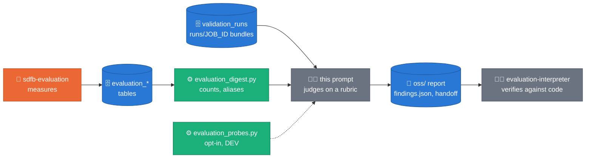

# /end_to_end_evaluation_report_generation — Evaluation assessment report

## Goal

Turn stored evaluations into decisions. One run of the evaluator writes
thousands of metric rows; a fleet of launches writes hundreds of thousands.
Nobody reads those, and an average hides what matters. This prompt produces
an assessment a person can act on and another agent can continue from:

1. **Engine status** — per engine and per level x family cell, graded on a
   fixed rubric.
2. **Quick wins, no code** — a prompt constraint, a `config/generator.yaml`
   knob, a relationship-model edit, or a change in how the evaluation is run.
3. **Code-level candidates** — what no configuration can move, with the
   evidence that says so.

*Claim: each stage does one thing, and only the last two judge.*



The judge is developer tooling. It is not part of the generation pipeline
and proposes nothing that `CLAUDE.md` rules out (no managed service, no
external LLM API in the serving path).

### How it fits with the validation prompt

| | `/end_to_end_validation_report_generation` | this prompt |
| :-- | :-- | :-- |
| Question | did the run work, and what did the generator do | how faithful, private, sound and diverse is what landed |
| Evidence | Dataflow job, worker-log milestones, the gate (`validation_runs`, DLQ), crosscheck and stats diff of one table | the metric catalogue over every column, pair, row, table and edge, for one run or many |
| Unit | one deployment (`runs/<JOB_ID>/`) | one evaluation or a fleet (`runs/evaluation_reports/<REPORT_ID>/`) |
| Explains | the mechanism behind a number | which numbers need a mechanism |

They join on the **generation job id** (`selection.evaluations[].generation_job_ids`
in the digest, the bundle folder name on the other side) and on the **same
aliases**: both read `runs/history_mappings_replacement.json`, so `A_TABLE`
and `A_COL_007` mean the same thing in both `oss/` bundles. Step 4 says which
validation evidence explains which evaluation finding.

---

## Inputs (ask the user if not provided; nothing is hard-coded)

Give at least one of `EVALUATION_IDS`, `SINCE_DAYS`, `FROM`/`TO`.

| Param | Example | Notes |
| :-- | :-- | :-- |
| `PROJECT` | `my-project-id` | project of the evaluation tables |
| `QUALITY_DATASET` | `synthetic_data_quality` | dataset of `evaluation_*` (the evaluator's `--output_dataset`) |
| `EVALUATION_IDS` | `eval-20261115T151634Z-c06bb27b` | one or several; the id is the last path segment of the GUI's `/evaluation/<id>` |
| `SINCE_DAYS` / `FROM`, `TO` | `7` / ISO timestamps | every evaluation started in the window |
| `ENGINES` | `b1_rag` | registry engine filter, repeatable |
| `RELATIONSHIP_MODELS`, `TABLES` | model or table names | optional filters |
| `LATEST_PER` | `table` (default) \| `none` | `table`: status is read from the latest evaluation of each table and engine, older ones feed the history; `none`: every evaluation counts |
| `ENGINE_BACKEND` | `b2_library=empirical` | what the operator knows about a backend BigQuery does not record. **Interim default while the sdgx backend is not integrated: `b2_library=empirical`** (see Step 2, premise P9) |
| `VALIDATION_RUNS_TABLE` | `<project>.synthetic_data_quality.validation_runs` | adds the generator's own verdict to each table card |
| `PROBES` | `no` (default) \| `yes` | Step 5, DEV only, bills BigQuery |
| `ROW_REVIEW` | `no` (default) \| `yes` | Step 6, DEV only: the agent reads a few landed synthetic rows |
| `RULINGS` | `runs/evaluation_reports/rulings.md` | optional: rulings a person confirmed on earlier reports (Step 10) |
| `REPORT_ID` | `evalrep-2026-11-16` | folder name; default: the evaluation id, or `evalrep-<stamp>-<n>runs` |

**Finished folder** (`runs/` is gitignored; `real/` and the registry never
leave the machine):

```
runs/evaluation_reports/<REPORT_ID>/
  real/   evaluation_digest.json   alias_map.json   report.md (decoded)
          [evaluation_probes.json] [samples/<ALIAS>.jsonl]
  oss/    evaluation_digest.json   report.md   findings.json   handoff.md
          [evaluation_probes.json] [row_review.json]
```

---

## The judge's rules (they bind every step)

These are the controls that keep an LLM judge honest. The failure modes they
answer are documented: a judge is swayed by order and length and favours its
own output ([Zheng et al. 2023](https://arxiv.org/abs/2306.05685),
[Wang et al. 2023](https://arxiv.org/abs/2305.17926)); it scores better
against an explicit rubric filled in as a form after reasoning
([Liu et al. 2023](https://arxiv.org/abs/2303.16634)); and its criteria drift
unless they are checked against human grades
([Shankar et al. 2024](https://arxiv.org/abs/2404.12272)).

1. **Measurement is not yours.** Every number in the report is copied from
   `evaluation_digest.json`, `evaluation_probes.json` or a validation bundle
   JSON, and its finding names the section it came from. Never add, average
   or estimate from rows yourself; if the digest lacks a number, say it is
   missing.
2. **A run status describes the evaluation, never the data.** `SUCCEEDED`
   with a thousand failing metrics is a successful evaluation.
3. **Not evaluated is not a pass; not applicable is not a gap.** A cell
   graded `U` is *unproven*. The digest tells the two apart
   (`not_evaluated[].kind`).
4. **Read a value against its baseline and its noise.** `baseline_value` is
   what a perfect copier of the reference sample scores; a crossing that
   sampling explains is already stored as a pass. A lift reads its confidence
   **lower bound**. An absolute match rate that fails next to a passing lift
   is chance on a narrow table (`privacy_readings`).
5. **Never rank by the overall score.** It averages families, and inside a
   table the whole pair group counts as ONE unit next to each column
   (catalogue ruling R11): a table can lose every dependence between its
   columns and keep a high fidelity score. Grade the cells; quote
   `scores.pair_trend` on its own.
6. **Keep three things apart in every finding:** the observation (numbers),
   the inference (what the pattern means), the hypothesis (why). A hypothesis
   carries what would falsify it and the metric that would accept a fix.
7. **Cheapest lever first, and only a lever that can move the metric.** The
   lever map (Step 7) says what each lever can and cannot do. Proposing a
   prompt constraint for a numeric distribution is a defect of the report.
8. **Abstain.** "Insufficient evidence" with the missing piece named is a
   valid result. A single table has no prevalence; a sampled-mode run has no
   exact-match verdict.
9. **Order is fixed, not discovered.** Read the digest in the order of Step 3
   and list findings in the order of Step 8, so that what you saw first does
   not become what matters most.
10. **Alias space.** Everything under `oss/` is written with aliases
    (`A_TABLE`, `A_COL_007`, `MODEL_01`) from `oss/evaluation_digest.json`.
    Real names appear only in `real/`.
11. **Judge twice.** Step 9 re-derives every number and attacks every
    hypothesis before anything is handed over.

---

## Step 0 — Prerequisites

ADC access to `PROJECT`, exactly as the validation prompt's Step 0
(`gcloud auth application-default login`, then
`set-quota-project <PROJECT>`). The four evaluation tables must exist
(`sdfb-eval schemas --project <PROJECT>`). No GCP access at hand: export each
evaluation where there is (`sdfb-eval report --project <PROJECT>
--evaluation_id <ID> --format json --out <ID>.json`) and use `--report-json`
in Step 1.

When the user gave a GUI link, keep its *Interpretation* sentence: Step 3
checks the digest against it.

---

## Step 1 — Build the digest

```bash
python scripts/e2e/evaluation_digest.py digest \
  --project <PROJECT> --quality-dataset <QUALITY_DATASET> \
  $(for e in <EVALUATION_IDS>; do echo --evaluation-id $e; done) \
  [--since-days <SINCE_DAYS> | --from <FROM> --to <TO>] \
  $(for e in <ENGINES>; do echo --engine $e; done) \
  --engine-backend <ENGINE_BACKEND> \
  --validation-runs-table <VALIDATION_RUNS_TABLE> \
  --latest-per <LATEST_PER> --report-id <REPORT_ID>
```

It prints how many evaluations, tables and measured rows it read, and where
`real/` and `oss/` are. Three things to check before reading further:

- `selection.excluded` — evaluations left out and why (`RUNNING` with no
  terminal event, `FAILED`, `SKIPPED`). Report them; an evaluation that died
  is a gap in the fleet, not a clean table.
- `selection.comparability` — more than one group means the evaluations were
  graded differently (catalogue or evaluator version, `exact` against
  `sampled`, a thresholds file). Compare numbers **within** a group only, and
  say so in the report.
- `selection.notes` — what the digest could not read (column order,
  `validation_runs`).

The digest refuses to write `oss/` when a string is not provably an alias, an
id or a word of the evaluator's vocabulary. If it stops, fix the cause; never
copy `real/` to `oss/` by hand.

A fleet digest is too large to read whole. Query it:

```bash
D=runs/evaluation_reports/<REPORT_ID>/oss/evaluation_digest.json
python scripts/e2e/evaluation_digest.py show --digest $D --section cells --where engine=b1_rag
python scripts/e2e/evaluation_digest.py show --digest $D --section signatures --where scope=systemic
python scripts/e2e/evaluation_digest.py show --digest $D --section offenders.pair --limit 10
```

---

## Step 2 — Check the lever map's premises against this checkout

The lever map rests on nine facts about the engines. Do not re-derive them
and do not trust this file's memory of them: confirm each with one `grep -c`
(expected at least 1). A premise whose anchor is gone is **unverified in this
checkout**: any finding that leans on it is written as a hypothesis for the
OSS side to settle, and the report lists the premise as stale.

`C=packages/sdfb-core/src/sdfb_core`

| # | Premise | Anchor (`grep -c -- '<text>' <file>`) |
| :-- | :-- | :-- |
| P1 | Both engines draw every non-key column from its own marginal. Only foreign-key tuples, fan-out cells and inherited columns are joint | `samples each column from its own marginal` in `$C/engines/b1_rag/engine.py`; `a key, a cell or an inherited column` in `$C/engines/fanout.py` |
| P2 | `b1_rag` temporal draws blend an observed instant with a uniform one inside a floored range; they do not follow the source distribution | `distribution-following yet` in `$C/engines/b1_rag/_fidelity.py`; `temporal_max_age_years_b1` in `config/generator.yaml` |
| P3 | The source statistics (calendar mixes, NULL patterns, deciles) are measured for people; the engines profile on their own and read none of them except the exact distinct count that sizes a pool | `Engines do NOT read these` in `$C/stats/source_stats.py`; `weekday/hour-preserving temporal bucket` in `docs/adr/0022-stats-driven-generation.md` |
| P4 | An LLM free-text pool holds at most `free_text.free_text_pool_max` values (512), sampled with replacement; `b2_library`'s pool size is a constant | `def _pool_target` in `$C/engines/b1_rag/engine.py`; `_DEFAULT_POOL_SIZE =` in `$C/engines/b2_library/freetext.py` |
| P5 | A prompt constraint acts only on a column that takes a free-text route; `route: "llm"` forces that route for STRING-like types only. It cannot change a numeric, temporal or categorical distribution, a NULL rate, or anything across columns | `def parse_prompt_constraint` in `$C/contracts/prompt_constraint.py`; `route` in `$C/engines/b1_rag/profile.py` |
| P6 | NULLs are drawn per column, independently | `def _apply_nulls_numpy` in `$C/engines/b1_rag/_fidelity.py` |
| P7 | A categorical column replays the reference sample's values at their sample frequencies, rare values included; the k-anonymity floors are constants, not knobs | `_NUMERIC_KANON_MIN_COUNT =` in `$C/engines/b1_rag/engine.py`; `_FREE_TEXT_HEAD_MIN_SHARE =` in `$C/engines/b1_rag/profile.py` |
| P8 | `b2_library`'s empirical backend interpolates numerics through 11 deciles and, for small pools, blends verbatim reference values at the `similarity` share | `def _decile_points` in `$C/engines/b2_library/fidelity.py`; `_REFERENCE_BLEND_MAX_DISTINCT =` in `$C/engines/b2_library/freetext.py` |
| P9 | The sdgx backend has not generated; a run labelled `b2_library` ran the empirical backend, and only the worker log says so (`generation_plan … backend=sdgx_fallback_empirical`, `b2_backend_fallback`) — BigQuery records the engine, not the backend | `has never generated in production` in `$C/engines/b2_library/backends.py`; `sdgx_fallback_empirical` in `$C/engines/b2_library/engine.py` |

**P9 and the engine label.** With `ENGINE_BACKEND=b2_library=empirical` the
digest labels those runs `b2_library[empirical]`; without it,
`b2_library[backend unverified]`. Never write "b2_library" alone, and never
credit or blame the sdgx model for a run. When a validation bundle of the
same job exists, confirm the backend from its `generation_plan` milestone and
say that you did. When P9's first anchor is gone, sdgx may be integrated:
stop defaulting, and ask which backend each run used.

Then read `RULINGS` when given: each ruling a person confirmed overrides the
lever map for the signature it names, and the finding cites the ruling's id.

---

## Step 3 — Read the digest, in this order

| # | Section | Read it for |
| :-- | :-- | :-- |
| 1 | `selection`, `fleet` | what is in scope; the generation knobs of each evaluation (`knobs`), its generator version and config digest |
| 2 | `selection.evaluations[].headline` | the run as the GUI states it. It must equal the GUI's *Interpretation* numbers for the same id; a difference is a tooling finding, reported first |
| 3 | `cells` | engine x level x family: status mix, `grade`, `evidence`. This is the status of an engine |
| 4 | `signatures`, `signatures_clean` | which metric fails on which column kind, on how many tables (`prevalence`, `scope`), and whether the reference sample already explains it (`baseline_limited_share`) |
| 5 | `pairs` | where the source links two columns, whether the synthetic side keeps the link (`lost`, `invented`, `dependent_fail_share`, `independent_fail_share`) |
| 6 | `privacy_readings` | rate next to lift; which copying tests failed, which did not run |
| 7 | `edges` | per foreign-key edge: orphans, fan-out, coverage, `enforced` |
| 8 | `not_evaluated` | why metrics did not run, by class, with `closes_with` |
| 9 | `tables` | the card of each table: scores, failures by level, enforced-key failures, the generator's verdict (`validation`) |
| 10 | `offenders` | the worst rows of each level, as examples for findings already made — never as the source of a finding |
| 11 | `cross_run` | score history per table and engine, status flips between its oldest and newest evaluation, two engines on one table |

**The rubric (v1) is computed by the digest**, so the grade does not depend
on who reads it. Per cell, over its graded rows (pass, warn, fail):

| Grade | Rule | Reads as |
| :-- | :-- | :-- |
| `4` | fail share ≤ 1 % and warn share ≤ 10 % | sound |
| `3` | fail share ≤ 5 % | sound with named gaps |
| `2` | fail share ≤ 20 % | usable with caveats |
| `1` | fail share ≤ 50 % | structurally limited |
| `0` | fail share > 50 % | broken, or absent by design |
| `U` | more than half not evaluated, or nothing graded | unproven |

An enforced-key FAIL (`table.pk_duplicate_rate`,
`table.identity_duplicate_rate`, `relationship.orphan_rate`) or a failing
copying test caps the cell at `2`, at `1` when it touches 10 % or more of the
tables. `evidence` is `full` when at most 10 % of the cell did not run, else
`partial`: quote it with the grade ("4, partial evidence"). The bands are
heuristics, like most catalogue thresholds; they are fixed here so that two
reports can be compared, and Step 10 is where they get corrected.

You may disagree with a grade once you have read sections 4 to 8 — a cell
whose failures are all chance-level rates, or all `baseline_limited`. Then
report **both**: the digest's grade, your `judged_grade`, and the reason in
one sentence. Never silently replace it.

---

## Step 4 — Fold in the validation evidence

The evaluation says *what* is off. The validation side often says *why*.

1. **Always:** `tables[].validation` (from `VALIDATION_RUNS_TABLE`) — the
   gate's status, `dlq_by_rule`, `excluded_blocker_rules`,
   `repeat_share_within_tolerance`. A table the gate `PASSED` with an
   evaluation FAIL is not a contradiction: the gate counts BLOCKER rule ids,
   it does not score fidelity. Report it as what the gate does not see.
2. **When a bundle exists** for a job in `generation_job_ids`
   (`runs/<JOB_ID>/real/`, written by the validation prompt), read from it
   only what the table below names. Never re-run that prompt's analysis.

| Evaluation finding | Validation evidence that explains or contradicts it | Where |
| :-- | :-- | :-- |
| free-text variety collapsed (`column.distinct_ceiling_hit`, low `distinct_ratio`) | the pool ladder of that column: target against achieved, stagnation, format collapse | `gcp_metrics.json` → `pool_ladder`, `sdfb.freetext_pool_*` |
| a copying test fails, or a text copy rate | `freetext_llm_fallback` with its `error=`; `vllm_ready` absent; a T4 or dtype fallback | `gcp_metrics.json` → `sdfb.*` milestones |
| shape, length or character-class failures on text | `shape_head_tv`, missing shapes; `prompt_constraints_found`, `prompt_constraint_example_off_format` | `freetext_crosscheck_metrics.json`, milestones |
| `table.row_count_ratio` off | DLQ rule counts; batch re-executions | `validation`, `engine_milestones.batch_ledger` |
| a primary-key duplicate rate | `pk.duplicate` among `excluded_blocker_rules` with a repeat share inside tolerance means the launch adjusted a disproved key (ADR 0038): the generator's verdict, not a defect | `validation` |
| fan-out or parent coverage off | `fk_fanout_measured source=cache`, `keys_dropped_null`, `fk.unmatched` | milestones, `dlq_by_rule` |
| a column fails where its neighbours pass, not baseline-limited | constraints that never reached the launch (`target_metadata_unavailable`, `ddl_pin_drift`); a different `build_info commit=` between two runs | milestones |
| anything attributed to `b2_library` | `generation_plan … backend=` | milestones |

Where the validation bundle hand-computed a number the evaluator also has
(decile KS, copy fraction) and they disagree, that is a finding to trace, not
two numbers to average.

---

## Step 5 — OPTIONAL: probes (`PROBES=yes`, DEV only)

The catalogue has no metric for row coherence. Three probes measure it as
aggregates on the source and landing tables (no row leaves BigQuery):

```bash
R=runs/evaluation_reports/<REPORT_ID>
python scripts/e2e/evaluation_probes.py run --report-dir $R --project <PROJECT> --dry-run
python scripts/e2e/evaluation_probes.py run --report-dir $R --project <PROJECT> \
  [--table <TABLE> …] [--max-tables 5] [--sample-percent 10] [--max-bytes-billed <N>]
```

Run `--dry-run` first: it prints every query. Then run for real; each query
carries `--max-bytes-billed` (50 GB by default). Without `--table` it takes
the tables with the most pair-level failures.

| Probe | Measures | A finding when |
| :-- | :-- | :-- |
| `temporal_order` | per pair of temporal columns of a table: the order the source keeps in at least 99.9 % of its rows, and `kept_synthetic` | `reading = invariant_broken` |
| `parent_child_order` | per foreign-key edge: parent instant not after the child's, over the joined rows | `reading = invariant_broken` |
| `combination` | per strongly dependent category pair (`pairs.strong_source_pairs`): share of synthetic rows whose combination the source never holds | `reading = invented_combinations` |

Read them as probes: no baseline, no noise floor, no status; they read the
tables **as they are now**, not the evaluation's time-travel scope (an append
since the run changes the landing side). Cite them as corroboration of a
pair-level finding, or as the only evidence for a blind spot — and say which.

---

## Step 6 — OPTIONAL: row review (`ROW_REVIEW=yes`, DEV only)

Some incoherence is semantic and no aggregate shows it. The agent reads a few
landed **synthetic** rows per table and scores them. This is the weakest
evidence in the report: a row-review finding alone never rates above `minor`,
and it is confirmed or dropped by a probe or a pair metric.

```bash
python scripts/e2e/evaluation_probes.py sample --report-dir $R --project <PROJECT> \
  [--table <TABLE> …] --rows 40
```

Protocol, per table (at most five tables):

1. Read the 40 rows of `real/samples/<ALIAS>.jsonl` **before** opening that
   table's pair section, so the metrics do not tell you what to see.
2. Score every row on each criterion: `0` nothing wrong, `1` doubtful, `2` a
   clear violation you can state as a rule naming the columns.

| # | Criterion | A clear violation looks like |
| :-- | :-- | :-- |
| R1 | temporal plausibility | an end before its start; a lifetime no real record has |
| R2 | code and label agree | a status that contradicts a date being set; a code whose label column says something else |
| R3 | fields that live or die together | part of an address present, the rest NULL, where the source never does that |
| R4 | numeric consistency | a total that is not its parts; a sign or unit that cannot be |
| R5 | text fits its row | a free-text field about a different kind of entity, or in another language, than the row's other fields imply |

3. Write `oss/row_review.json`: per table and criterion the number of rows,
   `clear_share`, `doubtful_share`, and up to three violations each as *a
   rule in alias space* (`A_COL_004` after `A_COL_009`). **Never a value,
   never a row.** The samples stay in `real/samples/`.
4. For each clear violation name the probe or pair metric that would confirm
   it. Unconfirmed, it is an open question, not a finding.

---

## Step 7 — Judge: classify every finding by its cheapest lever

A finding is a **signature** (a metric or a group of them, on a column kind,
for an engine), not a row. Start from `signatures` with `scope` systemic or
recurrent, then `pairs`, `privacy_readings`, `edges`, `not_evaluated`; local
signatures last and grouped.

**Levers, cheapest first**

| Lever | Means | Who acts |
| :-- | :-- | :-- |
| `evaluation_setup` | the metric did not run; change how the evaluation runs | operator |
| `constraint` | a per-column `llm_prompt_constraint` (DDL_CONTRACT_GUIDE §4, ADR 0024) | operator, via `/llm_prompt_constraint_recommender` |
| `knob` | a value in `config/generator.yaml` (or its DAG parameter) | operator |
| `model_contract` | `config/relationships/*.yaml` or the DDL contract | operator |
| `source_stats` | a statistic the generator measures but does not use, or does not measure | code |
| `engine_code` | the sampling design | code |
| `evaluator` | the metric misleads here, or nothing measures it | code (catalogue) |
| `none` | by design, chance, or a fact of the source | nobody |

**Decision order for one signature** — stop at the first that applies:

1. Did it run? If the rows are `not_evaluated`, the class's `closes_with` is
   the action (`evaluation_setup`), or it is not applicable (`none`).
2. Is it chance or by design? A rate failing next to a passing lift; a
   documented (`enforced: false`) edge; a ruling in `RULINGS`. → `none`.
3. Is it the reference sample? `baseline_limited_share` near 1: a perfect
   copier of the sample fails too. → `knob`: `sampling.reference_rows_limit`.
4. Is it the generator's input? `column.source_stats_drift` warns or fails on
   the same columns. → `knob`: `sampling.source_stats`, refresh the stats.
5. Otherwise find the signature in the lever map.

**Lever map.** "Not baseline-limited" means `baseline_limited_share` near 0:
the engine, not the sample, moves the metric.

| Signature | Reading | Lever and action | Accept when |
| :-- | :-- | :-- | :-- |
| `pair.*` fail with `dependent_fail_share` high, `lost` far above `invented`, `independent_fail_share` near 0; usually with `table.corr_*`, `table.detection_auc`, `table.pmse_ratio`, `row.null_pattern_tvd` while the column cells grade 3 or 4 | independent per-column draws lose every dependence the source has and invent none (P1, P6). No constraint and no knob reaches across columns (P5) | `engine_code`: joint or conditional sampling within a row. Themes T1, T3, T6 | `dependent_fail_share` falls on the same tables; `scores.pair_trend` ≥ 0.85; column cells unchanged |
| `pair.*` fail with `invented` above 0 | independent draws cannot invent a link: a shared artefact does (a temporal floor, a sentinel, a constant, a key-derived column) | `engine_code` or `evaluator`, after naming the artefact; until then an open question | the invented pairs return to pass |
| numeric `column.ks`, `pit_w1`, `psi`, `jsd`, `std_ratio`, `zero_rate_delta`, not baseline-limited, engine `b2_library[empirical]` | 11-decile interpolation flattens shape inside a decile and loses a zero spike (P8) | `knob`: `generation.engine: b1_rag` for that table; else `engine_code` | the signature's fail share on those tables |
| numeric, not baseline-limited, engine `b1_rag` | not expected: b1 draws through the whole sorted sample | open question for the OSS side (integer copy scrub, kind disagreement); check `build_info` across runs first | — |
| `column.range_coverage` low or `field.range_adherence` fails, baseline-limited | the sample never saw the tails | `knob`: `sampling.reference_rows_limit` ↑ | range coverage ≥ 0.9 |
| temporal `column.ks`, `pit_w1`, `psi`, not baseline-limited, engine `b1_rag` | the blend pulls the marginal toward uniform (P2) | `knob`, partial: `generation.similarity` ↑ moves draws toward observed instants **and toward copying them** — watch `field.value_memorization_lift`. The fix is `engine_code` (T2) | KS passes with the value lift still passing |
| temporal `column.range_coverage` low where the source reaches further back than the floor | generated instants are floored at now minus N years (P2) | `knob`: `generation.temporal_max_age_years_b1` / `_b2` ↑ | range coverage ≥ 0.9 |
| `column.dow_tvd`, `month_tvd`, `hour_tvd` | no engine conditions on calendar structure; the mixes are measured and unused (P3) | `source_stats`: calendar-preserving temporal sampling (T5) | the three TVDs under 0.10 |
| categorical `column.tvd`, `jsd`, `cohens_w`, `coverage_mass`, baseline-limited | the mix is the sample's mix (P7) | `knob`: `sampling.reference_rows_limit` ↑ | fail share of the signature |
| categorical, not baseline-limited, engine `b2_library[empirical]` | `similarity` away from 0.5 re-weights the categories | `knob`: `generation.similarity: 0.5` | TVD under 0.10 |
| `field.category_adherence` fails, or `column.novelty_mass` far above target, on a closed vocabulary | the evaluator reads the column as categorical while the generator routed it as free text | `knob` (b1 only): `free_text.free_text_max_categories`, `free_text_unique_ratio`, `free_text_min_mean_len`; b2's thresholds are constants → `engine_code` | adherence ≥ 0.99 |
| `column.distinct_ceiling_hit` = 1 with low `distinct_ratio` or `entropy_ratio` | variety is set by the pool, whose size is the smallest of the cap, `num_rows` and the column's known distinct count (P4) | `knob`: `free_text.free_text_pool_max` ↑; `sampling.source_stats: exact` (without it the distinct count is the sample's, which starves the pool); `free_text.freetext_expansion: all`. `constraint`: a samplable `pattern` on a code-like column leaves the pool for an uncapped sampler. `b2_library`: the pool size is a constant → `engine_code` | ceiling flag 0, distinct ratio ≥ 0.7 |
| `field.shape_adherence`, `column.shape_head_tv`, `column.length_ks`, `column.char_class_l1` on text or identifiers | the format drifted | `constraint`: `pattern`, `format`, `length`, `charset`, `families` (prefix shares). Chain `/llm_prompt_constraint_recommender` | shape head TV under 0.10 |
| `column.null_rate_delta`, `column.empty_rate_delta`, not baseline-limited | per-cell draws at the sample's rate should match | open question (`engine_code`) | — |
| `row.null_pattern_tvd` | NULLs are independent per column (P6); the pattern mix is measured and unused (P3) | `source_stats` (T5) | TVD under 0.10 |
| `field.value_memorization_lift` fails on a categorical, numeric or temporal column | sampling from the reference sample replays its rare values (P7). The catalogue expects this FAIL without a k-anonymity scrub | `engine_code`: scrub rare categories (the floors are constants). Temporal only: `knob` `generation.similarity` ↓ | lift CI lower bound under 2 |
| `field.substantive_copy_rate` fails on text | a text column routed as categorical is emitted verbatim; or the rejection set is truncated | `constraint`: `route: "llm"`; `knob`: `free_text.source_domain_cap` ↑; `b2_library`: `generation.similarity` ↓ (P8) | copy rate under 1e-4 |
| `field.pool_memorization_lift` or `row.exposure_lift` fails | the LLM echoes the rows it was shown | `knob`: `rag.rag_top_k` ↓, `free_text.pool_seed_strategy`; `constraint`: `examples` join the rejection set. Read the fallback milestones first (Step 4) | lift CI lower bound under 2 |
| `row.memorization_lift`, `row.near_match_lift` or `row.dcr_train_holdout_share` fails | whole records come back. Independent marginals do not do that: a fallback path does | **blocker**. `engine_code`, after Step 4's fallback evidence | lift CI lower bound under 2 |
| a rate fails, its lift passes | chance on a narrow table | `none`; note it under the evaluator | — |
| `table.pk_duplicate_rate` or `identity_duplicate_rate` above 0 | a generator defect — unless the launch adjusted the key (Step 4), or the table holds 100 M rows or more and the rate is a couple of rows (64-bit hash collision: confirm with a `GROUP BY`) | **blocker** `engine_code`, or `none` with the reason | exactly 0 |
| `relationship.orphan_rate` above 0 on an enforced edge | a generator regression: children come from landed parent keys | **blocker** `engine_code` | exactly 0 |
| `relationship.fanout_*`, `zero_child_share_delta` on a driven edge | the child follows the measured source fan-out, cached in `io.fk_fanout_stats_table`: a stale cache (`fk_fanout_measured source=cache`, Step 4) is the first suspect | `knob`: refresh the fan-out stats; root `generation.num_rows` sets the parents | mean ratio within 5 % |
| `relationship.parent_coverage` low on a side-input edge | the child draws from a capped sample of parent keys | `knob`: `relational.fk_key_sample_floor` / `_ceiling` ↑ | coverage ≥ 0.95 |
| an edge `not_evaluated` for key types | the two key columns differ in type | `model_contract` | the edge is evaluated |
| `table.row_count_ratio` off | rows lost to the DLQ, or an append the evaluation also read | `knob`: `guardrails.write_disposition`; Step 4's `dlq_by_rule` | within 1 % |
| `row.internal_duplicate_excess` | non-key content repeats more than in the source: a pool at its cap is the usual cause (keys differ, so de-duplicating whole rows does not help) | `knob`: `free_text.free_text_pool_max` ↑ when the text columns hit the ceiling; else an open question | under 0.01 |
| `field.type_validity` fails | malformed cells | **blocker** `engine_code` | ≥ 0.9999 |
| `table.detection_auc`, `table.pmse_ratio` alone | a consequence, not a cause: attribute it to the failing level (columns or pairs) | the lever of that level | — |

**What nothing measures** — write these under "Not measured", with the probe
or review that covers each and whether it ran: the order of two instants in
a row; a child's instant against its parent's; whether a combination of
values exists; whether a row makes sense to a reader; sequences of rows of
one entity over time; pairs outside the planned, budget-capped selection
(`pair_max_columns`); NULL patterns past 64 columns; free-text quality
beyond shape and length.

**Themes** tag findings so the OSS side can group them. They are labels for
evidence, not conclusions:

| Id | Theme | Evidence that supports it |
| :-- | :-- | :-- |
| T1 | joint or conditional sampling inside a row | the first row of the lever map; `combination` probe |
| T2 | temporal sampling and alignment, in a row and from parent to child | temporal signatures; `temporal_order`, `parent_child_order` probes; R1 |
| T3 | rows anchored on retrieved exemplars (`b1_rag` retrieval seeds prompts and never a row) | T1's evidence on `b1_rag`; R2, R5 |
| T4 | coherence that needs knowledge outside the source | row review only; label it speculative |
| T5 | statistics measured and unused: calendar mixes, NULL patterns | their signatures (P3) |
| T6 | statistics not collected: pairwise association, functional dependence | T1's evidence (ADR 0022 defers them) |

**Severity and confidence** are defined, not felt:

| Severity | When |
| :-- | :-- |
| `blocker` | an enforced-key FAIL not explained by an adjusted key; a failing copying test; type validity |
| `major` | a systemic or recurrent signature in a cell graded 0 to 2 |
| `minor` | a local signature, or one in a cell graded 3 |
| `info` | by design, chance, not applicable, documented |

| Confidence | When |
| :-- | :-- |
| `high` | the premise's anchor is present, and two independent kinds of evidence agree (a signature and the pair decomposition, a probe, or a validation milestone), and nothing contradicts |
| `medium` | one kind of evidence, premise present |
| `low` | partial evidence (`U` or `partial` cell, sampled mode, a single table), or an unverified premise |

---

## Step 8 — Write the outputs (alias space)

**`oss/report.md`**, sections in this order:

0. **Scope** — evaluations, tables, engines (with backends), comparability
   groups, what was excluded, which optional steps ran. One mermaid of the
   relationship model per `MODEL_NN` when edges exist (aliases only).
1. **Verdict** — three sentences, then the engine status table: one row per
   engine, one column per level, each cell the four family grades. Lead with
   what is unproven.
2. **Engine status** — per engine: the cells, the clean signatures in one
   line (what works), the failing ones by scope, `judged_grade` where it
   differs.
3. **Quick wins, no code** — a table: finding, lever, exact change (`from`
   and `to` for a knob; the constraint keys for a column), tables it
   touches, the metric that accepts it. Evaluation-setup items first.
4. **Code-level candidates** — per theme: evidence, why no configuration
   moves it (the premise), the acceptance metric, confidence.
5. **Privacy** — copying tests failed, chance-level rates, what did not run.
   A privacy score is a risk indicator, never a guarantee.
6. **Relational** — edges: orphans, fan-out, what the generator's verdict
   says about adjusted keys.
7. **Not measured** — blind spots; probe and row-review results under the
   one they cover.
8. **Across runs** — only with history or two engines on one table: what
   moved, between which generator versions. Name `sdfb-eval compare
   --evaluation_ids A,B` for a pair of runs: it marks a delta inside both
   rows' noise as `≈`, which this digest does not.
9. **Reproduce** — the exact commands of this run.

**`oss/findings.json`** — the same findings as data:

```json
{"schema": "sdfb.evaluation_findings/1", "report_id": "<REPORT_ID>",
 "engine_status": [{"engine": "b1_rag", "level": "pair", "family": "fidelity",
   "grade": "1", "evidence": "full", "judged_grade": "1", "reason": ""}],
 "findings": [{
   "id": "F-001", "severity": "major", "confidence": "high",
   "engine": "b1_rag", "level": "pair", "family": "fidelity", "scope": "systemic",
   "signature": {"metric_ids": ["pair.spearman_delta"], "kind_pair": "numeric x numeric"},
   "observation": "…", "evidence": [{"source": "digest", "section": "pairs.by_kind",
     "numbers": {"dependent_fail_share": 1.0, "lost": 41, "invented": 0}}],
   "premises": ["P1"], "inference": "…", "hypothesis": "…",
   "alternatives": ["…"], "falsifier": "…",
   "lever": "engine_code", "action": {"what": "…", "where": "…", "from": null, "to": null},
   "acceptance": {"metric": "pairs.by_kind.dependent_fail_share", "target": "…",
     "how": "re-evaluate the same tables; sdfb-eval compare"},
   "themes": ["T1"], "tables": ["A_TABLE"], "columns": ["A_COL_004", "A_COL_001"]}],
 "not_measured": [{"what": "…", "covered_by": "temporal_order probe", "ran": false}],
 "open_questions": ["…"], "stale_premises": []}
```

`lever` is one of the eight of Step 7. `source` is `digest`, `probes`,
`validation` or `row_review`. List at most ten tables per finding and say how
many more.

**`oss/handoff.md`** — at most 150 lines, for the OSS-side agent that has the
code and none of the data: the verdict; the premises that held and the stale
ones; the code-level candidates ranked, each with its finding id, evidence in
one line and acceptance metric; the open questions, as questions; the
validation bundles (job ids) that exist for the same runs.

---

## Step 9 — Verify, then export

1. **Numbers.** For every number in `report.md`, find it in a JSON of this
   report folder. One that is not there is removed.
2. **Hypotheses.** For every finding of severity `major` or above, argue the
   opposite once: what else produces this signature, and which digest number
   would differ. If you cannot tell them apart, lower the confidence and put
   the alternative in `alternatives`.
3. **Levers.** No finding proposes a lever its premise forbids (rule 7).
4. **Leak scan**, then decode for local use:

```bash
python scripts/e2e/evaluation_digest.py scan --dir $R/oss --alias-map $R/real/alias_map.json
python scripts/e2e/evaluation_digest.py decode --alias-map $R/real/alias_map.json \
  --in $R/oss/report.md --out $R/real/report.md
cp $R/real/report.md output/end_to_end_evaluation_report_$(date +%Y_%m_%d_%H_%M).md
```

   `oss/` is shareable only when the scan prints `leak scan: clean ✅`. A
   `REVIEW` line names a column whose name is also an ordinary word
   (`status`): read the place, rewrite it with the alias, or waive that one
   word with `--allow`. A `LEAK` line is never waived by rewording the scan.
5. Print one line: the report path and the single most important finding.

---

## Step 10 — Hand over, and keep the judge calibrated

- **Constraints.** When Section 3 lists `constraint` items, offer to chain
  `/llm_prompt_constraint_recommender` for those tables (it edits schema
  files, so ask). It needs that table's validation bundle.
- **OSS side.** Hand over `oss/` only. There, the `evaluation-interpreter`
  agent reads `handoff.md`, `findings.json` and the digest, checks each
  hypothesis against `packages/`, and writes the plan.
- **Rulings.** End the report with at most five findings a person should
  confirm or refute first (the highest severity at the lowest confidence).
  What they rule goes into `RULINGS` as one line each — id, date, the
  signature, the ruling — and binds the next report. A ruling that
  contradicts a grade band or a lever-map row is the signal to change this
  prompt, not to keep overriding it.

---

## Consistency rules (always enforce)

- **The digest counts; the judge reads.** No number without a JSON behind it.
- **Never "b2_library" without its backend.**
- **Not evaluated is not a pass.** Unproven cells lead the verdict.
- **Compare within a comparability group**, and latest per table unless the
  question is history.
- **Every finding:** observation, inference, hypothesis, falsifier, lever,
  acceptance metric, severity, confidence. One missing and it is an open
  question.
- **Probes and row review are DEV only**, labelled as such, and never the
  sole ground for a severity above `minor` (row review) or for a catalogue
  verdict (probes).
- **`oss/` is alias space** and leaves the machine only after a clean scan;
  `real/`, the samples and the registry never do.
- **Nothing here gates a generation run.** An evaluation, and this report,
  describe it.
- No managed dashboards, Vertex AI or external LLM APIs in any proposal
  (`CLAUDE.md`).

## References

- Catalogue and reading rules:
  [`metrics.yaml`](../../packages/sdfb-evaluation/src/sdfb_evaluation/catalogue/metrics.yaml),
  [`RESULTS.md`](../../packages/sdfb-evaluation/docs/RESULTS.md),
  [ADR 0041](../../docs/adr/0041-evaluation-standalone-package.md).
- Levers: [`config/generator.yaml`](../../config/generator.yaml),
  [`DDL_CONTRACT_GUIDE.md`](../../docs/DDL_CONTRACT_GUIDE.md) §4,
  [ADR 0022](../../docs/adr/0022-stats-driven-generation.md),
  [ADR 0024](../../docs/adr/0024-structured-prompt-constraint-templates.md).
- Why a `b2_library` run is the empirical backend, and what keeping the
  dependence between columns would take:
  [B.2 backend assessment](../../docs/designs/2026-11-16-b2-library-backend-assessment.md).
- Aliases: [ADR 0029](../../docs/adr/0029-fk-model-scenarios-and-history-mappings.md),
  `scripts/e2e/history_mappings.py`.
- LLM-as-judge practice:
  Zheng et al. 2023, [Judging LLM-as-a-Judge with MT-Bench and Chatbot Arena](https://arxiv.org/abs/2306.05685);
  Liu et al. 2023, [G-Eval](https://arxiv.org/abs/2303.16634);
  Wang et al. 2023, [Large Language Models are not Fair Evaluators](https://arxiv.org/abs/2305.17926);
  Shankar et al. 2024, [Who Validates the Validators?](https://arxiv.org/abs/2404.12272).
