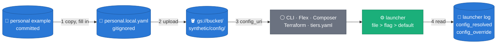
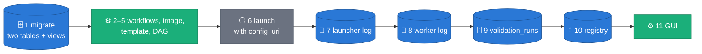
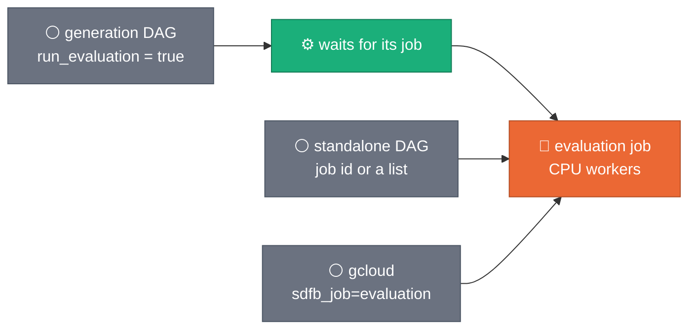
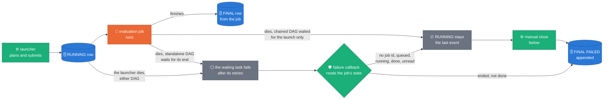
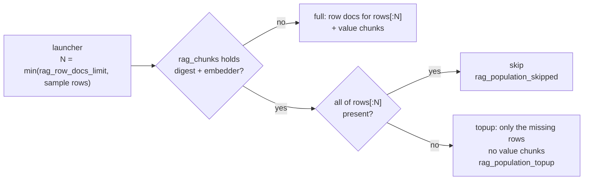
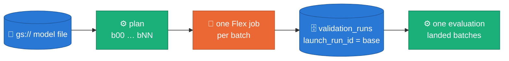

# Run playbook — GPU verdict, defaults, Dataflow options, recipes, pass criteria

The operational companion to [`DEPLOYMENT_PREREQUISITES.md`](DEPLOYMENT_PREREQUISITES.md)
(what must exist before a run) — this doc is about the run itself: which GPU to
pick, the current flag posture, which Dataflow launch knobs matter, how to hold
L4 capacity when `europe-west3` is stocked out, how to read worker logs, what
passing looks like, and how to turn a finished job into a report. Everything
here reflects the `composer/synthetic_beam_bigquery.py` DAG and the
`packages/sdfb-beam` CLI on `master` — read those files if a flag looks stale.
Campaign history (the WS8 R-series verdicts and remediation waves) lives in
ADRs 0023–0033 and the design docs they cite, not here.

---

## 0. From-scratch reset (before a cold campaign)

Deploy/align the stats table first (the schema carries
`sample_rows`/`stats_tier`/`profiler_version`):

```bash
# new table:
bq mk --table "${PROJECT}:synthetic_rag.source_table_stats" \
  config/bq_schema/synthetic_rag/source_table_stats.schema.json
# pre-existing table (additive, no data rewrite):
bq update "${PROJECT}:synthetic_rag.source_table_stats" \
  config/bq_schema/synthetic_rag/source_table_stats.schema.json
```

Then wipe state so every store path is exercised cold:

```bash
for t in \
  "synthetic_data.<LANDING_A>" "synthetic_data.<LANDING_B>" \
  "synthetic_data_quality.dlq" "synthetic_data_quality.validation_runs" \
  "synthetic_rag.freetext_pools" "synthetic_rag.rag_chunks" \
  "synthetic_rag.source_table_stats"; do
  bq query --use_legacy_sql=false "TRUNCATE TABLE \`${PROJECT}.${t}\`"
done
```

Truncating `freetext_pools`/`rag_chunks`/`source_table_stats` resets every
digest — **all first runs are cold** (full pool ladder + embed + stats
write). That is the expensive part: sequence warm runs immediately after
their cold twin.

Preflight (the stats-table step must report OK, not ACTION):

```bash
python scripts/deployment_prerequisites.py --project ${PROJECT} \
  --source-stats-table ${PROJECT}.synthetic_rag.source_table_stats
```

### 0a. Workflow edits for the generation record (untracked workflows)

Four deploy workflows are not in git. Since ADR 0044 the generator's version
lives in `packages/sdfb-core/src/sdfb_core/version.py`
(`GENERATOR_VERSION_BASE = "X.Y.Z"`); the pyprojects stay at `0.1.0`. A
Release build must name the image, the template and the DAGs after that base,
and every build passes its branch. Apply all four edits together: workflows 3
and 3e substitute the version that selects `sdfb-<version>-template.json`, so
changing only 1 and 2 points a Release DAG at a template no build writes.

| Workflow | Step | Edit |
|---|---|---|
| `1_build_python_beam.yaml` | after "Set PROJECT_VERSION" | add a step "Set GENERATOR_VERSION" (below) |
| `1_build_python_beam.yaml` | "Set RELEASE_VERSION" | Release branch: `echo "RELEASE_VERSION=${{ env.GENERATOR_VERSION }}" >> $GITHUB_ENV` (was `env.PROJECT_VERSION`); keep `PROJECT_VERSION` — the wheel path uses it |
| `1_build_python_beam.yaml` | the `docker build` | add `--build-arg SDFB_BUILD_BRANCH_ARG=${GITHUB_REF_NAME} \` after the `GIT_COMMIT_ARG` line |
| `2_deploy_flex_template_python_beam.yaml` | "Resolve RELEASE_VERSION" | Release branch: the `VER=` line below |
| `3_import_dag.yaml` | "Resolve PROJECT_VERSION + DAG_VERSION" | Release branch: the `VER=` line below |
| `3_import_eval_dag.yaml` | "Resolve PROJECT_VERSION" | Release branch: the `VER=` line below |

The new step in workflow 1:

```yaml
      - name: "Set GENERATOR_VERSION"
        run: |
          VER=$(grep -m1 '^GENERATOR_VERSION_BASE' packages/sdfb-core/src/sdfb_core/version.py | sed -E 's/.*"([^"]+)".*/\1/')
          echo "GENERATOR_VERSION=$VER" >> $GITHUB_ENV
```

The `VER=` line for workflows 2, 3 and 3e (it replaces the one that greps
`packages/sdfb-beam/pyproject.toml`):

```bash
VER=$(grep -m1 '^GENERATOR_VERSION_BASE' packages/sdfb-core/src/sdfb_core/version.py | sed -E 's/.*"([^"]+)".*/\1/')
```

Run Release builds from the release tag: the release Action stamps the tag's
version into `version.py` in the commit it tags, so a Release build of an
earlier commit carries the previous release's base.

### 0b. Workflow edits for whole-model launches (untracked workflows)

The model DAG (`composer/synthetic_model_launch.py`,
[ADR 0045](adr/0045-whole-model-launches.md)) is a template with a subset of
the generation DAG's markers (it adds none, and has no `{{SDFB_DDL_URI}}`),
and it imports `composer/sdfb_batches.py` from the DAGs folder. Workflow 3
imports all three files; workflows 1, 2 and 3e need no edit for ADR 0045 (the
image carries the code, the template file declares the new parameters).

| Workflow | Step | Edit |
|---|---|---|
| `3_import_dag.yaml` | "Substitute build-time placeholders" | run the same `sed -i -e …` expressions on `composer/synthetic_model_launch.py` (a second `sed -i` with the same `-e` list and that file) |
| `3_import_dag.yaml` | "Substitute build-time placeholders" — the marker check | run the `grep -nE '\{\{[A-Z_]+\}\}'` check on `composer/synthetic_model_launch.py` too |
| `3_import_dag.yaml` | "Substitute build-time placeholders" — the resolved-values check | for the model DAG, check `$MODEL_URI`, `$DEFAULT_TABLE_FQN`, `$LANDING_TABLE`, `$DLQ_TABLE`, `$VALIDATION_RUNS_TABLE` (empty, no batch writes its generation record and the launch's evaluation has nothing to read) — not `$DDL_URI`: a whole-model launch extracts every schema live and the file has no pin |
| `3_import_dag.yaml` | "Import DAG into Composer" | two more `gcloud composer environments storage dags import` calls, the same flags as the existing one, with `--source=composer/synthetic_model_launch.py` and `--source=composer/sdfb_batches.py` (the latter is not a template: import it unchanged) |

Once per Composer environment, set the Airflow Variable
`SDFB_MAX_PARALLEL_JOBS` (default `1` when unset): how many batch jobs run at
once. Each holds its workers' GPUs (up to `maxWorkers` 4 workers of one GPU
each), so keep it within the regional GPU quota divided by 4. It is read when
Composer parses the file; a change applies at the next parse, without a
re-import. Each running batch also holds one Airflow worker slot until its
job ends.

The model DAG's `plan` task reads the model file and the config file from
GCS as the Composer environment's own service account (the generation DAG
never reads GCS from Airflow): grant it `storage.objects.get` on the bucket
or prefix that holds them (`roles/storage.objectViewer`).

---

## 1. GPU verdict — Gemma cannot run on T4

**Gemma (2/3/3n/4, including AWQ/GPTQ-quantized variants) does not run on
NVIDIA T4 under vLLM.** This was verified, not assumed, and it is now enforced
in code: `ModelGpuIncompatibleError` in
[`packages/sdfb-beam/src/sdfb_beam/handlers/vllm_client.py`](../packages/sdfb-beam/src/sdfb_beam/handlers/vllm_client.py)
raises at `VLLMModelClient.setup()` — before the vLLM server subprocess spawns
— whenever the pulled model's `config.json` says `torch_dtype: bfloat16` and
the worker's reported CUDA compute capability is below `8.0`. That guard
exists because, before it, a Gemma-on-T4 job didn't fail — it silently sailed
past a ~24-minute stall and let the engines fall back to copying reference
exemplars into the batch (a privacy leak, not a crash), which is worse than a
loud failure.

Three blockers stack, and quantization does not rescue any of them:

1. **bf16 needs compute capability ≥ 8.0; T4 is 7.5 (Turing).** Gemma ships
   bf16-trained. `--dtype=half` bypasses vLLM's own capability check, but
   Gemma run in fp16 silently emits empty or pad-token output rather than an
   error — reported against `google/gemma-3-4b-it` in HF discussion #33, and
   in vLLM issues [#40290](https://github.com/vllm-project/vllm/issues/40290)
   and [#17123](https://github.com/vllm-project/vllm/issues/17123). There is
   no flag that makes bf16-trained Gemma correct on sub-Ampere hardware.
2. **No working attention backend on Turing for Gemma's shapes.**
   FlashAttention-2 requires SM ≥ 8.0 outright. `FLASHINFER` only supports
   head sizes `{64, 128, 256}`, while Gemma 4's global attention head dim is
   512. The remaining fallbacks, `TRITON` and `FLEX`, crash with shared-memory
   allocation failures on Turing
   ([vllm#38918](https://github.com/vllm-project/vllm/issues/38918),
   [vllm#38887](https://github.com/vllm-project/vllm/issues/38887)) — there is
   no attention backend left to fall back to.
3. **Gemma's `head_dim=256` attention tiles need ~96KB of shared memory per
   block; Turing's hard limit is 64KB per SM.** This is a hardware ceiling,
   not a tuning knob. Critically, the model in the failing report for
   [vllm#38918](https://github.com/vllm-project/vllm/issues/38918) was
   **already AWQ 4-bit quantized** — quantization shrinks the weights, not the
   attention working set, so it does not move this number.

**Conclusion: there is no Gemma-on-T4 configuration.** T4 runs pair with an
fp16-safe model; Gemma fidelity runs require an L4.

**L4 availability.** `europe-west3-a` and `europe-west3-b` both carry L4
(`g2-standard-*`) capacity; `g2-standard-4`, `-8`, `-12`, and `-16` all ship
exactly **one** L4 — the accelerator count doesn't scale with machine size
inside the `g2-standard` family, only vCPU/RAM does. `europe-west4` is the
capacity fallback region when both `europe-west3` zones are stocked out (see
§4 for what to do about a stockout instead of switching region, which trades
away the EU-residency alignment in
[ADR 0004](adr/0004-europe-west3-region.md)).

**T4-safe registry model.** For T4 runs, pair `gpu=t4` with a model that is
fp16-safe on Turing, not a Gemma checkpoint. The registry entry is
`qwen3_4b_instruct_2507` in [`config/models.yml`](../config/models.yml) —
Apache-2.0, `min_compute_capability: "7.5"`, FP16, guided-JSON clean. Point
the `SDFB_MODEL_URI` Composer Variable at its `gcs_uri` before a `gpu=t4`
run. If staging a qwen2.5 build: remember the local-dir rename before GCS
staging, and a missing `special_tokens_map.json` is expected and handled.

---

## 2. Run defaults + universal pass criteria

Common to every vLLM run: `client_type=vllm`, qwen + `vllm_dtype=float16`
(the DAG default — qwen ships bf16, T4 is CC 7.5), `vllm_max_model_len=8192`
(it caps the KV-cache allocation; uncapped Qwen3-2507 at native 262K context
needs a 36GiB KV cache and the T4 EngineCore exits 1 at startup),
`identity_cols`/`pk_cols` set to the table's real columns via
`config/relationships/`, fresh Airflow trigger per run (salted `run_id` is
derived). `batch_size=1000` for 1M/10M rows; the DAG's `16` default is sized
for smokes. Params not listed = DAG defaults, which already carry the current
posture: `source_stats=sample`, `freetext_expansion=identifiers`,
`prompt_constraints=on`, `build_pool_layer=true`, `build_rag_layer=true`,
`rag_row_docs_limit=1024`, `uniqueness_mode=exact`, `pool_seed_strategy=centroid`.

**Universal pass criteria — every vLLM run:**

1. `model_client_setup_start/done`, `model_pull_*`, `vllm_spawn`, `vllm_ready` all present in worker logs.
2. Zero `freetext_llm_fallback` milestones (a vLLM run that falls back now crashes instead).
3. `copy_ratio < 0.3` on every non-constant STRING column with `source_distinct > 100` (probe step 3).
4. `validation_runs.run_id` unique per Dataflow job (salted suffix visible).
5. `pk.duplicate` present in `dlq_by_rule` if and only if PK collisions occurred; PASSED requires ~0.
6. `b1_embed_done rows=` equals `rag_row_docs_limit` (1024 by default, §6e) and `rows_total=` equals `reference_rows_limit` (10000), not the full source count. A warm digest logs `b1_chunks_reused rows=` instead.
7. Check the Dataflow job state directly (`gcloud dataflow jobs describe <job_id>` or the Dataflow console) — the Composer DAG launches the job with `wait_until_finished=False`, so a strict-mode worker crash fails the Dataflow job itself while the Airflow task still shows success. Airflow green is not proof of a healthy run.
8. `validation_runs.valid_count` must equal `num_rows` requested. A shortfall — even on a `PASSED` row, since the BLOCKER gate only checks a *ratio* — means whole batches were lost to `engine_failure` and never replaced; PASSED is not proof the run actually produced the row count it was asked for.

The extended gates (stats contract, privacy, FK integrity, marginals) are §8.

### 2a. Sizing a launch — read the ROW PROJECTION before you pay for it

`--num_rows` sizes the ROOT tables only. Every DRIVEN child is sized by
the measurement, not by the flag: its count is its parent's DISTINCT
landed keys times the mean fan-out measured on the source
([ADR 0036](adr/0036-parent-driven-fanout-generation.md) D5,
[ADR 0038](adr/0038-measured-conflicts-adjust-the-model.md) fix H3). Two
ordinary fan-outs compound, so a five-table launch asking for 210,958
rows generated 32,858,875 of them, 94.2% in one table
(`2026-09-13_06_10_16-12600311608685394436`).

The launcher now says so before the graph is built
([ADR 0039](adr/0039-row-projection-before-the-graph.md)). Find
`ROW PROJECTION` in the DRIVER log — it is the last block before the DAG
and reads like this (that launch's own figures):

```text
ROW PROJECTION | 5 table(s), 32,858,875 rows — what this launch WILL generate, decided before the graph is built (ADR 0039)
 B_TABLE |       210,958 |   0.6% |                      | root — sized by --num_rows=210,958
 C_TABLE |       846,891 |   2.6% | #                    | driven by B_TABLE — 210,958 distinct keys x 4.0145 mean fan-out on (D_COL_001,D_COL_024,D_COL_025,C_COL_009)->B_TABLE
 E_TABLE |       423,999 |   1.3% |                      | driven by B_TABLE — 210,958 distinct keys x 2.0099 mean fan-out on (D_COL_001)->B_TABLE
 A_TABLE |    30,937,138 |  94.2% | ###################  | driven by C_TABLE — 846,891 distinct keys x 36.5302 mean fan-out on (D_COL_024,D_COL_025,C_COL_009)->C_TABLE
 F_TABLE |       439,889 |   1.3% |                      | driven by E_TABLE — 210,958 distinct keys x 2.0852 mean fan-out on (D_COL_001)->E_TABLE (its parent lands 423,999 rows over 210,958 DISTINCT keys — ADR 0038)
 TOTAL   |    32,858,875 | 100.0% |                      | across 5 table(s) — 94.2% of the run is A_TABLE
 WARNINGS | 3 — a measured relationship makes part of this projection unsound
```

**What to do with it, in order:**

1. **Read the TOTAL and the bar column first.** If one table owns most of
   the run, that table decides the job's wall clock and cost — nothing
   else you tune will matter much.
2. **Re-size by the ROOT.** A driven child cannot be capped directly;
   halving `--num_rows` halves every root and, through the same measured
   means, everything below it. (Dropping a table out of the launch is the
   other lever — see `enabled:` in
   [`config/relationships/README.md`](../config/relationships/README.md).)
3. **Read every WARNING before launching.** Each names the measurement
   that triggered it and the consequence for the LANDED table. A clean
   launch prints the projection and no warnings at all, so a warning here
   is never noise:

| Warning `code=` | Threshold | Read it as |
|---|---|---|
| `fk_source_orphans` | `matched_share < 0.5` | the source child holds far more distinct key values on this driving edge than its parent offers. The count is honest, the MODEL is suspect: the landed table reproduces only the matched slice of the source's key range, and the fan-out's zero bucket is unmeasurable so the mean is an UPPER bound. Check the edge names the columns you meant |
| `projection_explodes` | driven rows `> 10x --num_rows` | the multiplier and the parent chain that produced it. This is what turns a five-table run into an eighteen-hour one; it is the measured fan-out compounded, not a defect. Lower `--num_rows` or drop the table |
| `fanout_zero_share` | `zero_share > 0.5` | most source parents have no child at all on this edge, so the landed child covers a fraction of its parents — by construction, exactly as the source does. The row count is unaffected |
| `adjusted_key_projection` | the table's `pk:` was adjusted (ADR 0038) | its projection assumes the source's key-repeat share reproduces, and its DISTINCT-key count (not its rows) is what every descendant is sized from. `model_adjustment_repeat_share` at the end of the run is the proof it held |

4. **After the run, check the projection held.** Every
   `row_projection_table rows=` must equal that table's
   `validation_runs.num_rows_requested` and its entry in
   `relational_single_job rows_detail=`; the per-table milestone carries
   `requested=` beside `rows=` so a mismatch is one grep.

A table whose count could not be derived prints `not derivable` with the
reason and is EXCLUDED from the total (`row_projection_total
underivable=`) — never silently sized at `--num_rows`, which for a driven
child is the one number certainly wrong.

### 2b. Launch with a config file

One sparse YAML file per environment pins what differs there (tables, model,
dtype, tier), and every launch surface reads it. Flags and DAG params keep
working and fill every key the file leaves out; a key the file sets wins over
them ([ADR 0043](adr/0043-generator-config.md); the resolve order, one panel
per mode, is in [`DESIGN.md` §8](DESIGN.md#8-configuration)).

*One file, written once per environment, reaches every launch surface, and
the launcher log says what it decided:*



1. **Copy the example and fill it in.**

   ```bash
   cp config/generator.personal.example.yaml config/personal.local.yaml   # config/*.local.yaml is gitignored
   ```

   Put your project's table and bucket names in it. Keep it sparse: list only
   the keys that differ in this environment, and look up any other key's
   default and what raising or lowering it does in
   [`config/generator.yaml`](../config/generator.yaml), the rendered
   reference. Never pass the whole reference: it pins every key, so every
   flag and DAG param becomes a no-op. Keep the quotes the reference uses
   (`'on'`, `'false'`, `'8192'`, `''`). `run_id` stays a flag, and the
   reference's fixed and derived entries cannot be set.

   Optionally check it on your machine before a launch spends its 12 minutes
   on it (prints `ok`, or ends with the error the launch would print):

   ```bash
   uv run python -c "import sys; from sdfb_core.config import parse_config_text, resolve; p = sys.argv[1]; resolve({}, parse_config_text(open(p).read(), source=p), config_uri=p); print(p, 'ok')" config/personal.local.yaml
   ```

2. **Upload it.**

   ```bash
   gcloud storage cp config/personal.local.yaml "gs://${BUCKET}/synthetic/config/personal.yaml"
   ```

   Only the launcher reads the file. The workers receive the resolved
   values in the job graph, so the file can change after a job starts
   without affecting it.

3. **Pass it.**

   | Surface | How |
   |---|---|
   | CLI | `--config_uri gs://…/personal.yaml` (a local path also works) |
   | Flex Template | parameter `config_uri=gs://…/personal.yaml` (a `gs://` path ending `.yaml` or `.yml`) |
   | Composer generation DAG | trigger param `config_uri`; blank (the default) means no file |
   | Terraform (the Solution Guides copy) | variable `config_uri`: the Terraform-launched job's parameter, and `CONFIG_URI` for `scripts/04_run_dataflow.sh` |
   | `public_cloud/deploy/gcp/tiers.yaml` | uncomment `config_uri` under `defaults.params` |

   The Flex parameter and the DAG param exist only in an image and template
   built from this release, and in a DAG re-imported from it. A DAG that is
   not re-imported launches exactly as before. Rebuild the Flex template
   before re-importing the Composer DAG — the DAG always forwards
   `config_uri`, which an old template does not declare.

4. **Read the launcher log.** Every launch logs one `config_resolved` line
   (`uri=-` without a file). A launch with the example file that types the
   required flags the file does not set (`--reference_table`,
   `--landing_table`, `--num_rows`, `--run_id`) plus `--env uat` and
   `--vllm_dtype float16` logs (the second line at WARNING):

   ```text
   config_resolved uri=gs://my-bucket/synthetic/config/personal.yaml file=6 flag=4 default=65
   config_override key=guardrails.env typed='uat' file='dev' (the file wins)
   ```

   - `file + flag + default` is 75, every key a launch resolves (the 47
     flags and the 28 constants). `file` counts the keys your file set,
     including the two typed flags it overrode in value or matched;
     `flag` counts the typed flags the file left alone.
   - One `config_override` WARNING per typed param whose value the file
     replaced. `--vllm_dtype float16` gets none: the file sets the same
     value. An override you did not expect means the file decides a key you
     meant to set from the DAG: drop that key from the file or change it
     there.
   - One `config_sets_evaluation_input key=… (no generation record is
     written — <reason> — …)` WARNING per evaluation input the file sets,
     **only when the launch writes no generation record** (§2c); the example
     sets none. See the last paragraph of this section.
   - A `null` the file copied from the reference for a required key
     (`reference_table: null`) pins nothing: the typed flag fills it.
   - A file the launch refuses fails it before any Dataflow work, with exit
     status 2 and one `error:` line: `could not read --config_uri <uri>:
     <reason>`; `unknown key '…' — did you mean '…'?`; a type or range error
     naming the dotted key; `launch.run_id is launch identity — pass it as a
     flag`; `<key> is not settable — <why>`; `this generator understands
     config_version <= 1`.

**A store-shaping value off its default makes that store cold.** Nineteen of
the constants a file can set shape what a persisted store holds
(`source_table_stats`, `freetext_pools`, `rag_chunks`, `fk_fanout_stats`;
the list is the table in [ADR 0043](adr/0043-generator-config.md) D8). Off
their defaults they salt that store's key (`…+cfg.<salt>`), so the first
launch under the new value rebuilds that store's rows: expect
`freetext_pool_store_miss` and a pool build where the store used to hit. The
next launch with the same values is warm again, and a launch back at the
defaults finds the original rows. For §6d this means two arms that differ in
a pool-shaping value no longer mask each other; two arms at the same values
still share their pools.

**The chained evaluation follows the file through the generation record.**
When `validation_runs` has the [ADR 0044](adr/0044-generation-record.md)
columns, every row carries the launch's resolved config, and the chained
evaluation takes its tables, datasets, relationship model and
`reference_rows_limit` from it — a file that set `io.reference_table` (its
dataset), `io.landing_table`, `relational.relationships_uri`,
`relational.generate_fk_relationships` or `sampling.reference_rows_limit` is
evaluated as generated, with one warning on the evaluation per value that
differs from the DAG's. Without the columns the evaluation falls back to the
DAG params (the seed table from `table_fqn`, the datasets from
`source_dataset` and the landing-table marker, the model from
`relationships_uri` and `generate_fk_relationships`, `reference_rows_limit`
fixed at 10000), and the launcher logs a `config_sets_evaluation_input`
WARNING for each such key: add the columns (§2c) or keep those keys out of
the file. The record is read in the generation job's window, so an
evaluation that cannot read the job (no `roles/dataflow.viewer`) falls back
the same way.

### 2c. Read the generation record

Every `validation_runs` row of a launch carries its generation record when the
table has the [ADR 0044](adr/0044-generation-record.md) columns: one row per
table per Dataflow job, each with the same record.

| Column, or block of `config` | Read it as |
| :-- | :-- |
| `job_id`, `job_name` | the Dataflow job. `job_id` is read by a worker from the GCE metadata server; NULL on the DirectRunner or when no attribute answers (readers then match `job_name` in the job's window; a Composer job name is the same for every launch of a model, so the evaluator keeps the launch whose `launched_at` is the latest at or before the job's end) |
| `launch_run_id` | the launch's base run id, the same on every table's row (`run_id` is the base or `<base>-NN-<table>`) |
| `generator_version` | the workers' version, `<base>-<branch>-<sha7>[-dirty]`; the launcher's is `config.launcher.version` |
| `launched_at` | when the launcher built the job's graph (`created_at` stays the row write time) |
| `embedder_uri`, `retrieval_method`, `similarity`, `seed`, `source_stats` | the generation settings the GUI list shows; `retrieval_method` is `free_text.pool_seed_strategy` for `b1_rag` and NULL for `b2_library` (the registry's `retrieval_method` carries `pool_seed_strategy` for every engine), `seed` reads `derived` when none was given |
| `relationships_uri`, `relationships_digest` | the model as resolved and its sha12; NULL digest without a model |
| `config_digest` | sha12 of `config.values`: same digest, same generator config |
| `config.values` | the resolved config, every section; a valid `--config_uri` file |
| `config.provenance`, `config.overridden` | `file` / `flag` / `default` per key; the typed params the file replaced |
| `config.derived` | the temperature ladder, the profiler version and `cache_keys`, the key each store was read and written under |
| `config.thresholds`, `config.relationships`, `config.beam`, `config.launcher`, `config.batch` | the gate applied; the model as declared for this launch's tables; the Dataflow options; the launcher's version; `null` (reserved for whole-model launches) |

Query a launch's rows. The table is DAY-partitioned on `created_at`, so keep
the date filter (any day at or before the launch):

```sql
SELECT run_id, job_id, job_name, launch_run_id, generator_version, launched_at,
       config_digest, JSON_VALUE(config, '$.launcher.version') AS launcher_version,
       JSON_VALUE(config, '$.values.generation.similarity') AS similarity,
       JSON_QUERY(config, '$.overridden') AS overridden
FROM `<project>.<quality_dataset>.validation_runs`
WHERE launch_run_id = '<run id>'
  AND created_at >= TIMESTAMP('<launch day>')
ORDER BY run_id;
```

`<run id>` is the `run_id` the launch was given (on a Composer launch, the
`run_id` in the job's pipeline options in the Dataflow console);
`job_id = '<job id>'` in place of the `launch_run_id` filter finds the same
rows when the job id was recorded.

**The launcher log.** Against a migrated table it logs nothing about the
record. Otherwise one of:

```text
generation_record_degraded table=<project>.<quality_dataset>.validation_runs reason=missing_columns missing=job_id,job_name,… — writing today's 21-column row. Add the columns once with:
  bq update --schema config/bq_schema/synthetic_data_quality/validation_runs.schema.json <project>:<quality_dataset>.validation_runs
generation_record_degraded table=… reason=schema_unreadable — its schema could not be read (<error>); writing today's 21-column row. …
```

and then one `config_sets_evaluation_input key=…` WARNING per evaluation input
the file set (§2b): that launch's chained evaluation reads its DAG params.

**The worker log** (Cloud Logging, the job's worker logs). Each summary DoFn
logs, once per instance:

```text
SDFB_MILESTONE name=generation_record_job_id job_id=<job id> source=metadata:job_id
```

| `source=` | Means |
| :-- | :-- |
| `metadata:job_id`, `metadata:dataflow_job_id` | the GCE metadata attribute that answered; `job_id=` is the job's id |
| `none` | neither attribute answered: `job_id` stays NULL; the evaluator matches the job's rows by `job_name` in its window, the GUI by the evaluation's run ids. A Composer job name is the same for every launch of a model, so of the rows under it the evaluator keeps the launch whose `launched_at` is the latest at or before the job's end, and notes the other launch's rows it ignored |
| `not_dataflow` | the launcher did not run on Dataflow (the DirectRunner), so no metadata read is attempted; `job_id` is NULL |

A worker whose generator version is not the launcher's logs one
`SDFB_MILESTONE name=generator_version_mismatch launcher=<version> worker=<version>`
WARNING per summary DoFn instance; the row keeps the worker's version, because
its code wrote the rows. A launch that writes no record logs no
`generation_record_job_id` at all.

**Replay check.** A run's `values` resolve to the same config and digest.
Download the run's config from the GUI ("Download as config.yaml" on the run's
Parameters tab), or copy one row's `JSON_QUERY(config, '$.values')` into a
file (JSON is YAML), then:

```bash
uv run --no-sync python scripts/config/config_digest.py <file>
```

It prints the row's `config_digest`. The same file, passed as `config_uri`,
replays the launch (the run id stays a flag).

### 2d. Corp acceptance of the generation record (A2)

The end-to-end run the branch needs before release (AC-A2-5 of
[ADR 0044](adr/0044-generation-record.md)). Runs once on the corp project,
from a checkout of `feat/config-record-model-launch`; the laptop has no GCP
access. Every name in angle brackets is yours and nothing here names a real
table: `<project>`; `<quality_dataset>`, the dataset of `validation_runs`
(`synthetic_data_quality` by default); `<evaluation_dataset>`, the
evaluator's `output_dataset` (the same dataset by default);
`<source_dataset>.<A_TABLE>`, the source table you usually launch (the DAG's
`table_fqn`); `<bucket>`; `<location>`, the datasets' BigQuery location; and,
once the launch runs, `<run id>`, `<job id>` and `<launch day>` (its date,
`YYYY-MM-DD`). Commands run from the repository root of a checkout synced with
`uv sync --frozen --group dev`.

*Migrate in the same session as the image and template rebuild, then read
each surface in the order the launch writes it:*



1. **Migrate the two tables, then refresh the views** — in the same session
   as steps 3–5 (the new image, its Flex template, the DAG re-import), with
   no chained or standalone evaluation running in between, and before the
   new GUI is deployed. The `validation_runs` columns are optional for the
   generator (without them it writes today's row with one WARNING, and no
   record); the registry's are required: the new evaluator's load jobs carry
   them and fail on a table without them, and the new GUI's evaluation list
   queries them. The other direction fails too: an evaluator image from
   before ADR 0044 cannot write to the migrated registry. Its load jobs carry
   the old schema, and BigQuery rejects a load schema that lacks a column the
   table has (`Provided Schema does not match Table … Field generator_version
   is missing in new schema`). Until step 4's template is up, trigger the
   generation DAG with `run_evaluation` false. The committed registry schema
   also appends ADR 0045's `generation_job_ids` (REPEATED): the one registry
   `bq update` below adds it with ADR 0044's two columns, and the same
   applies to it — the new evaluator writes it, the new GUI's contract
   expects it on every registry row, and an evaluator image from before it
   cannot write to the migrated registry.

   ```bash
   bq update --schema config/bq_schema/synthetic_data_quality/validation_runs.schema.json \
         <project>:<quality_dataset>.validation_runs
   bq update --schema packages/sdfb-evaluation/src/sdfb_evaluation/schemas/evaluation_data_history.schema.json \
         <project>:<evaluation_dataset>.evaluation_data_history
   uv run --frozen --project packages/sdfb-evaluation sdfb-eval schemas \
         --project <project> --dataset <evaluation_dataset> --apply   # creates nothing that exists; replaces the views
   ```

   Check:

   ```bash
   uv run --frozen python scripts/deployment_prerequisites.py --project <project> \
         --source-table <project>.<source_dataset>.<A_TABLE> \
         --validation-runs-table <project>.<quality_dataset>.validation_runs \
         --evaluation-dataset <project>.<evaluation_dataset>
   ```

   Expect step 4d `BQ table · validation_runs` OK with `35 cols`, step 13c
   `Evaluation table · evaluation_data_history` OK, and the two views (13g,
   13h) OK.

   **Rolling the evaluator back** to an image from before ADR 0044 needs the
   three registry columns dropped, `generation_job_ids` with ADR 0044's two,
   then the views refreshed from the checkout you roll back to; the values
   the new evaluator wrote in them are lost. Otherwise stay on the new image.
   With the columns gone the new GUI's evaluation list fails too, so roll it
   back with them:

   ```bash
   bq query --use_legacy_sql=false \
     'ALTER TABLE `<project>.<evaluation_dataset>.evaluation_data_history`
        DROP COLUMN generator_version, DROP COLUMN generator_config_digest,
        DROP COLUMN generation_job_ids'
   uv run --frozen --project packages/sdfb-evaluation sdfb-eval schemas \
         --project <project> --dataset <evaluation_dataset> --apply   # replaces the views
   ```

   Rolling back to an image from after ADR 0044 but before ADR 0045 (an
   image this section's acceptance ran on) drops only `generation_job_ids`
   (`DROP COLUMN generation_job_ids` alone, then the views): that image
   writes ADR 0044's two columns, so dropping all three breaks it as well.

   To confirm the rejection first, on a scratch copy: `bq cp` the registry
   into a scratch dataset, migrate the copy with the registry `bq update`
   above, then append one row to it with `bq load --noreplace
   --source_format=NEWLINE_DELIMITED_JSON --schema=<old schema file>
   <scratch_dataset>.evaluation_data_history <one_row.jsonl>`, the old schema
   file being v0.6.1's (the last release before ADR 0044)
   `packages/sdfb-evaluation/src/sdfb_evaluation/schemas/evaluation_data_history.schema.json`
   (`git show v0.6.1:<that path>`). BigQuery either rejects the load, naming
   a column the old file lacks (`generator_version`, …), or accepts it (then
   an old image can write). Delete the copy afterwards.

2. **Apply the workflow edits of [§0a](#0a-workflow-edits-for-the-generation-record-untracked-workflows)**
   to workflows 1, 2, 3 and 3e, all four together.

3. **Rebuild the image** (workflow 1, a build of this branch). Expect the
   `docker build` step's script, as the build log prints it, to carry the
   `GIT_COMMIT_ARG` build argument and
   `--build-arg SDFB_BUILD_BRANCH_ARG=${GITHUB_REF_NAME}` (GitHub Actions
   prints the script with its variables unexpanded, and the build does not
   echo build arguments). The proof that the branch reached the image is
   step 7's `build_info … version=0.6.1-feat-config-record-model-<sha7>`.

4. **Rebuild the Flex template** (workflow 2) on that image tag. This phase
   adds no template parameter; the rebuild points the template at the new
   image. Build the template before step 5.

5. **Re-import the generation DAG** (workflow 3; and 3e if you use the
   standalone evaluation DAG). Expect the `config_uri` param's description in
   the trigger form to say the chained evaluation follows the generation
   record in `validation_runs`.

6. **Write a config file that changes two evaluation inputs, upload it, and
   launch.**

   ```yaml
   # a2-acceptance.yaml
   config_version: 1
   generation: {similarity: 0.6}
   sampling: {reference_rows_limit: 5000}
   ```

   ```bash
   gcloud storage cp a2-acceptance.yaml "gs://<bucket>/synthetic/config/a2-acceptance.yaml"
   ```

   Trigger the generation DAG with `config_uri` =
   `gs://<bucket>/synthetic/config/a2-acceptance.yaml`, `run_evaluation` true
   (the default), your usual `table_fqn`, and `similarity` left at the DAG's
   0.5: the DAG passes every param, so the file overrides both keys. A
   5,000-row sample has its own reference digest, so this launch builds its
   free-text pools and RAG chunks cold; to keep the stores warm, drop the
   `sampling` line (steps 7, 9 and 10 then show one override and the DAG's
   `reference_rows_limit`). Note the `run_id` and the Dataflow job id, and
   the launch day for the queries.

7. **Read the launcher log** (the DRIVER log, as in §2a). Expect:

   ```text
   SDFB_MILESTONE name=build_info commit=<sha> component=launcher version=0.6.1-feat-config-record-model-<sha7>
   config_resolved uri=gs://<bucket>/synthetic/config/a2-acceptance.yaml file=2 flag=<n> default=<n>
   config_override key=generation.similarity typed=0.5 file=0.6 (the file wins)
   config_override key=sampling.reference_rows_limit typed=10000 file=5000 (the file wins)
   ```

   (`0.6.1` is the checkout's `GENERATOR_VERSION_BASE`; the branch is cut to
   24 characters). And **no** `generation_record_degraded`, **no**
   `config_sets_evaluation_input`.

8. **Read the worker log** (Cloud Logging, the job's worker logs; search
   `name=generation_record_job_id`). Expect at least one line per landed
   table with `source=metadata:job_id` (or `source=metadata:dataflow_job_id`)
   and `job_id=` the job id the console shows: this confirms which metadata
   attribute answers on Dataflow. `source=none` means neither does:
   `validation_runs.job_id` stays NULL, step 9's `job_id` check and the probe
   fail, and AC-A2-5 is not met. The evaluator still finds the job's rows by
   `job_name`, so steps 10 and 11 still pass. The name is not unique per
   launch (every launch of a Composer model runs under it): of the rows in
   the job's window the evaluator keeps the launch whose `launched_at` is the
   latest at or before the job's end, and a warning names any other launch's
   rows it ignored. Report it, so the attribute list
   (`sdfb_beam/io/gce_metadata.py`), the column description and ADR 0044 can
   say so. Expect **no** `generator_version_mismatch`: the
   launcher and the workers run one image. The workers' `build_info` lines
   carry the version of step 7.

9. **Check `validation_runs`** with the §2c query (`launch_run_id =
   '<run id>'`, `created_at >= TIMESTAMP('<launch day>')`). Expect one row
   per landed table, and on every row: `job_id` = the Dataflow job id
   (AC-A2-5), `job_name` = the job's name in the console, `generator_version`
   = `launcher_version` = step 7's version, `similarity` = `0.6`, the same
   `config_digest`, and `overridden` naming `generation.similarity` and
   `sampling.reference_rows_limit`. Add
   `JSON_VALUE(config, '$.values.sampling.reference_rows_limit')` to the
   select list: `5000`. Then run the AC-A2-5 probe, which asserts every record
   column on every row of the launch:

   ```bash
   SDFB_RECORD_TABLE=<project>.<quality_dataset>.validation_runs \
   SDFB_RECORD_RUN_ID=<run id> \
   SDFB_RECORD_DAY=<launch day> \
   uv run --frozen python -m pytest -m gcp packages/sdfb-tests/tests/integration/test_generation_record_gcp.py
   ```

   `SDFB_RECORD_DAY` (`YYYY-MM-DD`, any day at or before the launch) is
   optional and recommended: it adds `created_at >= TIMESTAMP(<day>)` to the
   probe's query, so it reads the launch's partitions only, and a table with
   `require_partition_filter` needs it. Expect `1 passed`.

10. **Check the registry** — the chained evaluation's row:

    ```sql
    SELECT evaluation_id, params_source, engine, llm_model_uri, embedder_id,
           retrieval_method, similarity, seed, num_rows_requested,
           source_stats_tier, env, reference_rows_limit, generator_version,
           generator_config_digest,
           JSON_VALUE(generation_params, '$.launcher.version') AS snapshot_version,
           warnings
    FROM `<project>.<evaluation_dataset>.evaluation_latest`
    WHERE generation_job_id = '<job id>';
    ```

    Expect `params_source` = `validation_runs`; `engine`, `llm_model_uri`,
    `embedder_id`, `retrieval_method`, `similarity`
    (`0.6`), `seed`, `num_rows_requested`, `source_stats_tier` and `env` all
    filled (AC-A2-4); `reference_rows_limit` = `5000`, the file's and not the
    DAG's 10000; `generator_version` and `snapshot_version` = step 9's
    version; `generator_config_digest` = step 9's `config_digest`; and among
    the `warnings`: `the generation's record (validation_runs, job <job id>)
    decides what is evaluated (ADR 0044): reference_rows_limit 5000 (given
    10000)`.

11. **Check the GUI**, this branch's `gui/`, read-only against the corp
    project. It reads `validation_runs` and the registry from one
    `QUALITY_DATASET`, so this step needs `<evaluation_dataset>` =
    `<quality_dataset>` (the default):

    ```bash
    cd gui
    npm ci && npm run build
    DATA_SOURCE=bigquery GCP_PROJECT=<project> QUALITY_DATASET=<quality_dataset> BQ_LOCATION=<location> npm start
    ```

    - **Evaluations list**, the chained evaluation's row: Engine · model,
      Embedder · retrieval, Similarity `0.6`, Seed, Ref rows `5K`, Rows, Tier
      and Env filled, no `—`; the Generator · job · config cell shows
      `0.6.1 · <sha7>`, the job id (its link opens the job in the Dataflow
      console) and the config-digest chip. The **Generator version**,
      **Branch** (`feat-config-record-model`) and **Config digest** filters
      list this launch's values, and each keeps the row.
    - **The run's Parameters tab**, the Generator panel: the values by
      section with `file` / `flag` / `default` badges (`file` on
      `generation.similarity` and `sampling.reference_rows_limit`), the
      warning "The config file overrode 2 typed params" listing both, **no**
      `launcher … ≠ worker …` badge, the Relationships model card when the
      launch loaded a model, and the job link.
    - **Download as config.yaml** (the file is `config.<run id>.yaml`), then,
      from the repository root in another terminal,
      `uv run --frozen python scripts/config/config_digest.py <that file>`
      prints step 9's `config_digest`.
    - **Compare** this evaluation with an older one: the Generator config card
      lists the keys that differ (`generation.similarity` and
      `sampling.reference_rows_limit` against a record-backed launch without
      the file), or says "No generation record for <id> (ADR 0044)" for an
      evaluation from before the migration.

12. **The degrade path** (optional; on a scratch table, with `run_evaluation`
    false; run it only after steps 9–11 are recorded: under
    `write_disposition` overwrite its rows replace step 6's landed rows).
    Create a 21-column copy of the schema and a table from it, in a
    scratch dataset `<scratch_dataset>` the job's service account can write,
    and point one launch at it with a second config file:

    ```bash
    python3 -c "import json,sys; json.dump(json.load(open(sys.argv[1]))[:21], sys.stdout, indent=1)" \
          config/bq_schema/synthetic_data_quality/validation_runs.schema.json > validation_runs_21.schema.json
    bq mk --table --time_partitioning_type DAY --time_partitioning_field created_at \
          <project>:<scratch_dataset>.validation_runs_21 validation_runs_21.schema.json
    ```

    ```yaml
    # a2-degrade.yaml
    config_version: 1
    io: {validation_runs_table: <project>.<scratch_dataset>.validation_runs_21}
    ```

    Upload it as in step 6 and trigger the DAG with `config_uri` set to it and
    `run_evaluation` false. Expect one `config_override` row for
    `io.validation_runs_table` (the file replaces the DAG's table), one
    `generation_record_degraded … reason=missing_columns` WARNING
    with the `bq update` for that table, no `generation_record_job_id` on the
    workers, a 21-column row in the scratch table, and the job landing its
    rows as usual (the laptop test
    `test_the_landed_rows_do_not_depend_on_the_record` pins that the rows are
    identical).

**If it degrades** — what each line means and the one fix:

| You see | It means | Fix |
| :-- | :-- | :-- |
| `generation_record_degraded … reason=missing_columns` (launcher) | `validation_runs` lacks the record columns: today's row, no record | the `bq update` the WARNING prints (step 1) |
| `generation_record_degraded … reason=schema_unreadable` (launcher) | the launcher could not read the table's schema: a wrong FQN, or no `bigquery.tables.get` for the job's service account | correct `validation_runs_table`, or grant `roles/bigquery.dataViewer` on `<quality_dataset>` |
| `config_sets_evaluation_input key=…` (launcher) | this launch writes no record, so its chained evaluation reads the DAG params for that key | fix the line above, or keep the key out of the file |
| `generation_record_job_id … source=none` (worker) | no metadata attribute gave the job id: `job_id` is NULL (step 9 and AC-A2-5 fail), readers match `job_name` | nothing to fix in the run; report it (step 8) |
| `generation_record_job_id … source=not_dataflow` (worker) | a DirectRunner launch: no job id to read | none |
| `generator_version_mismatch launcher=… worker=…` (worker) | the launcher's code is not the workers' image: a template on an older image, or a launch from a checkout | rebuild the template on the image (step 4) and launch from it |
| the evaluation fails at its registry write, naming `generator_version`, `generator_config_digest` or `generation_job_ids` | the registry is not migrated | step 1's registry `bq update` |
| the evaluation fails at its registry write with `Provided Schema does not match Table … Field generator_version is missing in new schema` (or `generation_job_ids`) | an evaluator image from before ADR 0044 (or ADR 0045) wrote to the migrated registry | steps 3–4 (the new image and template), or step 1's rollback (for an image between ADR 0044 and ADR 0045, drop only `generation_job_ids`) |
| the GUI's evaluation list fails with `Unrecognized name: generator_version` | the registry or its views are not migrated | step 1's registry `bq update` and `sdfb-eval schemas --apply` |
| `params_source` is not `validation_runs` and the list's cells are empty | the evaluation found no record: the generation job could not be read (a "no window" warning: grant `roles/dataflow.viewer`), or its rows lack the columns | step 9 first, then the job read |
| "No generation record" on the Parameters tab | the run's rows predate the migration or went to a table without the columns | step 1, then a new launch |

Record the outcome (job id, step 8's `source=`, the step 9 and 10 query
output, GUI screenshots) under `runs/<job id>/` as usual, and report it back
on the branch.

### 2e. Corp acceptance of whole-model launches (B)

Runs once on the corp project, after §2d, from a checkout of
`feat/config-record-model-launch`. Every name in angle brackets is yours and
nothing here names a real table: §2d's `<project>`, `<quality_dataset>`,
`<evaluation_dataset>`, `<bucket>` and `<location>`; `<region>`;
`<source_dataset>`, the dataset of `<project>` your tables are read from;
`<landing_dataset>`, the dataset your real landing tables live in, which this
checklist only reads (their schemas); `<scratch_landing_dataset>`, a dataset
step 5 creates for this checklist and step 16 deletes — every acceptance run
lands there, never in `<landing_dataset>`; and, once the DAG has planned,
`<base>`, the launch's base run id. Every evaluation here is a `--run_id`
evaluation, which reads `validation_runs` from its output dataset and
writes its registry into that same dataset: in this checklist
`<evaluation_dataset>` IS `<quality_dataset>` (the model DAG's
`evaluation_output_dataset` default, and the dataset `run_model.py`
prints), so steps 11 and 15 read the registry from `<quality_dataset>`.
It closes AC-B-5 of
[ADR 0045](adr/0045-whole-model-launches.md): a model-DAG launch with at
least two batches, each launched inside the Flex Template's 12-minute
window, and one evaluation covering every landed table.

**Why a scratch landing dataset, overwritten.** The evaluation reads each
landing table whole (`scope=manual`). A table that also holds rows of an
earlier launch fails the evaluator's row-count check
(`scope count_mismatch … likely rows other launches wrote to the same
table`), and the evaluation ends `PARTIAL`. So every run below lands in
`<scratch_landing_dataset>` with `write_disposition` `overwrite`: each run
replaces only the scratch copies of its own batches' tables. Under `append`
the second and later runs of the same tables end `PARTIAL` for that reason.
Never point `overwrite` at `<landing_dataset>`.

*Deploy first; then a five-table copy of your model through the DAG, its
failure path and the CLI; the whole model last; then remove what the
checklist created:*

```mermaid
flowchart LR
  classDef beam  fill:#eb6834,color:#fff,stroke:#b44f26
  classDef cpu   fill:#1baf7a,color:#fff,stroke:#127a55
  classDef gpu   fill:#7a3fd1,color:#fff,stroke:#5a2f9d
  classDef store fill:#2a78d6,color:#fff,stroke:#1d5599
  classDef data  fill:#6b7280,color:#fff,stroke:#4b5563

  M[("🗄️ 1 registry<br/>migrated")]:::store
  B["⚙️ 2–4 workflows, image,<br/>template, DAGs"]:::cpu
  S[("📄 5 five-table<br/>model copy")]:::store
  D["🔀 6–11 model DAG<br/>two batches"]:::beam
  F["🛡️ 12 a failed<br/>batch"]:::cpu
  C["⚙️ 13 run_model.py"]:::cpu
  W["🔀 14 the whole<br/>model"]:::beam
  P["⚙️ 15 probe"]:::cpu
  X["∅ 16 clean up<br/>scratch only"]:::data
  M --> B --> S --> D --> F --> C --> W --> P --> X
```



The laptop has already run the model DAG under Airflow 2.10.5's `dag.test()`
with GCS and Dataflow stubbed — no batch, one batch and every batch failing,
`plan` failing, the evaluation off — and every final state matched ADR 0045
D6. What only Composer can show (mapped tasks on Composer 2, the provider's
job-name suffix, `on_kill`) is steps 8, 9 and 12.

1. **The registry.** §2d step 1's registry `bq update` uses the committed
   schema, which appends ADR 0045's `generation_job_ids` (REPEATED) after
   ADR 0044's two columns, so one command covers both. If §2d ran from this
   branch after that column was committed, there is nothing to do; otherwise
   run [§2d step 1](#2d-corp-acceptance-of-the-generation-record-a2)'s
   registry `bq update` and `sdfb-eval schemas --apply` again (they only
   append a column and replace the views). Either way the prerequisites check
   of §2d step 1 must show step 13c `Evaluation table ·
   evaluation_data_history` OK — before the new evaluator runs and before the
   GUI is deployed. Rolling back to an image from between ADR 0044 and
   ADR 0045 drops only `generation_job_ids` (§2d step 1).

2. **Apply the workflow 3 edits of [§0b](#0b-workflow-edits-for-whole-model-launches-untracked-workflows)**,
   set the Airflow Variable `SDFB_MAX_PARALLEL_JOBS` to `2`, and grant the
   Composer environment's service account read on the bucket that will hold
   the model file (§0b). The job's service account must be able to read every
   source the model names, a `source_table` in another dataset included.

3. **Rebuild the image** (workflow 1) and **the Flex template** (workflow 2)
   on it: the template now declares `tables`, `source_dataset`,
   `landing_dataset`, `max_tables_per_job`, `prep_workers`, `batch_index`,
   `batch_count` and `generation_job_ids` (six new parameters; `tables` and
   `landing_dataset` are names the evaluation already read).

4. **Re-import the DAGs** (workflow 3): the Composer UI lists
   `synthetic_sdfb_model_<DAG_VERSION>` beside the generation DAG, the DAGs
   folder holds `sdfb_batches.py`, and neither shows an import error.

5. **A small model first.** Copy your 100+-table model (git-ignored, never
   committed) to `<model>-acceptance.yaml` and set `enabled: false` on all
   but five unrelated tables (no FK edge between them): one with a `pk:`, one
   without, and, if your sources allow, one with a `source_table` in another
   dataset of `<project>` (a two-part `other_dataset.TABLE`) and a
   `num_rows`. Upload it under its own prefix, `acceptance/`, never beside
   the real model: a launch that names the folder
   `gs://<bucket>/synthetic/relationships` reads every `*.yaml` directly
   under it, and two files declaring the same table stop it (the scan does
   not recurse, so `acceptance/` is never read by it):

   ```bash
   gcloud storage cp <model>-acceptance.yaml \
     gs://<bucket>/synthetic/relationships/acceptance/<model>-acceptance.yaml
   ```

   Plan it on the laptop (no GCP needed for a local file):

   ```bash
   uv run --no-sync python3 scripts/launch/run_model.py --dry_run \
     --relationships_uri=<the local copy> --source_dataset=<project>.<source_dataset> \
     --landing_dataset=<project>.<scratch_landing_dataset> \
     --dlq_table=<project>.<quality_dataset>.dlq --num_rows=1000 \
     --run_id=plan --model_uri=gs://<bucket>/synthetic/models/<family>/<model>/<version>/ \
     --max_tables_per_job=3
   ```

   Expect `MODEL LAUNCH <model> | source <the local copy> | 5 tables enabled ·
   <n> disabled · 2 batch job(s) of <= 3 tables`, then `b00` with three tables,
   `b01` with two, and the skipped tables.

   **Create the scratch landing dataset** with an empty copy of each enabled
   table's landing table.
   [`CREATE TABLE … LIKE`](https://cloud.google.com/bigquery/docs/reference/standard-sql/data-definition-language#create_table_like)
   copies the table's metadata (the schema with its column descriptions,
   where the prompt constraints live, the partitioning and the clustering)
   and no row. The list of tables is the launcher's own selection:

   ```bash
   bq mk --dataset --location=<location> <project>:<scratch_landing_dataset>
   uv run --no-sync python3 -c '
   import sys
   from sdfb_core.contracts.relationships import RelationshipRegistry
   from sdfb_core.launch.batches import select_tables
   path, scratch, landing = sys.argv[1:4]
   registry = RelationshipRegistry.from_sources([(path, open(path).read())])
   for table in select_tables(registry)[0]:
       print(f"CREATE TABLE IF NOT EXISTS `{scratch}.{table}` LIKE `{landing}.{table}`;")
   ' <the local copy> <project>.<scratch_landing_dataset> <project>.<landing_dataset> > scratch_tables.sql
   bq query --use_legacy_sql=false "$(cat scratch_tables.sql)"
   ```

   The job's service account needs the same access to
   `<scratch_landing_dataset>` as to `<landing_dataset>`
   (`roles/bigquery.dataEditor`), and the evaluator's read access
   (`roles/bigquery.dataViewer`).

6. **Trigger the model DAG** with `relationships_uri` = the uploaded file
   (`gs://<bucket>/synthetic/relationships/acceptance/<model>-acceptance.yaml`),
   `source_dataset` = `<project>.<source_dataset>`, `landing_dataset` =
   `<project>.<scratch_landing_dataset>` (its default is the real landing
   dataset: change it), `write_disposition` = `overwrite` (on the scratch
   dataset only), `num_rows` = `1000`, `max_tables_per_job` = `3`,
   `run_evaluation` true (the default) and `create_if_not_exists` false (the
   default: step 5 created the tables).

7. **The `plan` task's log:** the `MODEL LAUNCH PLAN | 2 batch job(s) of <= 3
   tables` banner with `b00` and `b01`, the same tables as the dry run. Its
   XComs: the return value (two launch bodies) and the keys `base_run_id`
   (note it: `<base>`), `batch_count` (`2`), `relationships_uri`, `batches`
   and `banner`.

8. **Each `start_batch` instance** (two, running together with the Variable
   at 2). In each Flex launcher's log (the job's launcher log in the Dataflow
   console), expect:

   ```text
   SDFB_MILESTONE name=model_launch_plan batches=2 max_tables_per_job=3 model=<model> skipped=<n> tables=5
   SDFB_MILESTONE name=model_batch batch=b0N count=2 index=N launch_run_id=<base> run_id=<base>-b0N tables=<3 or 2>
   SDFB_MILESTONE name=launch_prep_parallel tables=<3 or 2> workers=8
   SDFB_MILESTONE name=relational_closure_no_enforced_edges note=… tables=<3 or 2>
   ```

   with the `MODEL LAUNCH` block under the first line (the same plan), one
   `table_override` line in the batch that holds the overridden table, and
   **no** `model_batch_count_mismatch` and **no** `launch_option_unused`.
   `relational_closure_no_enforced_edges` (WARNING) is expected: the tables
   are unrelated. In the Dataflow console the jobs are named
   `<job name>-b00-<8 hex>` and `<job name>-b01-<8 hex>`.

   **Launch margin.** The time from the job's creation (its `createTime`, the
   console's job info) to its `validation_runs.launched_at` (step 10: the
   launcher's clock just before it built the graph) must be under 12 minutes,
   and 12 minutes minus it is the batch's margin. Write both margins down:
   they are the measurement of K, which ADR 0045 only estimates. The probe of
   step 15 computes them. Cross-check: the launcher logs `Relational pipeline
   launched: <3 or 2> tables, run_id=<base>-b0N` once the graph is built,
   just before it hands the job over: after `launched_at` by the graph's
   build.

9. **The mapped-task behaviours the DAG relies on** (unverified until now):
   each `start_batch` instance stays running until its Dataflow job is DONE;
   `collect_landed` runs after both and returns `{"job_ids": "<b00's job
   id>,<b01's job id>"}` in batch order; `trigger_evaluation` and
   `wait_for_evaluation_launch` succeed; `fail_if_a_batch_failed` is skipped;
   the run ends success.

10. **`validation_runs`** — the launch's rows (the table is DAY-partitioned
    on `created_at`, so keep the date filter):

    ```sql
    SELECT run_id, job_id, launch_run_id, reference_table, num_rows_requested,
           config_digest, relationships_digest,
           JSON_QUERY(config, '$.batch') AS batch, launched_at
    FROM `<project>.<quality_dataset>.validation_runs`
    WHERE launch_run_id = '<base>'
      AND created_at >= TIMESTAMP('<launch day>')
    ORDER BY run_id;
    ```

    Expect five rows; run ids `<base>-b00-0M-<table>` and
    `<base>-b01-0M-<table>`; two `job_id`s, one per batch (NULL when no
    metadata attribute answers, as §2d step 8 showed); one `config_digest`
    and one `relationships_digest` on every row; `batch` =
    `{"count":2,"index":0,"tables":[…]}` or `"index":1`, the tables of that
    batch; the overridden table's `reference_table` = its `source_table`
    qualified with `<project>` and its `num_rows_requested` = its `num_rows`,
    every other table's `1000`.

11. **The registry** — one chained evaluation for the launch:

    ```sql
    SELECT evaluation_id, event, status, status_reason, base_run_id,
           generation_job_id, generation_job_ids,
           ARRAY_LENGTH(run_ids) AS runs, params_source,
           ARRAY(SELECT AS STRUCT name, source_table FROM UNNEST(tables)) AS sources,
           warnings
    FROM `<project>.<quality_dataset>.evaluation_latest`
    WHERE base_run_id = '<base>';
    ```

    Expect one row: `event` `FINAL`, `status` `SUCCEEDED` (or
    `SUCCEEDED_WITH_WARNINGS`), `generation_job_ids` = both job ids in batch
    order, `generation_job_id` = the first, `runs` = 5, `params_source` =
    `validation_runs`; `sources` lists the five landed tables, the overridden
    one with its `source_table`; no warning about rows of jobs not in
    `generation_job_ids`. A `PARTIAL` names its cause in `status_reason`; a
    `scope count_mismatch` there means a table held rows of another launch
    (an `append` run, or a landing dataset that is not the scratch one).

12. **The failure path** (on a second copy of the model, the same five
    tables): make one batch fail — give one table of b00 a `pk:` on a
    low-cardinality column (its values repeat on more than half of the
    reference sample's rows, and it has fewer distinct values than
    `num_rows`), so preflight P5 stops it (`[preflight P5] … the declared PK …
    is not a key of this data`). Upload it beside the first copy,
    `gs://<bucket>/synthetic/relationships/acceptance/<model>-failure.yaml`,
    and trigger again with step 6's params (`landing_dataset` the scratch
    one, `write_disposition` `overwrite`) and this file. Expect: b00's
    `start_batch` instance fails, b01 lands (its scratch tables overwritten),
    `fail_if_a_batch_failed` fails and with it the run; the evaluation covers
    b01's tables only (`generation_job_ids` = b01's job id) and its warnings
    name nothing of b00 (no row of b00 was written; b00's scratch tables keep
    step 6's rows, which this evaluation does not read). To run b00 again,
    fix the cause and clear its `start_batch` instance with its downstream
    tasks (the instances have no retries: a retry would launch the batch
    again under the same base).

13. **The CLI path**, from a checkout on a machine with GCP credentials (not
    inside the image: the image sets `FLEX_TEMPLATE_PYTHON_PY_FILE`, so a
    launcher there counts as Flex):

    ```bash
    uv run --no-sync python3 scripts/launch/run_model.py \
      --relationships_uri=gs://<bucket>/synthetic/relationships/acceptance/<model>-acceptance.yaml \
      --source_dataset=<project>.<source_dataset> \
      --landing_dataset=<project>.<scratch_landing_dataset> \
      --num_rows=1000 --max_tables_per_job=3 --run_id=<a new base> \
      <§9d step 2b's command from --dlq_table on, with --write_disposition=overwrite and --max_parallel_jobs=2>
    ```

    (In §9d's command `synthetic_data_quality` stands for your
    `<quality_dataset>`.)

    `--write_disposition=overwrite` replaces the scratch tables step 6 and
    step 12 landed; under the CLI's default `append` this evaluation would end
    `PARTIAL` (the intro). Expect two lines
    `<a new base>-b0N  OK  job <job id>  <checkout>/runs/model-launch/<a new base>/b0N.log`
    (the path is absolute; a character of the run id outside
    `[A-Za-z0-9._-]` becomes `-` in it), then the printed
    `sdfb-eval run … --run_id=<a new base> --generation_job_ids=<id>,<id> …
    --scope=manual …` command and, under it,
    `# append --sdk_container_image=<image> --disk_size_gb=200 and the worker options: RUN_PLAYBOOK §9d`.
    Run the command from the repository root with its `<BUCKET>` filled in
    (its `--region` is the launch's) and §9d step 2b's evaluation options
    appended (the worker image and the disk are required from a checkout:
    without the image the evaluation's workers boot Beam's stock image and
    cannot import `sdfb_evaluation`). Expect one registry row as in step 11 for
    `base_run_id = '<a new base>'`, and `run_model.py`'s exit status 0.

14. **The whole model.** Add an empty copy of every table the model enables
    to the scratch dataset (step 5's command, with a local copy of the model
    file itself in place of the acceptance copy; `IF NOT EXISTS` skips the
    five already there). If the model is not on GCS yet, upload it under
    `gs://<bucket>/synthetic/relationships/acceptance/`; if it already lives in
    the folder, point `relationships_uri` at that file. Trigger the model DAG
    with it, step 6's `source_dataset`, `landing_dataset` (the scratch one)
    and `write_disposition` (`overwrite`), and the default
    `max_tables_per_job` (10). Every batch's launcher re-plans the whole
    model, so each launcher's log carries one `model_batch_oversized` WARNING
    per component larger than 10, and each such component runs whole, as its
    own batch. Read every batch's launch margin (step 8); if any is under
    two minutes, lower `max_tables_per_job` (a config file or the DAG param)
    and note the value that holds.

15. **The probe** (`packages/sdfb-tests/tests/integration/test_model_launch_gcp.py`):

    ```bash
    SDFB_MODEL_LAUNCH_BASE=<base> \
    SDFB_RECORD_TABLE=<project>.<quality_dataset>.validation_runs \
    SDFB_REGISTRY_TABLE=<project>.<quality_dataset>.evaluation_latest \
    SDFB_DATAFLOW_REGION=<region> \
    SDFB_RECORD_DAY=<launch day> \
    uv run --no-sync python3 -m pytest -m gcp packages/sdfb-tests/tests/integration/test_model_launch_gcp.py -s
    ```

    `SDFB_RECORD_DAY` (`YYYY-MM-DD`, step 10's date) keeps both queries to
    the launch's DAY partitions, as step 10's date filter does. Expect it to
    pass and print each batch job's margin.

16. **Clean up what the checklist created**, after steps 10, 11 and 15 are
    recorded: the scratch dataset (and only it: check the name before you
    run `rm`) and the model copies under `acceptance/`. The rows the runs
    appended to the shared `dlq` and `validation_runs` tables stay, as for
    any launch.

    ```bash
    bq rm -r -f -d <project>:<scratch_landing_dataset>
    gcloud storage rm --recursive gs://<bucket>/synthetic/relationships/acceptance/
    ```

    If step 14 pointed at the model's own file in the folder, that file stays.

**If it fails** — what each line means and the one fix:

| You see | It means | Fix |
| :-- | :-- | :-- |
| `plan` fails with a `PlanError` | the model or config file, or K, cannot be planned: `relationships_uri` is not one `gs://…/<model>.yaml` file, the config file sets `launch.tables` to `explicit`, or K is not a positive integer | the param or the file the message names |
| `plan` fails reading the file (a 403) | the Composer environment's service account cannot read the model or config file | §0b's grant |
| `model_batch_count_mismatch` (launcher, ERROR) | the model file or K changed between `plan` and this batch's launch | trigger the DAG again |
| `[model launch] … a Flex launch runs one Dataflow job` | a Flex launch of `tables=all` that plans several batches without `batch_index` (the template launched by hand, or the single-table DAG pointed at a config file with `launch.tables: all`) | the model DAG, `run_model.py`, or `max_tables_per_job` ≥ the enabled tables |
| `launch_option_unused key=…` (launcher, WARNING) | a key the launch's `tables` mode does not read was given | drop it |
| `collect_landed` skipped, no evaluation | `run_evaluation` is off, or no batch job reached DONE | the failed batches first |
| the evaluation finds no row for `<base>` | `evaluation_output_dataset` is not the dataset of `validation_runs` | its default |
| `status` `PARTIAL` with `scope count_mismatch … likely rows other launches wrote to the same table` | a landing table held rows of an earlier launch: an `append` run, or a landing dataset other than the scratch one | `landing_dataset` = the scratch dataset and `write_disposition` = `overwrite` (steps 6, 12, 13, 14) |
| a launch that names the folder `gs://<bucket>/synthetic/relationships` stops with `declared in 2 models or more` | a model copy sits directly in the folder | move it under `acceptance/` (step 5) |
| the CLI's evaluation job fails to import `sdfb_evaluation` | the printed command ran without `--sdk_container_image` | append §9d step 2b's evaluation options |
| the evaluation fails at its registry write, naming `generation_job_ids` | the registry is not migrated | step 1 |
| the CLI batches' workers fail with `ModuleNotFoundError: No module named 'sdfb_core'` | a checkout launch without `--sdk_container_image` (the launcher WARNs) | the image of step 3 |

Record the outcome (the base run id, the job ids, the margins, the step 10
and step 11 query output) under `runs/<base>/` as usual, and report it back
on the branch.

### 2f. Corp acceptance of the isolated-tables views (C)

Runs once on the corp project, after §2d and §2e, from a checkout of
`feat/config-record-model-launch` that holds this phase's GUI commits. It
rebuilds no image, template or DAG and launches nothing: it reads what §2e's
launches wrote, and the GUI is read-only
([ADR 0042](adr/0042-self-hosted-platform-gui.md)), so nothing here writes to
BigQuery. Every name in angle brackets is yours and nothing here names a real
table: §2d's `<project>`, `<quality_dataset>` and `<location>`; §2e's
`<region>` and `<base>`, the base run id of §2e step 14's whole-model launch;
`<launch day>`, that launch's date (`YYYY-MM-DD`); and `<evaluation id>`, the
`evaluation_id` of its registry row (§2e step 11's query, for that `<base>`).
Every evaluation of §2e is a `--run_id` evaluation, which reads
`validation_runs` from its output dataset and writes its registry and its
metric rows into that same dataset: here too `<evaluation_dataset>` IS
`<quality_dataset>`, so the GUI and every query below read
`<quality_dataset>`. §2e step 1 must have migrated the registry: the GUI's
evaluation list reads `generation_job_ids` on every registry row.

Steps 2–7 read the evaluation of §2e step 14 (the whole model): the filter bar
shows from ten tables and the per-table lists scroll from thirteen, so §2e
step 6's five-table evaluation shows the card and five tiles only. Step 8
reads an older evaluation, step 9 §2e step 12's.

*Start the GUI, read the whole-model run view top-down as the GUI lays it
out, then two other evaluations:*

```mermaid
flowchart LR
  classDef beam  fill:#eb6834,color:#fff,stroke:#b44f26
  classDef cpu   fill:#1baf7a,color:#fff,stroke:#127a55
  classDef gpu   fill:#7a3fd1,color:#fff,stroke:#5a2f9d
  classDef store fill:#2a78d6,color:#fff,stroke:#1d5599
  classDef data  fill:#6b7280,color:#fff,stroke:#4b5563

  Q[("🗄️ registry · metrics<br/>validation_runs")]:::store
  G["⚙️ 1 GUI<br/>read-only"]:::cpu
  C["⚪ 2 model card"]:::data
  T["⚪ 3 tile grid"]:::data
  N["🛡️ 4 Not applicable"]:::cpu
  F["⚪ 5 filters<br/>in the URL"]:::data
  S["⚪ 6 per-table<br/>scorecards"]:::data
  R["⚪ 7 Relational tab"]:::data
  O["⚪ 8 an older<br/>evaluation"]:::data
  X["🛡️ 9 a failed<br/>batch"]:::cpu
  Q --> G --> C --> T --> N --> F --> S --> R --> O --> X
```



1. **Start the GUI** on the corp project as §2d step 11 does: one
   `QUALITY_DATASET` for the registry, the metric rows and `validation_runs`.

   ```bash
   cd gui
   npm ci && npm run build
   DATA_SOURCE=bigquery GCP_PROJECT=<project> QUALITY_DATASET=<quality_dataset> BQ_LOCATION=<location> npm start
   ```

   Open the Evaluations list, filter **Relationship model** to your model (or
   type `<base>`, or any batch job's id, into the search box), and open the
   evaluation of §2e step 14's launch. The list's job cell shows one job, the
   registry's `generation_job_id` (b00's): by design, the card of step 2 lists
   them all.

2. **The Model card** (the Overview tab, above the scorecards). Expect:
   - its header: your model's name, the badge `sha12 <sha12>` equal to the
     `relationships_digest` of §2e step 10's rows (the `sha=` of the
     launcher's `relationships_loaded` line), and "from the generation record
     (ADR 0044)";
   - **Tables** = the landed tables of the launch, with "disabled: not
     recorded" under it: the GUI serves only the committed example models, so
     it cannot read your model whole (by design);
   - **Primary key** "N declared" and "M none" = the enabled tables of your
     model file with and without a `pk:` (no "unknown");
   - **Edges** = the `fk:` entries of the enabled tables (0 for a model of
     unrelated tables), and **Isolated** = the tables with no foreign key in or
     out (all of them, then);
   - **Source overrides** = the enabled tables with a `source_table:`;
   - **Batch jobs** = the batch jobs the plan made (`batch.count`; the
     `MODEL LAUNCH PLAN` banner of §2e step 7), with `b00 … bNN` under it, and
     one link `bNN ↗` per batch job. A link opens that job id in the Dataflow
     console. A `--run_id` evaluation records no `generation_region`, so the
     link carries the job id and `?project=` but no region.

   Cross-check against the launch's rows:

   ```sql
   SELECT COUNT(DISTINCT run_id) AS tables,
          COUNT(DISTINCT job_id) AS jobs,
          COUNT(DISTINCT JSON_VALUE(config, '$.batch.index')) AS batches,
          MAX(CAST(JSON_VALUE(config, '$.batch.count') AS INT64)) AS planned
   FROM `<project>.<quality_dataset>.validation_runs`
   WHERE launch_run_id = '<base>'
     AND created_at >= TIMESTAMP('<launch day>');
   ```

   Expect `tables` = **Tables**, `planned` = **Batch jobs**, and `batches` =
   `jobs` = the number of `bNN ↗` links; §2e step 11's `generation_job_ids`
   holds the same ids, in batch order (each link's URL carries its id). In the
   console a batch job is named `<job name>-bNN-<8 hex>`: the model DAG's
   `<job_name>-bNN`, plus the Composer provider's suffix. Match a link to its
   job by the id, not the name.

3. **The tile grid** (the Model graph card, which takes the full width from
   ten tiles). Expect "Isolated tables · N" over one tile per table with no
   foreign key (a component's tables are drawn as layers above it), at most
   twelve tile rows tall and scrolling inside its frame. The page never scrolls
   sideways, at a phone-width window (390 px) too. A tile reads the table's
   name, `PK` or `no PK`, its status glyph and overall score, `⇄` when it has
   a `source_table` (hover: `source override: <table>`) and its `bNN`. A
   click scopes every section to that table; a second click shows all tables.

4. **Not applicable.** Type a PK-less table's name into **Find a table**,
   then click its integrity score in the Integrity scorecard's per-table list.
   The popover "Integrity of <table> · <score>" lists, under "Not applicable",
   "Not applicable — no primary key declared" (and "Not applicable — no
   identity columns declared" when the table declares no identity), and no
   Fail. Clear the search. Also expect the Not evaluated tile's footnote
   "<n> not applicable (no key declared): nothing to check. The rest is not a
   pass.", and, last in the Interpretation (**Show all … findings**), one
   finding "<n> tables declare no primary key (…): the uniqueness check is not
   applicable — nothing to check, not a gap." with a neutral `Not applicable`
   pill (the identity one just before it). Cross-check the evaluator's rows:

   ```sql
   SELECT metric_id, COUNT(*) AS not_applicable
   FROM `<project>.<quality_dataset>.evaluation_metrics`
   WHERE evaluation_id = '<evaluation id>'
     AND evaluated_at >= TIMESTAMP('<launch day>')
     AND status = 'not_evaluated'
     AND JSON_VALUE(detail, '$.reason') IN (
       'no primary key declared in the relationship model',
       'no identity columns declared in the relationship model')
   GROUP BY metric_id;
   ```

   The metric rows sit beside the registry: for this `--run_id` evaluation,
   in `<quality_dataset>` (the intro). Expect `table.pk_duplicate_rate` =
   step 2's Primary key "none" = that finding's count, and the two rows
   adding up to the footnote's `<n>`.

5. **Filters** (one row above the scorecards). **Primary key: No PK** leaves
   exactly the "none" tiles and the bar reads "M of N tables"; **Batch job:
   bNN** leaves exactly that batch's tables (step 2's query with
   `AND STARTS_WITH(run_id, '<base>-bNN-')` counts them); **Table status:
   Fail** leaves only tiles marked ✕ (none when no table failed); a search
   that matches nothing says "No table matches the filters."; **Clear
   filters** brings every table back. The filters narrow the tiles and the
   per-table scorecard rows only; the roll-ups, findings and counts stay the
   whole run's. The URL carries them (`tq`, `pk`, `ts`, `batch`, `tsort`):
   copy it into a new tab for the same view; change `ts=` to a word that is
   not a status and every table shows again.

6. **Per-table scorecards.** Above twelve tables each scorecard's per-table
   list scrolls inside its own frame (the Integrity one is named "Per-table
   scores, Integrity: N tables"). Scroll one to its end: the last table is
   there. Tab into a frame: the arrow keys scroll it. Click a tile far down
   the grid: its row scrolls into view in each list.

7. **The Relational tab.** A launch that declared no foreign key reads
   "Isolated tables — no relationships declared" and "Integrity is scored per
   table: columns, row count, keys where declared." A model with components
   shows their orphan rates as before, without that note.

8. **An older evaluation**, one written before §2d's migration (no
   generation record) with two tables or more: its card says "from the
   registry and the metric rows (no generation record)", **Source overrides**
   and **Batch jobs** read `—`, a PK row that carries the evaluator's no-key
   reason reads Not applicable (and `no PK` on a tile), and every tab still
   renders.

9. **The failure path**: the evaluation of §2e step 12's launch (b00 stopped
   by preflight, b01 landed). Its card reads **Batch jobs** `2` with `1
   recorded` under it (in general: Batch jobs N, N−1 recorded), one link
   `b01 ↗`, and no tile, row or link for b00's tables; nothing errors.

**If it fails** — what each line means and the one fix:

| You see | It means | Fix |
| :-- | :-- | :-- |
| the evaluation list fails with `Unrecognized name: generation_job_ids` | the registry or its views lack ADR 0045's column | §2e step 1 |
| no Model card, no tiles, and the Generator panel (Parameters tab) shows one job link only | a GUI built before this phase | step 1 from this branch's checkout |
| §2e step 14's card says "from the registry and the metric rows (no generation record)" | the GUI found no row of the launch with a snapshot: it reads `validation_runs` from another dataset than the launch wrote, or the rows lack the record columns | `QUALITY_DATASET` = the dataset of `validation_runs` (step 1); §2e step 10's query |
| "disabled: not recorded" under **Tables** | the GUI serves only the committed example models; your model is not one | none: by design |
| the list's job cell, or the Parameters row `generation_job`, names b00's job only | they show the registry's `generation_job_id`, the first listed job | none: by design (the card lists every job) |
| a `bNN` with no `↗` | that batch's rows carry no `job_id` (`generation_record_job_id … source=none`, §2d step 8) | nothing to fix in the run; report it |
| a `bNN ↗` opens the console but not the job | the link has no region: a `--run_id` evaluation records no `generation_region` | open the job from the console's job list in `<region>`; report it |
| a card count differs from the step 2 or step 4 query | the GUI and the rows disagree | report it with both outputs and the evaluation id |
| no filter bar, or no scrolling per-table list | the evaluation has fewer than ten tables (the bar), or twelve or fewer (the frames) | use §2e step 14's evaluation |

Record the outcome (the evaluation ids, the step 2 and step 4 query output,
screenshots of the card, the grid, the popover, the filter bar and the
Relational tab, at 1440 px and at a phone width) under `runs/<base>/` as
usual, and report it back on the branch.

---

## 3. Dataflow options

- **Accelerator selection.** The DAG's `additionalExperiments` list templates
  `worker_accelerator=type:nvidia-l4;count:1;install-nvidia-driver` for
  `gpu=l4` and `worker_accelerator=type:nvidia-tesla-t4;count:1;install-nvidia-driver:5xx`
  for `gpu=t4` — only when `client_type=vllm`; the `fake`/CPU-smoke path
  requests no accelerator at all so the BQ-write-path smoke can run on
  abundant CPU capacity while L4s are short. The `:5xx` driver pin on T4 is
  required by the Dataflow vLLM notebook's own driver guidance — don't drop
  it if you ever touch that experiment string.
- **Machine type / `g2-standard-4` vs `-8`.** Today the DAG offers no
  `g2-standard-4` toggle at all: `gpu=l4` hardcodes `g2-standard-8` in the
  DAG's `machineType` ternary, and `gpu=t4` maps to `n1-standard-8`. The `-4`
  vs `-8` trade-off is therefore informational, relevant only if someone
  edits that ternary: both sizes carry exactly one L4, so the choice is pure
  headroom, not GPU count — `-8` gives the CPU-side steps (BQ read, Pandera
  validation, `sdgx` fit for B.2, the Beam harness alongside vLLM) more
  vCPU/RAM to avoid becoming the bottleneck next to the GPU, at roughly
  double the non-GPU cost. The hardcoded `-8` is the right default for
  fidelity runs; don't downgrade it without a measured reason.
- **Worker disk.** The Flex Template's `environment.diskSizeGb` field does
  **not** propagate to the worker harness — it's set on the launch request
  but ignored (confirmed at `packages/sdfb-beam/src/sdfb_beam/cli/run_pipeline.py:57`,
  next to `_DEFAULT_WORKER_DISK_GB = 200` at line 59). The actual worker boot
  disk is pinned inside `run_pipeline.configure_pipeline_options()`, which
  sets `worker_options.disk_size_gb = 200` unless the caller already set it
  explicitly. 200GB is sized for the GPU container image plus the warm-pulled
  model weights (Gemma 4 E4B ≈ 9GB, the 26B-A4B AWQ checkpoint ≈ 16GB) with
  headroom — don't rely on the Flex Template's `diskSizeGb` to change this;
  change the CLI default or pass `--disk_size_gb` through
  `run_pipeline.py` instead.
- **Runner v2.** `use_runner_v2` is already in `additionalExperiments`
  unconditionally — required for the custom `ModelHandler`/DoFn `setup()`
  lifecycle this pipeline relies on to build the vLLM client once per worker
  rather than per bundle. Don't remove it.
- **Initial worker count — `initial_workers` (ADR 0034).** Dataflow
  starts a batch job below `maxWorkers` and scales up on backlog: the
  2026-08-29 R6 pair launched on 2 workers and reached 4 only ~4 min into
  the first generate stage (3 harness boots at 15:01 / 17:08), so
  C_TABLE ran its first 8 minutes at ~2.5k rows/s against a 10.5k rows/s
  steady state. Pass `initial_workers=4` (= `maxWorkers`) on every
  10M-row trigger; leave it empty for smoke runs. The launcher pins it
  through `WorkerOptions.num_workers` (`run_pipeline.configure_pipeline_options`),
  the same channel as `disk_size_gb`; `run_e2e.sh` tiers carry it as
  `job.num_workers` (`R7`) and as the template param `initial_workers`.
- **Autoscaling mode — `autoscaling=auto|throughput|fixed` (ADR 0034
  D9).** A fleet you sized by hand should stay that size: `auto`
  (default) pins Dataflow's `autoscaling_algorithm=NONE` exactly when
  `initial_workers` is given, `fixed` pins it and refuses to launch
  without `initial_workers`, `throughput` keeps THROUGHPUT_BASED. The
  2026-09-07 15:53 and 09-08 multi runs scaled 1 → 4 for the parent, fell
  to 1–2 workers through the parent's load and the child's pool phase,
  and re-provisioned VMs for the child — ≈ 4 min per job. `R7`/`R7m`
  now carry `initial_workers=4` + `autoscaling=fixed`; an explicit Beam
  `--autoscaling_algorithm` always wins.
- **Launcher VM — `launcher_machine_type` (default `e2-standard-8`).**
  The generation launch has the same 12 minutes as an evaluation launch
  (§5a), and on Dataflow's default launcher VM the image pull takes most of
  them. The five-table launch of 2026-10-12 (1 M root rows, 83.4 M
  projected) named no launcher machine and was shut down 12 min 25 s after
  it was accepted, with `Timeout in polling result file` and no job
  submitted:

  | at | step | took |
  |---|---|---|
  | 0:00 | the VM starts, up to the pull's first line | 54 s |
  | 0:54 | image pull: every layer downloaded after 65 s, the rest is extraction | 7 min 24 s |
  | 8:18 | launcher start and Python imports, up to `build_info` | 19 s |
  | 8:38 | preflight of the five tables, one after another (21 to 29 s each), and the two reports | 2 min 10 s |
  | 10:48 | graph | 31 s |
  | 11:19 | pipeline run, cut off before Beam's first upload line | 66 s |

  The param sets `environment.launcherMachineType`. On `e2-standard-8` the
  chained evaluation launch of 2026-10-10 printed its first Python line
  3 min 57 s after it was accepted (the figure in
  [ADR 0041, note of 2026-10-11](adr/0041-evaluation-standalone-package.md)),
  against 8 min 38 s here. Not yet run on a generation launch, and how long
  the generator's `pipeline run` needs in all is not known: it never
  finished. The preflight is the small part at this size, but it scans
  each source in full (the reference sample ordered by a row fingerprint,
  the driving edge's fan-out, the declared PK), so it grows with the
  source. To read a launch's log: `build_info` is the launcher's first
  Python line, each `Extracting DDL for <source table>` starts a table's
  preflight, and `Relational pipeline launched` is printed when the graph
  is built, **before** the job is submitted — Beam's `Starting GCS upload`
  has to follow it.
- **SDK-container topology — `sdk_containers=single|multi` (ADR 0034).**
  `single` is the pin described in the next bullet. `multi` (the
  Composer DAG's default since 2026-10-11; the personal-GCP tiers keep
  `single`) lifts it: Runner v2 starts one SDK process per vCPU, so the generate
  stages — pure-Python DoFns that shared ONE interpreter per worker on
  the R6 pair (8 harness threads, ~1 of 8 vCPUs busy, ~10.5k rows/s
  fleet-wide) — get eight interpreters per worker. The vLLM client makes
  that safe: a cross-process spawn mutex (a bound loopback port,
  `spawn_lock_port` = 8001) serializes the pull → spawn → ready window
  across processes, every other process binds to the one server through
  the existing reuse probe, and teardown keeps the server alive
  (`vllm_server_kept_alive`). The embedder loads lazily, so the seven
  non-spawning processes hold no CUDA context. `multi` is an
  **acceptance experiment**, not yet the default: run `R7m` (or trigger
  the DAG with `sdk_containers=multi`) and read `sdk_container_topology`,
  `vllm_spawn_lock_acquired` / `vllm_spawn_lock_wait` (exactly one
  acquired per worker), `engine_shared holders=`, and the generate
  stage's `batch_done` rate before promoting it. **Measured 2026-09-07
  (R7 pair, 10M rows/table):** `single` ≈ 76.5 min, `multi` ≈ 50.5 min
  — 10k-row batches in 5.6–6.7 s instead of 26–29 s, one spawn lock per
  worker, no CUDA OOM, the fleet on 1–2 workers for most of the job
  because `initial_workers` was left empty. Pass `sdk_containers=multi`
  **and** `initial_workers=4` (+ `autoscaling=fixed`) together for a
  10M run. Under `multi` the cold RAG population embed stays on the GPU
  but is bounded to `rag_embed_shards` (2) processes, and the pool
  branch waits for it before its first LLM call spawns vLLM (ADR 0034
  D8 rev. 2 — rev. 1's CPU embeds starved the model pull and the vLLM
  init on 2026-09-08: 598 s ignition, a 15-min population stage). The
  one-figure comparison of both topologies inside a worker is
  `docs/designs/assets/sdk-containers-topology.png` (design doc §5).
- **NVIDIA MPS — evaluated, not enabled (ADR 0034).** Dataflow's
  `worker_accelerator=…;use_nvidia_mps` shares one CUDA context across
  SDK processes and is meant for `RunInference` with `model_copies > 1`
  on one GPU. This pipeline runs ONE vLLM server per worker reached over
  HTTP from every process; the only other GPU tenant is the cold
  population embed, bounded to two processes that finish before vLLM
  spawns, so MPS has no work to schedule and would only add a daemon in
  front of the driver. Do not
  add it without a design change that puts a second model process on the
  card.
- **ONE SDK process per GPU worker — add `no_use_multiple_sdk_containers`.**
  Runner v2's default spawns one sibling SDK process per vCPU (8 on
  `n1-standard-8` / `g2-standard-8`), and **every sibling runs the full DoFn
  `setup()`**: its own 7.5 GB weight pull, its own vLLM server spawn into the
  single GPU (all but the first crash with CUDA OOM — `Free memory on device
  cuda:0 (0.66/14.56 GiB)`), and its own CPU embedding pass fighting the
  other seven for the same 8 vCPUs. An earlier 2026-07-16 T4 Dataflow run
  (`..._13_23_14-11053114042412770609`) paid 26–92 min *per bundle attempt*
  in `embedder.embed` because of exactly this contention; four Dataflow
  bundle retries — each landing on a *different* sibling and repeating the
  whole setup — turned one strict-mode failure into a 5.4 h job. Add
  `no_use_multiple_sdk_containers` to `additionalExperiments` whenever
  `client_type=vllm` (any GPU tier). The `sdfb-beam` code side is hardened
  too (vLLM server reuse + bounded embed sample), but a single SDK process
  is the correct topology for a one-GPU worker regardless.
- **Zone pinning.** The DAG sets `workerRegion` to the `REGION` Composer
  Variable (`europe-west3` per [ADR 0004](adr/0004-europe-west3-region.md))
  but does not pin a specific zone — Dataflow picks within the region. For L4
  fidelity runs, prefer explicitly pinning to `europe-west3-a` or `-b` (both
  carry L4 capacity, §1) via a `workerZone` override or by relying on the
  reservation-affinity ladder in §4, rather than letting Dataflow's own
  zone-spread retry logic hunt across all of `europe-west3`.
- **`maxWorkers` for smoke-scale runs.** The DAG currently hardcodes
  `maxWorkers: 4`. For 1000-row replay checks with `batch_size=16`
  (~63 batches), **1–2 workers is the right target** — the per-batch LLM call
  dominates wall time and more GPU workers just means more idle vLLM
  cold-starts and more GPU spend for no throughput gain. Treat the hardcoded
  `4` as a ceiling, not a target — Dataflow won't launch more workers than
  the graph can use; requesting fewer workers up front additionally reduces
  contention under an L4 stockout (§4).

---

## 4. L4 capacity strategy (`europe-west3` g2/L4 stockout)

`europe-west3` g2-standard / L4 capacity is intermittently stocked out. There
is a three-rung ladder here, weakest to strongest — use the weakest rung that
gets a run through, and only reach for the reservation when a *campaign* of
runs (not a single one-off) needs guaranteed capacity.

**(a) On-demand + zone spread across `europe-west3-a`/`-b` — the default.**
This is what happens with no extra setup: Dataflow's own on-demand allocation
retries across the zones in the region. It's free when it works and requires
no coordination, but under a real stockout it can fail outright or queue for
an unpredictable time. Use this for one-off runs and for anything where a
delayed start is tolerable.

**(b) The `automatically_use_created_reservation` experiment — already in the
DAG, inert by default.** `composer/synthetic_beam_bigquery.py:183` already
templates this experiment onto every `client_type=vllm` launch:

```python
"{{ 'automatically_use_created_reservation' if params.client_type == 'vllm' else 'upload_graph' }}",
```

This tells Dataflow to consume a matching Compute Engine reservation **if one
exists**, using ANY-reservation affinity — meaning it opportunistically grabs
capacity from any reservation that matches the worker shape in that
project/region, and falls back to on-demand if none matches. It rides the
same `additionalExperiments` channel as `worker_accelerator`, so it's proven
to work; it is completely harmless when no reservation exists (dedupes to a
no-op) and needs zero code changes to activate — you only need to create the
reservation described in rung (c) for it to start doing anything.

**(c) Strongest: a Compute Engine reservation for the exact worker shape, in
`europe-west3-a` or `-b`, combined with the experiment above.** The
reservation holds the capacity between runs; the experiment in rung (b) is
what makes Dataflow actually consume it. Create one sized to match the L4
fidelity shape (`g2-standard-8`, 1× `nvidia-l4`) before a run campaign:

```bash
gcloud compute reservations create sdfb-l4 \
    --machine-type=g2-standard-8 \
    --accelerator=count=1,type=nvidia-l4 \
    --zone=europe-west3-b \
    --vm-count=1
```

Two things to know before doing this:

- **Prerequisite: confirm the reservation is consumable.** The DAG requests
  it through the `automatically_use_created_reservation` experiment
  (`composer/synthetic_beam_bigquery.py`), but whether a GPU-targeted
  Dataflow job may consume a reservation depends on your organization's
  project policies. Confirm eligibility (and watch the reservation's in-use
  count on the first run) before assuming it will actually be consumed;
  otherwise Dataflow silently falls back to on-demand even with a
  reservation sitting idle.
- **Idle-billing caveat.** A Compute Engine reservation bills for the
  reserved capacity whether or not a job is using it. Create it right before
  a run campaign starts and **delete it as soon as the campaign is done** —
  don't leave `sdfb-l4` standing between ad-hoc runs.

  ```bash
  gcloud compute reservations delete sdfb-l4 --zone=europe-west3-b
  ```

- **Only ANY-affinity is supported through this channel.**
  `SPECIFIC_RESERVATION` targeting — pinning a job to consume *only* a named
  reservation and fail otherwise — is **not** used here and is not available
  through the `additionalExperiments` channel Dataflow exposes for this. The
  reservation created in rung (c) is a capacity pool that
  `automatically_use_created_reservation` opportunistically draws from; it is
  not a hard binding between the job and that specific reservation. Don't
  design a run around the assumption that the job will refuse to start
  without it — it will always fall back to on-demand instead.

---

## 5. After every run — the three-command report recipe

Run these against the finished Dataflow job(s) to produce a de-identifiable
end-to-end validation report. This is the same recipe the
`/end_to_end_validation_report_generation` prompt
(`.github/prompts/end_to_end_validation_report_generation.prompt.md`) drives;
copy the values for `<CSVS>`, `<SCHEMA>`, `<PK>`, `<IDENTITY_COLS>`,
`<PROJECT>`, `<SOURCE_FQN>`, `<LANDING_FQN>`, `<QUALITY_DATASET>`, `<REGION>`,
`<JOB_IDS>` from the run you just launched.

All per-deployment artifacts share one folder named after the primary
Dataflow job id, under the **local, gitignored `runs/` dir**: put the sample
CSVs at `runs/<JOB_ID>/*.csv` and write the metrics JSONs there as **working
files** — the bundle export folds them (plus any crosscheck/stats-diff
markdown) into `real/` + `oss/` and prunes the parent-level duplicates,
leaving the CSVs as the only parent-level artifacts (the finished-folder tree
is drawn in the E2E prompt's "Per-deployment artifact folder" section).

**1. Offline analysis** (table-agnostic; computes duplicate ratio, repetition,
singularity, sparsity, identity-column uniqueness, cross-sample Jaccard —
`--batch-size` enables the run-length-equals-batch-size replay flag,
`--identity-cols` scopes the per-row-uniqueness check to PK/UUID columns):

```bash
python scripts/e2e/e2e_validation_analysis.py \
  $(for c in <CSVS>; do echo --csv $c; done) \
  --schema <SCHEMA> --pk <PK> --identity-cols <IDENTITY_COLS> \
  --batch-size <BATCH_SIZE> \
  --out runs/<JOB_ID>/e2e_validation_metrics.json
```

**2. Live GCP cross-validation + Dataflow observability** (ADC-authenticated;
`--run-id` lets the probe correlate a job against the salted-run-id
replay-difference check, `--engine-label` stamps a human-readable
label onto each job_id so the report can say "b1_rag" instead of a raw
Dataflow job id):

```bash
python scripts/e2e/e2e_gcp_probe.py \
  --project <PROJECT> \
  --source-fqn <SOURCE_FQN> --landing-fqn <LANDING_FQN> \
  --quality-dataset <QUALITY_DATASET> \
  --region <REGION> --pk <PK> \
  $(for j in <JOB_IDS>; do echo --job-id $j; done) \
  --run-id <RUN_ID> \
  --engine-label b1_rag=<JOB_ID_1> --engine-label b2_library=<JOB_ID_2> \
  --out runs/<JOB_ID>/e2e_gcp_metrics.json
```

**3. Bundle export** (folds the report + metrics + markdown docs into an
internal `real/` folder and a de-identified `oss/` folder safe to hand to the
OSS team; exits non-zero unless the leak scan is clean, then prunes the
parent-level duplicates it ingested. Sample CSVs are registered in the
redaction mapping but NOT copied — the parent-level CSV stays the single
copy. Dataflow job ids and job names are kept verbatim in `oss/` — the
bundle folder is named after the primary job id):

```bash
python scripts/e2e/e2e_bundle_export.py \
  --metrics gcp=runs/<JOB_ID>/e2e_gcp_metrics.json \
  --metrics offline=runs/<JOB_ID>/e2e_validation_metrics.json \
  --metrics stats_diff=runs/<JOB_ID>/stats_diff.json \
  --metrics freetext_crosscheck=runs/<JOB_ID>/freetext_crosscheck_metrics.json \
  --doc stats_diff=runs/<JOB_ID>/stats_diff.md \
  --doc freetext_crosscheck_report=runs/<JOB_ID>/freetext_crosscheck_report.md \
  $(for c in <CSVS>; do echo --csv $c; done) \
  --report output/end_to_end_validation_report_YYYY_MM_DD_HH_MM.md \
  --out-root runs \
  --no-redact-values \
  --prune-inputs
  # writes runs/<JOB_ID>/{real,oss}/ and deletes the ingested
  # parent-level metrics/markdown after a clean leak scan
```

Keep the four `--metrics` labels exactly as written — they name the
`real/`+`oss/` files (`gcp_metrics.json`, `offline_metrics.json`,
`stats_diff_metrics.json`, `freetext_crosscheck_metrics.json`) that the
release pipeline's artifact discovery expects. When a run skipped the
crosscheck/stats-diff step, drop the matching `--metrics`/`--doc` pairs.

Then recompile each bundle into its one-file recap (`_full_report.md`: ToC +
every `.md` verbatim + every metrics `.json` as a ```json annex;
`mapping.json` excluded; idempotent — rerun after any doc lands later):

```bash
python scripts/e2e/build_full_report.py \
  --dir runs/<JOB_ID>/real \
  --dir runs/<JOB_ID>/oss
```

Only the `oss/` folder produced by step 3 is shareable outside the team; keep
`real/` (and its `mapping.json` decode key) local.

**Promotion.** When a release will cite the run, copy the finished bundle
into the evidence layout the release Action discovers:

```bash
cp -R runs/<JOB_ID> docs/releases/<version>/evidence/<JOB_ID>
```

Evidence bundles never reach the public repository: they carry
source-derived values, and the sensitive-content gate
(`scripts/dsg/precheck.py`) rejects any `**/evidence/**` path. Releases
publish the aggregate report only.

### 5a. Evaluate a run

After a generation job lands, the statistical evaluator scores its tables against the source ([ADR 0041](adr/0041-evaluation-standalone-package.md), [`packages/sdfb-evaluation/README.md`](../packages/sdfb-evaluation/README.md)). **Not yet run on Google Cloud**; commands are as built and tested on invented data. Prerequisites (tables, IAM, image): [`DEPLOYMENT_PREREQUISITES.md`](DEPLOYMENT_PREREQUISITES.md) "Evaluator".

**Do it soon: time travel is the deadline.** The evaluator recovers the job's rows and pins the source as it was when the job started, both through BigQuery time travel. Once the generation job's write window is older than the landing table's time-travel window (less a one-hour margin), that table's scope is `expired` and it is not evaluated (design §3.2). Separately, within the source's own window the source is pinned as of the job's create time; outside it, or when the create time is unknown, the source is read as it is now and the plan says so (design §3.3). Evaluate the same day, and before anything else writes to the landing tables.

```bash
cd packages/sdfb-evaluation
# 1. plan: nothing runs, no registry row; prints scope, panel, bytes, predicted shuffle
uv run sdfb-eval plan --dry_run --project <PROJECT> --region <REGION> --job_id <JOB_ID>
# 2. run (local, in-process Beam; --runner DirectRunner is the default spelling)
uv run sdfb-eval run --project <PROJECT> --region <REGION> --job_id <JOB_ID>
# 3. read it
uv run sdfb-eval report --project <PROJECT> --evaluation_id <ID>
```

Exit codes of `run`: 0 finished and no gate tripped; 1 the optional `--fail_on` gate tripped; 2 a usage error, nothing started; 3 the evaluation failed. Evaluation never fails the generation run.

**From Composer or the template, with nothing extra deployed.** One image and one template serve both jobs ([ADR 0041, amendment](adr/0041-evaluation-standalone-package.md#amendment-2026-10-06-one-image-one-template)); the template parameter `sdfb_job=evaluation` selects the evaluator. None of the three paths has been run yet.



| Path | Do this | Use it when |
| :-- | :-- | :-- |
| The generation DAG | trigger it: `run_evaluation` is true by default (false launches generation alone); set `source_dataset` to the dataset of the source tables when it is not that of `table_fqn` (optionally `evaluation_mode`, `evaluation_machine_type`, `evaluation_max_workers`, `evaluation_output_dataset`) | you want the run evaluated as soon as it lands: the launched table's enabled component in the relationship model, or that table alone — or, when the generator wrote its record, the tables the record names (§2c). The task `trigger_evaluation` submits the job and does not wait: read the result from the registry. It reads no job log. Of the three roles that read a job it needs only `roles/dataflow.viewer`, for the generation window (without it the run still works, with a warning and no window) |
| The standalone DAG `sdfb_evaluation_framework` (optional import) | trigger it with the defaults the import filled (`seed_table`, `landing_dataset`, `source_dataset`, `validation_runs_table`) and, when known, `generation_job_id` (its identity: the Dataflow job's window, no log); `seed_table` alone when the job id is unknown; `generation_job_id` alone with `seed_table` emptied for the full lookup (needs the roles that read a job's log); `run_id` or `tables` as before (a typed one beats the default seed); `generation_job_ids` for several jobs (one run and one Dataflow job per id, one after another; the seed is not handed to them, each is the full lookup of its own job) | the run already landed and you want it evaluated on its own (to re-run it, or the generation DAG ran without `run_evaluation`), or you want the launch to wait for the job and close the registry row if the job dies. It evaluates by the same seed path as the chain, reads no job log, and takes `launcher_machine_type` for the launcher VM |
| The template, by hand | `gcloud dataflow flex-template run … --template-file-gcs-location gs://<templates>/synthetic/sdfb-<VERSION>-template.json --parameters sdfb_job=evaluation,generation_job_id=<JOB_ID>,disk_size_gb=200 --worker-machine-type e2-standard-8` | no Composer at hand |

The launch has 12 minutes in all, the image pull included ("By default, the Flex Template launch process has a timeout of 12 mins", Google's troubleshooting page, "Polling timeout errors"); the pull of the multi-GB image took almost eight on a cold launcher, and planning runs on the launcher before the job exists. Both evaluation launches therefore take a launcher machine type (`evaluation_launcher_machine_type` in the generation DAG, `launcher_machine_type` in the standalone one, default `e2-standard-8`; REST field `environment.launcherMachineType`); a larger one pulls faster, but whether it is enough is known only from a launch (the planning lines in the console log show where the time goes). The public REST description has no field for the limit itself, so it cannot be set from a DAG. With `run_evaluation` true the generation DAG's run stays running until the generation job ends and then until the evaluation's launch is over (the task `wait_for_evaluation_launch`; how long that can take is in "A RUNNING row that never closes", below), and the DAG has `max_active_runs=1`: launches of that DAG then run one generation at a time, and every later trigger queues behind the waiting run. `max_active_runs` is the knob; raising it lets several generation jobs run at once (GPU quota). A chained evaluation does not look the launch up: it is given the generation job's id as the launch's identity (the evaluator reads the Dataflow job resource for its window, never its log or BigQuery job labels, plus this launch's rows of the generator's `validation_runs` table), the launched table (`seed_table`, the last part of `table_fqn`), the generation's landing dataset and `source_dataset`, and evaluates what the launch generated. When those rows carry the generation record ([ADR 0044](adr/0044-generation-record.md), §2c), the record names it: the launch's tables in run order, their landing and source datasets, the relationship model (none when the launch generated without one) and `reference_rows_limit`, each value that differs from the DAG's a warning on the evaluation; a record whose tables span several datasets keeps the DAG's tables and datasets, with a warning. Without a record (a table without the columns, or a job the evaluator cannot read) it evaluates the table's enabled component in the model at `relationships_uri`, parents first, or the table alone when no model names it, the folder holds no model file (it says so in the plan's warnings), or `generate_fk_relationships` is false. It reads each landing table whole (`scope=manual`): with the DAG's `write_disposition` overwrite that is exactly this launch's rows, with append it includes the rows of earlier launches (the row count then differs from what this launch wrote, so the run reads `PARTIAL`; the metrics are still computed). It passes the generation's `reference_rows_limit` (10000; the record's value wins when there is one) and `validation_runs_table` (the nearest-neighbour metrics also need the source table to hold at least twice `reference_rows_limit` rows, since the sample and its holdout must be the same size): the evaluator rebuilds the generator's reference sample and verifies it against the digest on this launch's `validation_runs` row, which is what lets the nearest-neighbour metrics (`row.dcr_train_holdout_share`, `row.dcr_p5_ratio`, `row.nndr_p5_ratio`, `row.density`, `row.coverage`) and the panel-based match rates and lifts (`row.memorization_lift` and `row.exposure_lift` among them) be evaluated. Without the table, or when the job's window cannot be read, those metrics are `not_evaluated` with the reason on the row; every other metric is unaffected. A table it cannot read is skipped by planning with a warning while the others are evaluated; only a target with no readable table fails. A landing table named differently from its source is not found: the evaluation looks for the source's name in the landing dataset. Its registry row carries the generation job's id and window, so a chained run is listed in `evaluation_latest_per_job`; that read needs `roles/dataflow.viewer` (without it: a warning and no window). The window also pins the source as of the job's create time, within the source's time-travel window, like any evaluation by job id. What stays lost: the launch's log, so a model the launch adjusted (ADR 0038) is not seen; and, without a generation record, the table list is the seed's, not the launch's own. The service account needs read on the `validation_runs` table. For an evaluation by `--job_id` the evaluator follows the launch's relationships, three outcomes for the URI the job's record names: a model on record (`relationships_loaded` in the generation launcher log) and no readable files raises; no model on record (log read) and only sample models there evaluates without relationships and says so in the plan's warnings; the log unread does the same and the warning says it is unknown whether a model was loaded. An explicit `--relationships_uri` that resolves to nothing always raises. If you expect a model, check that log line first.

**How the job reads, and what the launch log says about it.** The launch prints one timed line per step (`evaluation <id>: <step> <seconds>s`): the target check, the launch lookup, the relationship models, the planner's own lines, the `RUNNING` row, the prepare statements, the read path, then the four steps of the submission (`free text pools`, `pipeline options`, `graph`, `pipeline run`) and their sum, `submission`; while the pipeline is handed over, Beam's own `Starting GCS upload` / `Completed GCS upload … in N seconds` lines are relayed after `pipeline run:`. Planning scans the tables at once, up to eight: the per-table lines (`planning statistics`, `scope verification`, `reference panel`) keep their shape and their seconds now overlap, so they no longer add up; `planning <id> (all tables): scans <s>s` is the wall time of the whole phase. On Dataflow the reference panel is not in the job graph: the launch writes it as objects under `<temp_location>/sdfb-evaluation/<evaluation_id>/panel/` while it builds the graph, and `evaluation <id>: panel staging: <n> objects, <size>, <s>s (<w>s in the writes)` says what it wrote: `<s>` is everything staging took (pickling, hashing, writing), `<w>` the part spent writing to Cloud Storage, both inside `graph`'s seconds; nothing has to be set. The temp location is the one Beam settles on: `--temp_location`, or the staging location when none or an invalid one (a bucket with no path) is given. The `read path` step asks BigQuery for one read session per project of the tables the job will read. Where a project refuses, the job pages that project's tables instead of using the Storage Read API and the launch says so in one `WARNING` (§7's milestone dictionary has its row); nothing has to be set. Paging is slower and bounded by a per-project quota, so for large tables trigger the launch with `mode` = `sampled`.

**What a cold, full-size launch must show.** A chained evaluation is the first reader of tables that have just landed, so its planning scans are never served from an earlier run, and a launch has 12 minutes. The first chained evaluation of a full-size run (2026-10-10: five tables, 212.6 M landed rows) did not fit: planning took 5 min 20 s one table after another, and the launcher was shut down 84 s into `pipeline run`, before the first upload ([ADR 0041, note of 2026-10-11](adr/0041-evaluation-standalone-package.md) has the figure). Since then the scans run at once and the panel is staged beside the graph. Neither has run on a launcher yet; this is what the next launch's console has to show, and what to conclude when it does not:

| In the launch log | Must show | If it does not |
| :-- | :-- | :-- |
| `planning <id> (all tables): scans <s>s` | close to the slowest single table's `planning statistics` + `reference panel`, not to their sum over the tables | one of two things, and the per-table lines say which. BigQuery did not serve the scans side by side (slots): every table's `planning statistics` is longer than it was alone. Or the launcher is the limit: each `reference panel` read also turns its rows (twice `reference_rows_limit` a table) into Python objects, in the one launcher process, so those lines stretch while the statistics do not (an inference from the code, not measured). Either way the phase fits only if the sum does |
| `evaluation <id>: panel staging: <n> objects, <size>, <s>s (<w>s in the writes)` | per evaluated table its panel hashes and its privacy inputs, plus its R rows and its H rows when it has a panel, and one object for the census (21 objects for five tables with panels); seconds, not minutes | an error naming an object instead: the launcher cannot create objects under the temp location, and the registry row reads `FAILED` with that reason. Slow rather than failing: a large `<w>` is the bucket (21 uploads, one after another); a large `<s>` with a small `<w>` is the launcher pickling and hashing the panel |
| `evaluation <id>: graph <s>s` | close to the 75 s of the launch that did not fit, a little under: the panel's hashes, views and privacy inputs are still computed on the launcher while the graph is built (on a laptop the step went from 29 s to 23 s at 10,000 reference rows) | far above it: read `panel staging`'s seconds, the writes are inside this step |
| `evaluation <id>: pipeline run <s>s` | below the 221 s it was estimated to need; by how much is not known. The three steps timed on a laptop (serialise, rebuild, serialise again: 55 s there, 10 s with the panel staged) account for about 130–140 s of that estimate at the launcher's pace (an inference: the laptop's seconds times the ratio of the two `graph` steps), and staging removes most of them. The rest of the estimate was never measured. **A `pipeline run` near 100 s is consistent with the change working** | what is not consistent with it: a pipeline file of tens of megabytes. Look at `pipeline.pb` under the staging location (a few MB with the panel staged) and at the seconds of its `Completed GCS upload to …` line; Beam's lines carry no size |
| `pipeline run: Starting GCS upload to …` | present, minutes before the 12th | the launcher died inside `pipeline run` again |
| the launch itself | the job accepted with minutes to spare | — |
| the workers' log | one `staged panel object … verified` line per object and no `StagedObjectError` | a worker cannot read under the temp location, or an object was removed while the job ran: the job fails naming the object, never evaluates an empty panel |
| the registry | a table's metrics equal to those of a standalone run of the same generation job (same tables, mode and knobs: the same `evaluation_key`) | report it: staged and embedded panels give identical rows on a laptop |

Before the first one: the four tables exist (`sdfb-eval schemas --apply`) and the service account the launch uses has the evaluator's roles ([`DEPLOYMENT_PREREQUISITES.md`](DEPLOYMENT_PREREQUISITES.md) "Evaluator"; preflight step 13; of the three roles that read a job a chained launch needs only `roles/dataflow.viewer`, for the generation window). What closes the `RUNNING` row when a launch or its job dies, and what to do when nothing does: [A RUNNING row that never closes](#a-running-row-that-never-closes), at the end of this section.

How to read a row (each metric row is one unit, not a pass/fail verdict on the data):

| Field | Read it as |
| :-- | :-- |
| `value` against `baseline_value` | The baseline is `metric(R, source)`: what a perfect copier of the reference sample would score. A generator is fine when it is near the baseline, not near zero |
| noise floor / interval | A `WARN` or `FAIL` that sampling noise explains is reported `PASS`; compare a delta between runs only beyond both rows' noise (`sdfb-eval compare` marks `≈` inside it) |
| lifts (`row.memorization_lift`, `row.exposure_lift`, value lifts) | Synthetic matches to the reference sample over matches to the equally sized holdout; 1 is chance. Status reads the confidence **lower bound** of the lift |
| `row.dcr_train_holdout_share` | 0.5 is chance; a copy fraction f moves it by f/2. It cannot see one heavy copied cluster; the exact-copy metrics own that |
| status of the run | `SUCCEEDED`, `PARTIAL` (a table or block not evaluated) and so on describe the evaluation, not the data |

Latest result per generation job, for a script:

```sql
SELECT evaluation_id, status
FROM `<PROJECT>.synthetic_data_quality.evaluation_latest_per_job`
WHERE generation_job_id = '<JOB_ID>'
```

The privacy metrics are risk indicators, not guarantees. The same step inside the end-to-end validation report is Step 3.6 of [the prompt](../.github/prompts/end_to_end_validation_report_generation.prompt.md).

#### A RUNNING row that never closes

The registry is append-only events. The launcher writes `RUNNING` minutes into the launch, after the image pull and planning and before it submits the pipeline (the Dataflow job is queued meanwhile); the job writes its own `FINAL` row. When the launcher or the job dies, someone else has to write the terminal row, and where nobody does, `RUNNING` stays the evaluation's last event.



_A `RUNNING` row is closed by its job, or by the failure callback of the task that was waiting when the launcher or the job died. A death no task was waiting for leaves it open until someone closes it by hand._

Both DAGs carry the same callback, `_close_running_row`, on the task that waits, with one statement typed in each file. In the standalone DAG that is the launch task itself, `start_evaluation`, which waits for the job's end. In the generation DAG it is a sensor after the launch, `wait_for_evaluation_launch`, which waits only until the job runs (`JOB_STATE_RUNNING`, or `JOB_STATE_DONE` between two pokes). The chained launch task, `trigger_evaluation`, cannot carry it: it returns as soon as the job is queued, minutes before the launcher writes `RUNNING`, so it never sees a launcher die.

The callback writes `FINAL FAILED` only when XCom holds the launched job's id and that job is in a terminal state other than done (`JOB_STATE_FAILED`, `JOB_STATE_CANCELLED`, `JOB_STATE_UPDATED`, `JOB_STATE_DRAINED`). Without the id the job's state was never read; a job that is running or done writes its own row; a job still queued when the chained sensor times out (after an hour) may yet run: in each case it writes nothing, so the launch that died never gets two terminal rows and never a `FAILED` over a job that may have succeeded.

**It does not run at once.** A failed task is first retried, and the failure callback runs after the task's last retry. Neither DAG sets retries, so the environment decides: Cloud Composer's default is two retries, five minutes apart, for any failed task ([ADR 0041](adr/0041-evaluation-standalone-package.md), note of 2026-10-11, has the source). Under that default the row is closed about ten minutes after the chained sensor first sees the dead job; meanwhile the task shows as up for retry and the row still says `RUNNING`. That is the fix working, not failing. It is kept on purpose: a transient error in one poke then does not end the watch. A sensor that ends on its timeout is not retried. The same default launches a failed `trigger_evaluation` again.

What the chained sensor does on each read of the job (one a minute):

| The job's state | The sensor |
| :-- | :-- |
| `JOB_STATE_RUNNING`, `JOB_STATE_DONE` | succeeds: the launch is over |
| `JOB_STATE_FAILED`, `JOB_STATE_CANCELLED`, `JOB_STATE_UPDATED`, `JOB_STATE_DRAINED` | raises: retried while tries remain, then failed, and the callback closes the row |
| queued, pending, cancelling, draining, stopped, or a state the provider does not know | waits for the next read, until its one-hour timeout; then failed with no retry, and the callback writes nothing (the job has not ended) |

What a chained DAG run then looks like:

| What happens | The DAG run |
| :-- | :-- |
| the launch call fails | `trigger_evaluation` failed (after its retries), the sensor upstream-failed, the run failed; no callback |
| the launcher dies after `RUNNING` was written | the launch green within seconds, the sensor waiting up to the launcher's twelve minutes, then up for retry, then failed; the row closed; the run failed |
| the job dies within a minute of starting | either a read saw it running (the sensor green, the run green, the row open) or none did (the sensor failed, the row closed, the run failed) |
| the job dies later | the run green long before; the row open; Stale after 24 hours |
| the job finishes between two reads | done is expected: green |

What the chained wait costs: the DAG run holds the DAG's one run slot until the evaluation's launch is over, which is at most the launcher's twelve minutes and one read, plus the task's retries when the launcher died (above), and one hour for a job that stays queued; a dead evaluation launch now marks the DAG run failed, where before the run was green while its evaluation was dead; and a job that dies on the workers after it started is still not closed by the chain. Waiting for the job's end instead would close that one too, but the next generation launch would queue behind the whole evaluation (`max_active_runs=1`); it is not built.

**A close that writes nothing.** The statement is one insert, and the BigQuery job succeeds whether or not it matched a row, so the chained callback logs the count: `closed 1 RUNNING row(s) as FAILED…`, or a warning, `evaluation registry not updated: the close statement matched no open RUNNING row…` (the standalone DAG's callback logs nothing after its insert). Zero is usually right: the launcher wrote its own `FAILED` row before it ended, or it died before it wrote `RUNNING`. Two ways it is wrong, both rare:

- **(a) The run was cleared.** The statement only takes rows recorded since the DAG run's start, and Airflow resets that start when a finished run is cleared. If the sensor failed with the job still alive (its timeout, or an error in a read), you clear it to keep watching, and the launcher then dies, the `RUNNING` row is older than the new start and is not matched.
- **(b) The row had not landed.** The callback runs once, at the first read after the job ended, and the launcher's `RUNNING` row is a BigQuery load job: one submitted seconds before the launcher was killed can land after the callback ran.

In both the row stays `RUNNING`; close it by hand (below).

**Rows the statement can close by mistake.** It finds a row by generation job, trigger and the run's start, not by its own id. So two evaluations of one generation job inside one DAG run that is still running can close each other's row: a launch task that was retried (the environment's retries make that the normal path for a launch task that failed after its call was accepted) or cleared while the run is still running; a standalone evaluation of the same generation job started with `trigger` = `chained` during the chained launch; two overlapping standalone runs on one target. If the later launch dies while the earlier evaluation still runs, that one's row is closed too, and its job's own `FINAL` row then follows the `FAILED` one. Clearing the tail of a finished run is not such a case (its start is reset, so the earlier row is not matched), which is the other side of (a).

| Path | What died | Who writes the terminal row | The GUI shows |
| :-- | :-- | :-- | :-- |
| any | nothing: the job finished | the job, its own `FINAL` row | the row's status |
| `sdfb-eval run` by hand | planning, the prepare statements or the submission raised, or the job the command waited for ended failed or cancelled | the command, `FAILED` | Failed |
| standalone DAG | the launch, or the job (the launch task waits for it) | `_close_running_row`, `FAILED` | Failed |
| generation DAG, chained | the launch call: `trigger_evaluation` fails | normally nobody needs to: no launcher ran, so there is no `RUNNING` row. (If the task failed after its call was accepted, a launcher did run; its row is then closed by nobody) | normally nothing: no evaluation was recorded |
| generation DAG, chained | the launcher, for example when its 12-minute limit ends it after `RUNNING` was written: the job ends failed, which fails `wait_for_evaluation_launch` after its retries | its `_close_running_row`, `FAILED` | Running until the callback has run, then Failed |
| generation DAG, chained | the job, after a read saw it running: the sensor has succeeded and nothing waits for the job's end. A Dataflow job reports running when it starts, before any worker is up, so a job that dies while its workers start is on this row | nobody | Running, then Stale |
| either DAG | the launcher or the job, and XCom holds no job id or the job's state cannot be read; or the chained sensor timed out on a job still queued; or a standalone launch targeted by `tables` only | nobody: the callback logs one warning | Running, then Stale |
| the template by hand, or a command that was stopped | the job, after the command returned or stopped watching | nobody | Running, then Stale |

The GUI ([`gui/`](../gui/README.md)) reads the registry and writes nothing. It shows a `RUNNING` last event as **Running** for 24 hours after the event was recorded and as **Stale** after that: every table an evaluation prepares for its reads expires 24 hours after it was created, so by then the evaluation is not expected to be running: the launch or the job most likely ended without recording a result. That is an inference from the event's age, which is why step 2 below has you check for a running job before closing a row. Stale is a display state only; the row's status is still `RUNNING` until a `FINAL` row is appended.

Not verified, because nothing here has been parsed or run by Airflow. The chained close rests on two things, both read and neither run ([ADR 0041](adr/0041-evaluation-standalone-package.md), note of 2026-10-11, has the links). One: the status sensor raises when the job it watches ends in a state it was not told to expect. That is the provider's source; if an installed provider only waited, the sensor would fail at its one-hour timeout and the callback would close the row then. Two: while the launcher runs, the job is not yet running, so the sensor does not succeed early. Google's page of job statuses says so: "Queued: either a FlexRS job is queued or a Flex Template job is being launched". Its limits: that page lists the console's statuses, and no page names the state a launch that timed out ends in (the troubleshooting page says only that "the job fails"). That one you can check today, on a job whose launcher timed out:

```bash
gcloud dataflow jobs describe <JOB_ID> --region <REGION> --format='value(currentState)'
```

It should print `JOB_STATE_FAILED`. If it prints a state outside the four the callback closes, the sensor would end on its timeout for such a launch and the callback would write nothing. Also unverified: the environment's retries, and that a sensor in reschedule mode has its failure callback called as written. A callback runs as the Composer environment's own identity, not the Dataflow service account: it needs to read the Dataflow job and to run the insert on the registry table, which is what the standalone DAG's callback needs too.

**1. List the open evaluations.** Every evaluation whose last event is `RUNNING`, oldest first:

```sql
SELECT evaluation_id, recorded_at, `trigger`, generation_job_id, evaluation_job_id,
       TIMESTAMP_DIFF(CURRENT_TIMESTAMP(), recorded_at, HOUR) AS hours_open
FROM `<PROJECT>.<QUALITY_DATASET>.evaluation_latest`
WHERE event = 'RUNNING'
ORDER BY recorded_at;
```

**2. Check before you close.** Make sure no job of that evaluation is running (the Dataflow console, or `gcloud dataflow jobs list --region <REGION> --status active`; launched by either DAG, an evaluation job is named `sdfb-evaluation-v<VERSION>-<timestamp>`). Then read what the close would copy. It must return one row per id you mean to close, and none for an id that already has a `FINAL` event:

```sql
SELECT running.evaluation_id, running.recorded_at, running.trigger, running.generation_job_id
FROM `<PROJECT>.<QUALITY_DATASET>.evaluation_data_history` AS running
WHERE running.evaluation_id IN ('eval-20260914T050000Z-0a1b2c3d')
  AND running.event = 'RUNNING'
  AND NOT EXISTS (
    SELECT 1 FROM `<PROJECT>.<QUALITY_DATASET>.evaluation_data_history` AS closed
    WHERE closed.evaluation_id = running.evaluation_id AND closed.event = 'FINAL')
QUALIFY ROW_NUMBER() OVER (
  PARTITION BY running.evaluation_id ORDER BY running.recorded_at DESC) = 1;
```

**3. Close by hand.** The same rows, appended as `FINAL FAILED`. The statement copies the `RUNNING` row, so every required field is kept; an id that already has a `FINAL` event is skipped, so running it twice adds nothing. It needs write access to the registry table.

```sql
INSERT INTO `<PROJECT>.<QUALITY_DATASET>.evaluation_data_history`
SELECT * REPLACE (
  'FINAL' AS event,
  'FAILED' AS status,
  'closed by hand: the launch ended without a result (launcher time limit)' AS status_reason,
  CURRENT_TIMESTAMP() AS recorded_at,
  CURRENT_TIMESTAMP() AS finished_at)
FROM `<PROJECT>.<QUALITY_DATASET>.evaluation_data_history` AS running
WHERE running.evaluation_id IN ('eval-20260914T050000Z-0a1b2c3d')
  AND running.event = 'RUNNING'
  AND NOT EXISTS (
    SELECT 1 FROM `<PROJECT>.<QUALITY_DATASET>.evaluation_data_history` AS closed
    WHERE closed.evaluation_id = running.evaluation_id AND closed.event = 'FINAL')
QUALIFY ROW_NUMBER() OVER (
  PARTITION BY running.evaluation_id ORDER BY running.recorded_at DESC) = 1;
```

The id above is invented; put your own, several if you like, and say in `status_reason` why and that it was closed by hand. This is the callbacks' statement (`_CLOSE_RUNNING_SQL` in both DAG files) with the row named by its id instead of found by launch target, trigger and run start. **In this shape it has not been run against BigQuery**: step 2 uses the same `FROM`, `WHERE` and `QUALIFY`, so what it lists is what the insert copies. Afterwards `evaluation_latest` shows the evaluation as `FAILED` with your reason, and so does the GUI on a reload once its server's five-minute cache has passed.

**4. What the dead launch left in the bucket.** A Dataflow launch that died during or after its `graph` step has staged its reference panel, or part of it: source rows, as objects under `<temp_location>/sdfb-evaluation/<evaluation_id>/panel/`, with the id you just closed. No job will read them. Remove them, or leave them to the bucket's lifecycle rule ([`DEPLOYMENT_PREREQUISITES.md`](DEPLOYMENT_PREREQUISITES.md), "Temp and staging locations: where the reference panel is"). A launch that died while planning, before `graph`, staged nothing.

---

## 6. Stores, flags, and experiment hygiene

### 6a. Free-text pool store (optional, provision once)

**The pool store is OPTIONAL.** Without it the pipeline rebuilds pools in
every worker process's `setup()` — the 19.1 GPU-hour / 68-minute behaviour
the store exists to remove ([ADR 0020](adr/0020-freetext-pools-as-persisted-artifact.md)).
It is a performance opt-in, not a prerequisite: `deployment_prerequisites.py`
step 10 reports a missing table as **SKIP, never ACTION**.

```bash
bq mk --table \
  "${PROJECT}:synthetic_rag.freetext_pools" \
  config/bq_schema/synthetic_rag/freetext_pools.schema.json
```

No partitioning: the table holds one row per
`(reference_digest, model_uri, column)` — a handful per run.
`--build_pool_layer=true` against a missing table fails at launch with the
`bq mk` line above rather than a cryptic `NotFound`; the read path degrades
silently and correctly on its own.

A run that rebuilds pools because `--freetext_pools_table` was never passed
announces itself: grep for `freetext_pool_store_absent` (WARNING) before
blaming anything else — a 2026-07-26 run spent 26 of its 53 minutes on
exactly this.

### 6b. Target-table bootstrap flags

- **A missing `--ddl_uri` is not fatal** — the launch falls through to live
  `INFORMATION_SCHEMA` extraction (live-first resolution, ADR 0027 D2) and
  logs `ddl_uri_miss_fallback`. A *corrupt* pin still fails loudly, by
  design.
- **The landing table is not created unless you ask.** Pass
  `--create_if_not_exists=true` (`derive_bq_load_schema` + `CREATE_IF_NEEDED`).
  The default stays `false` deliberately: flipping it widens blast radius on
  every run.

### 6c. `--uniqueness_mode`

| Value | Landing | Duplicates | Use when |
|---|---|---|---|
| `exact` (default) | after ONE full-row shuffle barrier (PK/identity resolved from key-only groups, [ADR 0034](adr/0034-generation-throughput-single-barrier-shared-engines.md)) | diverted to the DLQ | you need duplicates removed |
| `exact_chained` | after 3 chained full-row barriers (row digest → PK → identity, the pre-ADR-0034 path) | diverted to the DLQ | A/B against `exact` only — same envelopes and counts, ~3x the shuffle bytes |
| `streaming` | **incremental, as generated** | **land**, rate measured and gated | you want rows visible early and will re-run on a gate failure |

`exact` and `exact_chained` divert the same rows with the same `rule_id`s
and exact counts; `exact` keeps the row with the smallest digest per
collision (deterministic) where the chain kept an arbitrary one. The
2026-08-29 R6 pair measured the chain at ~26 of 94 minutes per job
(123 GB through Dataflow Shuffle, `resource exhausted` retry storms).

In `streaming`, duplicate rows land. The run is still marked
`FAILED_BLOCKER` in `validation_runs`, so recover with
`--write_disposition=overwrite`. The gate ratio is computed identically in
both modes (the transform publishes `distinct_count` so
`total = valid + dlq` stays equal to the rows generated).

### 6d. Do not confound experiments

When measuring any pool/seeding/stats arm: arms that *build* pools must each
start from an **empty** `freetext_pools` for their digest, or the persisted
pool masks the effect being measured. Clear with:

```bash
bq query --use_legacy_sql=false \
  "DELETE FROM \`${PROJECT}.synthetic_rag.freetext_pools\`
   WHERE reference_digest = '<digest>'"
```

The same rule applies to prompt/constraint edits: the pool skip-key is the
**reference digest** (row content), which a description-only edit does NOT
change — a warm store hit would replay pools built with the OLD prompts and
mask the edit. Exclude `COL_047`/`COL_048` (binary-character columns, known
special case) from every comparison.

### 6e. `--rag_row_docs_limit` (B.1 row documents)

How many reference rows B.1 embeds as row documents: the first N of the
fingerprint-ordered sample, one value for the population branch that writes
`rag_chunks` and the engine that embeds or reads the same prefix back
([ADR 0019](adr/0019-rag-population-scoped-to-consumers.md)). Default
**1024**, the constant `MAX_ROW_DOC_ROWS` it replaces; a launch at the
default behaves as before. CLI `--rag_row_docs_limit`, flex template and
generation DAG param `rag_row_docs_limit`. An integer >= 1 (empty = the
default); a value above the reference sample is clamped to the sample and
logged once per table (`rag_row_docs_clamped`).



| Store state for (digest, embedder) | Launch with `--build_rag_layer` | Workers read |
| :-- | :-- | :-- |
| empty | `full`: rows[:N] + the distinct free-text values | this job: whatever the store holds when a worker sets up, else they embed rows[:N] themselves (a cold digest); later launches: the store |
| written with a limit >= N | `skip` | rows[:N] by `row_digest` from the store |
| written with a limit < N | `topup`: the missing rows of rows[:N] only | this job: as on a cold digest; later launches: the store |

The store is keyed by digest and embedder, not by the limit, so the limit is
checked by content: every row of the prefix must be present or the engine
re-embeds (all-or-nothing, never a mix). Raising N costs one embed of the
extra rows and N x 384 floats of worker memory per engine; it does not
change the value chunks (they come from the whole sample).

---

## 7. Milestone log dictionary — reading worker logs

```bash
grep -o 'name=[a-z_]*' worker_logs.jsonl | sort | uniq -c | sort -rn
```

Store / pool lifecycle:

| Milestone | Reads as |
|---|---|
| `freetext_pool_store_hit` | pool read, ladder skipped — the point of the store |
| `freetext_pool_store_miss` | store attached but empty for that column |
| `freetext_pool_store_error` | store unreachable; run degraded to building (not fatal) |
| `freetext_pool_store_absent` (WARNING) | no `--freetext_pools_table` passed — this run rebuilds pools per worker process |
| `pool_build_skipped` | driver found this digest+model already populated |
| `rag_population_skipped` | the `rag_chunks` row docs already cover `rows[:rag_row_docs_limit]` for this digest + embedder |
| `rag_population_topup rows_missing=` | the store was written with a smaller `rag_row_docs_limit`: only the missing row docs are populated (§6e) |
| `rag_row_docs_clamped requested= sample_rows=` | a non-default `rag_row_docs_limit` above the reference sample was clamped to it |
| `pool_branch_setup_done` / `pool_branch_emitted` | the build branch ran |
| `freetext_pool_built target=` | per-column pool landed; compare targets across stats tiers for the exact-distinct lift |
| `freetext_pools_warm columns=` | every pool came from the persisted store / process cache — the designed warm path (ADR 0020/0033), not idle hardware |
| `engine_shared holders=N` | this generate DoFn reused the process's engine (ADR 0034 D2): N holders share one build — 4 builds per table on the R7 single run instead of 32 |
| `source_values_arrow_fallback error=` / `source_values_storage_api_disabled` | the Storage Read API attempt failed (`PermissionDenied` = grant `roles/bigquery.readSessionUser`); REST paging serves the process. A following `*_source_filter_error` means the fetch itself failed — the ADR 0023 filters are INACTIVE, treat the run's pools as tainted |
| `the BigQuery Storage Read API refused a read session on project …` (WARNING, an **evaluation** launch's console and its registry row's `warnings`) | the evaluator's probe was refused (a 403) by the project(s) named: their read tables are paged through `tabledata.list` instead of `DIRECT_READ`, the rest keep the fast read. The line lists each paged table side with its rows and the table's logical bytes; dividing them by the quota it quotes (3.7 GB of row data per minute, 7.5 GB in the US and EU multi-regions, for the project that contains the table) gives an estimate of the read time, not a bound: the bytes count every column where only the plan's are paged (an overestimate, most of all for a read-only parent, read by its key columns), and the quota is shared with every other reader of that project. Where the refusing project is yours, `roles/bigquery.readSessionUser` on it for the account the job runs as restores the fast read; otherwise, or when the tables are too large to page, launch with `mode=sampled`. In the job's worker log `paged read of <table>: …` lines give the row count, the ranges and the pages, and two WARNINGs name a table whose metadata says nothing (`carries no row count`: the count is `tabledata.list`'s own; `carries no modification time`: a rewrite with as many rows would not be noticed). `TableChangedError` means the table's metadata and its rows disagreed, or something wrote to it while it was paged: evaluate again once nothing does (§5a, [`DEPLOYMENT_PREREQUISITES.md`](DEPLOYMENT_PREREQUISITES.md) "Evaluator") |
| `planning <id> (all tables): scans <s>s` (an **evaluation** launch's console) | the wall time of planning's concurrent phase: every table's planning SELECTs, row-count check and panel, up to eight tables at once. The per-table lines before it overlap in time. Expect the slowest table's own seconds, not the sum (ADR 0041, note of 2026-10-11). `planning <id> <table>: its scan failed too (…)` (WARNING) is a second table's failure when the error raised is another table's: its statements were billed as well |
| `evaluation <id>: panel staging: <n> objects, <size>, <s>s (<w>s in the writes)` (an **evaluation** launch on Dataflow) | the reference panel was written under `<temp_location>/sdfb-evaluation/<evaluation_id>/panel/` instead of being embedded in the job graph: `<s>` seconds in all, `<w>` of them writing to storage. The workers read the objects and check each one's sha256 (`staged panel object … verified` in the worker log). A `StagedObjectError` names the object that could not be written (launch: `FAILED` row) or read, verified or unpickled (worker: the job fails). A launch that fails or is killed after this line leaves the objects there with no job: the path follows from the `evaluation_id` of its `RUNNING` row |
| `vllm_spawn_lock_acquired` / `vllm_spawn_lock_wait` / `vllm_server_kept_alive` | `sdk_containers=multi` (ADR 0034 D6): exactly one process per worker acquires the spawn window; waiters bind to its server via the reuse probe; the server outlives the client that spawned it |
| `sdk_container_topology topology=` | launcher: `single` (one SDK process per worker) or `multi` (one per vCPU) — decides the cross-process vLLM mode and the CPU population embed |
| `llm_route_unused` (WARNING) | this setup has NO LLM-derived pool at all (every column expandable / typed / binary) — GPU workers idle; plan a CPU-only rerun (ADR 0027/0033) |
| `freetext_pool_skipped_expandable` | the column draws from its shape mix — no pool built, by design (ADR 0026) |
| `freetext_pool_ladder_retried column= error=` (WARNING) | a ladder thread hit a transient client condition and was rebuilt in-process; expect `freetext_pool_built` right after — a second failure raises (ADR 0033) |
| `freetext_pool_format_collapse column= attempts= parsed= format_rejected=` (WARNING) | two consecutive full-yield rounds with zero in-format values — structural mismatch; the shape fallback follows; check `prompt_constraint_example_off_format` for the cause (ADR 0033) |
| `prompt_constraint_example_off_format column= example_len= gate_lengths=` (WARNING) | a clause `examples` entry fails the column's own format gate — the model WILL echo it; fix the example in the DDL description (ADR 0033) |
| `freetext_pool_length_clamped column= clamped= max_len=` | prose candidates past a fixed-width source ceiling were truncated before novelty rejection (ADR 0033) |
| `freetext_pool_binary_fallback` | control-char column skipped the LLM ladder for the template fallback (ADR 0027) |
| `freetext_pool_source_filter size=` (+ `_absent`/`_error`) | the column's FULL source domain is in the pool rejection set (ADR 0023); absent/error = sample-only rejection — check copy_fraction post-run |
| `pool_taint_rebuild` (WARNING, launcher) | warm pools overlapped the live source → deleted + rebuilt clean (expected ONCE per tainted pre-ADR-0023 digest) |
| `pool_taint_check_error` / `pool_taint_delete_error` | preflight could not verify/clear — warm pools kept, verify copy_fraction post-run |

Stats / DDL / build provenance:

| Milestone | Reads as |
|---|---|
| `source_stats_written` / `source_stats_skipped` | stats landed / versioned skip key hit (digest + `profiler_version` + achieved tier) |
| `source_stats_exact` | Tier-2 aggregate scan merged; `source_distinct` threaded to pool sizing |
| `source_stats_exact_failed` (WARNING) | exact scan failed; run degraded to sample tier and stays retryable — investigate, not fatal |
| `temporal_range_clamped` | a temporal column's floor hit now−10y; its decile vector was clamped too |
| `generation_plan` (detail) | per-column route + null/empty/shapes/constraint/expandable — the first thing to check when a column misbehaves |
| `prompt_constraints_found` (launcher + worker) | the `llm_prompt_constraint` clauses actually fetched from the DDL: rendered clause + `clause_sha12` per column; diff `clause_sha12` across launches to verify a Terraform edit landed |
| `prompt_constraint_unknown_keys` (WARNING) | a description carries a typo'd/newer constraint key — names the `column=` |
| `build_info commit= version=` (launcher + workers) | the image's git commit and the generator version `<base>-<branch>-<sha7>[-dirty]` (ADR 0044) — compare builds BEFORE comparing runs (ADR 0027) |
| `generation_record_degraded table= reason=` (WARNING, launcher; a plain log line) | the launch writes no generation record: `reason=missing_columns missing=…` (the line carries the `bq update` that adds them) or `reason=schema_unreadable`; today's 21-column row is written (§2c, ADR 0044) |
| `generation_record_job_id job_id= source=` (worker) | a summary DoFn's job-id read, once per instance: `source=metadata:job_id` / `metadata:dataflow_job_id` (the attribute that answered), `none` (neither: `job_id` NULL) or `not_dataflow` (DirectRunner, no read) (§2c) |
| `generator_version_mismatch launcher= worker=` (WARNING, worker) | the worker's generator version is not the launcher's (a template on an older image, a launch from a checkout); the row keeps the worker's (§2c) |
| `ddl_live_extracted` | the LIVE `INFORMATION_SCHEMA` schema is what this launch generates from — BigQuery metadata edits always take effect |
| `target_metadata_overlaid constraint_columns=` / `target_metadata_unavailable` (WARNING) | constraints + contract come from the LANDING table's descriptions; unavailable = NO constraints this run |
| `ddl_live_extract_failed` (WARNING) → `ddl_loaded_from_uri fallback=True` | live extraction unreachable — OFFLINE mode, the pin's (possibly stale) constraints/contract apply |
| `ddl_pin_drift` (WARNING) / `ddl_pin_fresh` / `ddl_pin_check_error` | the `--ddl_uri` pin vs live — drift means the OFFLINE FALLBACK is stale; re-extract before the next air-gapped day |

Engine / GPU lifecycle:

| Milestone | Reads as |
|---|---|
| `vllm_ready` | should appear **once** on a cold run, **never** on a warm one |
| `vllm_spawn_lost_race` | a duplicate spawn adopted the healthy server — **benign** |
| `vllm_unfittable_wait` (WARNING) | VRAM transiently short — in-process re-measure instead of a bundle retry (window 12 × 20 s since ADR 0033) |
| `embedder_cuda_no_room` | the GPU was too full for the embedder; it used CPU instead of OOMing |
| `embedder_cuda_oom_fallback` | the move to CUDA OOMed and degraded to CPU rather than failing the bundle |
| `identifier_source_filter size=` (+ `_absent`/`_error`) | an identifier column's FULL source domain feeds its mask table + novelty rejection (ADR 0025/0026) |
| `numeric_source_filter size=` (+ `_absent`/`_error`) | an identity-like INT64 column's full domain feeds the draw-time collision scrub (ADR 0026) |
| `numeric_source_rejected collisions= nudged= redrawn= unresolved=` | per-column scrub outcome (first batch); `unresolved > 0` = fully dense neighborhood, read with the k-anon exemption in mind |
| `numeric_kanon_filter size=` (+ `_absent`/`_error`) | the scrub's keep-set from SOURCE frequencies (HAVING COUNT ≥ 10); absent = sample-heuristic fallback (ADR 0027) |
| `dofn_setup_retry` | expect **0**; non-zero means the setup cascade is back and worth a postmortem |

Relational:

| Milestone | Reads as |
|---|---|
| `relationships_example_skipped uri= files=` (launcher) | documentation samples (`example_*.yaml`, `*.example.yaml`) found next to the real models and left out of the scan — name a sample file directly to load it |
| `relationships_loaded` / `relationships_absent` (launcher) | which model FILES this launch read, their models, table count and sha (ADR 0032); absent = every table generates alone |
| `relationship_model` (launcher AND every worker; **WARNING** when a relational launch enforces 0 edges) | the whole model at a glance — tables with PK/identity, every edge as `-->` enforced / `..>` documented, `[DISABLED — detached]` tables, the generation waves, and the FILE it came from. Pipes and arrows only, launcher and worker alike — no mermaid in any log (2026-09-10); `scripts/relationships/card.py --mermaid` renders the diagram |
| `relational_e2e landing= pk= identity= fk_edges= constraints=` + one `relational_fk_edge cols= ref= parent_landing= key_tuples= active=` per edge (worker, once per plan) | did the whole relational contract reach this run — one line each, replacing the indent-2 JSON blocks that were 40 % of the 2026-09-09 worker logs |
| `fk_key_pool_bound columns= key_tuples= weighting= null_fraction=` | one per enforced edge (ADR 0031). `weighting=child_marginal` = the IPF fit ran; `uniform` = no overlap between the child's sample and the parent's keys — check the edge is the one you meant |
| `fk_key_pool_capped cap=` (WARNING) | the parent holds ≥ the edge's side-input cap of distinct keys — the child references a uniform sample of them. The cap is 100k unless the child's PK contains the FK, then preflight sizes it up to 1M (ADR 0035) |
| `pk_capacity_tight capacity= num_rows= expected_pk_duplicate_share=` (WARNING, launcher) | the PK tuple draws at random from a bounded space (FK-bound / categorical members) and 1–20 % of rows are expected to divert as `pk.duplicate` — under the gate, but the table lands fewer rows than requested (ADR 0035). Over the gate the launch stops at preflight P4 naming the largest gate-safe `--num_rows` |
| `identity_constraint_owned` | the named identity columns are generated from their DECLARED CLAUSE (Tier P/B), not UUID synthesis (ADR 0028 amendment) |
| `fk.orphan` in `validation_runs.dlq_by_rule` | rows that referenced a non-existent parent. Non-zero = a generator regression (the draw is joint by construction) — a BLOCKER, not a tolerance |
| `fk_edge_widened table= ref= via= added=` (launcher) | the registry widened a parent's edge with inherited columns pinned by a child that references the same columns in both tables — no model edit needed (ADR 0036 rev) |
| `fk_edge_role edge= role=driving\|implied\|independent\|conditional\|external overlap=` (launcher + worker preflight) | the role of EVERY enforced edge: which edge a child is generated FROM (`driving`), which are satisfied by construction (`implied`), which ride the side-input key pool (`independent` — a star-schema dimension, no column shared with the driving edge), which are joined on their shared columns (`conditional` — `overlap=` names them), and which point outside the launch (`external`). ADR 0036/0037 |
| `fk_driving_edge_defaulted table= edge= hint='mark drives: true to choose'` (launcher, **WARNING**) | the child has several enforced parents, none marked `drives: true` and no ancestry between them, so the FIRST DECLARED edge drives (ADR 0037 ruling A). The launch is correct either way — mark the edge you meant, or reorder the `fk:` list, if it is not this one |
| `fk_edge_overlap_external table= edge= other= overlap= note=` (launcher, **WARNING**) | fix wave F3: one line per overlapping PAIR with an EXTERNAL end — driving∩external, external∩external, or external∩any non-driving edge (`edge=` is always the external one, `other=` what it clashes with). The launch does NOT stop: the last edge written keeps the shared column, so `other`'s tuple may not exist in its own parent — bring the parent into the launch to resolve it. Fix wave G3: the report reads the MODEL, not the resolved edge roles, so it fires in a SINGLE-TABLE launch too — the shape where it matters most, since a denormalised child's parents are all external |
| `fk_nullable_schema_mismatch table= edge= landing= generation= reason= pk=` (launcher, **WARNING**, once per conditional edge) | fix waves A4 + F2 + G2: `reason=` is `declared_pk`, `schema_mode_mismatch`, or both comma-joined — the landing/generation schemas disagree on this edge's `rest` nullability (comma-joined per-column modes), and/or a `rest` column named in `pk=` sits in the PRIMARY KEY the run ENFORCES, which rejects a NULL regardless of mode. That PK is the UNION of the relationship model's `pk:` (ADR 0032, what the run enforces) and `TableSchema.primary_keys` (the BQ table constraint in `_ddl.json`, what the record model validates against) — a NULL in either is fatal, so reading only one leaves a window where the edge is called nullable and every NULL-filled row is dropped inside the engine's `except Exception: continue`. Either way the edge is treated as NON-nullable, so an unmatched key diverts as `fk.unmatched` instead of NULL-filling a row the record model would silently reject |
| `fk_candidate_request_unbounded table= candidate_cap= conditional_edges= tuples_per_request= ceiling=` (launcher, **WARNING**, per table) | fix wave G5: `--fk_candidate_cap × conditional edges` exceeds the 100k per-request candidate ceiling ON ITS OWN, so the `keys_per_batch` bound has floored at ONE key per request and bounds the request no further. The cap is deliberately NOT clamped (fix wave F1 reverted that — clamping collapsed the co-parent choice to a point mass), so this is the signal to lower `--fk_candidate_cap`: past the candidates a co-parent actually holds per shared value it buys no per-key variety, only request size |
| `relational_fk_edge … mode=fanout\|implied\|side_input\|conditional overlap=` (worker, per edge) | the DAG path EVERY edge actually took this run — one line per edge, including the driving one (`mode=fanout`) and an `implied` one. `side_input` = the ADR 0031 key pool: an `independent` edge, the pre-ADR-0037 default for legacy metadata, OR an `external` edge — its parent is outside the launch, so `fk_edge_metadata` gives it no `mode` key at all and the worker falls back to `side_input` by design, not a defect. `conditional` = the co-partitioned join, with `overlap=` naming the shared columns. Compare each line's `mode=` with the launcher's `fk_edge_role role=` for that edge: `role=independent`, legacy metadata, and `role=external` all legitimately show `mode=side_input`; any OTHER role/mode pairing (e.g. `role=driving` without `mode=fanout`) is a wiring defect (ADR 0037) |
| `fk_fanout_cache_unavailable table= op= error=` (launcher, WARNING) | the optional `fk_fanout_stats` cache could not be read/written (missing table, permission, transient) — the launch measured without it (ADR 0036) |
| `fk_fanout_measured edge= parents= children= key_values= orphan_keys= mean= p50= p95= max= zero_share= source=measured\|cache` (launcher) | the SOURCE ratio the driven child reproduces; `cache` = read from `fk_fanout_stats` instead of re-scanning. Every figure is over the histogram, which counts rows per child KEY VALUE, so `mean` can never exceed `max`; `key_values` and `orphan_keys` say how much of the child's key space the parent actually covers |
| `fk_fanout_source_orphans edge= child_tuples= parent_tuples= orphan_keys= matched_share=` (launcher, **WARNING**) | the source child holds key values its parent does not, so the zero bucket is unmeasurable and the child generates from the matched share of its key space only. A low `matched_share` means the driving edge is suspect — check the edge names the columns you meant |
| `relational_single_job … rows_detail=<name>:<rows>,…` (launcher) | derived row count per table — roots take `--num_rows`, driven children derive from their parent's landed keys and the measured fan-out |
| `row_projection tables= rows= warnings= dominant= dominant_share=` + the multi-line `ROW PROJECTION` block (launcher, once per launch; **WARNING** when it carries warnings) | ADR 0039: what this launch WILL generate, before the graph is built — per table the projected count and its derivation (root `--num_rows`, or parent DISTINCT keys x measured mean fan-out with the edge named), a bar column showing who owns the run, and the TOTAL `rows_detail` never took. Read it with §2a before launching |
| `row_projection_table table= rows= basis=root\|driven\|underivable parent= parent_keys= mean_fanout= share= requested= note=` (launcher, one per table) | the greppable form of one block line. `rows=` is the projection, `requested=` the count the run actually asks for — they are the same number by construction (both are `round(parent_keys x mean_fanout)`), so a difference is a wiring defect. `basis=underivable` carries the reason in `note=` and leaves `rows=` EMPTY: no fallback to `--num_rows` |
| `row_projection_total tables= rows= dominant= dominant_share= underivable=` (launcher, once) | the launch's total record count, the table that owns it, and how many tables were excluded because their count could not be derived. `rows=` must equal the sum of `relational_single_job rows_detail=` |
| `row_projection_warning code= table= measurement= consequence=` (launcher, **WARNING**, one per unsound measurement) | ADR 0039's four codes — `fk_source_orphans` (matched_share < 0.5), `projection_explodes` (driven rows > 10x `--num_rows`), `fanout_zero_share` (zero_share > 0.5), `adjusted_key_projection` (this table's `pk:` was adjusted). `measurement=` names the figure and the milestone it came from; `consequence=` says what it means for the LANDED table. ZERO of these on a clean launch — the thresholds are deliberately loose (§2a) |
| `fanout_bound driving_cols= cells= exact_cells= mean_fanout= conditional= candidate_cap=` (worker, once per engine build) | the engine bound the driven child's recipe; `exact_cells=True` = the PK-completing cells alone must key the child (drawn without replacement, a weighted permutation) — `False` = an unbounded PK member keys it instead, cells follow their measured weights WITH replacement and are NOT part of the joint walk; `conditional=<n>` = how many conditional edges ride with the keys and `candidate_cap=` is `--fk_candidate_cap` VERBATIM (fix wave F1 reverted an A3 clamp to the measured max fan-out) |
| `fanout_rows_capped requested= emitted= capacity=` (worker, **WARNING**, once per worker process PER DRIVEN TABLE) | fix waves A1/E2/E3/G1/G4: `capacity` is the product of the dimensions that genuinely bound the PRIMARY KEY — the cell count ONLY when `exact_cells`, times the actual candidate count (or 1, a NULL fill) of each conditional edge whose `rest` supplies a PK MEMBER. An edge outside the PK distinguishes no child, so it multiplies nothing (before G1 it did, and the extra children landed as PK duplicates with `shortfall == 0`). Capping applies IF AND ONLY IF `exact_cells`; an inexact PK never caps, and its candidate digits wrap instead while its cells keep drawing independently from their weights. The guard is keyed on the landing table (`table=` comes from the ambient milestone scope), so every driven table of a single-job relational run reports its own capping — not just the first one to cap (both engines' call sites are pinned, fix wave G4). Raise `--fk_candidate_cap` or fix the `pk:` |
| `batch_unmatched batch_id= keys_dropped=` (worker) | driving keys removed from a batch BEFORE generation because a NON-nullable conditional edge had no candidate for them (ADR 0037 ruling B) — each one is also a `fk.unmatched` DLQ envelope |
| `fanout / candidates_dropped_null` (Beam counter) | conditional-parent rows discarded because a SHARED (join-key) column was NULL. Non-zero means the parent landed NULLs in the columns the join keys on — expect 0 on a PK-declared parent |
| `fanout / keys_unmatched` (Beam counter) | driving keys dropped for a non-nullable conditional edge with no candidate. Read it next to `fk.unmatched` in `dlq_by_rule`: the counter counts KEYS, the rule counts their expected ROWS |
| `fk.unmatched` in `validation_runs.dlq_by_rule` | rows never generated because the conditional parent held no candidate for their shared value, weighted by each dropped key's expected rows (ADR 0037 ruling B). Unlike `fk.orphan` this is an INPUT fact, not a generator regression — a branch the source genuinely lacks. Non-zero with a source you expect to be complete = check the edge's columns and `fanout / candidates_dropped_null` |
| `model_adjustments count= tables=` + the multi-line `MODEL ADJUSTED` block (launcher, **WARNING**, once per launch) | ADR 0038: this run did NOT generate with the model on disk. The block states, per table, what the model declared, what the full source measured, what was dropped, and the consequence — plus the SOURCE key-repeat share the landing table has to match. A run with this block is never a clean run; read it before reading anything else |
| `model_adjusted table= change=pk_dropped declared= measured= consequence= source_repeat_share=` (launcher, **WARNING**, one per adjustment) | the greppable one-line form of the same fact. `declared` is the `pk:` the model carried; `measured` is what the full source proved — since fix J, the DECLARED PK's own measurement (distinct key tuples over rows, the largest group) and why the key cannot tell those rows apart; `source_repeat_share` is `1 - key_tuples/rows` over **the declared PK**, the same columns `pk.duplicate` is counted over. It is absent only when the conflict was proven by the cell-capacity ladder instead, with no measurement of the key itself — then the banner says "not measured" rather than printing a share over other columns. Fix it permanently by pasting the emitted YAML into `config/relationships/` — or re-launch with `--on_model_conflict=stop` to refuse instead |
| `source_pk_measured table= pk= rows= key_tuples= max_rows_per_key= repeat_share= source=measured\|cache\|histogram` (launcher, one per driven child with a `pk:`) | fix J: the DECLARED PK, measured on the SOURCE child — the evidence P4's verdict rests on. `source=histogram` means the declared PK IS the driving edge, so the fan-out already measured that tuple and **no second scan was paid for**; `measured` is one extra GROUP BY over the PK columns; `cache` is the `fk_fanout_stats` row, which holds both measurements under one key. Compare `predicted_observed` (not `repeat_share`) with the run's `blocker_failure_ratio`: the gate divides by generated PLUS diverted rows, so a source share `s` lands `s / (1 + s)`. Above the gate the model is ADJUSTED, at or below it the key is KEPT |
| `preflight_pk_source_repeats table= pk= rows= key_tuples= max_rows_per_key= repeat_share= gate= note=` (launcher, **WARNING** when `repeat_share>0`) | fix J: the declared PK IS a key of this source within the run's BLOCKER gate, so it is KEPT and the repeats that remain divert as `pk.duplicate` like any other table's. A source that is 0.4% dirty must not lose its key. Expect `pk.duplicate` on this table at roughly `repeat_share × rows` — read it against the gate, not against zero |
| `preflight_pk_capacity_below_fanout table= pk= max_fanout= capacity= candidate_cap= note=` (launcher, **WARNING**) | fix J: the ADR 0037 per-key capacity model (cells × `--fk_candidate_cap` per conditional edge) sits below the source's largest fan-out, but the declared PK's own measurement KEPT the key. Reported, never acted on — capacity estimates what a key can represent, the measurement measured it. If `pk.duplicate` overshoots the measured share, raise `--fk_candidate_cap` |
| `model_adjustment_model model= source= uri= tables=` + the YAML body (launcher, **WARNING**, one per adjusted model FILE) | the EFFECTIVE relationship model this run generated with: the declared model with the adjusted tables' `pk:` removed and a comment naming the measurement that removed it. `uri=` is where it was also written (`--staging_location`/`--temp_location` + `/model_adjustments/`), or `(not written)` — the log copy always exists. `model_adjustment_model_unwritten` (WARNING) precedes it when the artifact write failed; the launch continues by design |
| `model_adjustment_repeat_share table= source= landing= delta= tolerance= within_tolerance= excluded_blocker_rules=` (worker, end of run; **WARNING** unless `within_tolerance=True`) | ADR 0038's proof that the copy is faithful: the SOURCE key-repeat share measured at launch against the one the landing table actually reached (`pk.duplicate` over `valid_count + row.duplicate`). Both describe the DECLARED PK since fix J, so the verdict is like-for-like in every case (fix H4's `comparable=`/`note=` are gone with the mismatch that needed them). `within_tolerance=False` means the adjusted table did NOT reproduce its source — a fan-out capped to one child per key lands ≈0.00 against a source ≈0.50. The line is absent when the launch measured no source share for the table. The same figures land in `validation_runs` (`source_repeat_share`, `landing_repeat_share`, `repeat_share_delta`, `repeat_share_within_tolerance`, `excluded_blocker_rules`) |
| `preflight_pk_sample_stop_deferred table= pk= distinct= sample_rows= duplicate_ratio= note=` (launcher, **WARNING**) | fix H2: the 10,000-row sample showed ≥50% duplicate PK tuples, and P5's stop DEFERRED because a full-source measurement is in scope for this table. The verdict is P4's, on the DECLARED PK's own measurement (fix J, `source_pk_measured` above) — it either adjusts the model (the `model_adjusted` row above) or, with `--on_model_conflict=stop`, refuses. Seeing this line with NO `model_adjusted` line after it means the full source repeats the key less often than the run's gate allows, and the sample was the weaker signal |
| `model_adjustment_descendant_rows table= parent= parent_rows= parent_distinct_keys= mean_fanout= derived_rows= unadjusted_rows= note=` (launcher, **WARNING**) | fix H3: this table is driven by a parent whose own `pk:` was ADJUSTED away, so the parent lands REPEATED keys and this table fans out from its DISTINCT ones. `derived_rows` is `parent_distinct_keys × mean_fanout`; `unadjusted_rows` is what sizing it off the parent's rows would have requested — and could not have produced (the 2026-09-12 shape: 220,215 requested against ~109,556 producible). Expect `num_rows_requested` in `validation_runs` to match `derived_rows`, not `unadjusted_rows` |
| `batch_start batch_id= keys=` / `batch_done batch_id= keys= rows= seconds=` (worker) | a key batch: parent keys in, children out (ADR 0036) — replaces `n=`/`rows=` for a driven child's batches |

Whole-model launches ([ADR 0045](adr/0045-whole-model-launches.md), §9d):

| Milestone | Reads as |
|---|---|
| `model_launch_plan batches= max_tables_per_job= model= skipped= tables=` + the multi-line `MODEL LAUNCH` block (launcher, once per launcher of a `tables: all` launch) | the whole plan: the model and its file, the tables enabled and disabled, every batch with its tables, `[OVERSIZED — one component of N tables]` on a batch larger than K, and the skipped tables. `scripts/launch/run_model.py --dry_run` prints the same block; the model DAG's `plan` task logs its own `MODEL LAUNCH PLAN` banner |
| `model_batch batch= count= index= launch_run_id= run_id= tables=` (launcher, once per batch it runs) | this job is batch `index` of `count`: its run id `<base>-bNN`, the launch's base run id, its table count. Its tables run as `<base>-bNN-MM-<table>` |
| `model_batch_oversized batch= max_tables_per_job= note= tables=` (launcher, **WARNING**) | one connected component is larger than `max_tables_per_job`: it runs whole, as its own batch job (`batch=`), never split. Every batch's launcher re-plans the whole model, so every launcher's log carries one per oversized batch of the plan, not only the oversized batch's own |
| `model_batch_count_mismatch max_tables_per_job= planned= replanned=` (launcher, **ERROR**) | the orchestrator planned `planned` batches and this launcher plans `replanned`: the model file or K changed in between. The batch stops before reading any table; trigger the model DAG again, or rerun `run_model.py` |
| `model_batches_in_sequence batches= note=` (launcher, **WARNING**) | a CLI `--tables=all` launch of several batches without `--batch_index`: they run one after another in this process (`run_model.py` runs them in parallel). A Flex launch refuses instead |
| `model_batch_failed batch= rc=` (launcher, **ERROR**) | in that CLI sequence, a batch returned non-zero (`rc=`) or raised (no `rc=`, the traceback above it); the next batch runs, and the launch ends naming every failed batch |
| `table_override num_rows= source_table= table=` (launcher, one per table the model overrides, before any table is read) | the model's `source_table` (resolved: a two-part name carries the source dataset's project) and/or `num_rows` for this table, each only when set. In both `tables` modes |
| `launch_option_unused key= reason= value=` (launcher, **WARNING**) | a key the launch's `tables` mode does not read was set: under `all`, `io.reference_table`, `io.landing_table` or `io.ddl_uri`; under `explicit`, `io.source_dataset` or `io.landing_dataset`. Drop it |
| `launch_prep_parallel tables= workers=` (launcher, once per single-job launch of several tables when `prep_workers` > 1) | every table's schema, sample and stats reads were submitted to `workers` threads; their log lines interleave, while the cross-table steps (fan-out, P4, stores) keep the plan's order. `prep_workers: 1` restores the old sequence |
| `relational_closure_no_enforced_edges note= tables=` (launcher, **WARNING**) | a job of several tables in which no enforced FK edge resolved. Expected for a whole-model batch of unrelated tables; otherwise read the `relationship_model` card (`..>` edges, `[DISABLED]` tables) |

---

## 8. Extended pass criteria (stats, privacy, FK, marginals)

On top of the §2 universal list:

1. **Stats contract** — every row a campaign wrote:

   ```sql
   SELECT stats_tier, profiler_version, COUNT(*) n,
          COUNTIF(sample_rows IS NULL) missing_sample_rows
   FROM `${PROJECT}.synthetic_rag.source_table_stats`
   GROUP BY 1, 2;
   -- expect the tiers you ran; missing_sample_rows = 0 everywhere
   ```

2. **Privacy gate** — no literal values persisted for high-cardinality
   columns:

   ```sql
   SELECT `column` FROM `${PROJECT}.synthetic_rag.source_table_stats`
   WHERE `distinct` > 50
     AND JSON_VALUE(stats, '$.top_values[0][0]') IS NOT NULL;
   -- expect: zero rows
   ```

3. **Skip-key tiers** — after an exact-tier run over a digest that already
   holds sample-tier rows, the same `(table_fqn, reference_digest)` must
   hold BOTH tiers: the tier-aware `exists()` worked; a single-tier result
   means the earlier rows blocked the exact write.
4. **FK integrity** (enforced-edge runs) — orphan target is zero. Composite
   edges join on the WHOLE tuple (ADR 0031); NULL FK tuples are legitimately
   parentless and excluded:

   ```sql
   -- single-column edge
   SELECT COUNT(*) FROM `${PROJECT}.synthetic_data.<LANDING_B>` c
   LEFT JOIN `${PROJECT}.synthetic_data.<LANDING_A>` p
     ON c.<FK_COL> = p.<PK_COL>
   WHERE p.<PK_COL> IS NULL AND c.<FK_COL> IS NOT NULL;

   -- composite edge: DISTINCT projection of the parent's ref columns
   SELECT COUNT(*) AS orphans
   FROM `${PROJECT}.synthetic_data.<LANDING_B>` c
   LEFT JOIN (SELECT DISTINCT <REF_COLS>
              FROM `${PROJECT}.synthetic_data.<LANDING_A>`) p
     USING (<REF_COLS>)
   WHERE p.<FIRST_REF_COL> IS NULL
     AND c.<FIRST_FK_COL> IS NOT NULL;
   ```

   **Read the launcher first, before the money is spent** (ADR 0032 D6):
   the `relationship_model` card states `N enforced + M documented edges`
   for the whole model. `0 enforced` on a relational launch means every
   edge is `enforced: false` or a parent is `[DISABLED]` — fix
   `config/relationships/<model>.yaml` and relaunch; nothing downstream
   can produce integrity from an edge that draws no keys.
   Cross-check on the worker side: `fk_key_pool_bound` (one per enforced
   edge, `weighting=child_marginal`, `key_tuples=N`) and the absence of
   `fk.orphan` in `validation_runs.dlq_by_rule` — the in-DAG BLOCKER
   measures what the SQL above verifies independently.

5. **Marginals** — numeric and temporal columns' decile overlap vs source
   holds (`stats_diff` `numeric.decile_ks` ≤ 0.2 class); categorical
   entropy_gap ≈ 0 / top1_delta ≈ 0.
6. **Diversity** — freetext `distinct` is not pinned at pool size; shapes
   still conform to the observed `shape_mix`.
7. **thresholds.yml freetext rules** — `freetext.empty_parity`,
   `freetext.distinct_floor` pass; `freetext.copy_fraction` (BLOCKER) at 0.

After each run, the §5 report recipe plus
`scripts/e2e/freetext_crosscheck.py` for the per-column fidelity readout;
interpretation is `e2e-interpreter`'s job as usual.

---

## 9. Launch recipes

### 9a. Constraint acceptance rerun (after `llm_prompt_constraint` edits)

Verifies operator edits to per-column constraint clauses:

```
1. terraform apply           # description edits on the LANDING tables
   -- (synthetic_data.*, the tables YOU own — never the source/lake
   -- tables, whose descriptions are stripped by design) — and that is
   -- ENOUGH to reach the next launch: live-first DDL resolution
   -- (ADR 0027 D2) overlays the target table's descriptions from
   -- INFORMATION_SCHEMA every time.
2. OPTIONAL housekeeping: python scripts/extract_ddl.py … + re-upload the
   ddl_uri pin — only to keep the OFFLINE fallback fresh for air-gapped
   days; `ddl_pin_drift` reminds you when it drifts.
3. DELETE FROM `${PROJECT}.synthetic_rag.freetext_pools` WHERE reference_digest IN (
     SELECT DISTINCT reference_digest
     FROM `${PROJECT}.synthetic_rag.source_table_stats`
     WHERE table_fqn IN ('<A_FQN>','<B_FQN>'))
   -- REQUIRED: the pool skip-key is the REFERENCE digest (row content),
   -- which a description-only edit does NOT change — a warm store hit
   -- would replay pools built with the OLD prompts and mask the edit
   -- (§6d do-not-confound rule). rag_chunks/source_table_stats can stay.
4. Trigger per table: {"num_rows":"1000000","batch_size":"1000"}
5. Verify BEFORE reading any metric: `build_info commit=` matches the
   image you built; `ddl_live_extracted` + `target_metadata_overlaid
   constraint_columns=N` (a `target_metadata_unavailable` launch ran with
   NO constraints; an `ddl_live_extract_failed` → pin-fallback launch does
   NOT carry fresh edits); then `prompt_constraints_found` with the
   expected clause_sha12 per column.
```

Readout ladder (in order, before any crosscheck): launcher
`prompt_constraints_found` (`clause_sha12` changed/newly present per edited
column) → worker `generation_plan.columns_detail` (edited columns on the
expected route) → crosscheck per column (`shape_head_tv` ≈ 0 on
identifier-mask columns — judge mask columns by head TV, not recall;
`shape_recall` lift where a `format`/`examples` edit targeted named
templates).

### 9b. Relational run — parent + FK child (full config recipe)

**Contract (Terraform).** Declare relationships on BOTH tables' **LANDING
twins** (`synthetic_data.a_table` / `synthetic_data.b_table` — ADR 0027
D2: the pipeline reads description surfaces from `--landing_table`, never
the source) — the parent needs its `pk` so `--uniqueness_mode=exact`
gives the child a duplicate-free key pool:

```hcl
locals {
  a_table_contract = jsonencode({
    sdfb = 1
    pk   = ["ORDER_ID"]                # activates pk.duplicate gate + clean parent keys
  })
  b_table_contract = jsonencode({
    sdfb = 1
    pk   = ["LINE_ID"]
    fk = [{
      cols     = ["ORDER_ID"]
      ref      = "demo_shop.a_table"      # dataset-qualified, ALWAYS (P1 stops otherwise)
      ref_cols = ["ORDER_ID"]
    }]
  })
}
```

`ref` names the SOURCE-world `dataset.table`; at run time only the table
name is reused — the read targets `{fk_parent_landing}.{a_table}`
(`io/fk_pools.py::parent_landing_fqn`). Full worked examples + sequence
diagram: [`DDL_CONTRACT_GUIDE.md`](DDL_CONTRACT_GUIDE.md) §6–§8.

**Trigger config (child run — overrides only):**

```json
{"table_fqn": "<TABLE_B>", "num_rows": "1000000", "batch_size": "1000",
 "fk_parent_landing": "${PROJECT}.synthetic_data"}
```

`fk_parent_landing` is `project.dataset` (no table) — the landing dataset
holding the parent's already-landed synthetic rows. It is the activation
switch: contract `fk` **and** this flag must both be present
(`run_pipeline.py::_load_reference_and_preflight`), otherwise the FK
column silently keeps its profiled marginal.

**Preconditions checklist (in order):**

1. The model declares the edge — check it WITHOUT launching:
   `uv run --no-sync python3 scripts/relationships/card.py --table <TABLE_B>`
   prints exactly what the launch will plan (ADR 0032). A broken model
   file is a loud stop; P2 then checks the columns against the real
   schema. Column CONSTRAINTS still come from the landing table's column
   descriptions — expect `target_metadata_overlaid` in the launcher log.
2. OPTIONAL: `extract_ddl.py` re-run against the LANDING table to refresh
   the `ddl_uri` offline-fallback pin (live overlay is authoritative).
3. **Parent landed and non-empty**: `SELECT COUNT(*), COUNT(DISTINCT
   ORDER_ID) FROM ${PROJECT}.synthetic_data.a_table` — run the parent
   first and do NOT truncate its landing table between the parent run and
   the child run. An empty parent = empty `fk_pools` = the FK override
   silently NOT applied (engine skips empty pools) → orphans.
4. Parent-key cap awareness: `io/fk_pools.py` loads ≤ 100k DISTINCT
   parent keys per edge. A 1M-row parent with > 100k distinct keys is
   fine — the child samples a 100k subset, referential integrity holds,
   the orphan query stays 0.
5. Keep DAG defaults: `uniqueness_mode=exact`, `prompt_constraints=on`.

**Milestones to grep (on top of §7):** `relational_contract_loaded
pk=LINE_ID fk_count=1`, `fk_pool_loaded
parent=${PROJECT}.synthetic_data.a_table values=N` (N ≤ 100k),
`preflight_pk_not_unique_in_sample` (WARNING-only — real sources may
violate an undeclared PK).

**Pass criteria:** §8.4 orphan query = 0 rows, plus `validation_runs`
gate with `pk.duplicate` ACTIVE. **Expected side-effect, not a defect:**
the FK column's marginal is restricted to the parent pool (integrity
beats the child marginal), so `stats_diff` on the FK column may show
entropy/top1 drift — the documented trade-off.

Multi-table alternative: `scripts/run_tableset.py` (parent-first
ordering, dry-run first).

**Driven fan-out (ADR 0036) — three-table chain, `B_TABLE → C_TABLE →
A_TABLE`.** When a child's PK contains its parent's FK (C_TABLE's
`(D_COL_001, C_COL_002, D_COL_018)` inside each B_TABLE account), the
`9b` recipe above does not apply — a random FK-pool draw collides
(ADR 0035); the child must generate FROM its parent's landed keys.
Model edit (`config/relationships/<model>.yaml`, before the launch):
widen C_TABLE's edge to B_TABLE so it carries every column A_TABLE will
need inherited (`cols: [D_COL_001, D_COL_024, D_COL_025, C_COL_009] →
B_TABLE`), and mark A_TABLE's edge to C_TABLE `drives: true` — A_TABLE
also has an enforced edge straight to B_TABLE, which then resolves
`implied` (satisfied by construction through C_TABLE) instead of
stopping the launch as ambiguous. New flags on the launch trigger:
`--fk_fanout_stats_table=${PROJECT}.synthetic_data_quality.fk_fanout_stats`
(empty = measure the source fan-out fresh every launch; set it once the
model is stable so a re-launch pays no BigQuery scan) and
`--driven_uniqueness_mode=streaming` (default — C_TABLE and A_TABLE
skip the ADR 0034 landing-path barrier because their PK is unique by
construction; an identity-bearing driven child keeps `exact` regardless
of this flag). `--num_rows` is passed on B_TABLE only — C_TABLE and
A_TABLE derive theirs (`relational_single_job rows_detail=`).
Milestones and pass criteria: §7's new rows above, plus the same §8.4
orphan query per driven edge and `pk.duplicate` expected **0** (not
just under the gate) on both C_TABLE and A_TABLE. `streaming` mode
MEASURES `pk.duplicate` on its own digest branch (ADR 0036 D6), so that
0 is a reading, not a blank — but read it next to the independent
post-run check below, which counts the landed table rather than the
generated stream.

**`--on_model_conflict=adjust|stop` (ADR 0038, default `adjust`).** A
driven child whose declared `pk:` the FULL SOURCE proves is not a key
(the 2026-09-12 `E_TABLE` stop: its `pk:` IS its driving edge, and the
source carries a median of 2 rows per key value) no longer stops the
launch. **What "proves" means, since fix J:** the DECLARED PK is
measured on the source child — distinct key tuples over rows — and that
share is compared with THIS RUN'S `blocker_failure_ratio`. Above the
gate the key cannot survive generation and is dropped; at or below it
the key is KEPT and `preflight_pk_source_repeats` reports the share. So
the same table adjusts under a 0.2 gate and keeps its key under a 0.3
one: the operator's own threshold decides. The measurement covers a PK
with members outside the driving edge — `F_TABLE` on launch
`…-12600311608685394436`, whose 0.2908 source share reached the BLOCKER
gate because nothing had measured that key at launch time. The launcher DROPS that key from the effective model, prints the
`MODEL ADJUSTED` banner, emits the effective model as YAML, and
generates with the measured fan-out untouched — so the landing table
reproduces the source's key-repeat share. Consequences on the run:

- that table is FORCED to `uniqueness_mode=streaming` regardless of
  `--driven_uniqueness_mode` and of identity columns (nothing may be
  removed), so its `identity.unique` is not measured this run;
- `pk.duplicate` on that table is still MEASURED but **excluded from the
  BLOCKER gate** (`validation_runs.excluded_blocker_rules`). Its
  expected value is NOT 0 — it is the source's repeat share, and
  `repeat_share_within_tolerance` is the criterion instead. Every OTHER
  table's `pk.duplicate` is unchanged and still expected 0;
- the exclusion leaves **both sides** of the ratio (fix H1):
  `observed_blocker_ratio` is `blocker_count` over the rows the run
  GENERATED — `valid_count + dlq_count` minus the excluded rules'
  counts — so every other blocker rule on that table still fails at the
  configured threshold. Read the ratio against `num_rows_requested`,
  not against `valid_count + dlq_count`, when
  `excluded_blocker_rules` is non-empty;
- `repeat_share_within_tolerance` is NULL when the launch measured no
  source share for the table — the conflict was proven by the cell
  capacity, not by a measurement of the key itself. That is the absence
  of a verdict, not a failure. Fix J made every measured share
  comparable (both sides describe the declared PK), so fix H4's
  `repeat_share_note` column is no longer written;
- a driven child of that table is sized off its parent's **distinct**
  landed keys (fix H3, `model_adjustment_descendant_rows`), so its
  `num_rows_requested` is roughly `(1 - source_repeat_share)` of what
  the pre-H3 launcher would have asked for. A missed request on such a
  table is a defect again, not arithmetic;
- the post-run PK check below, run on an ADJUSTED table, is expected to
  return the source's duplicate count, not 0. Compare it with
  `validation_runs.landing_repeat_share`, not with zero.

Pass `--on_model_conflict=stop` to get the pre-0038 refusal back, word
for word. Model SELF-contradictions (unknown columns, two `drives: true`
edges, an ambiguous role) and the ADR 0035 capacity gate stop under
BOTH settings.

**P5 defers to the measurement (fix H2).** The sample-based
"the declared PK is not a key of this data" stop (§"PK capacity" above)
does NOT fire on a table whose FULL source was measured: it logs
`preflight_pk_sample_stop_deferred` and hands the verdict to P4, which
adjusts (default) or refuses (`stop`). Before the fix a driven child
whose 10k sample showed ≥50% duplicate keys exited the whole launch at
`[preflight P5]` — zero rows for every planned table — with
`--on_model_conflict` never read. A table with NO measurement keeps the
P5 stop exactly as documented.

**Post-run independent PK check (per driven table, expect 0 rows):**

```sql
SELECT COUNT(*) AS duplicated_pk_tuples FROM (
  SELECT D_COL_001, C_COL_002, D_COL_018, COUNT(*) AS c
  FROM `${PROJECT}.synthetic_data.c_table`
  GROUP BY D_COL_001, C_COL_002, D_COL_018
  HAVING c > 1
)
```

Non-zero here with `pk.duplicate = 0` in `validation_runs` means the
in-DAG measurement missed rows (a wiring defect); non-zero in both is a
generator regression — start at `fanout_bound` and the `[preflight P4]`
cell counts.

**Dropped parent keys.** `fanout / keys_dropped_null` (Beam counter) is
the number of parent key tuples the fan-out projection discarded because
a JOIN-KEY column was NULL. Inherited (non-join) NULLs ride through and
are copied verbatim, so a non-zero counter means the parent landed NULLs
in the driving edge's own columns — expect 0 on a PK-declared parent.

**Multi-parent children (ADR 0037) — which parent drives, and the
candidate cap.** A driven child may reference several parents. You do
not declare roles; the registry derives them from the columns, and
`scripts/relationships/card.py --table <CHILD>` prints them before you
launch:

- an edge that shares **no** column with the driving edge is
  `independent` — it keeps the ADR 0030/0031 side-input key pool and the
  `fk.orphan` gate, exactly as a root's edge would (a star-schema
  dimension);
- an edge that shares **at least one** column is `conditional` — the
  shared columns come from the driving key, and the rest is joined in
  from the parent rows that carry that shared value (a diamond branch).
  `relational_fk_edge mode=conditional overlap=` (worker) is the
  confirmation.

**Which parent drives** is a pure function of the model file, in order:
a lone enforced in-model edge drives; else exactly one edge marked
`drives: true`; else the parent that descends from every other candidate
parent (its edge to the other parent is widened, `fk_edge_widened`);
else — no marker and no ancestry between the parents — the **first
declared** enforced edge drives and the launcher logs
`fk_driving_edge_defaulted table= edge= hint=` at WARNING. That WARNING
is not a failure: the launch is correct either way, and the fix if it
picked the wrong parent is one `drives: true` in the model file (two
markers on one table is still the one `RelationshipError` left). Every
overlapping pair with an EXTERNAL end — driving∩external,
external∩external, or external∩any non-driving edge — cannot be
resolved by any model edit (fix wave F3: an external edge never becomes
`implied`, `drives: true` is inert for it, and it has no `tables:` entry
to disable or document), so none of them stop the launch: each logs
`fk_edge_overlap_external table= edge= other= overlap= note=` (WARNING,
`edge=` always the external one) instead. Fix wave G3: that report comes
from the MODEL, not from resolved edge roles, so a single-table launch
of a denormalised child (every parent external) warns too — it used to
launch with no stop and no signal, its rows diverting as `fk.orphan`. The last edge written keeps
the shared column, so `other`'s tuple may not exist in its own parent —
bring the parent inside the launch to resolve it.

`--fk_candidate_cap` (default `64`) is `M`, the operator's flag, used
VERBATIM: the composer's Top-M combine and every request payload carry
it unclamped (fix wave F1 reverted an A3 attempt to clamp it to the
measured max fan-out — `M` sizes the candidate SAMPLE per shared JOIN
VALUE, reused by every driving key carrying that value, not a per-key
allotment, so clamping it collapsed a 1:1 driving edge's shared value to
one candidate, a point mass, on the default flag). A key whose fan-out
exceeds its candidate list is CAPPED at the joint capacity — the cell
count ONLY when the PK's completing members are exact, times the actual
candidate count (or **1**, a NULL fill) of each conditional edge whose
`rest` supplies a PK MEMBER (fix waves E2 + G1: an edge outside the PK
distinguishes no child, so it multiplies nothing — counting it emitted
rows that landed as PK duplicates with no warning) — if, and only if,
the PK's completing members are exact; an INEXACT PK never caps, and
its candidate digits wrap instead while its cells keep drawing
independently from their measured weights (fix wave E1, `joint_key_draw`;
ADR 0037 D3). A capped key's shortfall is reported once per worker
process **per driven table** (fix wave E3) as
`fanout_rows_capped requested= emitted= capacity=` (WARNING) — raise the
cap when a branch's within-key variety matters and the shuffle can
afford it, lower it when a request gets too wide. `keys_per_batch` is
lowered at launch so candidate TUPLES per request (`keys_per_batch × cap
×` number of conditional edges) never exceed 100k — that bounds tuples,
not the raw per-request VALUE count, which is
`keys_per_batch × cap × Σ|rest|` and can run higher when a conditional
edge's `rest` spans more than one column (ADR 0037 D4). Once `cap ×`
the number of conditional edges passes 100k on its own, that bound
floors at ONE key per request and stops bounding: the launcher logs
`fk_candidate_request_unbounded table= candidate_cap= conditional_edges=
tuples_per_request= ceiling=` (WARNING) instead of clamping the cap —
lower `--fk_candidate_cap` (fix wave G5). A shared value
the parent simply has too few distinct candidates for is capped or
wrapped (per the rule above) the same way at ANY setting of the cap; the
figure in [ADR 0037](adr/0037-multi-parent-children.md) D4 shows the
candidate-list split that feeds it.

Preflight P4 folds ONE new member into the per-key PK capacity, not two
(fix wave A2 corrected this): a conditional edge's `rest` in the PK
contributes at most `--fk_candidate_cap` (the operator's flag, used
as-is) — a stop there names the edge or the flag. An INDEPENDENT edge in
the PK contributes NOTHING: its pool is drawn per ROW WITH REPLACEMENT,
so two children of one parent key can draw the same parent tuple, and
counting its pool cap here used to declare PKs safe that the engine then
duplicated. The conditional factor itself is an UPPER bound — a model
whose co-parent is thin still passes P4 and caps at run time, visibly,
via `fanout_rows_capped`.

**Unmatched conditional keys (`fk.unmatched`).** When the conditional
parent holds NO row for a driving key's shared value, the engine writes
`NULL` on the branch columns if every one of them is NULLABLE in BOTH
the landing schema AND the generation schema (fix wave A4 — landing
alone let a REQUIRED generation column silently reject the row inside
`model_validate`, with no envelope, counter or milestone) AND absent
from the PRIMARY KEY THE RUN ENFORCES — the relationship model's `pk:`
(ADR 0032), with the DDL constraint standing in only when the model
declares none (fix waves F2 + G2 — the record model rejects a NULL on a
declared PK column whatever its mode says, and reading the BQ constraint
alone never fired on the canonical setup, where it is None; on ADR
0037's own diamond the child PK's last member IS the co-parent's column,
so this is the default shape, not a corner). Either failure is treated
as NON-nullable and logged once per edge as
`fk_nullable_schema_mismatch table= edge= landing= generation= reason=
pk=` (WARNING; `reason=` is `declared_pk`, `schema_mode_mismatch`, or
both, and `pk=` names the offending `rest` columns). Otherwise the key
is dropped before generation (`batch_unmatched`, `fanout /
keys_unmatched`) and reported as `fk.unmatched` in
`validation_runs.dlq_by_rule`, weighted by that key's expected rows.
Expect non-zero only when the SOURCE genuinely lacks that branch — it is
an input fact, not a generator regression the way `fk.orphan` is. The
§8.4 orphan query is unchanged for a conditional edge: the same
whole-tuple LEFT JOIN, and the ruling-B NULL rows are excluded from it
exactly as every NULL tuple already is.

**The cache table is optional.** If `--fk_fanout_stats_table` names a table that does not exist (or cannot be read or written), the launcher logs `fk_fanout_cache_unavailable` (WARNING) once per table and measures the fan-out from the source instead; nothing else changes.

**Cache invalidation.** The `fk_fanout_stats` row is keyed by
`(source_table, edge_cols, model_sha)` ONLY — nothing in the key tracks
the source's content. If the source table changes shape (rows added, the
fan-out ratio moves), a cached payload keeps replaying the OLD ratio.
Re-measure by editing the model file (any field — `sha12()` covers all of
them) or by deleting the cached row. Gaining or losing a driving,
conditional or independent `fk:` entry (ADR 0037) already forces this on
its own: `sha12()`'s canonical string covers every `fk:` entry (`cols`,
`ref`, `ref_cols`, `enforced`, `drives`), so the sha changes and the next
launch is a cache miss — no manual step needed. What the key does NOT
cover is the PK-completing `cell_cols` measured alongside the histogram:
those come from `pk_cell_columns` over the reference-data column
profiles (categorical vs. identifier), not from the `fk:` list. A child
whose cell columns change WITHOUT any `fk:` entry changing — for example
a source column's profile flipping between categorical and identifier as
the table grows — keeps a stale cell table under the unchanged sha.
Since nothing in the model file moved, editing it won't help; delete
that table's `fk_fanout_stats` row directly to force a re-measurement.

**Did PK/FK enforcement actually happen?** After the job lands, run the
`/e2e_fk_pk_validator` prompt
(`.github/prompts/e2e_fk_pk_validator.prompt.md`) with the model file and
the `JOB_ID`: it derives the contract from the registry (widened edges,
roles, disabled tables), reads the launch's own milestones, and runs the
PK-duplicate, identity, whole-tuple orphan and fan-out queries through the
local `bq` CLI (read-only), cross-checking each count against
`validation_runs.dlq_by_rule`. One PASS/FAIL per (table, check).

### 9c. 10M scale (warm everything)

**Trigger config:** `{"num_rows":"10000000","batch_size":"1000"}` — same
table(s), same digest.

**Fleet:** `initial_workers=4`, `autoscaling=fixed`, `sdk_containers=multi`
(tier `R7m`, ADR 0034 D5/D6/D9) — the 09-07/09-08 multi runs lost ≈ 4 min
per job to autoscaler dips between the parent and child stages.

**Preconditions:** all stores populated and NOT truncated since the last
cold run (`freetext_pools`, `rag_chunks`, `source_table_stats`); no
source-table content change (a content change moves the reference digest
and silently makes this a cold 10M run — cold pool build measured at
41–53% of wall time would dominate). Verify warmth first: `pool_build_skipped`,
`freetext_pool_store_hit`, `b1_chunks_reused`, `source_stats_skipped`
must all fire.

**Expect:** ≥ 6k rows/s class; diversity ceiling gone (`freetext_expansion`
default); `batch_done seconds=` p99 in the p50 class; a fully-warm run may
never ignite vLLM (the GPU pool can be dropped for warm replays — CPU-only
`n1-highmem-8` runs the same DAG; the embedder already demotes). Re-score
memorization at 10M: collision metrics scale with row count, so
`copy_ratio_substantive` on identity-like numeric columns is THE number to
re-read at scale.

### 9d. Whole-model launch — every enabled table of one model

[ADR 0045](adr/0045-whole-model-launches.md). One model file (not a folder)
names the tables; `enabled: false` skips one; a table may set `source_table`
and `num_rows` ([config/relationships/README.md](../config/relationships/README.md#whole-model-launches-tables-all-adr-0045)).
Upload the model where no folder launch reads it twice. A launch that names
the folder `gs://<bucket>/synthetic/relationships` reads every `*.yaml`
directly under it and stops when two files declare one table; the scan does
not recurse. So the one model file that declares these tables may sit in the
folder (`gs://<bucket>/synthetic/relationships/<model>.yaml`), and a copy or
a variant of it goes under a sub-prefix, e.g.
`gs://<bucket>/synthetic/relationships/whole-model/<model>.yaml`.

*The model DAG plans once, launches one Flex job per batch, at most
`SDFB_MAX_PARALLEL_JOBS` at a time, and evaluates the batches that landed
once:*



**1. Plan it** (no GCP needed for a local model file):

```bash
uv run --no-sync python3 scripts/launch/run_model.py --dry_run \
  --relationships_uri=<model>.yaml --source_dataset=<project>.<source_dataset> \
  --landing_dataset=<project>.<landing_dataset> \
  --dlq_table=<project>.synthetic_data_quality.dlq --num_rows=<N> \
  --run_id=plan --model_uri=gs://<bucket>/synthetic/models/<family>/<model>/<version>/
```

It prints the `MODEL LAUNCH` block: every batch, its tables, an
`[OVERSIZED — one component of N tables]` batch (one component larger than
`max_tables_per_job`, which runs whole), and the skipped tables. Exit 2 is a
usage error (a refused flag, a folder for `--relationships_uri`, a model that
does not load), with nothing launched.

**2a. Launch from Composer:** trigger `synthetic_sdfb_model_<DAG_VERSION>`
with `relationships_uri` (the `gs://` file), `source_dataset`,
`landing_dataset`, `num_rows`, and optionally `max_tables_per_job`,
`prep_workers`, `config_uri` (its keys win, the planning ones included:
`relational.relationships_uri` and `launch.max_tables_per_job`; it may not
set `launch.tables` to `explicit`) and the usual generation params. At most
`SDFB_MAX_PARALLEL_JOBS` batches run at once (§0b; a config file's
`launch.max_parallel_jobs` does nothing here), and the DAG runs one launch
at a time. With `run_evaluation` on, one evaluation covers the batches that
landed. A failed batch fails its own `start_batch` instance and, through
`fail_if_a_batch_failed`, the run; the other batches run on. The instances
have no retries: to run a failed batch again, fix the cause and clear its
`start_batch` instance with its downstream tasks. Killing a running instance
(a Composer worker restart, marking it failed) cancels that batch's
Dataflow job.

**2b. Launch from a checkout** (GCP credentials; from a checkout, not inside
the image: the image sets `FLEX_TEMPLATE_PYTHON_PY_FILE` for every process,
so a launcher there counts as Flex and refuses a multi-batch plan without
`--batch_index`). To launch what the model DAG launches, pass what its launch
passes: the launcher flags of `composer/sdfb_batches.py::common_parameters`
and the worker options of `::launch_environment`, here for its `gpu` param
`l4` and `sdk_containers` `multi`. A checkout has no
`SDFB_SDK_CONTAINER_IMAGE`, so the image the template runs is passed too.
Give the launch its own run id (not step 1's `plan`):

```bash
uv run --no-sync python3 scripts/launch/run_model.py \
  --relationships_uri=<model>.yaml --source_dataset=<project>.<source_dataset> \
  --landing_dataset=<project>.<landing_dataset> --num_rows=<N> \
  --run_id=<a new base run id> \
  --dlq_table=<project>.synthetic_data_quality.dlq \
  --validation_runs_table=<project>.synthetic_data_quality.validation_runs \
  --model_uri=gs://<bucket>/synthetic/models/<family>/<model>/<version>/ \
  --embedder_uri=<the build's embedder URI> --env=<env> \
  --engine=<b1_rag or b2_library> --vllm_dtype=float16 \
  --write_disposition=<append or overwrite> \
  --rag_chunks_table=<rag_chunks table> --build_rag_layer=true \
  --freetext_pools_table=<freetext_pools table> --build_pool_layer=true \
  --source_stats_table=<source_table_stats table> \
  --runner=DataflowRunner --project=<project> --region=<region> \
  --temp_location=gs://<bucket>/temp --staging_location=gs://<bucket>/staging \
  --sdk_container_image=<the image the template runs> \
  --machine_type=g2-standard-8 --max_num_workers=4 \
  --experiments=use_runner_v2 --experiments=upload_graph \
  --experiments=enable_secure_boot \
  --experiments="worker_accelerator=type:nvidia-l4;count:1;install-nvidia-driver" \
  --experiments=automatically_use_created_reservation \
  --experiments="use_network_tags=<tags>" \
  --subnetwork=<subnetwork> --service_account_email=<the job's service account> \
  --no_use_public_ips --max_parallel_jobs=2
```

- **The launcher flags.** `--validation_runs_table` is what makes each batch
  write its generation record: without it (the launcher's default is empty)
  no row is written and the evaluation has nothing to read. The embedder, the
  `env` and the three store tables are the values workflow 3 substitutes into
  the DAG (an empty store: drop its two flags; an empty embedder: drop it,
  B.1 then uses the `HashingEmbedder`). The DAG forwards its other params
  with defaults equal to the launcher's, except `vllm_dtype` (`float16`; the
  launcher's is `auto`) and `engine` and `write_disposition` (the build's
  defaults), passed above; `reference_rows_limit` is `10000` in both.
- **The worker options.** `use_network_tags` only when the Composer
  Variable `DATAFLOW_NETWORK_TAGS` is set (its value; the DAG's second tag
  experiment is for the Flex launcher VM, which a checkout launch has not);
  drop the line otherwise. For a T4: `n1-standard-8` and
  `worker_accelerator=type:nvidia-tesla-t4;count:1;install-nvidia-driver:5xx`;
  for `--client_type=fake`: `e2-standard-8` and no accelerator or
  reservation experiment; for one SDK container per worker, add
  `--experiments=no_use_multiple_sdk_containers`. Without
  `--sdk_container_image` the launcher WARNs and the workers boot Beam's
  stock container, which has no `sdfb_core`. The DAG's job labels and
  launcher machine are left out.

It refuses `--batch_index`, `--batch_count` and `--job_name` (and any
abbreviation of them of three or more characters): it sets them per batch.
It waits for every batch, prints one line per batch
(`<base>-bNN  OK  job <job id>  <log>`, every id the batch logged,
comma-separated, when `--multi_table_mode=sequential_jobs` ran one job per
table; or `FAILED rc=…`), where `<log>` is
the absolute path of the batch's output, `<checkout>/runs/model-launch/<run
id>/bNN.log` (a character of the run id outside `[A-Za-z0-9._-]` becomes
`-`; `--log_dir` puts the logs elsewhere). Then the `sdfb-eval run
--run_id=<base> --generation_job_ids=<ids> … --scope=manual …` command for
the landed ones (`--scope=manual`: a `--run_id` evaluation has no labelled
writes, so `auto` would resolve every table's scope to `unknown`; with FK
generation on it also passes `--relationships_uri=<the model file>`, as the
model DAG does, for records that name no model; its `--region` is the
launch's), and under it the line
`# append --sdk_container_image=<image> --disk_size_gb=200 and the worker options: RUN_PLAYBOOK §9d`.
A batch that finished OK but logged no job id marks the command
`# PARTIAL`. Exit 0: every batch finished; 1: at least one failed, the
others ran; 2: a usage error, nothing launched. On Ctrl-C or SIGTERM it
stops the launchers and prints every Dataflow job they had already created,
with `gcloud dataflow jobs cancel <id> --region=<region>`: stopping a
launcher does not cancel its job.

**The evaluation options.** Run the printed command from the repository
root with `<BUCKET>` filled in (and `<REGION>`, printed only when the launch
named no `--region`) and, appended, the options the
model DAG's evaluation launch gives its CPU workers
(`composer/synthetic_model_launch.py`, `trigger_evaluation`):

```bash
  --sdk_container_image=<the image the template runs> --disk_size_gb=200 \
  --machine_type=e2-standard-8 --max_num_workers=8 \
  --experiments=use_runner_v2 --experiments=enable_secure_boot \
  --experiments="use_network_tags=<tags>" \
  --subnetwork=<subnetwork> --service_account_email=<the job's service account> \
  --no_use_public_ips
```

The worker image and the disk are required: outside the image the
evaluation's workers otherwise boot Beam's stock image and cannot import
`sdfb_evaluation`, and they unpack the multi-GB image onto their boot disk.
`use_network_tags` as above; the machine and the worker cap are the DAG's
`evaluation_machine_type` and `evaluation_max_workers` defaults.

`--generation_job_ids` narrows ONE evaluation to those batch jobs' rows,
unlike the standalone evaluation DAG's `generation_job_ids` param, which
fans out one evaluation per job.

Under `--multi_table_mode=sequential_jobs` every job of a CLI batch runs, one
after another, under the batch's Dataflow name `sdfb-<base>-bNN` (sanitized):
when its workers record no `job_id` (`generation_record_job_id …
source=none`, §2d step 8), evaluate the model by `--run_id=<base>`, as the
printed command does, not by one of those job ids, since an evaluation by job
id then matches the rows by that shared name and can take the batch's other
jobs' rows too.

**3. Read the launchers' logs** (§7, whole-model launches):
`model_launch_plan` (the plan, once per launcher), `model_batch batch=bNN …
launch_run_id=<base>`, one `table_override` per overridden table,
`launch_prep_parallel` (reads on threads), and the warnings
`model_batch_oversized` (one per oversized batch of the whole plan, in every
launcher's log: each re-plans the model) and `launch_option_unused`. On a
batch of unrelated
tables (an isolated forest) the `relational_closure_no_enforced_edges`
WARNING is expected. Each table's `relationship_model` card is logged during
its batch's prep and on the workers. `model_batch_count_mismatch` means the
model or K changed after the plan: trigger again. A launch over one batch
runs on Flex as one job; above one batch a Flex launch without
`batch_index` is refused — use the DAG or `run_model.py`.
