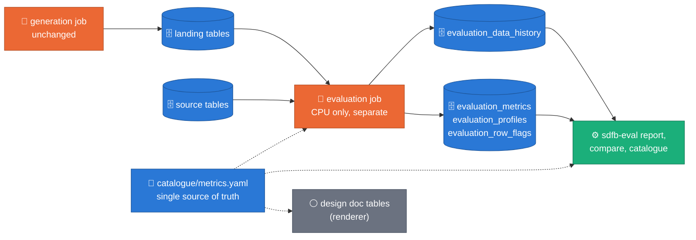
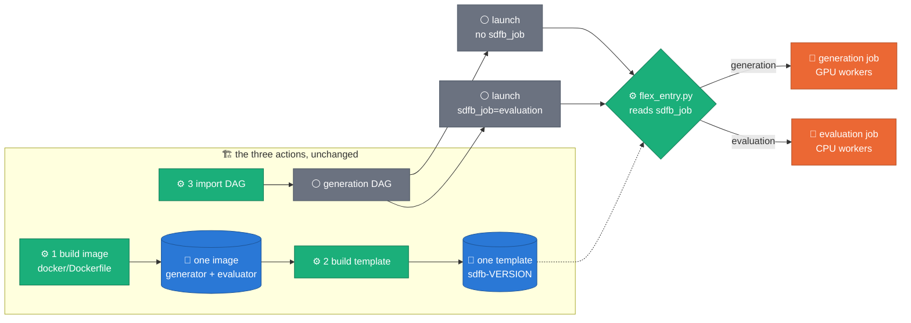
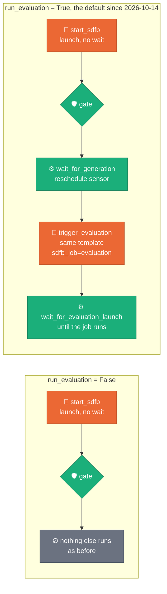
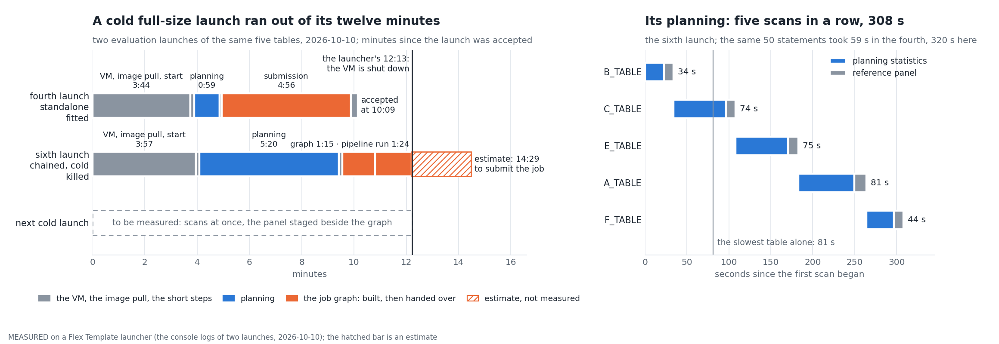
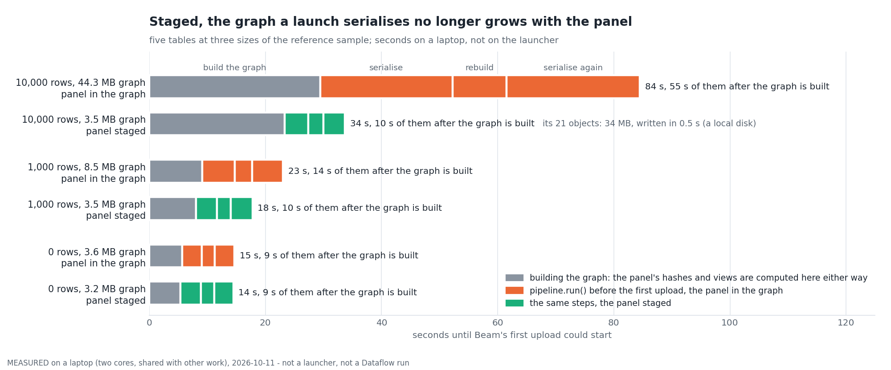
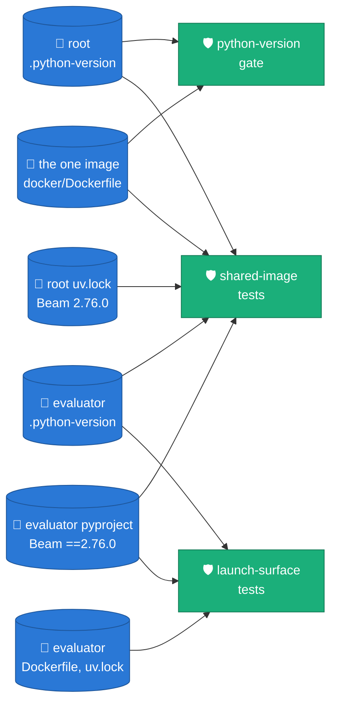

# ADR 0041 — Evaluation is a standalone package and a separate job

**Status:** ACCEPTED (2026-10-05) — **built and reviewed on a laptop; not yet run on Google Cloud.** The statistics, planning, Beam transforms and the composed pipeline are tested on invented data with an in-process Beam runner and fake BigQuery clients. The `sdfb-eval` command line has run on invented data only. The scoping SQL (`APPENDS`, time travel, snapshot clones) has been generated and unit-tested as text and never executed by BigQuery. The CPU image has never been built, the flex template never launched, and the Composer DAG never parsed by Airflow. The acceptance gate still open is the first run on GCP (criteria 5-13 of the design's §11). **Amended 2026-10-06:** the evaluator has no image, template or DAG import of its own any more; see [the amendment](#amendment-2026-10-06-one-image-one-template) at the end. **Amended 2026-10-13:** Python 3.14 and Beam 2.76, moved with the shared image and no longer on its own; see [the second amendment](#amendment-2026-10-13-python-314-and-beam-276-with-the-shared-image).
**Design:** [`2026-07-07-evaluation-framework-design.md`](../designs/2026-07-07-evaluation-framework-design.md) · section [§11 of `DESIGN.md`](../DESIGN.md#11-evaluation-sdfb-evaluation)
**Package:** [`packages/sdfb-evaluation/`](../../packages/sdfb-evaluation/README.md) (evaluator `0.1.0`, metric catalogue `1.0.0`)
**Relies on:** [ADR 0001](0001-no-managed-gcp-services.md) (no managed GCP services) · [ADR 0009](0009-single-flex-template-image.md) (dispatch entrypoint) · [ADR 0022](0022-stats-driven-generation.md) (the literal policy) · [ADR 0032](0032-relationships-as-config.md) (relationship model) · [ADR 0040](0040-dsg-donation-golden-source-sync.md) (the DSG manifest)
**Supersedes:** the evaluation proposal of 2026-07-07 (an in-job evaluation branch, three metric tiers, one history table). None of it was merged.

## Context

The first evaluation design was built on the branch `ws3-eval-framework`: a
post-`WriteLanding` branch inside the generation pipeline, a single
`EvaluationDoFn` fed by a stratified reservoir sample, SDMetrics quality and
diagnostic reports on a pandas frame, a memorization gate that failed the
generation job, and one history table. Reading it against what the evaluation
has to answer shows structural limits, not bugs to patch:

| Limit of the in-job branch | Why it matters |
| :-- | :-- |
| Fidelity is read against the generator's own reference sample | A generator that copied the 10k sample would score perfectly. The honest floor is how far the sample itself sits from the full source |
| A fixed threshold, no noise floor | At small n sampling noise crosses it; at tens of millions of rows every difference is "significant" ([Lin, Lucas & Shmueli 2013](https://doi.org/10.1287/isre.2013.0480)) |
| It runs inside the generation job, on one worker, on a sample | Evaluation cost and failure are coupled to generation, and the metrics are limited to what one worker holds in memory |
| A metrics library and pandas on the runtime path | Heavy dependencies in the generation image, and a metric whose definition is whatever the library does |
| A memorization gate that fails the generation job | A measurement outcome would change whether data landed |
| One history row per run | No per-column, per-pair, per-edge or per-table grain to query; the details sit in one JSON blob |

The same design had to respect the standing constraints: nothing managed, no
Vertex, Dataplex or Looker ([ADR 0001](0001-no-managed-gcp-services.md)), and
results in BigQuery tables and local or object-store files only.

## Decision

**Claim:** evaluation is a separate CPU job that shares files with the generator, never code, and answers one question per metric row: how far is this unit of the synthetic data from the source, and is that distance more than sampling noise?

Evaluation is its own job, started after generation, reading the landing
tables and the source and writing four tables in `synthetic_data_quality`.
The generation job is not touched. A status describes the run
(`SUCCEEDED`, `PARTIAL`, ...), not the data: a run whose metrics fail still
succeeded, and evaluation never fails the generation run. A calling script may
turn metric statuses into an exit code with the optional `--fail_on`, and
nothing more.

**D1 — A standalone nested project.** `packages/sdfb-evaluation` is not a
workspace member: the root `[tool.uv.workspace]` has
`exclude = ["packages/sdfb-evaluation"]`
([uv workspaces](https://docs.astral.sh/uv/concepts/projects/workspaces/)). It
has its own `pyproject.toml`, `uv.lock` and Python 3.11 pin. A fourth member
would break `docker/Dockerfile` (it copies three member project files, then
syncs every package) and the DSG unit, which ships the root project file and
lock ([ADR 0040](0040-dsg-donation-golden-source-sync.md)). A later bump of
Python or Beam touches this package alone. *(Amended 2026-10-13, see [the second amendment](#amendment-2026-10-13-python-314-and-beam-276-with-the-shared-image).)* A CI job installs it from its own
lock and asserts that no generator module is importable.

**D2 — Parity by two-sided golden files, never by import.** The few pieces
whose semantics must match the generator (the relationship-model reader, the
reference digest, the reference query, the row-document limit) are
re-implemented. One golden file, produced by
`scripts/evaluation/make_parity_goldens.py` on the originals, is checked from
both sides: a root test proves the originals still produce it, a package test
proves the mirrors do. An AST test fails on any import of `sdfb_core`,
`sdfb_beam` or `sdfb_tests`.

**D3 — The reference sets come from the generator's own order.** R, E, H and
H_E are prefixes of one ranking of the source by row fingerprint (the
`FARM_FINGERPRINT` order of the reference sample, [BigQuery hash
functions](https://docs.cloud.google.com/bigquery/docs/reference/standard-sql/hash_functions)):
R is the sample the generator read, E the prompt-exposed prefix, H the next n
rows (a holdout, after [Platzer & Reutterer 2021](https://doi.org/10.3389/fdata.2021.679939)),
H_E its exposed-sized prefix. R and H are exchangeable, so chance matches fall
on both and a ratio between them does not depend on how dense the value domain
is.

**D4 — Fidelity is measured against the full source, as the job saw it.** The
source is pinned by time travel at the generation job's create time while that
is inside the table's [time-travel window](https://docs.cloud.google.com/bigquery/docs/time-travel).
Every fidelity row also stores `baseline_value = metric(R, source)`, the floor
that a perfect copier of the sample would score.

**D5 — Status reads effect sizes and sampling noise.** A metric warns or fails
only when its value crosses the threshold and that crossing is not explained by
its noise floor. Lifts and the holdout share gate on a confidence bound. No
p-value is reported. Metrics whose raw value depends on sample size (entropy,
distinct count, coverage, DCR, density, detection AUC) are computed at matched
n.

**D6 — Outputs honour the literal policy.** A value is written literally only
when its column has at most 50 distinct source values
([ADR 0022](0022-stats-driven-generation.md)) and the value occurs at least 10
times in the source. Everything else is a keyed hash label, and source keys in
row flags are keyed hashes by default. A value held by a handful of records is
a quasi-identifier ([Sweeney 2002](https://doi.org/10.1142/S0218488502001648)).
The same k = 10 bounds the numeric values a profile publishes: a histogram edge
or a quantile is published only with at least 10 source records at or beyond it
on each side, two published histogram edges are at least 10 source records
apart, and two published quantile probabilities are at least 10 of that side's
records apart. For one column the exact source values it publishes (histogram
edges, the quantile values of every side, the pair axis's labels) come from
that one set of edges. Counts are not values: a profile may still store a
count below 10 (top-k items under hashed labels, null patterns, contingency
cells, length histograms, calendar and shape mixes, a rate or a tail mass with
its n). The design's §4.9 lists those places and the four disclosure channels
that are accepted.

**D7 — The registry is append-only events.** A run writes a `RUNNING` row and
exactly one terminal row (`SUCCEEDED`, `SUCCEEDED_WITH_WARNINGS`, `PARTIAL`,
`SKIPPED`, `FAILED`). The view `evaluation_latest` picks the last event per
`evaluation_id`; `evaluation_latest_per_job` the last final row per generation
job. The terminal row is written after the metric tables' load and copy jobs
have finished, so a row that says a run finished implies its metrics are
readable.

**A separate CPU job.** The evaluation runs on CPU workers from its own image
and flex template (`packages/sdfb-evaluation/deploy/build_flex_template.sh`),
launched by `sdfb-eval run`, by the template, or by a Composer DAG
(`composer/evaluation_framework.py`) that the generation DAG may trigger,
opt-in and off by default. *(Amended 2026-10-06, see [the amendment](#amendment-2026-10-06-one-image-one-template); on by default since the note of 2026-10-14.)* A local run executes on Beam's in-process
`FnApiRunner`; `--runner DirectRunner` is the user-facing spelling. Beam 2.74's
`DirectRunner` hands a batch pipeline to Prism, which could start a step before
its side input was complete in this package's tests (see
[apache/beam#36563](https://github.com/apache/beam/issues/36563), closed), so
the evaluator refuses Prism.

**The catalogue is the single source of truth.** `catalogue/metrics.yaml`
defines every metric once: id, level, family, direction, thresholds, noise
rule, pitfalls and the explanation text. Three readers consume it: the scoring
code, `sdfb-eval report` / `catalogue`, and `scripts/doc/render_eval_catalogue.py`,
which generates the design document's catalogue tables (a CI check fails on
drift). A GUI on another branch reads the same file and the table schemas as
its data contract and grades nothing itself.

**Four tables, two views**, in `synthetic_data_quality` and defined inside the
package (`schemas/`), never under `config/bq_schema/`, which belongs to the
generator's Terraform:

| Table | Grain |
| :-- | :-- |
| `evaluation_data_history` | one row per event (`RUNNING`, `FINAL`) |
| `evaluation_metrics` | one row per metric x table x column, pair or edge |
| `evaluation_profiles` | one row per profile x table x column or edge x side |
| `evaluation_row_flags` | at most `--row_flags_top_k` rows per table and check, expiring after 180 days |

## Consequences

- The generation job, its image, its tests and the DSG unit are unchanged. The
  generator and the evaluator evolve independently, at the price of the
  mirrors of D2, which a golden file keeps honest. *(Amended 2026-10-06, see [the amendment](#amendment-2026-10-06-one-image-one-template).)*
- Evaluation can be re-run on a past generation job while the source's
  time-travel window and the landing table's history allow it; after that the
  source is read as it is now and the plan says so.
- Evaluation needs its own IAM: read on the source and landing tables, job
  listing, Dataflow and log viewing, snapshot permissions on a temporary
  dataset, and write on `synthetic_data_quality` (see
  [`DEPLOYMENT_PREREQUISITES.md`](../DEPLOYMENT_PREREQUISITES.md)).
- Every metric row carries its own noise, so two runs can be compared
  without a significance test; the privacy metrics remain risk indicators,
  not guarantees ([Stadler, Oprisanu & Troncoso 2022](https://arxiv.org/abs/2011.07018);
  [Ganev & De Cristofaro 2023](https://arxiv.org/abs/2312.05114)).
- The old in-job evaluation code (`sdfb_core/evaluation/`, the branch
  `ws3-eval-framework`) is retired by a later task, with its salvage mapped to
  the new modules. Metric tiers 2 and 3 (SDMetrics reports, SynthEval,
  Evidently) are dropped at runtime. Also dropped with the old design, each
  stated here because nothing else records it:
  - The old `profile` module's stratified row sampling and its per-stratum cap.
    The new package samples rows with a deterministic bottom-k hash sample
    (`sampling/reservoir.py`, after [Cohen & Kaplan 2007](https://doi.org/10.1145/1281100.1281133)),
    which is uniform over rows, not stratified. (The value sampling of the
    census is a separate stratified design, design §4.6.) The design gives no
    reason for the change.
  - The in-job lookup of the previous run for a run-versus-run PSI. Two stored
    evaluations are compared with `sdfb-eval compare`, a manual step, which
    gives the PSI only when both runs' histograms carry the same `edges_digest`.
  - The old diagnostic's "data structure" check (synthetic columns equal the
    source columns). The evaluator scores only the columns both sides share,
    records the one-sided columns in a plan note ("columns [...] exist on one
    side only and are not compared", `context/plan.py`), and does not fail on
    the difference; `beam/encode.py` fails only on a row that lacks a plan
    column. A column-set mismatch is therefore reported, not gated.
  - The Evidently HTML drift report as a deliverable and the `--eval_tier`
    knob: the reports are markdown and JSON (`sdfb-eval report`, `compare`),
    and there are no tiers.
- **Unverified until the first GCP run:** the scoping SQL on real BigQuery,
  snapshot creation with the evaluator's roles, the image build and the
  dispatch entrypoint, a template launch, the shuffle prediction against a
  real job, the Composer deferrable wait and failure callback, and the
  deploy workflow substituting `{{EVALUATOR_VERSION}}` into the DAG.
  *(Amended 2026-10-06, see [the amendment](#amendment-2026-10-06-one-image-one-template).)*

## Alternatives rejected

| Alternative | Why not |
| :-- | :-- |
| **The in-job branch** (the 2026-07-07 proposal) | Couples evaluation cost and failure to generation, limits metrics to one worker's memory, and measures fidelity only against the generator's own sample. See Context |
| **A fourth uv workspace member** | Breaks the image build and the DSG unit, and forces the evaluator's Python and Beam pins onto the generator (D1) |
| **SDMetrics at runtime** | Built instead: statistics in numpy and scipy, with the lock holding no pandas and no synthetic-data metrics library (design [§9](../designs/2026-07-07-evaluation-framework-design.md#9-packaging-and-the-dsg-unit)). Several metric names follow [SDMetrics](https://docs.sdv.dev/sdmetrics); no SDMetrics code runs (design [§4.3](../designs/2026-07-07-evaluation-framework-design.md#43-distributions-on-a-fixed-grid)). The design gives no further reason for not using it; the ws3 branch used it on a pandas frame (Context) |
| **SQL-only pushdown** | Built instead: BigQuery SQL for planning (counts, quantile grids, dictionaries, one aggregate scan per table side) and one Beam graph for the per-row pass, which encodes each row once (design [§5.1](../designs/2026-07-07-evaluation-framework-design.md#51-planning-before-a-row-is-read), [§5.2](../designs/2026-07-07-evaluation-framework-design.md#52-the-graph)). The design does not state why SQL alone was rejected. Reasoning of this ADR, not measured: an exact Gower nearest-neighbour search and a classifier are not expressible in standard BigQuery SQL |
| **Beam `ApproximateQuantiles`** | The first plan considered it; the build replaced it with a planning-time grid. Built instead: planning asks BigQuery for a 1,001-point grid per side ([`APPROX_QUANTILES`](https://docs.cloud.google.com/bigquery/docs/reference/standard-sql/approximate_aggregate_functions)) and the Beam pass counts every row exactly against that fixed grid. The design's reason: "A column of a hundred million rows cannot be sorted in a Beam combiner, and it does not need to be"; two passes, plan then count, replace a sort (design [§4.3](../designs/2026-07-07-evaluation-framework-design.md#43-distributions-on-a-fixed-grid)). No other reason is recorded |
| **A gate inside generation** | Evaluation is post-hoc by decision; the generation job keeps its own blocker rules |
| **p-values** | At scale everything is significant; each row carries a noise floor instead (D5) |

## Amendment (2026-10-06): one image, one template

**Status of the amendment:** built and tested on a laptop. The image has not
been built, the template has not been launched, and Airflow has parsed neither
DAG. Everything below about a build, a launch or a DAG run describes what the
files are written to do.

**Claim:** the deployment's three existing actions (build the image, build the
template, import the generation DAG) are enough to generate and to evaluate.
Evaluation stays a separate package and a separate job; what it loses is an
image, a template and a DAG import of its own.

**Why.** Two reasons, both about the deployment and neither about the
statistics:

1. The deployment has three actions and must need no fourth. The first design
   (above, "A separate CPU job") needed a second image build, a second template
   build and a second DAG import with a marker of its own.
2. The generation job records `relationships_uri=config/relationships`, a
   folder inside the generator's image, and the evaluator reuses the recorded
   value. In an image of its own that folder does not exist, so planning a
   relational launch would fail. The shared image carries the folder.

*One image and one template serve two jobs; the template parameter `sdfb_job`
picks the entry. Implemented in `docker/flex_entry.py::main`.*

| | Before this amendment | Now |
| :-- | :-- | :-- |
| Image | the generator's, and a CPU image for the evaluator | one, `docker/Dockerfile`: it also carries the evaluator's source, which runs on the environment `uv sync` installs for the generator |
| Entry | each image ran its own file | one dispatcher, `docker/flex_entry.py`, which reads `sdfb_job` and calls the generator's or the evaluator's `main` |
| Template | one per image | one, whose metadata declares the generator's parameters, `sdfb_job` and the evaluator's; every parameter is optional |
| Orchestration | the generation DAG triggered a second DAG | the generation DAG waits for its own job and launches the evaluation itself; the second DAG is optional |

**What did not change.** The package is still a standalone project with its own
`pyproject.toml` and `uv.lock` for development and CI (D1), and neither side
imports the other (D2): the dispatcher is the only file that names both. The
evaluation is still a separate Dataflow job after generation, on CPU workers,
that never gates or fails the generation run. The four tables, the two views,
the registry's events (D7) and the command line are untouched.

**A1. One image.** `docker/Dockerfile` copies the evaluator's `src` through a
throwaway [build stage](https://docs.docker.com/build/building/multi-stage/)
that copies `packages/` and looks for the directory in shell, so the same file
builds in a tree without the evaluator (the DSG copy has none; the image then
runs generation only). There is no second `uv sync` and no second virtualenv.
The source is made importable the way the generator's is: last on the
launcher's `PYTHONPATH`, and as a path line of the worker bridge `.pth`
([`site`](https://docs.python.org/3/library/site.html) adds such a line only
when the directory exists). The existing build argument also sets the
evaluator's worker-image variable, so its workers run this same image
([custom containers](https://docs.cloud.google.com/dataflow/docs/guides/build-container-image)).

**A2. One environment, checked.** The evaluator runs on the generator's
dependency versions, not on its own lock's. Two of its dependencies, scipy and
scikit-learn, are in the image only because an extra of the generator installs
them. Three things turn that into a checked fact: a test that every dependency
the evaluator declares is in the root lock inside its range; a test that the
extras named on the image's `uv sync` line still reach each of them in the
lock's dependency graph; and a build step that imports the evaluator's two
entry modules in the launcher's context and in the worker's, so an image that
lost one fails at build and not at the first evaluation launch
(`packages/sdfb-tests/tests/unit/docker/test_shared_image.py`).

**A3. One template, every parameter optional.** A launch for one job cannot be
made to supply the other's parameters, so the template requires none
([Flex Template metadata](https://docs.cloud.google.com/dataflow/docs/guides/templates/configuring-flex-templates)).
What a job needs is refused by its own argument parser, in the launcher. The
three names both jobs use (`relationships_uri`, `run_id`, `thresholds_uri`)
appear once; `run_id` loses its pattern, because both parsers take any text
and an evaluation may pass it empty.

*The two modes of the generation DAG's `run_evaluation` parameter
(`composer/synthetic_beam_bigquery.py`). The last task was added on
2026-10-11, and the default became True on 2026-10-14: see the notes of
those dates below.*

**A4. The chain is inside the generation DAG.** `start_sdfb >>
run_evaluation_gate >> wait_for_generation >> trigger_evaluation` (and, since
2026-10-11, `>> wait_for_evaluation_launch`). The wait is
a sensor in [reschedule mode](https://airflow.apache.org/docs/apache-airflow/stable/core-concepts/sensors.html),
which holds no worker slot between two reads of the job's state and needs no
triggerer; it is stated as not deferrable because the environment may have
none. `trigger_evaluation` launches the same template with
`sdfb_job=evaluation` and the generation job's id (superseded for how the
tables are named by the second note of 2026-10-08), as a CPU job in the
generation job's network, and does not wait. It also passes Beam's own
[`disk_size_gb`](https://docs.cloud.google.com/dataflow/docs/reference/pipeline-options):
the evaluation job's workers unpack the same multi-GB image and the evaluator
pins no boot disk, where the generator pins one for itself.

**A5. The standalone DAG is the optional path.** `composer/evaluation_framework.py`
launches from the same template, reads the marker the import workflow already
substitutes for the generation DAG, and keeps what the chain does not have: a
launch that waits for its job and a failure callback that closes the registry
row. It accepts a list of generation job ids and then starts one run of itself
per id, so the per-job path is the reviewed one. The evaluator's CPU
`Dockerfile` stays for the package copied out as a unit of its own, and its
build script now builds only a template from an existing image.

**Costs.**

- The evaluation job's workers pull and unpack the large GPU image: a slower
  start than a small CPU image, and a 200 GB boot disk per worker.
- The evaluator runs on the generator's versions. They are inside its declared
  ranges and guarded as in A2; the evaluator's own suite was also run once on
  the root lock's versions on a laptop and passed. On a worker, packages the
  Beam base image installs globally come ahead of the image's virtualenv on the
  path, as they always have for the generator: which numpy, scipy and
  scikit-learn a worker imports is unverified until a real job.
- The template no longer refuses a generation launch that lacks a required
  parameter: the launcher does, a moment later, and the launch's job fails
  there.
- A chained evaluation that dies after it was launched leaves its `RUNNING`
  row open. Nothing in the generation DAG closes it; a run of the standalone
  DAG for the same job is the path that does.

  **Note (2026-10-11): the chain waits for the evaluation's launch, and that
  wait closes the row of a launcher that dies.** Two chained launches were
  ended by the launcher's time limit after it had written `RUNNING`, and the
  rows stayed open. The launch task cannot see that: with
  `wait_until_finished=False` the provider returns as soon as the job is in
  an awaiting state, queued included
  ([`_check_dataflow_job_state`](https://github.com/apache/airflow/blob/providers-google/10.0.0/airflow/providers/google/cloud/hooks/dataflow.py#L393-L421)),
  minutes before the launcher writes the row. So the chain gains a fifth
  task, `wait_for_evaluation_launch`: a second
  [`DataflowJobStatusSensor`](https://airflow.apache.org/docs/apache-airflow-providers-google/stable/operators/cloud/dataflow.html#howto-operator-dataflowjobstatussensor)
  on the evaluation job, with the first sensor's arguments, expecting
  `JOB_STATE_RUNNING` or `JOB_STATE_DONE`. The sensor's `poke` raises for a
  terminal state it was not told to expect
  ([source](https://github.com/apache/airflow/blob/providers-google/10.0.0/airflow/providers/google/cloud/sensors/dataflow.py#L103-L111);
  the same in `main`), so a job that ended failed fails the task, and its
  failure callback appends the `FAILED` row with the standalone DAG's
  statement, copied. Not at once: the task is retried first and the callback
  runs after its last retry. No task sets `retries` and the DAG sets no
  `default_args`, so the environment decides, and Cloud Composer's default
  is "two retries for a failed task", "twice with 5 minute intervals"
  ([known issues](https://docs.cloud.google.com/composer/docs/composer-2/known-issues)):
  the row is closed about ten minutes after the sensor first sees the dead
  job. That is kept, so that a transient error in one read does not end the
  watch. Rejected: the callback on the launch task (it never runs for this
  case), `retries=0` on the sensor (an immediate close, but one failed read
  would end the watch), and waiting for `JOB_STATE_DONE` (it would also
  close a job that dies on the workers, but the DAG has one run slot and the
  next generation would queue behind the whole evaluation). Still not closed
  by the chain: a job that dies after a read saw it running; the GUI shows
  such a row as Stale after 24 hours and the run playbook has the manual
  close. Costs: the run holds its slot until the evaluation's launch is over
  (at most the launcher's twelve minutes and one read, plus the retries when
  the launcher died), and a dead evaluation launch fails the DAG run. Two
  conditions of the environment: below `providers-google` 4.0.0 the launch
  ignored `wait_until_finished` and waited for the job's end, which inverts
  this design (the launch task fails on a dead launcher and the sensor never
  runs); and neither sensor is deferrable only while `[operators]
  default_deferrable` is not set. While the launcher runs, the job is not yet
  running: "Queued: either a FlexRS job is queued or a Flex Template job is
  being launched" ([Dataflow jobs list](https://docs.cloud.google.com/dataflow/docs/guides/jobs-list)).
  That page lists the console's statuses, and no page names the
  [job state](https://docs.cloud.google.com/dataflow/docs/reference/rest/v1b3/projects.jobs#Job.JobState)
  a launch that timed out ends in (the
  [troubleshooting page](https://docs.cloud.google.com/dataflow/docs/guides/troubleshoot-templates)
  says "the job fails"); the run playbook has the one-line check. All of
  this was read, in the provider's source at two versions and on those
  pages. None of it was run: not the DAG, not the installed provider, not
  the environment's retries.
- The copy that ships to the Dataflow Solution Guides has a `Dockerfile` and a
  template metadata that mention an evaluator it does not ship.

**Unverified until a real build, launch and Airflow parse:** the image build
with and without the evaluator's directory; the import check in both contexts;
the dispatcher under the template launcher; a template with every parameter
optional; the sensor's behaviour when the generation job fails or is
cancelled (the provider's source was not available to read; read since,
see the note of 2026-10-11 above); `maxWorkers`
rendered as a string; the boot disk reaching the evaluation job's workers; the
standalone DAG re-triggering itself.

**Note (2026-10-08): the template's name for the generation job is
`generation_job_id`.** The first chained launch reached the evaluator without
its target: the Flex Template Python launcher logged `Skipping dissallowed
override: job_id` and ran the entry with no `--job_id`, so the evaluator
refused to start (exit 2). The launcher owns a few option names for Python
([the documented five are `runner`, `project`, `job_name`, `template_location`
and `region`](https://cloud.google.com/dataflow/docs/guides/troubleshoot-templates));
`job_id` is not among them, and the log line is the evidence that it is dropped
too. A template launch therefore names the generation job
`generation_job_id`, in both metadata files and in both DAGs. In the CLI it is
a second option string of the same argument, so `--job_id` still works, and is
still the name the documents use, for a direct command line. A test now holds
every template parameter clear of the six names.

**Note (2026-10-08, second): the chained evaluation names its tables from the
launched table and the relationship model.** The second chained launch could
not resolve its launch: reading the generation job's Cloud Logging entries
returned HTTP 403 (the deployment's service account has no
`roles/logging.viewer`), and nothing else could resolve the launch without the
log. The labelled BigQuery writes need a BigQuery location that only the log
or a landing table gives, and `validation_runs` needs the launch's
`validation_runs_table`, which only the log gives. So the generation DAG's
`trigger_evaluation` no longer names the tables by the job. It passes `seed_table` (the
launched table), `relationships_uri` (empty when `generate_fk_relationships`
is false), `landing_dataset` and `reference_dataset`, and the evaluator
(`--seed_table`) evaluates what that launch generated: the table's enabled
component in the model, parents first, or the table alone when no model names
it or the folder holds no model file (a warning says so). The generator's own
rule is mirrored by `relationships.component`. The chained evaluation reads each landing table
whole (`scope=manual`): this launch's rows with `write_disposition`
"overwrite", the rows of earlier launches too with "append". The cost of not
reading the log: the launch's own record of its tables, and a model the
launch adjusted under
[ADR 0038](0038-measured-conflicts-adjust-the-model.md), are not seen. Runs
named by job id (`--job_id`, the standalone DAG) are unchanged and still need
the job roles.

The job id still travels, as the launch's identity (ruling R134). A
first version of this note left it out; the row then had no
`generation_job_id` and no window, so the view `evaluation_latest_per_job`
(which lists only rows with a job id) never showed a chained run. The owner
asked for it back, and `--generation_job_id` may now accompany `--seed_table`:
the seed still names the tables, and the evaluator reads the Dataflow job
resource (`jobs.get`: id, name, region, start and end) and nothing else about
the job: not its log, not BigQuery job labels. That needs
`roles/dataflow.viewer`; a job that cannot be read (not
found, past retention, no role) costs the window and one warning, never the
evaluation. What the window changes: the source is pinned as of the job's
create time (a snapshot clone, within the source's time-travel window, as for
any evaluation by job id), and the row's `source_drifted` and generation
columns are filled; the scope stays `manual`.

The reference sample is verified from `validation_runs` (ruling R136). With
the job's window known and the generator's `validation_runs_table` passed
(`--validation_runs_table`, the value the generation launch passes), the
evaluator runs the one query `runs_for` already defines, for this launch's
rows: the landing tables of the seed's group, created inside the job's
window, the latest launch if the window holds several. Their
`reference_digest` is what makes the rebuilt reference sample (R) `verified`;
without it the panel is unverified and every reference-based metric is
`not_evaluated` with the reason: the nearest-neighbour metrics
(`row.dcr_train_holdout_share`, `row.dcr_p5_ratio`, `row.nndr_p5_ratio`,
`row.density`, `row.coverage`) and the panel-based match rates and lifts
(`row.memorization_lift` and `row.exposure_lift` among them). R133 had passed
`reference_rows_limit` so the panel was planned, but a planned panel is not
a verified one. The run rows are attached to the launch context and do not
decide the table list: the seed's tables stay the tables, so a table with no
row is evaluated, only without a digest. The query needs read on the table;
a table that cannot be read, or an unknown window (the job could not be
read), costs a warning and those metrics, never the evaluation. This partly
reverses R134, which had the job-only path read no `validation_runs`, on the
owner's word.

**Note (2026-10-09): the standalone DAG evaluates a landed run by the same
path, and both launches name a launcher machine.** The owner's service account
cannot launch with gcloud and cannot read Cloud Logging, and the third real
launch of the chain showed that the image pull (almost eight minutes) left
planning too little of the Flex Template launch's 12 minutes ("By default, the
Flex Template launch process has a timeout of 12 mins",
[Google](https://cloud.google.com/dataflow/docs/guides/troubleshoot-templates),
"Polling timeout errors"). So `composer/evaluation_framework.py` now takes the
seed path of the chain (`seed_table`, the datasets, `scope=manual`,
`reference_rows_limit`, `validation_runs_table`, and `generation_job_id` as the
identity), with the job id alone and the seed emptied as the explicit way to
the full lookup, and it drops `deferrable` (a recent provider argument that
needs a triggerer). Both evaluation launches pass
`environment.launcherMachineType` (default `e2-standard-8`): a larger launcher
pulls faster. The timeout itself cannot be set from a DAG: the public REST
description of the launch has no such field (gcloud has
`--launcher-vm-timeout-secs`). The image stays the generator's: a CPU-only
image would pull faster but is a second image, and that stays the owner's
decision.

**Note (2026-10-10): where a project refuses a read session, the evaluator
pages.** The fourth real launch (the standalone DAG, the seed path, five
tables) reached Dataflow and failed on every read. The pipeline read its
source and synthetic rows with `ReadFromBigQuery` and `DIRECT_READ`, the
[BigQuery Storage Read API](https://docs.cloud.google.com/bigquery/docs/reference/storage),
which needs `bigquery.readsessions.create` on the project of the table being
read (Beam 2.74 opens the session with that project as its parent). The
owner's worker account does not hold it; the generator met the same refusal
on 2026-09-07 and pages around it
([ADR 0034](0034-generation-throughput-single-barrier-shared-engines.md) D4).
The evaluator had no other read path.

*Decision.* Once the prepare statements have built the read tables and
before the graph is built, the driver asks the API for one read session per
project of the planned read tables (the call a worker makes; no row is
read). **A read table is paged if and only if its project refused** (a
403): it is read through the BigQuery client's `list_rows`, REST
[`tabledata.list`](https://docs.cloud.google.com/bigquery/docs/paging-results),
by row ranges, which needs `bigquery.tables.get` and
`bigquery.tables.getData` on the read table (both in
`roles/bigquery.dataViewer`, and both already used by planning on the source
and landing tables) and no read session. Every
other read table keeps `DIRECT_READ`. Any other answer of the probe fails
the launch: a transient error never changes how an evaluation reads. No
parameter chooses the path, because the permission is a fact of the project
and the launcher of a Flex Template runs as the account its workers run as.
The rule is per project because the permission is: a public project is
expected to refuse (the caller holds no role there; an inference from the
parent project Beam uses, not an observation), so a read-only parent's
source twin read from one would be paged while the job's own tables keep
the fast read. The mechanism, its diagram, the
checks that fail a job whose table changes while it is paged and the wait
on a throttled page are the design document's
[§5.2](../designs/2026-07-07-evaluation-framework-design.md#52-the-graph).

*Rejected: `ReadFromBigQuery(method=EXPORT)`,* an extract job to Cloud
Storage read back as Avro files. It scales, and it was not built, for three
reasons.

1. **Its permissions have never run in that deployment.** An export needs
   [`bigquery.tables.export`, an extract job, and objects created in the
   bucket](https://docs.cloud.google.com/bigquery/docs/exporting-data), and
   here it would export a table snapshot (the source pin), which that page
   does not say is possible. Every launch so far has stopped on something
   the deployment refuses, and each costs a build, a deploy and a day.
   Paging needs the two permissions that the planning of that same launch
   had just used on its source and landing tables.
2. **Types.** In an Avro export a DATETIME is a string, and the evaluator
   repairs that at top level only. The client's cells are the panel's types
   by construction: the same code decodes both.
3. **No copy.** An export leaves a full copy of every read table, source
   tables included, in the temporary bucket while the job runs, and after it
   when the job dies before its cleanup step. The design's §4.9 lists no
   such place for source data.

*Consequences.* `roles/bigquery.readSessionUser` is optional for the
evaluator; granting it later moves the same image to the fast read without
a rebuild. The price of paging is speed: BigQuery limits `tabledata.list`
to [3.7 GB of row data per minute, 7.5 GB in the US and EU
multi-regions](https://docs.cloud.google.com/bigquery/quotas), a quota of
the project that contains the table, shared with every other reader of
that project (for a public source, with everyone who reads it), and
recommends the Storage Read API above that. `--mode sampled` is the lever
for tables too large to page; an
export path stays a later decision of the owner's, should exact mode be
needed at that scale and the bucket copy be accepted. A paged read of a
table that is still being written fails the job rather than read it wrong,
which matters for the tables read live: the landing table of a `table` or
`manual` scope, an unpinned source, a read-only parent. A table is read as
empty only when `tabledata.list` itself counts no row, never on its
metadata's word. Not verified until
a launch: that `tabledata.list` answers for a table snapshot in that
project, and how the paged read behaves at the owner's volumes. The same
launch spent almost five of its twelve minutes in the driver's submission
step without saying where, so the driver now times the steps inside it.

**Note (2026-10-11): a cold, full-size launch has to fit the launcher's
twelve minutes, so planning scans the tables at once and, on Dataflow, the
panel is staged beside the job graph.** The sixth real launch (2026-10-10)
was the first chained evaluation of a full-size run: five tables,
212.6 M landed rows, the launcher on `e2-standard-8`. The chain worked: the
gate, the wait, the trigger, the right parameters, and a plan for all five
tables. The launch itself was shut down with `Timeout in polling result
file` before it had submitted the job. "By default, the Flex Template
launch process has a timeout of 12 mins. This launch process includes
pulling the template container image and executing the code to construct
the job graph"
([Google, troubleshoot Flex Templates](https://docs.cloud.google.com/dataflow/docs/guides/troubleshoot-templates));
the page lists "The program that creates the graph takes too long to
finish" and "Code running in the launcher VM takes too long to finish"
among the causes.

*Claim: the launch that did not fit spent 5 min 20 s of its 12 min 13 s
planning five tables one after another, and the launcher was shut down
1 min 24 s into handing the job graph over, before Beam's first upload.*
Two things were inside the fixed window that grow with the data:

1. **The planning scans, one table after another.** A table's planning
   statistics scan both of its sides in full and its reference panel
   scans its source, and the planner ran them table after table: 308 s
   of the 320 s. The slowest table alone took 81 s. The fourth launch had
   run the same 50
   statements in 59 s. The likely reason for the difference is BigQuery's
   result cache, and it is not confirmed: the planner's queries leave the
   cache on, their text is the same for two evaluations of one generation
   job with the same scope (the source is pinned with a literal time, a
   `manual` scope reads the landing table itself), and the fourth launch
   came 16 hours after another launch on the same job. "If you run the
   exact same query again, BigQuery returns the results from the cached
   table", for "approximately 24 hours", unless "any of the referenced
   tables … have changed since the results were previously cached"
   ([BigQuery, cached query results](https://docs.cloud.google.com/bigquery/docs/cached-results)).
   The owner's job history can confirm it: a served query has
   `statistics.query.cacheHit` true (`cache_hit` in
   `INFORMATION_SCHEMA.JOBS`). What matters for the design holds either
   way: a chained evaluation is the first reader of tables that have just
   landed, so it always pays the scans in full.
2. **The job graph, with the panel in it.** `beam.Create` embeds its
   elements in the graph, and four places handed the workers what the
   driver had built from the panel that way: the R and H rows, the
   census's views of them, and each table's panel hashes and privacy
   inputs. On Dataflow `pipeline.run()` serialises the graph, rebuilds the
   pipeline from it and serialises it again before the first upload, so
   every panel row was paid several times, on the launcher's clock.

*Decision.*

- **Planning scans the tables at once**, on up to eight threads sharing
  the one BigQuery client; each table's own statements stay in order.
  Sampling and everything after it run once every scan has ended, one
  table after another in table order, so the plan is the one a
  table-after-table planning makes whichever scan ends first. A table
  whose scan fails raises its own error after the others have ended (a
  second failing table is a warning in the log). An interrupt is not a
  failure: it leaves planning at once, and no further statement is sent.
  The dry runs (9 s) and the metadata reads stay as they were.
- **On Dataflow the panel is staged, not embedded.** The launch writes
  each of those payloads as one object under
  `<temp_location>/sdfb-evaluation/<evaluation_id>/panel/` while it builds
  the graph, and the graph carries the object's name, sha256 and element
  count. The temp location is the one Beam settles on when it validates
  the pipeline (`--temp_location`, or the staging location when none or
  an invalid one is given). A worker checks the digest before it
  unpickles the object and the count after; a missing or different
  object fails the job naming it. A local run embeds as before.

The mechanisms and their diagrams are the design document's
[§5.1](../designs/2026-07-07-evaluation-framework-design.md#51-planning-before-a-row-is-read)
(the scans) and
[§4.9](../designs/2026-07-07-evaluation-framework-design.md#49-what-the-outputs-may-reveal),
accepted channel 4 (the panel).

**This changes accepted channel 4, and corrects it** (the owner's decision
of 2026-10-11). The design said the panel rows were an object in the job's
bucket only with the `upload_graph` experiment. Beam stages the whole
pipeline as `pipeline.pb` under the staging location for every Dataflow
job
([`apiclient.py`, `create_job_description`, Beam 2.74.0](https://github.com/apache/beam/blob/v2.74.0/sdks/python/apache_beam/runners/dataflow/internal/apiclient.py#L834-L849));
`upload_graph` adds `dataflow_graph.json` beside it. So the rows have been
an object in the job's bucket since the first Dataflow launch. They are
one still, under the temp location, and no longer in the graph: whoever
can read objects under the temp location can read them, and nothing that
shows the job's graph shows them.

*Claim: with the panel staged, what `pipeline.run()` serialises no longer
grows with the panel; building the graph still does.* This is a laptop
measurement of the composed, never-run graph of five invented tables, not
a launch: the launcher took 75 s for the `graph` step this laptop takes
29 s for, and nothing in the figure is converted to launcher seconds. At
10,000 reference rows the three steps `pipeline.run()` takes before its
first upload fall from 55 s to 10 s, on a 3.5 MB graph where it was
44 MB, and the staged graph is the same size at 1,000 and at 10,000
reference rows. The `graph` step itself falls only from 29 s to 23 s: most
of it is the launch computing the panel's hashes, views and privacy
inputs, which staging does not move. **So the next launch should show
`graph` close to what it was, and `pipeline run` below the 221 s it was
estimated to need.** By how much is not known. At the launcher's pace
the three steps timed here account for about 130–140 s of that estimate
(an inference: the laptop's 55 s times the ratio of the two `graph`
steps), and the rest of it was never measured. A `pipeline run` near
100 s would be consistent with this change working; a pipeline file of
tens of megabytes under the staging location would not.

*Not changed.* `pipeline.run()` still serialises the graph, rebuilds the
pipeline and serialises it again; the graph it does that to is smaller.
BigQuery's cache is left as it was: a re-launch on the same job may still
be served from it, a first launch never is. The dry runs are not
concurrent. The staged objects are not deleted when the job ends: they
follow the temp location's lifecycle, as `pipeline.pb` follows the staging
location's, and deleting them from the job is the owner's decision to
make.

*Consequences.*

- Nothing to import and no parameter: the same template, the same DAGs. A
  deployment pulls, rebuilds the image and deploys the template.
- The launcher now creates objects under the temp location, and the
  workers read them. Dataflow already asks that the worker account can
  read and write there ("Ensure that your user-managed service account has
  read and write access to the staging and temporary locations specified
  in the Dataflow job",
  [Google](https://docs.cloud.google.com/dataflow/docs/concepts/security-and-permissions)),
  and both DAGs put the two locations in one bucket; a launcher has so far
  written only under the staging prefix.
- The temp location holds source rows. Restrict it, and the staging
  location, to the evaluator's account and its operators, with a lifecycle
  rule longer than a job, scoped to the two prefixes. The staging location
  is no less sensitive than it was: the graph still carries the plan's
  per-column specs, the source's quantile grids with their extremes among
  them.
- A launch that fails or is killed after staging leaves its objects with
  no job, under the `evaluation_id` of its `RUNNING` row; and a deleted
  object stays recoverable while the bucket's
  [soft-delete policy](https://docs.cloud.google.com/storage/docs/soft-delete)
  retains it (seven days by default).
- The digest guards against accidents and against a party who can write
  under the temp prefix and cannot replace the graph. It keeps nothing
  secret, and whoever can replace the graph can replace the digest with
  it.
- A scan that fails no longer stops the scans after it: the other tables'
  statements have run, and were billed, by the time the error is raised.
- Up to eight planning queries run at once. Whether the phase then takes
  the slowest table's time rather than the sum depends on BigQuery serving
  them side by side (slots), which only a launch shows.

*Not verified until a launch:* that the scans overlap on BigQuery as they
do on a laptop's fake; that the launcher can create objects under the temp
location and the workers read them; the launcher's `graph` and `pipeline
run` seconds with the panel staged; and that a job evaluated from a staged
panel gives the metrics of one evaluated from an embedded panel (on a
laptop the written rows are identical). `docs/RUN_PLAYBOOK.md` ("What a
cold, full-size launch must show") lists the lines to read.

**Note (2026-10-14): a generation DAG run evaluates itself by default.**
`run_evaluation` defaults to True (it was False) and
`evaluation_max_workers` to 8 (it was 4), on the owner's decision. The chain,
its tasks and its launch are unchanged; what changes is what a trigger with
no parameters does. It now also launches the CPU evaluation job (up to eight
`e2-standard-8` workers), keeps the DAG's one run slot until the generation
job has ended and the evaluation's launch is over (A4 and the note of
2026-10-11), and is marked failed when that launch dies. It therefore needs
what an evaluation needs: the four `evaluation_*` tables and the two views,
and the evaluator's roles for the Dataflow service account
(`docs/DEPLOYMENT_PREREQUISITES.md`). A trigger with `run_evaluation` false
launches generation alone, as before. The standalone DAG's own `max_workers`
is unchanged. Not run on a deployment.

## Amendment (2026-10-13): Python 3.14 and Beam 2.76, with the shared image

**Status of the amendment:** resolved, type-checked and tested on a laptop
(macOS). The image has not been rebuilt on the new base and no job has run
on it. Everything below about a worker describes what the files are written
to do.

**Claim:** the evaluator's interpreter and its Beam version are the shared
image's. They move when the generator's move, in one change, and three
tests refuse a tree where they differ.

**Why.** D1 says "a later bump of Python or Beam touches this package
alone". That was written for an evaluator with an image of its own. Since
the [amendment of 2026-10-06](#amendment-2026-10-06-one-image-one-template)
the deployed evaluator has no environment: its source runs on what
`uv sync` installs from the root lock, inside the generator's image. Two
things follow.

- The interpreter is the image's. It pickles the graph on the launcher and
  unpickles it on the workers, for both jobs.
- Beam is the root lock's, and the evaluator declares an exact
  `apache-beam[gcp]==` pin, so the root lock can satisfy it only at the same
  version.

The generator moved to Python 3.14 and Beam 2.76.0, the baseline of the
Dataflow Solution Guides
([ADR 0040](0040-dsg-donation-golden-source-sync.md), A6). The evaluator
moves with it: `.python-version`, `requires-python` (`>=3.14,<3.15`), the
mypy target, `apache-beam[gcp]==2.76.0`, its own lock, the package's own
`docker/Dockerfile` (base image, launcher base, bridge path) and its CI job.
That one sentence of D1 no longer holds. The rest of D1 does: its own
project file and lock, not a workspace member, importing none of the
generator.

*Three tests hold the evaluator's pins to the generator's, so neither can
move alone; an arrow is a file a test reads. Implemented in
`packages/sdfb-tests/tests/unit/scripts/test_dsg_python_version.py`
(every pin in the generator's files against the root `.python-version`),
`packages/sdfb-tests/tests/unit/docker/test_shared_image.py` (the two
`.python-version` files are equal, the image's paths name that version, and
the root lock holds every dependency the evaluator declares, inside its
range) and `packages/sdfb-evaluation/tests/unit/test_launch_surfaces.py`
(the package's own Dockerfile against its own pin and lock).*

**What moved in the evaluator's lock.** Beam 2.74.0 to 2.76.0, and what
Beam itself changed underneath: `google-apitools` 0.5.31 to 0.5.35,
`google-cloud-dataflow-client` added (Beam's Dataflow client is now that
library, no longer a generated one), and `envoy-data-plane` with its
pre-release `betterproto` gone
([Beam 2.76.0 release notes](https://beam.apache.org/blog/beam-2.76.0/)),
so the `betterproto==2.0.0b6` constraint is gone from the project file too.
numpy, scipy, scikit-learn, PyYAML and the BigQuery client keep their
versions. Every package of both locks that a linux x86_64 CPython 3.14
installs has a wheel for it recorded in the lock (read from the locks; not
installed on linux here).

**What the evaluator relies on in Beam, read again in 2.76.0.** Several
mechanisms of this ADR rest on how Beam behaves inside, and the code says
so where it does. Each was read in the installed 2.76.0 package and
compared with 2.74.0.

| What the evaluator relies on | In Beam 2.76.0 |
| :-- | :-- |
| The load and copy job-id outputs of `WriteToBigQuery` with `FILE_LOADS`: the FINAL row waits for them (D7) | As before: a load pair is yielded when the job is submitted and awaited in `finish_bundle`; a copy pair is yielded after its wait. New, and only when a table loads through temporary tables: the load takes the destination table's partitioning (one more `tables.get` on it), and the first copy job of an append is awaited in `finish_bundle` like the others |
| `DIRECT_READ`: the read session's parent is the read table's project; Arrow with native `DATETIME` (the note of 2026-10-10) | The storage source is the same code in both releases |
| `max_cache_memory_usage_mb` defaults to 0, so the evaluator sizes it | Still 0 |
| `pipeline.pb` is staged for every Dataflow job (accepted channel 4, the note of 2026-10-11) | The same statements in [`create_job_description`](https://github.com/apache/beam/blob/v2.76.0/sdks/python/apache_beam/runners/dataflow/internal/apiclient.py#L851-L866) |
| The three upload lines the launch relays from Beam's Dataflow client logger | Same logger name, same text |
| The public result of a submitted pipeline (`state`, `wait_until_finish`, `job_id`, `has_job`) | Unchanged. The evaluator reads the Dataflow job resource over REST itself, so Beam's change of client library does not reach it |
| Prism is refused for a local run | Not tried again on 2.76.0; the refusal stays |

Two changes the release notes call breaking were checked against the code.
[`DoFn.process` returning a `str`, `bytes` or `dict` now raises](https://github.com/apache/beam/issues/18712)
(2.76.0), checked once per `DoFn` whose `process` uses `return`: every
`process` of the evaluator and of the generator is a generator function,
which Beam does not check, except one that returns nothing, which passes.
[Dataclass field type hints are honoured in type inference](https://github.com/apache/beam/pull/38797)
([2.75.0](https://beam.apache.org/blog/beam-2.75.0/)): both test suites
build and run their pipelines unchanged, and no launch passes the opt-out
`--exclude_infer_dataclass_field_type`.

**What Python 3.14 changes that a macOS laptop cannot show.**

- On Linux the default `multiprocessing` start method is now `forkserver`
  ([What's new in Python 3.14](https://docs.python.org/3.14/whatsnew/3.14.html#whatsnew314-multiprocessing-start-method)).
  Neither package starts a Python child process: no `multiprocessing`, no
  process pool, no `os.fork` in the evaluator, the generator, the DAGs or
  the image's entry. Parallel work is threads (the planning scans, the pool
  builds), and the one child process, the generator's vLLM server, is
  started with `subprocess`, which does not depend on the start method.
- Since Python 3.12 the builtin `sum()` adds floats with a compensated sum
  ([What's new in Python 3.12](https://docs.python.org/3.12/whatsnew/3.12.html#other-language-changes)),
  which moves the last bit of a total. Five functions here summed floats
  with it: `stats/noise.py::tvd_null_expectation` (the noise floor of the
  TVD family), `stats/shapes.py::char_class_l1` and `shape_head_tv`,
  `beam/census.py::_baseline_diversity` (the reference side's
  `sum(c ln c)`) and `stats/diversity.py::chao_shen_bits` (which only the
  tests call). No written value moved. A row's floats are rounded to nine
  significant digits before they are written and graded
  (`beam/assemble.py`, Determinism), and the three evaluations of the
  acceptance test (the good launch, the one with planted defects, the
  heavy copier) write the same metric, profile and flag rows on 3.11 and
  on 3.14. The five functions add left to right again, as 3.11 did, so
  they also return the same bits, and a test pins a 3.11 value for each.
  Nothing else in the package follows the interpreter's arithmetic: it
  imports neither `statistics` nor `random`, its means use `math.fsum`,
  and numpy, scipy and scikit-learn are the same versions on both sides.
  One thing a plain sum brings back: `shape_head_tv` sums over a set, so
  its last bit follows the process's hash seed, as it did on 3.11. The
  rounding absorbs that as well.

*Not verified until a build and a launch:* that the image builds on
`apache/beam_python3.14_sdk:2.76.0` and its build-time import of the
evaluator passes; that a launcher and its workers start on it; and
everything the earlier notes of this ADR already leave to a first run.

**What it costs.**

- A bump of Python or Beam is now one change over two locks, two project
  files, two Dockerfiles and two CI jobs. The three tests above fail until
  all of them agree.
- The evaluator's own lock and the root lock still resolve separately, so
  the versions the evaluator's tests run on are not all the ones the shared
  image runs (numpy and scikit-learn differ today). The shared-image tests
  check the ranges, not equality. This was so before the bump.

## Sources

[Lin, Lucas & Shmueli 2013](https://doi.org/10.1287/isre.2013.0480) (p-values at scale) ·
[Stadler et al. 2022](https://arxiv.org/abs/2011.07018) and [Ganev & De Cristofaro 2023](https://arxiv.org/abs/2312.05114) (limits of similarity metrics) ·
[Sweeney 2002](https://doi.org/10.1142/S0218488502001648) (k-anonymity) ·
[Platzer & Reutterer 2021](https://doi.org/10.3389/fdata.2021.679939) (the holdout design) ·
[BigQuery time travel](https://docs.cloud.google.com/bigquery/docs/time-travel),
[table snapshots](https://docs.cloud.google.com/bigquery/docs/table-snapshots-intro),
[`INFORMATION_SCHEMA.JOBS`](https://docs.cloud.google.com/bigquery/docs/information-schema-jobs) ·
[Dataflow Flex Templates](https://docs.cloud.google.com/dataflow/docs/guides/templates/using-flex-templates) ·
[BigQuery Storage Read API](https://docs.cloud.google.com/bigquery/docs/reference/storage),
[reading with pagination](https://docs.cloud.google.com/bigquery/docs/paging-results),
[quotas and limits](https://docs.cloud.google.com/bigquery/quotas),
[exporting table data](https://docs.cloud.google.com/bigquery/docs/exporting-data) (the note of 2026-10-10) ·
[troubleshooting Flex Templates](https://docs.cloud.google.com/dataflow/docs/guides/troubleshoot-templates),
[BigQuery cached query results](https://docs.cloud.google.com/bigquery/docs/cached-results),
[Dataflow security and permissions](https://docs.cloud.google.com/dataflow/docs/concepts/security-and-permissions),
[Cloud Storage soft delete](https://docs.cloud.google.com/storage/docs/soft-delete),
[Beam 2.74.0 `apiclient.py`](https://github.com/apache/beam/blob/v2.74.0/sdks/python/apache_beam/runners/dataflow/internal/apiclient.py) (the note of 2026-10-11) ·
[Beam 2.75.0](https://beam.apache.org/blog/beam-2.75.0/) and [2.76.0](https://beam.apache.org/blog/beam-2.76.0/) release notes,
[Beam 2.76.0 `apiclient.py`](https://github.com/apache/beam/blob/v2.76.0/sdks/python/apache_beam/runners/dataflow/internal/apiclient.py),
[What's new in Python 3.12](https://docs.python.org/3.12/whatsnew/3.12.html) and [3.14](https://docs.python.org/3.14/whatsnew/3.14.html) (the amendment of 2026-10-13) ·
[uv workspaces](https://docs.astral.sh/uv/concepts/projects/workspaces/) ·
[apache/beam#36563](https://github.com/apache/beam/issues/36563). The full list, each fetched and checked, is the design document's §14.
