# ADR 0043 — Generator config: a typed model, a catalogue, file wins

**Status:** Accepted (2026-10-20). Built and tested on a laptop with the fake client and the DirectRunner; not yet run on Dataflow. It ships in one release with the generation record that `validation_runs` carries, [ADR 0044](0044-generation-record.md) (see Consequences, "Depends on the generation record"). **Revised 2026-10-26** (unreleased, same release): `generator.yaml` holds the default values, a Composer env overlay sits between it and the trigger, the DAG passes only what differs plus the yaml's digest, three DAG-only machine knobs become `serving` keys and `vllm_dtype` follows the GPU; see [the revision](#revision-2026-10-26-the-yaml-holds-the-values).
**Design:** [`docs/DESIGN.md` §8 Configuration](../DESIGN.md#8-configuration)
**Code:** [`sdfb_core/config/`](../../packages/sdfb-core/src/sdfb_core/config/) (`generator.yaml`, `defaults.py`, `model.py`, `catalogue.yaml`, `resolve.py`, `salt.py`, `render.py`) · [`config/generator.yaml`](../../config/generator.yaml), a link to the packaged file · [`composer/sdfb_env.yaml`](../../composer/sdfb_env.yaml) and [`composer/sdfb_batches.py`](../../composer/sdfb_batches.py) (`load_layers`, `launch_overrides`, `with_file_hardware`) · an example [`config/generator.personal.example.yaml`](../../config/generator.personal.example.yaml)
**Builds on:** [ADR 0007](0007-dry-documentation-policy.md) (one source of truth across docs and code) · [ADR 0032](0032-relationships-as-config.md) (relationships are configuration; this ADR does the same for every other generator setting) · [ADR 0042](0042-self-hosted-platform-gui.md) (the GUI's `/config` page renders what this ADR defines)
**Keeps:** [ADR 0041](0041-evaluation-standalone-package.md): the evaluator's settings stay on its own CLI, and their GUI prose stays in `config.ts`.

## Context

A launch was configured in three places, none of which held the whole picture:

- **47 argparse flags** in `sdfb_beam/cli/run_pipeline.py`, plain `argparse`, no `PipelineOptions` subclass.
- **About 100 module constants** beside them. Changing one meant a code edit, a test run and an image rebuild.
- **The launch surfaces' own defaults**: the Composer DAG's params, the Flex Template metadata, Terraform variables, `public_cloud/deploy/gcp/tiers.yaml`. No file said what one environment's launch was.

The same default was typed in up to five places. Examples:

| Default | Where it was typed |
| :-- | :-- |
| 10,000 reference rows | the `--reference_rows_limit` default, `io/bq_sources.py` (`limit=10_000`), a literal in the Composer DAG's launch body, the Flex help text, the GUI's fallback |
| `vllm_max_model_len` 8192 | the CLI default, the Composer param, `tiers.yaml`, the playbook |
| batch size 16 | the CLI default, `PipelineConfig.batch_size`, the Composer param |
| similarity 0.5 | the CLI default, `PipelineConfig.similarity`, the Composer param |
| FK key-sample floor 100,000 | `io/fk_pools.py` (`_DEFAULT_LIMIT`) and `engines/pk_capacity.py` (`FK_KEY_SAMPLE_FLOOR`) |
| FK candidate cap 64 | the `--fk_candidate_cap` default (`preflight.DEFAULT_FK_CANDIDATE_CAP`) and `FkEdgeSpec.candidate_cap` |

Two of them already disagreed: `vllm_dtype` defaulted to `float16` in the
Composer DAG and to `auto` on the CLI.

The explanations had the same problem. The GUI `/config` page rendered
`knobs.json` (83 knobs), which `scripts/gui/export_knobs.py` built by scraping
argparse defaults and the source lines of module constants. The prose was
written a second time, by hand, in
`gui/packages/contracts/src/concepts/config.ts`. Seventeen IO and identity
flags appeared nowhere on the page.

## Decision

**Claim:** every value is typed once and every explanation is written once.
The reference file and the GUI page are rendered from the two, and the launch
reads the same model.

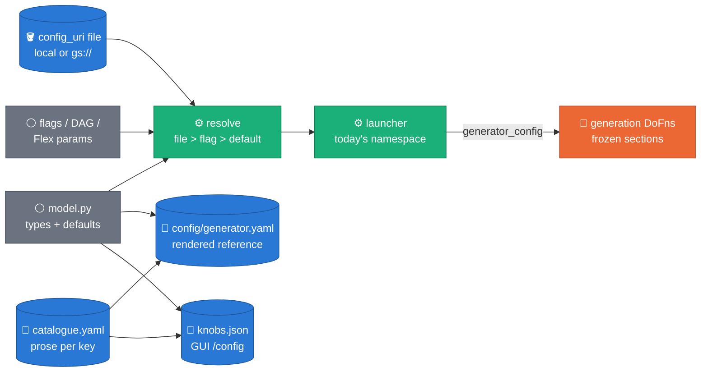

### D1 — What is settable

All 47 flags, and the 28 constants the GUI already showed as tunable knobs,
are fields of one model. Each flag keeps its CLI name inside its section
(`--similarity` is `generation.similarity`). Each constant takes its GUI knob
id (`free_text.pool_values_per_call`). The sections are the GUI's channels
plus `io` and `launch`: `io`, `launch`, `sampling`, `generation`, `free_text`,
`rag`, `guardrails`, `relational`, `serving`.

Three kinds of entry are documented but not settable:

- **Launch identity**, `launch.run_id`: a flag only, because it names one launch.
- **12 fixed values**: identities and versions (`sampling.profiler_version`, the embedder dimensions, the fallback embedder's identity), the gate's budgets and rules (set in `config/thresholds.yml`, or in code for the rule ids the gate counts), and the Composer-only machine params `gpu` and `sdk_containers`. `generation.generation_max_retries` is also here: no engine reads it (the retry ladder is `escalating_sampling()`), and it stays documented as unused until it is removed. *(Revised 2026-10-26: `gpu` and `sdk_containers` are now settable `serving` keys, with `launcher_machine_type`; ten fixed values remain. See [the revision](#revision-2026-10-26-the-yaml-holds-the-values).)*
- **2 derived values**: `generation.temperature_ladder` and `free_text.sampling_ladder`.

Every other internal constant stays in code. The module constants that were
promoted are deleted, so each value is typed once, and the defaults that were
duplicated (`PipelineConfig.batch_size`, `io/bq_sources.py`,
`io/fk_pools.py`, …) now read the model default.

### D2 — A typed model holds the values; a strict catalogue holds the prose

- **`sdfb_core/config/model.py`**: `GeneratorConfig`, one frozen [Pydantic](https://docs.pydantic.dev/latest/api/config/) model per section with `extra="forbid"` and `Field(ge=…, le=…)` ranges. mypy checks every read in `sdfb-core`, where the engines live. The module imports nothing from `sdfb_core`, so every other module may import it. *(Revised 2026-10-26: the model keeps the types and validators; the default values are the value lines of `generator.yaml`, which `defaults.py` loads. See [the revision](#revision-2026-10-26-the-yaml-holds-the-values).)*
- **`sdfb_core/config/catalogue.yaml`**: per dotted key, a label, group, purpose, what raising and what lowering it does, and optionally a tip, a formula, sources, ADRs, docs, `shapes_cache` (D8) and `null_means`. The `fixed:` and `derived:` blocks document the entries a file may not set, with `why_fixed`. `null_means` says what a null value means: for `free_text.pool_stagnation_min_novel` the derived `max(1, pool_values_per_call // 8)`, for `serving.vllm_max_model_len` no cap (the checkpoint's native context, which a T4 cannot hold).
- **The loader is strict**, like the evaluator's metric catalogue: an unknown or missing key is a load error, and a test enforces a 1:1 match between the model and the catalogue.
- **Two renders, both checked in CI**: `scripts/doc/render_generator_config.py` writes [`config/generator.yaml`](../../config/generator.yaml), every key with its default and explanation; `scripts/gui/export_knobs.py` writes `knobs.json` and `knob_guides.json` for the GUI. Each has a `--check` mode that fails on drift.
- **How values reach the code.** The launcher rebuilds the `argparse.Namespace` the rest of `run_pipeline.py` already reads, so no downstream flag code changes. Engines receive their frozen sections through `PipelineConfig.generator_config`, which is copied into the worker's `GenerationContext` and pickled into the DoFns with it. Pure helpers take a section as a keyword argument whose default is the model default.

### D3 — File wins

**Claim (Figure A):** a key set in the file wins over the same flag, which
wins over the model default.

*Mode 1 — no `config_uri` (every launch before this ADR).*

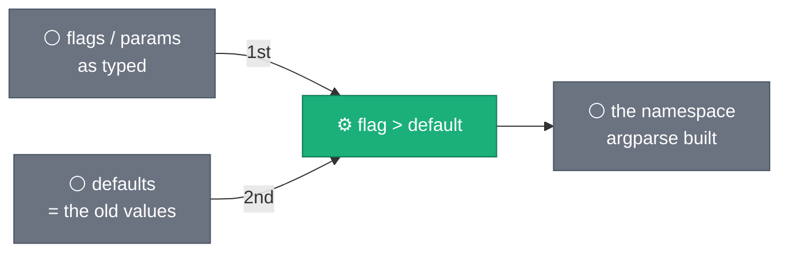

*Mode 2 — with `config_uri`.*

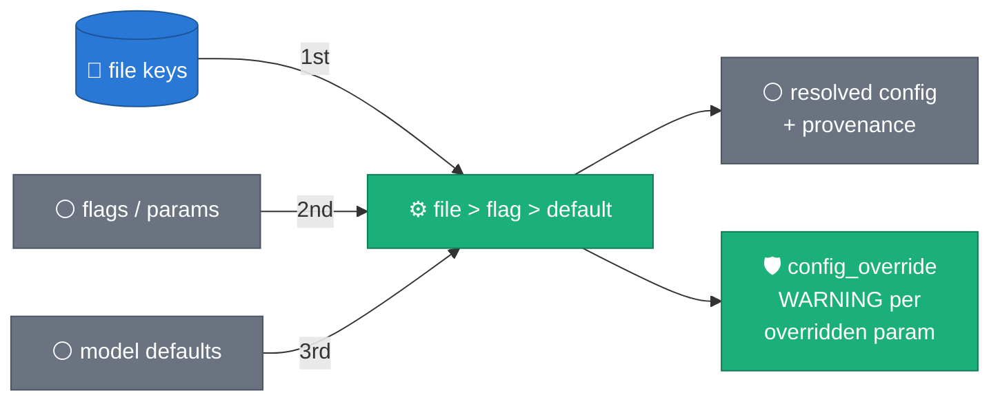

- A key the file sets wins over any flag or DAG param; flags fill only the keys the file leaves out. The Composer DAG passes every param on every trigger, so under this rule the file still decides what it sets. *(Revised 2026-10-26: the DAG now passes only the keys whose value differs from `generator.yaml`; the file still wins over every one of them. See [the revision](#revision-2026-10-26-the-yaml-holds-the-values).)*
- The parser is built with [`argument_default=argparse.SUPPRESS`](https://docs.python.org/3/library/argparse.html#argument-default), so a flag appears in the parsed namespace only when it was typed. That is what tells "typed" from "default" and makes the three-level order possible.
- Every key gets a provenance (`file`, `flag` or `default`). The launcher logs one line, `config_resolved uri=… file=N flag=N default=N`, and one `config_override key=… typed=… file=… (the file wins)` WARNING for each typed flag whose value the file replaced. A flag typed with the same value the file sets is not an override and gets no row.
- Files may be **sparse**: a file pins only the keys it lists. The reference file's header says so, because passing the whole reference pins every key and makes every flag a no-op.
- A `null` in the file on a key whose default is null (the required keys and `free_text.pool_stagnation_min_novel`) pins nothing: the reference shows those keys as null, so a block copied from it leaves them to the flags or the default, and their provenance is `flag` or `default`. A null on any other key is a value and wins like one (`serving.vllm_max_model_len: null` is no cap).
- Required flags (`reference_table`, `landing_table`, `dlq_table`, `num_rows`, `model_uri`) may come from either source; the launch fails only when neither supplies one. `run_id` must be a flag (D1).

### D4 — Every flag and param keeps working; `config_uri` is added everywhere

| Surface | How a file is passed |
| :-- | :-- |
| CLI | `--config_uri` (a local path or `gs://`) |
| Flex Template | the `config_uri` parameter (`docker/flex_template_metadata.json`; a `gs://` path ending `.yaml` or `.yml`) |
| Composer generation DAG | the `config_uri` param, blank by default |
| Terraform (the Dataflow Solution Guides copy) | the `config_uri` variable: a launch parameter of the Terraform-launched job, and `CONFIG_URI` for `scripts/04_run_dataflow.sh` |
| `public_cloud/deploy/gcp/tiers.yaml` | a commented `config_uri` example under `defaults.params`: uncomment it to pass a file |

A blank `config_uri` means "no file", exactly the earlier behaviour: the
Composer DAG passes `""` when the param is empty.

### D5 — IO belongs in the file: one file per environment

The `io` section holds the reference, landing, DLQ, `validation_runs` and
store tables, so one file describes a launch in one environment. Real
per-environment files are `config/*.local.yaml` (gitignored, because they
carry real project and table names) or live in GCS. The committed example
[`config/generator.personal.example.yaml`](../../config/generator.personal.example.yaml)
uses placeholder names.

### D6 — Flag fields mirror argparse exactly

A flag field has the same type, the same `choices` and the same default as
its argparse definition, including the string encodings argparse holds
(`"true"`, `""`, `"8192"`). It enforces no stricter constraint than argparse
does, so every value a launch accepted before still parses. YAML-native
values are coerced into those encodings on the way in: `true` becomes
`"true"`, `4096` becomes `"4096"`, a list becomes a comma-joined string
(`pk_cols`, `identity_cols`, and `landing_table`, whose flag takes a
comma-separated list).
PyYAML reads YAML 1.1, which resolves an unquoted `on`, `off`, `yes` or `no`
as a boolean ([YAML 1.1 boolean type](https://yaml.org/type/bool.html)). The
four choice fields with an `off` (`source_stats`, `prompt_debug`,
`freetext_expansion`, `prompt_constraints`) read `false` as `off`, and
`prompt_constraints`, the one with an `on`, reads `true` as `on`; `true` on
the other three is still refused. The reference file quotes every value YAML
would reinterpret (`'on'`, `'false'`, `'8192'`, `''`), and its header says to
keep them quoted.

This is what keeps a launch without `config_uri` unchanged. Goldens captured
from `master` at `edcfdcd` pin it on every change: the argparse namespace for
a matrix of argv, every promoted constant's value, and a DirectRunner run's
landed, DLQ and `validation_runs` rows.

### D7 — Errors fail the launch before any Dataflow work

Every error exits with argparse's status 2 and an `error: …` line, never a
traceback.

| Input | Message |
| :-- | :-- |
| An unreadable file (local typo, `gs://` without access) | `could not read --config_uri <uri>: <reason>` |
| An unknown section or key | `unknown key 'generation.similarty' — did you mean 'generation.similarity'?` (closest match by [`difflib.get_close_matches`](https://docs.python.org/3/library/difflib.html#difflib.get_close_matches)) |
| A key written at the top level (`similarity: 0.7`) | `unknown section 'similarity' — did you mean 'generation.similarity' (keys live under their section)?` when exactly one section holds that key |
| A wrong type or an out-of-range value (`rag.bge_max_length` above the checkpoint's 512 positions among them) | Pydantic's message, prefixed with the file and the dotted key |
| `sampling.top_values_max_distinct` above `free_text.free_text_max_categories` | a message naming both keys: a column with more distinct values is free text, and the stats would store its literal source values |
| `config_version` newer than supported | `this generator understands config_version <= 1, got 2` |
| Launch identity in a file | `launch.run_id is launch identity — pass it as a flag` |
| A fixed or derived key in a file | `<key> is not settable — <why_fixed from the catalogue>` |
| No `config_version` | treated as 1 |
| An empty section (`rag:` with no keys) | accepted as an empty mapping |

### D8 — The settings salt: a cache built under one value is never served under another

Four BigQuery stores persist work across runs: `source_table_stats`,
`freetext_pools`, `rag_chunks` and `fk_fanout_stats`. Their keys were built
from digests and model ids only, because the values that shape their content
were fixed constants. Once those values are settable, a run with a changed
value could silently reuse a store row built under the old one.

A catalogue entry therefore declares the stores it shapes (`shapes_cache`).
`settings_salt(config, cache)` compares each shaping key's effective value
with its default. When all are at their defaults the salt is the empty
string. Otherwise it is the first 12 hex digits of the SHA-256 of the
changed `{key: value}` pairs as sorted JSON. The salt suffixes a field the
key already has (`<field>+cfg.<salt>`), so no table schema changes, and at
the defaults **every existing key is unchanged**. A derived default counts by
its derived value, so a file that sets a shaping key to its default has
provenance `file` but leaves the salt empty.

**Claim (Figure B):** a cache key changes only when a value that shapes it
leaves its default.

*Mode 1 — every shaping key at its default (with or without a file).*

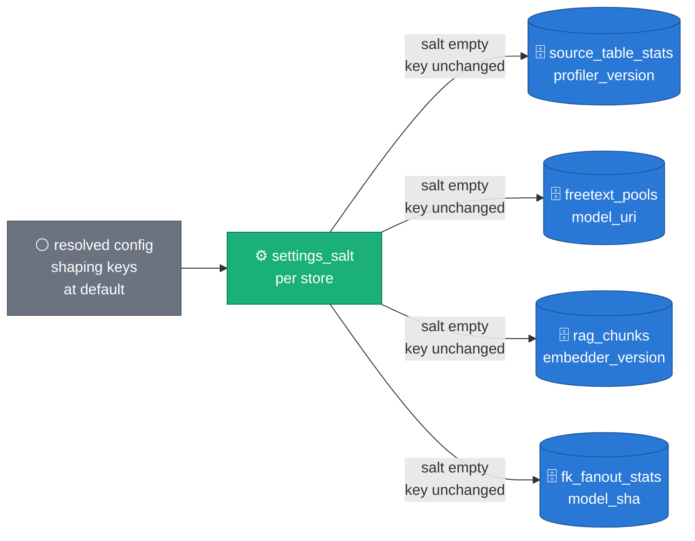

*Mode 2 — one shaping key off its default
(`free_text.pool_values_per_call: 16`, which shapes only the pools).*

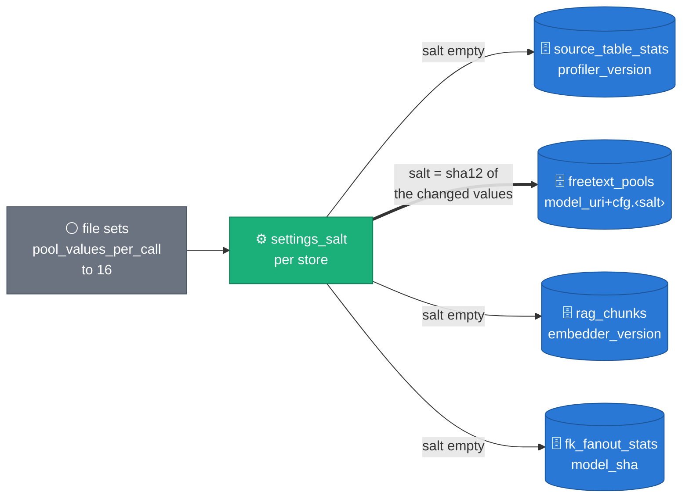

| Store | Field the salt suffixes | Where it is salted | Shaped by |
| :-- | :-- | :-- | :-- |
| `source_table_stats` | `profiler_version` (`2` → `2+cfg.<salt>`) | `stats_profiler_version()`, `sdfb_core/stats/source_stats.py` | the six `sampling.*` profiler constants (`top_values_max_distinct`, `top_values_top_k`, `shape_mix_top_k`, `length_percentiles`, `null_pattern_max_cols`, `null_pattern_top_k`) |
| `freetext_pools` | `model_uri` | `pool_store_model_key()`, `sdfb_core/config/salt.py`: the launcher's exists, taint and delete calls, the worker's fetch and the pool branch's write all go through it | 12 keys: the pool ladder (`free_text.free_text_pool_max`, `pool_values_per_call`, `pool_parallel_choices`, `pool_stagnation_window`, `pool_stagnation_min_novel`, `pool_format_collapse_rounds`, `source_domain_cap`), the column routing (`free_text_unique_ratio`, `free_text_min_mean_len`, `free_text_max_categories`), `rag.max_free_text_values_per_column` and `rag.rag_top_k` |
| `rag_chunks` | `embedder_version` | `resolve_embedder_identity()`, `sdfb_beam/cli/run_pipeline.py`, salted once so the population branch and the engine's store read agree | the column routing, `rag.max_free_text_values_per_column`, `rag.bge_max_length` |
| `fk_fanout_stats` | `model_sha` (the relationship model's sha12) | the fan-out measurement's cache read and write, `sdfb_beam/cli/run_pipeline.py` | the column routing |

The nine other promoted constants (the two temporal floors, the pool build's
worker count, the embedder's free-VRAM floor, the repeat-share tolerance, the
FK key-sample floor, ceiling and margin, and the cap on a fan-out request's
values) change how work is done or checked, not what a store holds, so they
shape no store. A test pins the mapping.

## Revision 2026-10-26: the yaml holds the values

The release is unreleased, so this ADR is amended in place. The D1–D8 text
above stays as decided on 2026-10-20; where it no longer holds, an italic
note points here.

**Claim:** every default of every launch surface is a value line of one
file, `generator.yaml`; an environment and a launch override it in layers,
and the Composer DAG passes only what differs.

### R1 — `generator.yaml` holds the default values

The value lines of
[`sdfb_core/config/generator.yaml`](../../packages/sdfb-core/src/sdfb_core/config/generator.yaml)
are the defaults. The file ships inside the sdfb-core package, so the image,
the wheel and the Solution Guides copy carry it; `config/generator.yaml` at
the repository root is a symlink to it. `sdfb_core/config/defaults.py` loads
it (`load_defaults`), and `model.py` keeps the types, ranges and validators
and no value. The comments are still rendered from `catalogue.yaml`:
`scripts/doc/render_generator_config.py --check` fails on a stale comment and
`--fix` rewrites the comments and never a value.

### R2 — Four layers, file wins

**Claim (Figure C):** a key takes the value of the highest layer that sets
it; the image and the DAG read the same `generator.yaml`.

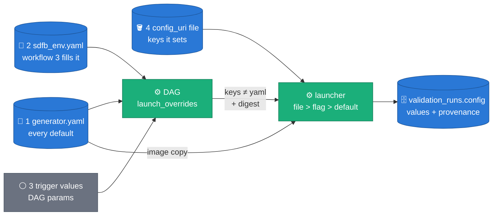

The order is `generator.yaml` < `composer/sdfb_env.yaml` < the trigger's
values < the `config_uri` file. On the CLI the overlay is absent: the
flags override `generator.yaml` and the file overrides the flags; an
operator can pass an environment's values as a `config_uri` file. The
provenance names are unchanged: a key the DAG passed is `flag`, a key the
file set is `file`, every other key is `default`.

- **The overlay.** [`composer/sdfb_env.yaml`](../../composer/sdfb_env.yaml)
  holds the generation DAG's 18 deploy markers, the same 18 master's DAG
  carried, under three sections: `dag:` (`project_version`, `dag_version`),
  `infra:` (the staging and templates buckets) and `config:` (section → key
  over `generator.yaml`: the default source, landing, DLQ, DDL-pin,
  validation-runs and three store tables, `engine`, `embedder_uri`, `env`,
  `write_disposition`, `model_uri` and `gpu`). Every value is a quoted
  string, so a substituted `prd`, `append`, `l4`, `0.7.0_20261026T1200` or
  `''` stays that string. `composer/sdfb_batches.py::load_layers` reads both
  files from the DAG's own folder at parse time and refuses an overlay key
  `generator.yaml` does not have. The DAG's id
  (`synthetic_sdfb_<dag_version>`), its Flex Template
  (`sdfb-<project_version>-template.json`), its buckets and job names come
  from the overlay (`dag_constants`). The DAG file itself carries no marker:
  workflow 3 runs its `sed` on the overlay alone and imports the DAG,
  `sdfb_batches.py`, `generator.yaml` and the overlay side by side
  ([RUN_PLAYBOOK §0b](../RUN_PLAYBOOK.md#0b-workflow-3-for-the-one-generation-dag-untracked-workflows)).
- **What the DAG passes** (`launch_overrides`): each key whose text differs
  from `generator.yaml`'s, whether the overlay or the trigger set it, plus
  `run_id`, `config_uri` when set, and `generator_defaults_digest`. A key the
  trigger sets back to `generator.yaml`'s value is not passed even where the
  overlay set another, because the launcher's default is that value. A key
  the launch's mode does not read is left out (`reference_table`,
  `landing_table` and `ddl_uri` under `tables=all`; `source_dataset` and
  `landing_dataset` under `explicit`).
- **The file's hardware keys** (Rulings R16, R16b). The machine, the
  accelerator, the SDK-container experiment and the launcher VM belong to
  the Flex launch, which the DAG builds itself (`launch_environment`), not
  the launcher. So when a trigger names a `config_uri`, the DAG reads the
  file once and lays its `serving.client_type` (`vllm` | `fake`),
  `serving.gpu` (`l4` | `t4`), `serving.sdk_containers` (`multi` | `single`)
  and `serving.launcher_machine_type` (non-empty text) over the params before
  it builds any launch body (`with_file_hardware`). A file's `gpu: t4` thus
  launches a T4 machine, and a file's `client_type: fake` a CPU machine with
  no accelerator, as the file says. Any other value fails the DAG's `route`
  task once (a `PlanError`, never retried). Without `config_uri` the DAG reads
  nothing from GCS for an explicit launch, as master's DAG read nothing.

### R3 — The defaults digest

**Claim (Figure D):** a DAG imported from another commit than the image's
says so in the launcher log.

*Mode 1: the DAG's `generator.yaml` is the image's.*

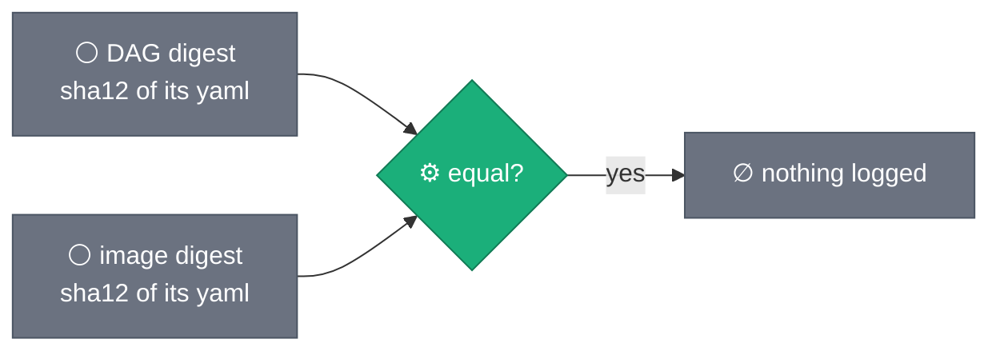

*Mode 2: they differ.*

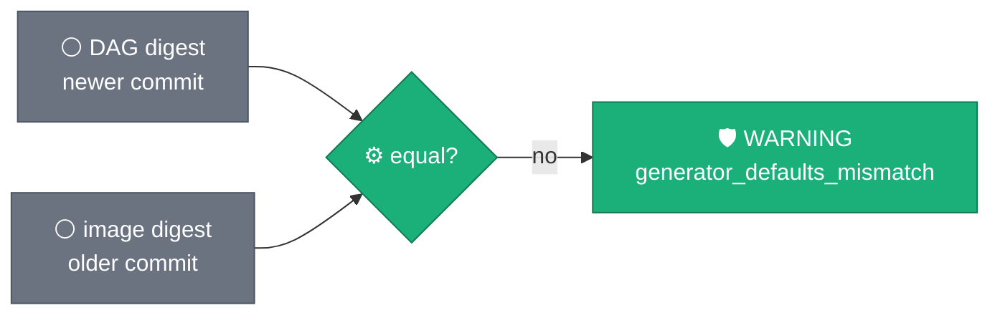

The digest is the first 12 hex characters of the SHA-256 of the file's
bytes (`defaults.py::defaults_digest`, mirrored by `load_layers`). The DAG
passes it as `--generator_defaults_digest`; the launcher compares it with the
image's and logs `SDFB_MILESTONE name=generator_defaults_mismatch dag=
image=` at WARNING when they differ (`run_pipeline.py::log_defaults_mismatch`).
Nothing is logged on a match, or when no digest was given (a CLI launch). A
key the DAG did not pass takes the image's value, so a mismatch means a key
whose default changed between the two commits may not be the one the DAG
showed. The digest is launch identity, a flag only (a file that sets it is
refused), and the snapshot records the image's as
`config.launcher.defaults_digest`. Byte identity is the test (Ruling R9): a
comment-only difference between the two files also logs the WARNING. The
warning is advisory, and the comments are rendered from the catalogue, so a
comment change is a catalogue change between the two commits.

### R4 — Three DAG-only machine knobs become `serving` keys

| Key | Default | Flag | The DAG turns it into | The launcher |
| :-- | :-- | :-- | :-- | :-- |
| `serving.gpu` | `l4` (the overlay sets the environment's) | `--gpu` (`l4` \| `t4`) | `g2-standard-8` + the L4 accelerator, or `n1-standard-8` + the T4 accelerator (with `client_type` `vllm`) | derives `vllm_dtype` from it (R5) and records it |
| `serving.sdk_containers` | `multi` | `--sdk_containers` (`multi` \| `single`) | `no_use_multiple_sdk_containers` under `single` (vLLM launches only) | records it; a direct launch passes Beam's experiments itself |
| `serving.launcher_machine_type` | `e2-standard-8` | `--launcher_machine_type` | the Flex launch's `launcherMachineType` | records it |

All three are settable from a file (R2's hardware keys); `gpu` and
`sdk_containers` leave D1's fixed list, which keeps ten entries. A DAG launch
passes each only when it differs from `generator.yaml`; the Flex Template
declares the three and the digest, so the template must be rebuilt before the
DAG is re-imported.

**Claim (Figure E):** one key picks the GPU workers' machine, accelerator
and, unless set, the dtype. One panel per mode (`client_type` `vllm`; with
`fake` the launch takes `e2-standard-8` and no accelerator on either).

*`serving.gpu: l4` (the default).*

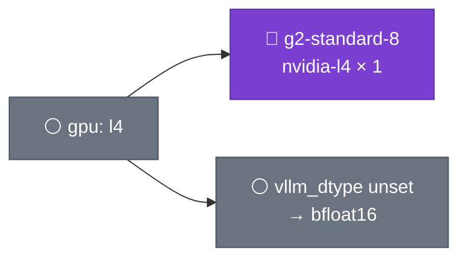

*`serving.gpu: t4`.*

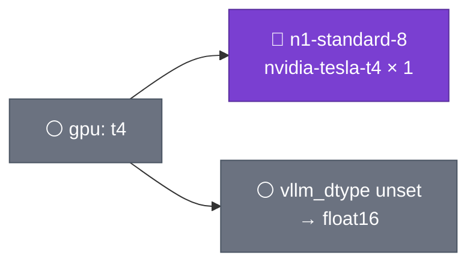

**Claim (Figure F):** `sdk_containers` changes only the workers' SDK-process
topology.

*`serving.sdk_containers: multi` (the default).*

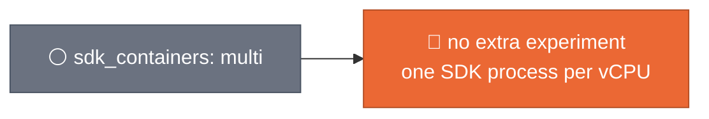

*`serving.sdk_containers: single`.*

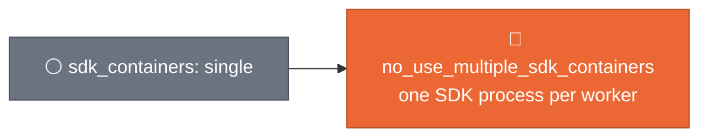

`launcher_machine_type` has no modes: its value is the launcher VM's machine
type, which must hold the image pull and the table prep inside the Flex
launcher's 12 minutes.

### R5 — `vllm_dtype` follows the GPU

*`serving.vllm_dtype: null` (the default) is derived from `serving.gpu`; an
explicit value wins on either GPU.*

| `serving.gpu` | `vllm_dtype` unset (null) | `vllm_dtype` set |
| :-- | :-- | :-- |
| `t4` | `float16`: a T4 (compute capability 7.5) has no bfloat16 | the set value |
| `l4` | `bfloat16`: a bf16 checkpoint keeps its own precision | the set value |

The value is vLLM's
[`--dtype` engine argument](https://docs.vllm.ai/en/latest/configuration/engine_args.html)
(`auto` is the checkpoint's own dtype). The derivation is
`model.py::DTYPE_OF_GPU` and `ServingSettings.effective_vllm_dtype`; the
launcher logs `SDFB_MILESTONE name=vllm_dtype_resolved dtype= gpu= source=`,
where `source` is `derived` for a null, else the key's provenance (`flag`,
`file`). The derivation does not loosen the Gemma guard: an explicit
`float16` for a Gemma checkpoint is still refused before vLLM starts,
because fp16 Gemma silently emits empty output
([`google/gemma-3-4b-it` discussion #33](https://huggingface.co/google/gemma-3-4b-it/discussions/33),
[vLLM issue #40290](https://github.com/vllm-project/vllm/issues/40290);
`vllm_client.py::_assert_dtype_supported`, RUN_PLAYBOOK §1).

*Rejected:* keeping the DAG's `float16` as the L4 default. It reproduces
master's L4 launch, but it serves bf16 checkpoints in fp16 on a GPU that has
bf16, and it keeps two defaults for one key on two surfaces, which this ADR
exists to remove. A launch that needs master's L4 dtype sets
`serving: {vllm_dtype: float16}` in its file (RUN_PLAYBOOK §2d's parity
control).

### R6 — What changes from `master`, on purpose

The master goldens (`packages/sdfb-tests/tests/fixtures/config_parity/`,
captured at `edcfdcd`) are never regenerated. The differences are one table
in code, `sdfb_tests/config_parity.py::DELIBERATE_CHANGES`, which the golden
comparison applies before it compares, and nothing else:

| Key | Master's CLI | Now (`generator.yaml`) | Effect |
| :-- | :-- | :-- | :-- |
| `generation.num_rows` | required | `1000` | the CLI no longer requires it; master's DAG already defaulted it to 1000 |
| `rag.build_rag_layer` | `''` | `'true'` | builds the RAG layer when `rag_chunks_table` is set; a no-op without it |
| `free_text.build_pool_layer` | `''` | `'true'` | builds the pools when `freetext_pools_table` is set; a no-op without it |
| `serving.vllm_dtype` | `auto` | null, derived from `serving.gpu` (R5) | an L4 DAG launch moves from master's `float16` to `bfloat16`; a CLI L4 launch from `auto` to `bfloat16`; T4 stays `float16` |
| `serving.gpu` | absent (a DAG param) | `l4` | none: master's DAG took it from the `{{GPU}}` marker, and the overlay still does |
| `serving.sdk_containers` | absent (a DAG param) | `multi` | none: master's DAG default |
| `serving.launcher_machine_type` | absent (a DAG param) | `e2-standard-8` | none: master's DAG default |

The two build layers' no-op is the default's (Ruling R8): a typed
`--build_rag_layer=true` without `--rag_chunks_table`, or
`--build_pool_layer=true` without `--freetext_pools_table`, is still refused
at parse time, as on master (`run_pipeline.py::parse_args`). A file's `true`
without its table is the no-op too.

Every flag added since `v0.6.1` made some of master's abbreviations
ambiguous. Hidden aliases keep master's unambiguous prefixes of three or more
characters on the same flag (`--lan…` → `--landing_table`, `--bat…` →
`--batch_size`, `--gen…` → `--generate_fk_relationships`); they never appear
in `--help` or on a launch surface (`run_pipeline.py::_FLAG_ALIASES`, pinned
by `fixtures/config_parity/abbreviations.json`).

### Acceptance criteria of the revision

7. **AC-A1-7** An explicit DAG launch without `config_uri` resolves like
   master's except for `DELIBERATE_CHANGES`, and reads nothing from GCS
   (`test_launch_helpers.py::test_explicit_launch_resolves_like_master`,
   `test_generation_dag.py::test_route_reads_gcs_only_for_a_config_file_or_a_whole_model_launch`).
8. **AC-A1-8** The overlay's substituted values parse to exactly those
   strings (`test_overlay_values_survive_yaml_after_substitution`).
9. **AC-A1-9** A DAG digest that differs from the image's logs
   `generator_defaults_mismatch` with both
   (`test_defaults_digest.py::test_mismatched_digest_warns_with_both`).
10. **AC-A1-10** An explicit `vllm_dtype` wins over the GPU derivation, and the
    launcher logs the dtype and why
    (`test_serving_launch_keys.py::test_explicit_vllm_dtype_wins_over_the_gpu_derivation`).
11. **AC-A1-11** Every abbreviation of three or more characters that master
    accepted reaches the same flag
    (`test_flag_abbreviations.py::test_every_master_abbreviation_reaches_the_same_dest`).

## Alternatives rejected

- **YAML holds everything: values and prose in one file, no typed model.** One file to edit, and the GUI and the reference read it directly. But the values would be untyped until runtime: an engine's read of a misspelt key, or of a string where it expects an int, fails on a Dataflow worker instead of under mypy on a laptop, and the types would be declared again in every loader that reads the file. D2 splits the two: values in the typed model, prose in the catalogue, and a 1:1 test so neither can drift from the other.
- **A process-global registry: a settings singleton any module reads.** It would change the fewest signatures. But Beam serializes user code and runs it in other processes on other machines ([Beam programming guide, "Requirements for writing user code"](https://beam.apache.org/documentation/programming-guide/#requirements-for-writing-user-code-for-beam-transforms)): a global set on the launcher is not set on a worker unless something ships it, and a module that reads it has a dependency no signature shows. Every test would have to set and restore process state around each case. D2 passes the frozen config explicitly: through `PipelineConfig` into the pickled `GenerationContext`, and as a keyword argument to pure helpers.
- **Flag wins: file < flags < defaults.** This is the usual order for a CLI that reads a config file, commonly built by loading the file into [`ArgumentParser.set_defaults()`](https://docs.python.org/3/library/argparse.html#argparse.ArgumentParser.set_defaults) so that a typed flag overrides it. It fails here because the Composer DAG passes every param on every trigger, with its own defaults: under flag-wins the file could never set a key the DAG passes, so from Composer it could not set any of the DAG's own params. File wins costs a surprise for an operator who types a param the file also sets; the `config_override` WARNING and the per-key provenance name every such case.
- **Slimming the launch surfaces now: a config file as the only channel, the flags and DAG params removed.** One channel and no precedence question. But it would break every existing launch at once (Composer triggers, the Terraform module, the `tiers.yaml` runs, the Solution Guides scripts), it would force a DAG re-import and a template rebuild before any launch could run again, and a launch without a file would no longer behave as it did. D4 keeps every surface. Slimming stays possible once launching with a file is the habit.

## Consequences

- **Enables:**
  - **One file per environment.** A sparse file pins what differs between environments (tables, model, dtype, tier) and the flags supply the rest. Launches from the CLI, Flex, Composer and Terraform read the same file.
  - **A reference for every setting.** [`config/generator.yaml`](../../config/generator.yaml) lists every key with its default, what raising and lowering it does, its flag and its ADRs. It is rendered, never edited, and CI fails when it drifts from the model or the catalogue.
  - **Constants become launch-time settings.** The 28 promoted constants change with a file edit instead of a code edit and an image rebuild.
  - **The GUI says where a knob is set.** `/config` takes every explanation from the catalogue and shows 17 IO and identity settings it did not show before, in two new channels, `io` and `launch`. A knob's sheet has a "Config file" row with its dotted key. A promoted constant reads "Set in a config file as `<key>` — no flag." where it read "Fixed constant"; a fixed value still reads "Fixed constant". Eighteen constant tips changed from "A constant: changing it is a code edit, a test run and an image rebuild." to "Set it in a config file (--config_uri); a cache it shapes is rebuilt under the new value." The GUI's parity test lists exactly those eighteen, and the rewritten purpose, raise and lower of `sampling.shape_mix_top_k` and `sampling.length_percentiles` (their master text promised a shape-expander and a prompt effect; both change only the `source_table_stats` rows), as the intended difference from `master`.
- **Costs:**
  - **A non-default cache-shaping value makes its store cold.** The first launch under it rebuilds that store's rows: pools spend LLM time again, chunks are re-embedded, stats re-profiled (one BigQuery scan at `source_stats=exact`), fan-out re-measured. A later launch with the same values is warm again (same salt), and a launch back at the defaults finds the original rows. Each distinct salt adds its own rows to the store, and nothing prunes them.
  - **File wins can surprise an operator** who types a param the file also sets. The `config_override` WARNING names each one.
  - **A deployment needs a rebuild to use it.** The image and the Flex Template must be rebuilt for the `config_uri` parameter, and the Composer DAG re-imported for its param. A DAG that is not re-imported keeps working as before. Rebuild the Flex Template before re-importing the Composer DAG: the DAG always forwards `config_uri`, which an old template does not declare. *(Revised 2026-10-26: the DAG forwards `config_uri` only when it is set, and `generator_defaults_digest` on every launch, which an old template does not declare either; the order stands. See [the revision](#revision-2026-10-26-the-yaml-holds-the-values).)*
  - **The chained evaluation does not read the file.** The Composer DAG builds the evaluation's inputs from its own params: the seed table from `table_fqn`, the reference dataset from `source_dataset` (or `table_fqn`), the landing dataset from the landing-table marker, `relationships_uri` and `generate_fk_relationships` from their params, and `reference_rows_limit` fixed at 10000. A file that sets `io.reference_table`, `io.landing_table`, `relational.relationships_uri`, `relational.generate_fk_relationships` or `sampling.reference_rows_limit` therefore generates one thing and evaluates another. The launcher logs one `config_sets_evaluation_input key=… (no generation record is written — <reason> — so a chained evaluation reads the DAG param, not the file)` WARNING per such key; the structural fix is the generation record (below), which the evaluation can read instead of the params. *Resolved by [ADR 0044](0044-generation-record.md): when the launch writes its generation record, the chained evaluation takes these inputs from `validation_runs`; the WARNING is now logged only when no record is written.*
  - **The Composer DAG keeps its own param defaults.** It cannot import `sdfb-core`, so its defaults stay where they were (including `vllm_dtype` `float16` against the CLI's `auto`), pinned by the launch-surface parity tests. A file that sets the key decides it for both. *(Superseded 2026-10-26: the DAG reads its defaults from a copy of `generator.yaml` in its own folder, and the two surfaces now share `vllm_dtype`'s derivation from the GPU. See [the revision](#revision-2026-10-26-the-yaml-holds-the-values).)*
  - **`generation.generation_max_retries` is documented as unused** (fixed, read by no engine) until it is removed.
- **Depends on the generation record.** Under a non-default pool-shaping value the pools are stored under the salted `model_uri`. The evaluator reads pools by `(reference_digest, model_uri)` with the unsalted URI, so it does not find them: its pool-memorization metrics read as not evaluated, for the wrong reason. The GUI's RAG pages show a salted `embedder_version` as a separate embedding set. The evaluator cannot import the salt ([ADR 0041](0041-evaluation-standalone-package.md)), so the next phase, the generation record, carries the effective cache keys in `validation_runs` for the evaluator and the GUI to follow. This ADR and that record ship in one release; neither ships alone. At the defaults nothing is salted and nothing is affected. *Resolved by ADR 0044: the record carries `derived.cache_keys` and the evaluator binds `cache_keys.freetext_pools`.*
- **Forbids:**
  - a second copy of a default or an explanation (the 1:1 test and both `--check` renders fail);
  - a promoted constant read from anywhere but the config (the module constants are deleted);
  - launch identity, a fixed value or a derived value set from a file;
  - a setting that shapes a store without declaring it in `shapes_cache` (the mapping is pinned by a test).

## Acceptance criteria

1. **AC-A1-1** With no `config_uri`, the three goldens captured from `master` (argparse namespaces, constant values, a DirectRunner run's landed, DLQ and `validation_runs` rows) reproduce exactly.
2. **AC-A1-2** `config/generator.yaml` equals its render, and the model and the catalogue match 1:1.
3. **AC-A1-3** A file setting `generation.similarity: 0.7` with `--similarity 0.3` typed resolves to 0.7 with provenance `file` and one `config_override` WARNING.
4. **AC-A1-4** Every error in D7 fires with its documented message.
5. **AC-A1-5** Default values leave every store key unchanged; a non-default store-shaping value changes that store's key only.
6. **AC-A1-6** `knobs.json`, built from the model and the catalogue, keeps every existing knob id and value; the generator guides are gone from `config.ts`; the GUI gate passes.

## Figures

The twelve figures above are inline mermaid in the repository's house style
(node classes and icons as in `.claude/skills/visual-first-documentation/`).
They carry no measured number: the shape, both resolution modes and both salt
modes are read from the code in `sdfb_core/config/`; the revision's four
layers (Figure C) and both digest modes (Figure D) from `sdfb_core/config/defaults.py`,
`composer/sdfb_batches.py` and `run_pipeline.py::log_defaults_mismatch`; the
GPU and SDK-container panels (Figures E, F) from
`composer/sdfb_batches.py::launch_environment` and `model.py::DTYPE_OF_GPU`.
Figure A also appears in [`docs/DESIGN.md` §8](../DESIGN.md#8-configuration),
Figure C too. Sources retrieved 2026-10-21; the revision's (vLLM's `--dtype`,
the two Gemma fp16 reports) 2026-10-27.
