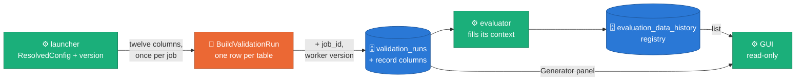
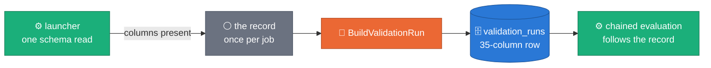
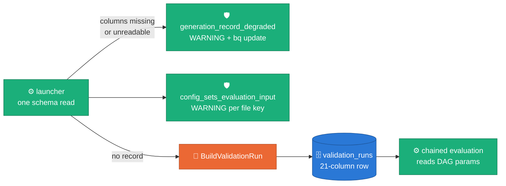

# ADR 0044 — The generation record: `validation_runs` records what generated it

**Status:** Accepted (2026-10-21). Built and tested on a laptop with the fake client and the DirectRunner; the Dataflow acceptance (AC-A2-5) is the corp run of [RUN_PLAYBOOK §2d](../RUN_PLAYBOOK.md#2d-corp-acceptance-of-the-generation-record-a2). Built in phase A2 of the config, record and model-launch work (the phase design is local to the branch and not committed).
**Design:** [`docs/DESIGN.md` §7.1 The generation record](../DESIGN.md#71-the-generation-record)
**Code:** [`sdfb_core/record.py`](../../packages/sdfb-core/src/sdfb_core/record.py) (the columns, the snapshot, the digest) · [`sdfb_core/version.py`](../../packages/sdfb-core/src/sdfb_core/version.py) (`generator_version`) · `sdfb_beam/cli/run_pipeline.py` (`record_supported`, `prepare_record_base`, `finish_record`) · `sdfb_beam/pipeline.py` (`_BuildValidationRunDoFn`) · `sdfb_beam/io/gce_metadata.py` (`read_job_id`) · [`scripts/config/config_digest.py`](../../scripts/config/config_digest.py) (the replay check)
**Builds on:** [ADR 0043](0043-generator-config.md) (the resolved config this record snapshots, and the two consequences it left open) · [ADR 0041](0041-evaluation-standalone-package.md) (the standalone evaluator that reads the record without importing the generator) · [ADR 0042](0042-self-hosted-platform-gui.md) (the read-only GUI that shows it)
**Operations:** [RUN_PLAYBOOK §0a](../RUN_PLAYBOOK.md#0a-workflow-edits-for-the-generation-record-untracked-workflows) (workflow edits) · [§2c](../RUN_PLAYBOOK.md#2c-read-the-generation-record) (read the record) · [§2d](../RUN_PLAYBOOK.md#2d-corp-acceptance-of-the-generation-record-a2) (corp acceptance) · [`DEPLOYMENT_PREREQUISITES.md`](../DEPLOYMENT_PREREQUISITES.md) (both migrations)

## Context

**The evaluation could not say what it evaluated.** The GUI's evaluation list
reads the evaluator's registry view `evaluation_latest`, never
`validation_runs`, and most of its generation cells were empty. Both Composer
evaluations, the chained one and the standalone DAG, pass `seed_table` and
`generation_job_id`, which selects the evaluator's job-only path. That path
fetched the Dataflow job, whose display data carries the engine, model,
embedder, seed, similarity, retrieval, rows, tier and env, and then kept only
the job's identity, so only the four manual parameters reached the registry,
and of the list's generation cells only the reference-row limit filled. The evaluator did find the
generation's `validation_runs` rows, but it selected eight columns and never
read the engine, model or env, and the table had no column for the embedder,
retrieval, similarity, seed or tier at all.

**The generator had no version.** Every pyproject and both `__version__`
strings say `0.1.0`; a release existed only as a git tag. The only build stamp
was `SDFB_BUILD_COMMIT`, baked from a Docker build argument and logged by
`log_build_info`: no branch, no version, never stored. `.git` never reaches the
image, and the release Action tags its own report commit.

**ADR 0043 left two consequences open.** A config file that changes the
tables, the relationship model or the reference-row limit generates one thing
while the chained evaluation, which reads its DAG params, evaluates another
(A1 only warned: `config_sets_evaluation_input`). And a non-default pool
setting salts the free-text pool store key, which the evaluator cannot
compute ([ADR 0041](0041-evaluation-standalone-package.md): it imports nothing
from the generator), so it looked for the pools under the wrong key.

## Decision

**Claim:** a `validation_runs` row says what generated it — the Dataflow job,
the code version and the whole resolved config — and a table without the
columns still gets its row.

### D1 — Fourteen NULLABLE columns, appended

*The launcher writes the record once per job; the evaluator and the GUI read it
instead of logs and DAG params.*



The schema file
[`validation_runs.schema.json`](../../config/bq_schema/synthetic_data_quality/validation_runs.schema.json)
appends them after the 21 existing columns (`RECORD_COLUMNS` in
`sdfb_core/record.py`). The launcher builds twelve once per Dataflow job
(`finish_record`, just before the job's graph is built); the record travels
pickled into the summary DoFn, and every table of the job writes the same
record. A worker adds the other two in `setup()`.

| Column | Value | Written by |
| :-- | :-- | :-- |
| `job_id` | the Dataflow job id, read from the GCE metadata server: attribute `job_id`, then `dataflow_job_id`, one second each, only when the launch ran on Dataflow; NULL otherwise or when neither answers | worker |
| `job_name` | the job name the launcher ran the job under; NULL on the DirectRunner | launcher |
| `launch_run_id` | the launch's base run id, shared by every table of the launch | launcher |
| `generator_version` | the worker's version (D3): its code produced the rows | worker |
| `launched_at` | the launcher's clock when the job's graph was built; `created_at` stays the row write time | launcher |
| `embedder_uri` | `rag.embedder_uri` | launcher |
| `retrieval_method` | `free_text.pool_seed_strategy` for `b1_rag`; NULL for `b2_library` | launcher |
| `similarity` | `generation.similarity` | launcher |
| `seed` | `generation.seed`; `derived` when none was given, as the registry spells it | launcher |
| `source_stats` | `sampling.source_stats`, the stats tier | launcher |
| `relationships_uri` | `relational.relationships_uri` as resolved | launcher |
| `relationships_digest` | sha12 of every loaded relationship model (the `relationships_loaded` sha); NULL without a model | launcher |
| `config_digest` | sha12 of the snapshot's `values` as canonical JSON: same digest, same generator config | launcher |
| `config` | the snapshot (D2), as JSON text | launcher |

`engine`, `model_uri`, `env`, `num_rows_requested`, `reference_table` and
`landing_table` already existed and keep their meaning. `config` is a STRING,
like `dlq_by_rule`: BigQuery's JSON functions read a STRING the same way
([`JSON_VALUE`, `JSON_QUERY`, `PARSE_JSON`](https://cloud.google.com/bigquery/docs/reference/standard-sql/json_functions)).

### D2 — The snapshot: `values` replays the launch

`config` holds ten blocks (`build_snapshot`):

| Block | Holds |
| :-- | :-- |
| `config_version` | the config model's version (1) |
| `values` | every section of the resolved config (`io`, `launch`, `sampling`, `generation`, `free_text`, `rag`, `guardrails`, `relational`, `serving`), launch identity (`launch.run_id`) left out |
| `provenance` | `file`, `flag` or `default` per dotted key |
| `overridden` | every typed param the file replaced: key, typed value, file value |
| `derived` | what the launch derived: the temperature ladder, the profiler version, and `cache_keys` (the key each store was read and written under: `freetext_pools`, `rag_chunks`, `source_stats`, `fk_fanout_stats`) |
| `thresholds` | the thresholds file, its env and the blocker ratio applied |
| `relationships` | the relationship model's URI, name and sha12, and this launch's tables as the model declares them |
| `beam` | the runner and the Dataflow options the job ran with (network tags left out) |
| `launcher` | the launcher's `version` |
| `batch` | `null`; reserved for whole-model launches, which record `{index, count, tables}` |

- **Replay.** `values` alone is a valid `--config_uri` file (the run id stays
  a flag; derived defaults are written `null`, which a file reads as "not
  pinned"). Resolving it gives the same resolved config and the same
  `config_digest`; `scripts/config/config_digest.py <file>` prints a file's
  digest, and the GUI's "Download as config.yaml" writes `values` under a
  comment naming the run.
- **The model is embedded**, not only its URI: a `gs://` model file can be
  overwritten after the run.
- **Compatibility.** Readers ignore keys they do not know and fall back to the
  row's typed columns when `config` is NULL or not a JSON object; rows written
  before this ADR have NULL record columns. A later `config_version` gets a
  migration in `sdfb_core/config/resolve.py`.

### D3 — `generator_version` = `<base>-<branch>-<sha7>[-dirty]`

```text
0.6.1-master-edcfdcd                    a build of master
0.6.1-feat-config-record-model-<sha7>   a build of this branch, its name cut to 24 characters
0.6.1-master-edcfdcd-dirty              a checkout with uncommitted changes to tracked files
```

- **Base:** `GENERATOR_VERSION_BASE` in `sdfb_core/version.py`. The release
  Action stamps the tag's version there
  (`scripts/release/bump_generator_version.py`, step "Stamp the generator
  version" of `release_tag_report.yaml`) in the commit it tags, so a tagged
  checkout carries its own version.
- **Branch and commit**, the first source that answers: `git` when the package
  sits in a checkout (laptop, M4, DirectRunner; two-second timeout), then the
  image's `SDFB_BUILD_COMMIT` and `SDFB_BUILD_BRANCH`, then `unknown`.
- **Cleaning:** characters outside `[A-Za-z0-9._-]` become `-`, the branch is
  cut to 24 characters, a detached HEAD reads `detached`, `-dirty` marks
  tracked changes. Computed once per process.
- **The image:** `docker/Dockerfile` declares `GIT_COMMIT_ARG` and the new
  `SDFB_BUILD_BRANCH_ARG` after the `uv sync` layer, so a per-commit value
  never invalidates the cached install.
- **The pyprojects stay at `0.1.0`** (Alternatives).
- `log_build_info` logs the version as `build_info … version=` on the launcher
  and every worker. The evaluator keeps its own `EVALUATOR_VERSION`.

### D4 — Degrade, never reject

*A table without the record columns gets today's row and one WARNING; nothing
fails.* One panel per state of the table.

*Migrated: the table has all 35 columns.*



*Not migrated: 21 columns, or a schema the launcher cannot read.*



When `--validation_runs_table` is set, the launcher reads the table's schema
once per launch (`record_supported`). A table that lacks a record column gets
one `generation_record_degraded … reason=missing_columns missing=…` WARNING
carrying the one command that adds them
([`bq update --schema`](https://cloud.google.com/bigquery/docs/managing-table-schemas),
`bq_update_command`); a schema that cannot be read (no `bigquery.tables.get`, a
typo, no credentials) gets `reason=schema_unreadable`. Either way the job
writes today's 21-column row, which FILE_LOADS accepts, instead of a wider row
rejected at the end of a long job, and the landed rows do not depend on the
record. Only then does the launcher log `config_sets_evaluation_input`, once
per evaluation input the file set (`io.reference_table`, `io.landing_table`,
`relational.relationships_uri`, `relational.generate_fk_relationships`,
`sampling.reference_rows_limit`): without a record the chained evaluation
still reads its DAG params. A launch without `--validation_runs_table` writes
no row and logs the same per-key WARNING. On a worker nothing raises either: a
metadata read that fails leaves `job_id` NULL (milestone
`generation_record_job_id source=none`), and a worker whose version differs
from the launcher's logs one `generator_version_mismatch` WARNING and records
its own.

### D5 — The evaluator reads the record first

*Each source fills only what the earlier ones left open; the caller's tables
are never replaced inside the context.*

```mermaid
flowchart LR
  classDef beam  fill:#eb6834,color:#fff,stroke:#b44f26
  classDef cpu   fill:#1baf7a,color:#fff,stroke:#127a55
  classDef gpu   fill:#7a3fd1,color:#fff,stroke:#5a2f9d
  classDef store fill:#2a78d6,color:#fff,stroke:#1d5599
  classDef data  fill:#6b7280,color:#fff,stroke:#4b5563

  subgraph targets["① targets, before planning"]
    F1["⚙️ seed path: the record<br/>names tables, datasets,<br/>model, row limit"]:::cpu
    TD["⚙️ target derivation"]:::cpu
  end
  subgraph context["② launch context, fill-only"]
    S1[("🗄️ validation_runs<br/>record")]:::store
    S2[("📄 launch_config log<br/>else display data")]:::store
    S3["⚪ manual<br/>flags"]:::data
    C["⚙️ params<br/>+ params_source"]:::cpu
  end
  F1 --> TD
  TD -->|"tables fixed"| C
  S1 -->|"1st"| C
  S2 -.->|"2nd · full lookup only"| C
  S3 -->|"3rd"| C
```



- **`SELECT *`.** `context/runs.py` reads every column and keeps the ones it
  knows, so the same code reads a 21-column and a 35-column table. Only the
  job's own rows fill its context: by `job_id`, else `job_name`; another
  launch's rows in the same window are dropped with a warning naming them.
- **The fill order** (`context/launch.py`): the record (its snapshot's
  `values`, or its typed columns on a row without one) → the `launch_config`
  log, else the Dataflow display data → manual. The seed path reads no log,
  so there it is record → manual. A manual value that disagrees with a
  resolved one is ignored and warned about.
- **`params_source = validation_runs`** when the record supplied the snapshot,
  or the only params besides manual input. The seed path (`seed_table` +
  `generation_job_id`, what both Composer DAGs pass) now fills the engine,
  model, embedder, retrieval, similarity, seed, rows, tier and env.
- **The seed path evaluates what was generated** (`cli/driver.py`,
  `_record_targets`, before target derivation). With `--validation_runs_table`
  and a record for the job, the record names the tables (in run order), their
  landing and source datasets, the relationship model and
  `reference_rows_limit`; each differs from the caller's value only with a
  warning naming both. A record stating relationships off
  (`generate_fk_relationships` `"false"`) is evaluated isolated, whatever
  `relationships_uri` says. A record whose tables span several datasets, or
  names something that is not a table, is a warning and keeps the caller's
  targets and `relationships_uri`; the launch lookup still takes the
  generation's parameters from it. No record, an unreadable job or an older
  table: the caller's values stand.
- **The registry** `evaluation_data_history` gains `generator_version` and
  `generator_config_digest` (the rows' `config_digest`), appended; the views
  are `SELECT *`. `generation_params` (already JSON) holds the snapshot when
  there is one.
- **Pools under the recorded key.** The evaluator reads free-text pools under
  `derived.cache_keys.freetext_pools` when the snapshot carries it, and notes
  it when a record lacks it (then `model_uri`, as before). The generator states
  the key because the evaluator cannot import its salt
  ([ADR 0043](0043-generator-config.md) D8).
- Metrics, scoring and the catalogue are unchanged.

### D6 — The pool store key is computed once, on the launcher

`launch_cache_keys` computes the four store keys once in the launcher's
`main`; `PipelineConfig.pool_store_key` carries the pool key to
`GenerationContext.pool_key()`, which the engine's fetch and the pool
branch's write use. The same keys are the snapshot's `derived.cache_keys`, so
the key the record states is the key the job used. At the defaults every key
equals master's.

### D7 — The GUI shows the record (read-only)

| Where | Adds |
| :-- | :-- |
| Evaluation list | the engine · model, embedder · retrieval, similarity, seed, rows, tier and env cells fill from the registry; a "Generator · job · config" cell: the short version, the generation job (linked to the Dataflow console) and the config-digest chip; filters "Generator version", "Branch" and "Config digest" |
| Run page, Parameters tab | a Generator panel: the resolved values by section with a `file` / `flag` / `default` badge, the overridden-params warning, a launcher ≠ worker version badge, the relationships model card, the job link and "Download as config.yaml" |
| Compare | a "Generator config" card: only the keys that differ, side by side, or "No generation record" for an evaluation without one |
| Run page | the relational panel's repeat-share band and the tolerance the run's verdicts print are the run's `guardrails.repeat_share_tolerance`, else the default |

The list reads the registry; the panel, the diff and the download read
`validation_runs.config` through `GET /api/evaluations/:id/record`, which
keeps only the rows of the evaluation's own launch, with a tolerant schema for
the snapshot.

## Alternatives rejected

- **A JSON-typed `config` column.** BigQuery's
  [JSON type](https://cloud.google.com/bigquery/docs/json-data) would type the
  value, but the column is written by Beam's Python `WriteToBigQuery` with
  `FILE_LOADS`, whose support for that type is not reliable enough to bet a
  long job's last write on, and `PARSE_JSON` / `JSON_VALUE` read a STRING the
  same way. The pipeline's other JSON column, `dlq_by_rule`, is a STRING too.
- **Reading the job id from Beam's runtime.** The Python SDK exposes no public
  API that gives a DoFn its Dataflow job id. The worker reads the
  [GCE metadata server](https://cloud.google.com/compute/docs/metadata/querying-metadata)
  instead, the one source a worker VM always has.
- **Failing the launch on an un-migrated table.** It would force a migration
  before any launch could run again; D4 degrades with one WARNING and the
  command instead.
- **A degrade path for the evaluator's registry write.** Deferred: the
  evaluator's load jobs carry the committed schema, so an un-migrated registry
  fails its write. The registry migration is a required rollout step instead,
  checked by preflight step 13.
- **Bumping the pyprojects to the release version.** Every bump would change
  `uv.lock` (the workspace members' versions) and the corp `uv sync --frozen`
  path. One committed constant, stamped by the release Action, says the same.

## Consequences

- **Enables:** an evaluation names the generation it scored — engine, model,
  embedder, retrieval, seed, tier, env, version and config — even on the seed
  path; a config file's tables and inputs are evaluated as generated; two
  evaluations with the same `generator_config_digest` ran the same generator
  config; a run's config downloads as a file that replays it.
- **Rollout, in order** (RUN_PLAYBOOK §2d is the checklist):
  1. **Migrate.** `bq update --schema` on `validation_runs` (optional for the
     generator, D4, but no record without it) and on `evaluation_data_history`
     (required), then `sdfb-eval schemas --apply` to refresh the views —
     before deploying the new evaluator or the new GUI, whose evaluation list
     queries the two registry columns. `public_cloud/deploy/gcp/03_storage_bq.sh`
     appends the `validation_runs` columns, Terraform adds them on `apply`, and
     preflight steps 4d and 13 check both tables.
  2. **Workflows.** The four untracked deploy workflows take the edits of
     [RUN_PLAYBOOK §0a](../RUN_PLAYBOOK.md#0a-workflow-edits-for-the-generation-record-untracked-workflows):
     workflow 1 passes `SDFB_BUILD_BRANCH_ARG` and, with 2, 3 and 3e, reads
     the release version from `GENERATOR_VERSION_BASE`. The personal path
     (`public_cloud/deploy/gcp/06_build_image.sh`, its Cloud Build file) and
     the Solution Guides scripts are tracked and already pass the branch.
  3. **Image and Flex Template rebuild.** This ADR adds no template parameter;
     the rebuild points the template at an image that carries the code.
  4. **DAG re-import** (workflows 3 and 3e): the generation DAG's
     `config_uri` param says the chained evaluation follows the record.
  5. **The Solution Guides copy** after the release: `sdfb_core/version.py`
     and `scripts/config/config_digest.py` ship with it.
- **The registry migration is required**; the `validation_runs` one is not.
  A new evaluator against an un-migrated registry fails its registry write.
- **The job-id attribute is unconfirmed on Dataflow.** The worker tries
  `job_id`, then `dataflow_job_id`; the milestone
  `generation_record_job_id source=metadata:<attribute>` names the one that
  answered. When neither does (`source=none`), `job_id` stays NULL and the
  evaluator matches the job by `job_name` in its window. RUN_PLAYBOOK §2d
  step 8 is the check.
- **ADR 0043's WARNING is narrowed.** `config_sets_evaluation_input` is logged
  only when the launch writes no record, the one case where the chained
  evaluation still reads its DAG params.
- **Two versions, two owners.** `generator_version` (the generation's, in
  `validation_runs` and the registry) and `evaluator_version` (the
  evaluator's `EVALUATOR_VERSION`, in the registry) are independent.
- **Costs:** fourteen columns on every `validation_runs` row, the largest the
  `config` JSON text (one row per table per launch); one schema read per
  launch; one metadata read per summary DoFn instance; the snapshot carries the
  launch's resolved config, so who can read `validation_runs` can read it.
- **Forbids:** a launch failing because the record is missing, unreadable or
  malformed; an evaluator or GUI read that fails on a NULL or malformed
  `config`; a store key computed on the workers again.

## Acceptance criteria

| AC | Criterion | Proof |
| :-- | :-- | :-- |
| AC-A2-1 | A DirectRunner run writes every record column; `values` replays to the same `config_digest` | `packages/sdfb-tests/tests/unit/cli/test_generation_record.py::test_a_launch_writes_every_record_column_and_its_values_replay`; `packages/sdfb-tests/tests/unit/test_record_snapshot.py::test_values_replay_to_the_same_config_and_digest` |
| AC-A2-2 | `generator_version` reads `<base>-<branch>-<sha7>[-dirty]` from a checkout and from the image's environment | `packages/sdfb-tests/tests/unit/test_version.py` |
| AC-A2-3 | Against a 21-column table: one WARNING and today's row; the landed rows are identical | `test_generation_record.py::test_a_table_without_the_columns_gets_todays_row`; `::test_the_landed_rows_do_not_depend_on_the_record` |
| AC-A2-4 | The evaluator's seed path fills engine, model, embedder, retrieval, similarity, seed, rows, tier and env from `validation_runs`, and evaluates the tables and inputs the record names | `packages/sdfb-evaluation/tests/unit/context/test_launch.py::test_job_only_fills_the_generation_cells_from_the_record`; `packages/sdfb-evaluation/tests/cli/test_main.py::test_the_record_names_the_tables_and_inputs_of_the_seed_path` |
| AC-A2-5 | (GCP) A chained Composer run shows those cells filled in the GUI; `job_id` is non-null | the corp run of [RUN_PLAYBOOK §2d](../RUN_PLAYBOOK.md#2d-corp-acceptance-of-the-generation-record-a2) (pending) and `packages/sdfb-tests/tests/integration/test_generation_record_gcp.py` |

## Figure provenance

| Figure | Form | Claim |
| :-- | :-- | :-- |
| R1, the record's flow (D1; also in DESIGN.md §7.1) | inline mermaid, this file | the launcher writes the record once per job; the evaluator and the GUI read it |
| R2, one panel per table state (D4) | inline mermaid, two panels, this file | a table without the columns gets today's row and one WARNING |
| R3, the evaluator's fill order (D5) | inline mermaid, this file | each source fills only what the earlier ones left open |

The figures use the repository's mermaid house style (node classes and icons
as in `.claude/skills/visual-first-documentation/`) and carry no measured
number: every shape and count is read from the code named above. Links
retrieved 2026-10-21.
