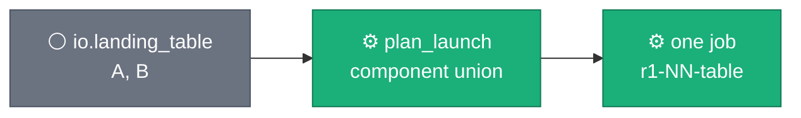
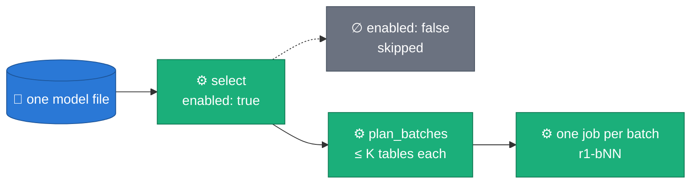
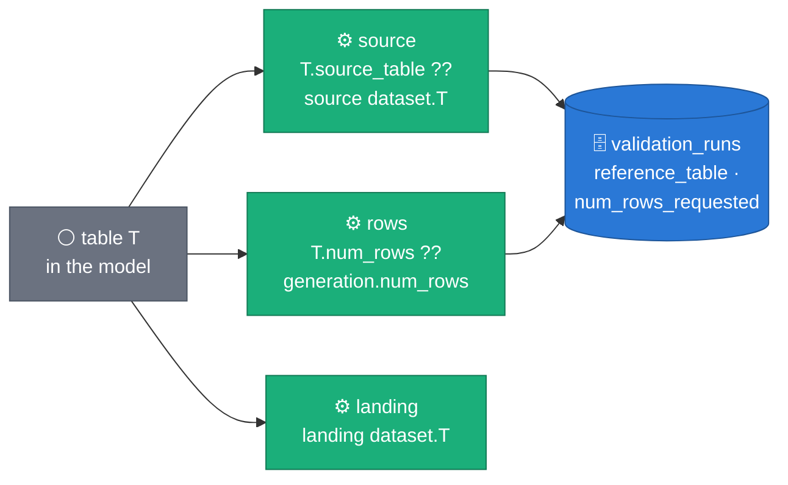
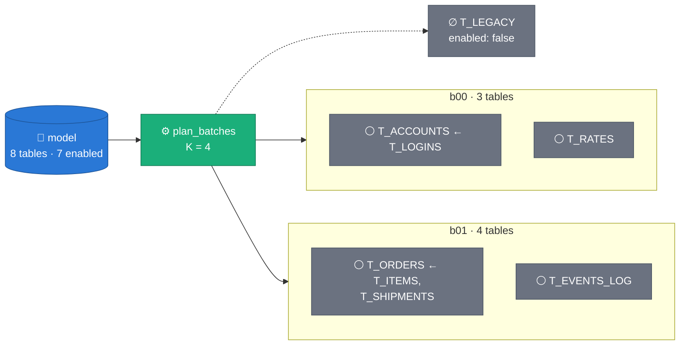
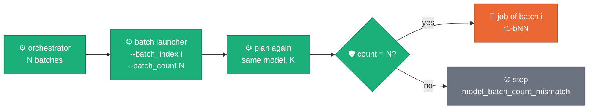
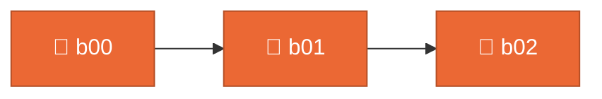
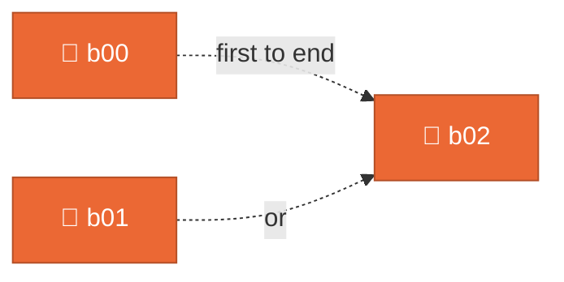
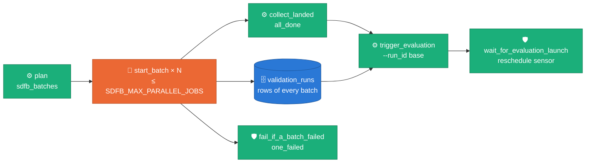
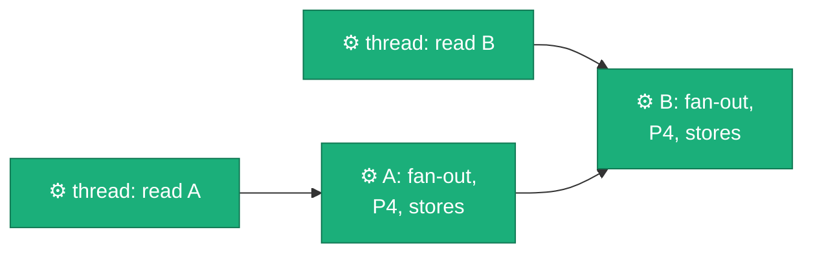

# ADR 0045 — Whole-model launches: every enabled table of one model, in batch jobs

**Status:** Accepted (2026-10-21). Built and tested on a laptop (DirectRunner, fake client, the model DAG read statically); the Dataflow acceptance (AC-B-5) is the corp run of [RUN_PLAYBOOK §2e](../RUN_PLAYBOOK.md#2e-corp-acceptance-of-whole-model-launches-b). Built in phase B of the config, record and model-launch work (the phase design is local to the branch and not committed).
**Design:** [`docs/DESIGN.md` §4 Relational generation](../DESIGN.md#4-relational-generation) ([§4.5 Whole-model launches](../DESIGN.md#45-whole-model-launches))
**Code:** [`sdfb_core/launch/tables.py`](../../packages/sdfb-core/src/sdfb_core/launch/tables.py) (the launch modes, a table's source and rows) · [`sdfb_core/launch/batches.py`](../../packages/sdfb-core/src/sdfb_core/launch/batches.py) (the planner) · `sdfb_beam/cli/run_pipeline.py` (`_run_model`, `chosen_batches`, `_run_batch`, `PrepReadAhead`) · [`composer/synthetic_model_launch.py`](../../composer/synthetic_model_launch.py) (the model DAG) · [`composer/sdfb_batches.py`](../../composer/sdfb_batches.py) (its planner mirror) · [`scripts/launch/run_model.py`](../../scripts/launch/run_model.py) (the CLI runner) · `sdfb_evaluation/context/runs.py` (`rows_of_jobs`), `sdfb_evaluation/context/launch.py` (`_launch_of`)
**Builds on:** [ADR 0030](0030-single-job-relational-generation.md) (a component in one job) · [ADR 0032](0032-relationships-as-config.md) (relationships are configuration) · [ADR 0036](0036-parent-driven-fanout-generation.md) (a child's rows follow its parents) · [ADR 0043](0043-generator-config.md) (the config keys) · [ADR 0044](0044-generation-record.md) (the record each batch writes)
**Operations:** [RUN_PLAYBOOK §0b](../RUN_PLAYBOOK.md#0b-workflow-edits-for-whole-model-launches-untracked-workflows) (workflow edits) · [§2e](../RUN_PLAYBOOK.md#2e-corp-acceptance-of-whole-model-launches-b) (corp acceptance) · [§9d](../RUN_PLAYBOOK.md#9d-whole-model-launch--every-enabled-table-of-one-model) (the recipe) · [`config/relationships/README.md`](../../config/relationships/README.md#whole-model-launches-tables-all-adr-0045) (the two model keys)

## Context

A relationships model can list 100+ unrelated landing tables, but a launch
generates only the tables named in `--landing_table` and their components,
every source is the reference table's dataset plus the table's name, every
table gets the launch's `--num_rows`, and one Flex launcher preps its tables
one after another inside a 12-minute window.

That window was already tight at five tables: the five-table launch of
2026-10-12 had its graph ready with less than a minute of the Flex launcher's
twelve minutes left, after prepping its tables one after another (the
generation DAG's `launcherMachineType` comment records its timings). A
100-table model could not be launched: no option named "every table", and no
single job's launch window would hold it.

This ADR introduces no measured number: the timing above is the one that
comment records, and K = 10 (`launch.max_tables_per_job`) is the phase
design's estimate. The corp run of RUN_PLAYBOOK §2e measures each batch's
launch margin.

## Decision

**Claim:** one launch generates every enabled table of a model, in batch jobs
of at most K tables that never split a component, and one evaluation covers
the batches that landed.

### D1 — `launch.tables`: explicit or all

*An explicit launch is today's: the targets and their components, one job.*

*`launch.tables: explicit` (the default).*

*A whole-model launch selects every enabled table of one model file and runs
one job per batch.*

*`launch.tables: all`.*

The flag is `--tables=explicit|all` (config `launch.tables`, template
parameter `tables`). Under `explicit` a multi-table plan is one job in
`multi_table_mode: single_job` (the default), one job per table in
`sequential_jobs`, as before.

| Mode | Selects | Needs | Refuses | Ignores, with one `launch_option_unused` WARNING each |
| :-- | :-- | :-- | :-- | :-- |
| `explicit` (default) | the `io.landing_table` targets and the tables their components pull in | `io.reference_table`, `io.landing_table` | `--batch_index`, `--batch_count` | `io.source_dataset`, `io.landing_dataset` |
| `all` | every `enabled: true` table of ONE model file | `io.source_dataset`, `io.landing_dataset` (each `project.dataset`); `relational.relationships_uri` naming one `.yaml` / `.yml` file that loads exactly one model | a global `relational.pk_cols` / `relational.identity_cols` (it would key every table the model leaves without a key: declare `pk:` / `identity:` per table); `--batch_index` without `--batch_count` or the reverse; an index outside `0 … count−1` | `io.reference_table`, `io.landing_table`, `io.ddl_uri` (a pin describes one table; every schema is extracted live) |

Both modes still need `io.dlq_table`, `generation.num_rows` (every table's
rows unless the model says otherwise), `launch.run_id` and
`serving.model_uri`. Every refusal is checked when the flags are parsed
(`model_launch_problems`), before any BigQuery read, and is argparse's usage
error (exit 2). A model file that loads more than one model, or enables no
table, stops the launch (`ModelLaunchError`). A direct file name loads a
documentation sample too, so `config/relationships/example_isolated_forest.yaml`
can be launched.

### D2 — A table's own source and rows: `source_table`, `num_rows`

*A table's source and rows come from the model when it says so, else from the
launch; it always lands under its own name.*

- **Both keys apply in both modes** (Ruling 6): an explicit launch of a model
  that sets them reads the override, and a model's `num_rows` wins over
  `--num_rows` for its table. Each overridden table is announced once, before
  any table is prepared: `table_override num_rows=… source_table=… table=…`
  (each key only when the model sets it), and
  `launch_config.resolved.overrides`. The row projection says
  `root — sized by its model num_rows=…` (Ruling 23) and the relationship card
  prints `source … · rows …` after the keys (Ruling 21).
- **The source dataset** is `io.source_dataset` under `all` and the reference
  table's dataset under `explicit`. A two-part `source_table` takes that
  dataset's project; a three-part one is kept; a source dataset without a
  project leaves a two-part name as written (`launch/tables.py::source_fqn`).
- **Grammar and strict types** (Ruling 7): `source_table` is
  `[project.]dataset.table` (`SOURCE_TABLE_RE`); `num_rows` an integer ≥ 1
  (Pydantic `StrictInt`: no `true`, no `"5000"`, no `5000.0`); `null` is
  absent. The evaluator's hand-written parser copies the grammar and the
  strict types, so the two accept and refuse the same values. The Composer
  mirror reads only `enabled` and the FK refs; the launcher validates the rest
  when a batch starts.
- **`num_rows` on a table a parent drives is a load error** (Ruling 8): an
  enabled table with an enforced in-model edge to an enabled parent takes its
  rows from its parent's keys ([ADR 0036](0036-parent-driven-fanout-generation.md)),
  whatever `generate_fk_relationships` says at launch.
- **Absent keys stay out of every canonical form** (Ruling 9): `sha12` appends
  `:src=…` / `:rows=…` only when set, so every committed model keeps its sha
  and its `fk_fanout_stats` cache key; the GUI export writes them only when
  set. The generation record's `relationships.tables[T]` carries both, `null`
  when unset.
- **A driving parent is measured on its own source** (Ruling 22): the fan-out
  reads `source_fqn(parent, its relations, source dataset)`, which equals the
  old expression for a model without overrides.

### D3 — The planner: first-fit-decreasing over whole components

*First-fit-decreasing packs whole components: no edge crosses a batch.*

`plan_batches` (`sdfb_core/launch/batches.py`) does four steps:

1. **Components** of the selected tables (`RelationshipRegistry.component`):
   undirected, over every in-model edge between two enabled tables, enforced
   or documented. A disabled table is not traversed, so a branch reached only
   through it detaches.
2. **Sort** them by size descending, then by their first table name.
3. **First-fit-decreasing** into bins of at most K tables: each component goes
   into the first bin it fits, else a new one. A component larger than K gets
   a bin of its own (`Batch.oversized`), announced by one
   `model_batch_oversized` WARNING and run whole.
4. **Name** the bins by their first table: b00, b01, … in that order.

In the figure the components are sized 3, 2, 1, 1: the 3 opens b01's bin and
takes `T_EVENTS_LOG`; the 2 opens b00's and takes `T_RATES`
(`test_first_fit_decreasing_on_the_adr_figure`). The plan depends only on the
model's content and K, never on the order the file declares its tables
(`test_the_plan_depends_only_on_the_content_and_k`). K < 1 is refused.
First-fit-decreasing is the classic one-dimensional bin-packing heuristic of
[D. S. Johnson, A. Demers, J. D. Ullman, M. R. Garey, R. L. Graham, "Worst-case performance bounds for simple one-dimensional packing algorithms", SIAM J. Comput. 3(4), 1974](https://doi.org/10.1137/0203025);
here an item is a component and its size its table count.

**A component is never split**: a child is generated from its parent's landed
keys inside one job ([ADR 0030](0030-single-job-relational-generation.md),
[ADR 0036](0036-parent-driven-fanout-generation.md)), so a component spread
over two jobs would lose its referential integrity.

### D4 — Orchestration: the launcher is authoritative

*Every batch job plans the model again and stops when its count is not the
orchestrator's.*

Three things run the batches (`run_pipeline.py::chosen_batches`):

| Orchestrator | What it does |
| :-- | :-- |
| the Composer model DAG, `composer/synthetic_model_launch.py` (D6) | one Flex Template launch per batch, `tables=all`, `batch_index`, `batch_count`, `run_id=<base>`; at most `SDFB_MAX_PARALLEL_JOBS` at once |
| `scripts/launch/run_model.py`, from a checkout | one launcher process per batch, `--tables=all --batch_index=i --batch_count=N`, at most `launch.max_parallel_jobs` at once; refuses `--batch_index`, `--batch_count`, `--job_name` and any abbreviation of them of three or more characters; on Ctrl-C or SIGTERM stops its launchers and prints every Dataflow job already created with the `gcloud dataflow jobs cancel` command (stopping a launcher does not cancel its job); exit 0 (every batch finished, or `--dry_run`), 1 (a batch failed; the others ran), 2 (a usage error: nothing was launched) |
| the launcher alone, `--tables=all` without `--batch_index` | a one-batch plan runs as one job, Flex included. Above one batch: on the CLI every batch in sequence (`model_batches_in_sequence` WARNING); a batch that fails is logged (`model_batch_failed`) and the next one runs, and the launch then exits naming every failed batch (Ruling 15). On Flex it refuses, naming the model DAG, `run_model.py` and the K that would make one job |

- **"On Flex"** (Ruling 16) means the environment variable
  `FLEX_TEMPLATE_PYTHON_PY_FILE` is set. `docker/Dockerfile` sets it for every
  process of the image, and a checkout's shell does not, so a CLI run *inside*
  the container counts as Flex and refuses a multi-batch plan without
  `--batch_index`. Run the CLI and `run_model.py` from a checkout.
- **The count check** happens before any BigQuery read of the batch's tables
  (only the model file has been loaded): `model_batch_count_mismatch
  max_tables_per_job=… planned=… replanned=…` (ERROR), then a stop that says
  to trigger the model DAG again or rerun `run_model.py`. A model edit or a K
  change that keeps the count is not detected by it; every row's snapshot
  carries the model's `sha12` (`relationships_digest`) and `batch.tables`, so
  one digest across the launch proves one model (RUN_PLAYBOOK §2e step 10).
- **Run ids** (Ruling 14): the job of batch *i* runs as `<base>-bNN`, its
  tables as `<base>-bNN-MM-<table>` (a one-table batch too), and every row's
  `launch_run_id` is `<base>`. The model DAG names each job
  `<job_name>-bNN`, to which the Dataflow provider appends `-<8 hex>`; a CLI
  batch job is named from its run id (`sdfb-<base>-bNN`, sanitized).
- **One `config_digest` per launch**: `launch.batch_index` and
  `launch.batch_count` are launch identity, flags only, like `launch.run_id`,
  and left out of the snapshot's `values`.
- **The record**: the snapshot's `batch` block is `{index, count, tables}`;
  each batch logs its own `launch_scenario` and `launch_config`, whose
  `resolved` gains `launch_run_id` and `batch` (Ruling 31), so a batch job
  evaluated alone by its job id resolves like any multi-table job.
- **One `prepare_record_base` per batch.** A CLI run of N batches repeats the
  `validation_runs` schema read and any `generation_record_degraded` or
  `config_sets_evaluation_input` WARNING once per batch; a DAG or
  `run_model.py` batch is its own process and reads once. The store keys
  (`launch_cache_keys`) are computed once per launcher, so every batch reads
  and writes the same stores.
- **The mirror.** The Composer environment has neither sdfb-core nor
  pydantic, so `composer/sdfb_batches.py` repeats the planner with the
  standard library and PyYAML, plus every pure piece of the launch (planning
  inputs with file-wins, job names, the launch environment and parameters,
  the landed ids, the banner; Ruling 19). A parity test pins it to sdfb-core
  on every committed model and on generated forests of up to 120 tables
  (`packages/sdfb-tests/tests/unit/composer/test_sdfb_batches.py`).

### D5 — The parallel cap

*The cap decides how many batch jobs hold GPUs at once, never what they
generate.*

*`max_parallel_jobs = 1` (the default).*

*`max_parallel_jobs = 2`.*

b00 and b01 start together; b02 takes the slot of whichever ends first. Each
running batch job holds its workers' GPUs (the model DAG's launch asks for up
to `maxWorkers` 4 workers of one GPU each), so the cap is bounded by the
regional GPU quota. Ruling 13 says where each cap lives:

- `scripts/launch/run_model.py` reads `launch.max_parallel_jobs`
  (`--max_parallel_jobs`, default 1: the only value inside every GPU quota,
  Ruling 12). The launcher accepts the key but never reads it, since a
  launcher runs one job or a sequence; the Flex Template does not declare it.
- The model DAG's cap is the Airflow Variable `SDFB_MAX_PARALLEL_JOBS`
  (default `"1"`), read when Composer parses the file into the mapped task's
  `max_active_tis_per_dag`: Airflow fixes a mapped task's concurrency at parse
  time ([Airflow: dynamic task mapping](https://airflow.apache.org/docs/apache-airflow/stable/authoring-and-scheduling/dynamic-task-mapping.html)).
  A change applies at the next parse, without a re-import. A config file's
  `launch.max_parallel_jobs` does nothing in the DAG.

### D6 — The model DAG

*One evaluation covers the batches that landed; a failed batch fails the run,
not its neighbours.*

`composer/synthetic_model_launch.py`, DAG id `synthetic_sdfb_model_<DAG_VERSION>`
(Ruling 18):

| Task | Trigger rule | Does |
| :-- | :-- | :-- |
| `plan` | `all_success` | reads the model file and the config file (whose keys win, the planning ones included) from GCS, plans the batches with `sdfb_batches`, mints the base run id (`<dag run id>-<8 hex>`, salted like the single-table DAG's run id) and builds one Flex launch body per batch. The bodies are its **return value**, which `start_batch` expands over; `base_run_id`, `batch_count`, `relationships_uri`, `batches` and `banner` are pushed under their own XCom keys. Logs the `MODEL LAUNCH PLAN` banner |
| `start_batch` | `all_success` | one mapped `DataflowStartFlexTemplateOperator` per body, `wait_until_finished=True`, `max_active_tis_per_dag` = the Variable. A job that ends in any state but DONE fails its own instance; the other instances run on (the DAG sets no fail-stop) |
| `collect_landed` | `all_done` | after every instance, the failed ones included: returns `{"job_ids": "<id>,<id>"}`, the ids of the jobs that reached DONE in batch order; skips (and so skips the evaluation) when `run_evaluation` is off or nothing landed |
| `trigger_evaluation` | `all_success` | one CPU Flex launch of the same template: `sdfb_job=evaluation`, `run_id=<base>`, `generation_job_ids=<the landed ids>`, `relationships_uri` (empty when `generate_fk_relationships` is false), `scope=manual`, `trigger=chained`, `output_dataset` = `evaluation_output_dataset`; neither `reference_rows_limit` nor `validation_runs_table` (Ruling 30: the rows and the sample size come from the record, so `evaluation_output_dataset` must be the quality dataset, its default). Not waited for |
| `wait_for_evaluation_launch` | `all_success` | the single-table DAG's reschedule sensor (the evaluation job running or done); its failure callback closes the evaluation's RUNNING registry row, found by `base_run_id`, with a copy of the single-table DAG's statement pinned equal by test |
| `fail_if_a_batch_failed` | `one_failed` | a leaf that fails once a `start_batch` instance failed (or `plan` did); skipped when every batch succeeded |

- **`wait_until_finished=True` is what makes the cap count running jobs**: an
  instance holds its slot, and an Airflow worker slot (the operator is not
  deferrable), until its job ends. Killing a running instance (a Composer
  worker restart, marking it failed) cancels that batch's Dataflow job: the
  operator's `on_kill` cancels the job it waits for.
- **Retries**: `plan` and `start_batch` pass `retries=0`. A plan error fails
  the same way every time, and a retried batch would launch again under the
  same base run id, landing its rows twice under append after a BLOCKER. To
  run a failed batch again, fix the cause and clear its `start_batch`
  instance with its downstream tasks. The other tasks leave retries to the
  environment, as the single-table DAG does.
- **Manual trigger only** (`schedule_interval=None`, `max_active_runs=1`).
- **The Composer environment's service account** reads the model file and the
  config file (`plan` uses `GCSHook`), so it needs `storage.objects.get` on
  them; the single-table DAG never reads GCS from Airflow.
- **The run's outcome**: Airflow fails a run by a failed leaf. After a failed
  batch the watcher fails at once and the run ends failed once the
  evaluation's launch has been waited for; with every batch landed the watcher
  is skipped and the run ends as the evaluation's launch did.
- **Laptop evidence, no Composer**: the DAG file was imported and run under
  Airflow 2.10.5's `dag.test()` with GCS and Dataflow stubbed — no batch, one
  batch and every batch failing, `plan` failing, the evaluation off — and every
  final state matched the table above.
- **Unverified on Composer**, checked by RUN_PLAYBOOK §2e: a mapped
  `DataflowStartFlexTemplateOperator` with `wait_until_finished=True` holding
  its slot until its job ends and failing on any other terminal state;
  `xcom_pull(task_ids="start_batch")` returning the mapped return values in
  map order without the failed instances; `all_done` and `one_failed` counting
  every mapped instance; the job-name suffix; `on_kill`.

### D7 — The evaluator: one evaluation over the landed batches

A whole-model launch is evaluated as `sdfb-eval run --run_id <base>
--generation_job_ids <id>,<id>`, the batch jobs that landed (Ruling 2), not
as `--tables`: the evaluator takes exactly one target, and `--tables` reads
each source as `<reference_dataset>.<name>`, which would ignore a
`source_table`. On the `--run_id` path every table is compared with the
source its `validation_runs` row names, an override included.

- **A batch's rows are the launch's** (Ruling 3, `context/launch.py::_launch_of`):
  a row belongs to the asked base when its recorded `launch_run_id` names it,
  or its run id's base does, or — only on a row without a recorded launch —
  when its run id's base is the asked base plus a batch suffix `-bNN`.
- **Narrowed by the recorded `job_id`** (Ruling 4, `context/runs.py::rows_of_jobs`):
  rows of jobs not listed are dropped with a note; a row with no `job_id` (the
  worker could not read it, ADR 0044) is kept with a note that it may belong
  to an unlisted batch. Positions are checked per batch, so a gap is named by
  its batch.
- **`--generation_job_ids` goes with `--run_id` alone**; any other target with
  it is a usage error. It narrows ONE evaluation, unlike the standalone
  evaluation DAG's `generation_job_ids` param, which fans out one evaluation
  per job.
- **`scope=manual`**: the model DAG and `run_model.py` pass it, because a
  `--run_id` evaluation has no labelled writes and `auto` would resolve every
  table's scope to `unknown`.
- **The registry** `evaluation_data_history` gains `generation_job_ids`
  (REPEATED STRING, appended after ADR 0044's columns; Ruling 5): the listed
  ids on a model launch, `[generation_job_id]` on a single job, `[]` when the
  evaluation names none; `generation_job_id` is the first id.
- **`_evaluation_key` is unchanged** (Ruling 29): it already holds every run
  id, which distinguishes the batches. The request key of a launch that
  failed to resolve gains the job ids when they are given.
- Metrics, scoring and the catalogue are unchanged.

### D8 — Parallel prep

*Threads read ahead; the cross-table steps keep the plan's order, so the
outputs do not change.*

*`prep_workers = 1`: before ADR 0045.*

*`prep_workers = W`: reads ahead.*

`launch.prep_workers` (default 8; `--prep_workers`, template parameter
`prep_workers`) is Ruling 17:

- **Where**: only the single-job multi-table runner (`_run_relational_job`).
  A single-table launch, `sequential_jobs`, `prep_workers: 1` and a one-table
  plan create no thread.
- **What runs on a thread** (`prefetch_table_prep`): `resolve_schemas` (both
  schemas), `load_reference_rows`, and the source-stats computation including
  the `exact` aggregate scan — reads and pure profiling, nothing else. No
  model and no embedder: the transformers v5 lazy-import race of 2026-07-30
  is why.
- **How** (`PrepReadAhead`): the first table's prep logs
  `launch_prep_parallel tables=… workers=…` and submits every table's reads;
  each table's prep then takes its own, in plan order, where the sequential
  prep read them. The fan-out, preflight P4, the pools and the stores run
  where they did. Source stats are computed on a thread but written after
  preflight, as before, so a table whose preflight stops writes no stats. A
  read that failed raises at its table's turn, the same exception as before.
  At the end the reads not started are cancelled and the ones in flight
  waited for.
- **The one default-on change** for a launch that uses none of this ADR's
  options: the outputs are identical; the timing, the log order, and the reads
  already paid by a table that preflight then stops differ (under
  `--source_stats=exact` that includes its exact aggregate scan, and the
  look-ahead can have finished later tables' reads when a hard failure lands).
  The launcher also issues more BigQuery reads at once. `launch.prep_workers:
  1` restores the previous sequence exactly
  (`packages/sdfb-tests/tests/unit/cli/test_parallel_prep.py`).

### Rulings

The numbered decisions the code cites as "Ruling N" (or "ADR 0045 Ruling N").

1. **Two template names are shared.** `docker/flex_template_metadata.json`
   declared `tables` and `landing_dataset` for the evaluator; the generator's
   parameters of the same names join them, each help text says
   "Generation: … Evaluation: …", and neither carries a pattern.
2. **The model evaluation targets `--run_id <base>` plus
   `--generation_job_ids`**, not `--tables` (D7).
3. **A whole-model batch's rows are the launch's**: by `launch_run_id`, else
   the run id's base, else — only on a row without a recorded launch — the
   `-bNN` suffix (D7). A launch whose own run id ends in `-bNN`, written
   without a record and evaluated by the shorter prefix, is read as a batch.
4. **`--generation_job_ids` narrows by the recorded `job_id`**; a row without
   one is kept with a note (D7).
5. **`generation_job_ids` is written on every new registry row**, and the
   registry is migrated before the new evaluator and the GUI (D7,
   Consequences).
6. **`source_table` and `num_rows` apply in both launch modes**, each
   override announced (D2).
7. **`source_table` grammar and strict types**; a missing project is the
   launch source dataset's (D2).
8. **"A parent-driven child" at load time** is an enabled table with an
   enforced in-model edge to an enabled parent; `num_rows` there is a load
   error (D2).
9. **Absent keys stay out of every canonical form**: `sha12`, the GUI export;
   the snapshot writes them `null` (D2).
10. **What `launch.tables: all` needs and ignores**: the D1 table, with one
    `launch_option_unused` WARNING per ignored key, under `explicit` too.
11. **One model file**: `.yaml` / `.yml`, exactly one model; a sample loads by
    its file name (D1).
12. **Defaults**: `max_tables_per_job` 10, `prep_workers` 8,
    `max_parallel_jobs` 1.
13. **`launch.max_parallel_jobs` belongs to the orchestrators**; the model
    DAG reads `SDFB_MAX_PARALLEL_JOBS` (D5).
14. **Run ids** `<base>-bNN` and `<base>-bNN-MM-<table>`; `launch_run_id` is
    `<base>` (D4).
15. **The CLI runs the batches in sequence and keeps going** after a failed
    batch, then exits naming every failed one (D4).
16. **"On Flex" is `FLEX_TEMPLATE_PYTHON_PY_FILE`** (D4).
17. **Parallel prep is pull-based and output-neutral**; `prep_workers: 1`
    restores the previous sequence (D8).
18. **The model DAG's shape**: the six tasks and trigger rules of D6, `plan`'s
    return value the launch bodies.
19. **`composer/sdfb_batches.py` holds the planner mirror and every pure
    piece of the launch**, unit-tested without Airflow (D4).
20. **Logging under `all`**: a batch gets no "N targets WITH relationships"
    advice (the planner chose its tables), and `main` logs no up-front
    `relationship_model` card per target; the card is still logged for every
    table during its batch's prep, and by the workers. `model_launch_plan`
    states the whole plan once per launcher.
21. **The relationship card shows an override** after the keys (D2).
22. **A driving parent's fan-out is measured on the parent's own source**
    (D2).
23. **The row projection reads a root's own rows** (`root_rows`, empty unless
    a plan has a `num_rows` override); a driven child past ten times its
    chain root's rows is measured against that root's rows (D2).
24. **The single-table DAG's `source_dataset` param is evaluation-only**:
    `scripts/gui/export_knobs.py` does not count a DAG param whose
    description begins "Only with run_evaluation" as a surface of a generator
    flag.
25. **Abbreviated flags**: argparse's prefix matching stays on; prefixes only
    `--landing_table` or `--batch_size` matched before (`--landing`,
    `--landing_`, `--batch`, `--batch_`) are now ambiguous and stop the
    launch.
26. **The Dataflow Solution Guides copy** ships neither `composer/` nor
    `scripts/launch/`; it ships `example_isolated_forest.yaml`, and its form of
    a whole-model launch is the launcher's `--tables=all` (batches in
    sequence).
27. **The committed example uses generic names** (`T_ACCOUNTS`,
    `T_EVENTS_LOG`, `T_RATES`, `T_LEGACY`, dataset `other_ds`).
28. **No Terraform, `tiers.yaml` or single-table DAG change**: the
    single-table DAG keeps its params and its launch.
29. **`_evaluation_key` is unchanged** (D7).
30. **The model DAG's evaluation passes neither `reference_rows_limit` nor
    `validation_runs_table`** (D6).
31. **Every batch job logs its own `launch_scenario` and `launch_config`**
    (D4).

## Alternatives rejected

- **The evaluator's `--tables` for the model evaluation.** Two targets with
  `--run_id`, which the evaluator refuses, and sources by name, which would
  ignore `source_table` overrides (D7).
- **One evaluation per batch job**, the standalone evaluation DAG's fan-out.
  The acceptance wants one evaluation over every landed table; one evaluation
  per batch would split the launch's scores and registry rows.
- **A runtime DAG param for the parallel cap.** Not possible with task
  mapping: Airflow fixes a mapped task's concurrency when it parses the file
  (D5).
- **A Composer pool for the cap** ([Airflow: pools](https://airflow.apache.org/docs/apache-airflow/stable/administration-and-deployment/pools.html)).
  An Airflow admin setting outside the DAG file; possible later.
- **Sharing the single-table DAG's file.** It stays as it is (Ruling 28); the
  model DAG is a second file built from the same markers.
- **Splitting a component across jobs to fill bins.** It would break
  referential integrity (D3).
- **Merging the per-table DLQ and `validation_runs` sinks per job.** Deferred
  (Consequences: the load-job budget).

## Consequences

- **Enables**: one trigger generates a 100+-table model, each batch inside
  its own launch window; a table can be sourced from another dataset or
  project and sized on its own; one evaluation scores the launch.
- **Rollout, in order** (RUN_PLAYBOOK §2e is the checklist):
  1. **Migrate the registry** before the new evaluator runs and before the
     GUI is deployed: the new evaluator's load jobs carry
     `generation_job_ids`, and the regenerated GUI contract expects it on
     every registry row, as ADR 0044's list expects its two columns. One
     `bq update` with the committed schema covers ADR 0044 and this ADR (the
     file is a superset), in the same session as the new image; a rollback to
     an image from between the two ADRs drops only `generation_job_ids`
     ([RUN_PLAYBOOK §2d](../RUN_PLAYBOOK.md#2d-corp-acceptance-of-the-generation-record-a2)
     step 1, [`DEPLOYMENT_PREREQUISITES.md`](../DEPLOYMENT_PREREQUISITES.md)).
  2. **Image and Flex Template rebuild.** The template declares six new
     parameters (`source_dataset`, `max_tables_per_job`, `prep_workers`,
     `batch_index`, `batch_count`, `generation_job_ids`), and `tables` and
     `landing_dataset` are now names both jobs read.
  3. **Workflow 3** takes the edits of
     [RUN_PLAYBOOK §0b](../RUN_PLAYBOOK.md#0b-workflow-edits-for-whole-model-launches-untracked-workflows)
     (substitute and import the model DAG, import `sdfb_batches.py`), and the
     Composer environment gets the Variable `SDFB_MAX_PARALLEL_JOBS`.
- **The load-job budget of the shared tables.** Each batch job writes its
  tables' landing, DLQ and `validation_runs` rows with FILE_LOADS, at least
  one load job per table into each. BigQuery limits load jobs per table per
  day ([BigQuery quotas: load jobs](https://cloud.google.com/bigquery/quotas#load_jobs);
  1,500 at the time of writing), so the shared `dlq` and `validation_runs`
  tables take about 15 launches of 100 tables a day (the phase design's
  estimate, 1,500 ÷ 100).
- **K = 10 is an estimate**, not a measurement: the corp run reads each
  batch's margin to the Flex launcher's 12 minutes
  ([Dataflow: troubleshoot Flex Templates](https://cloud.google.com/dataflow/docs/guides/troubleshoot-templates))
  and lowers K where a margin is thin.
- **Abbreviated flags.** `--landing` and `--batch` (and `--landing_`,
  `--batch_`) are now ambiguous; a script that abbreviated `--landing_table`
  or `--batch_size` that way fails at parse time and must spell them out
  (Ruling 25).
- **A held Airflow worker slot per running batch**, for the job's duration
  (D6), at most `SDFB_MAX_PARALLEL_JOBS` slots.
- **A run id ending in `-bNN`**, written without a record and evaluated by a
  shorter prefix, is read as a batch of that prefix (Ruling 3).
- **`evaluation_latest_per_job`** keeps one row per `generation_job_id`, so a
  model evaluation is listed under its first batch job only.
- **A CLI sequence repeats the record's schema read per batch** (D4).
- **The Dataflow Solution Guides copy** has `--tables=all` (batches in
  sequence on the CLI) but no parallel runner and no model DAG (Ruling 26).
- **Forbids**: a component split across jobs; a batch launch that runs after
  its count disagrees with the orchestrator's; a global key applied to every
  table of a model.

## Acceptance criteria

| AC | Criterion | Proof |
| :-- | :-- | :-- |
| AC-B-1 | `tables: all` over `example_isolated_forest.yaml` selects exactly the enabled tables | `packages/sdfb-tests/tests/unit/launch/test_batches.py::test_the_isolated_forest_example_selects_exactly_the_enabled_tables` |
| AC-B-2 | `plan_batches` is deterministic, never splits a component, and the Composer mirror matches it | `packages/sdfb-tests/tests/unit/launch/test_batches.py` (`test_the_plan_depends_only_on_the_content_and_k`, `test_a_component_is_never_split_and_every_table_runs_once`); `packages/sdfb-tests/tests/unit/composer/test_sdfb_batches.py` |
| AC-B-3 | `source_table` and `num_rows` land in `validation_runs.reference_table` / `num_rows_requested` | `packages/sdfb-tests/tests/unit/cli/test_model_launch_main.py::test_every_batch_records_its_tables_sources_rows_and_one_digest` |
| AC-B-4 | Every committed model's sha12 is unchanged; the explicit relational launch plan equals its golden | `packages/sdfb-tests/tests/unit/contracts/test_relationship_launch_keys.py::test_absent_keys_leave_every_committed_sha_unchanged`; `packages/sdfb-tests/tests/unit/cli/test_launch_plan_golden.py` |
| AC-B-5 | (GCP) A model-DAG launch with at least two batches: every batch launches inside the 12-minute window, and one evaluation covers every landed table | the corp run of [RUN_PLAYBOOK §2e](../RUN_PLAYBOOK.md#2e-corp-acceptance-of-whole-model-launches-b) (pending) and `packages/sdfb-tests/tests/integration/test_model_launch_gcp.py` |

## Figure provenance

| Figure | Form | Claim |
| :-- | :-- | :-- |
| M1, `launch.tables: explicit` (D1) | inline mermaid, this file | an explicit launch is today's: the targets and their components, one job |
| M2, `launch.tables: all` (D1) | inline mermaid, this file | a whole-model launch selects every enabled table of one model file and runs one job per batch |
| M3, the planner (D3; also in DESIGN.md §4.5) | inline mermaid, this file | first-fit-decreasing packs whole components: no edge crosses a batch. The example is `test_first_fit_decreasing_on_the_adr_figure`'s |
| M4, per-table resolution (D2) | inline mermaid, this file | a table's source and rows come from the model when it says so, else from the launch |
| M5, the launcher is authoritative (D4) | inline mermaid, this file | every batch job plans the model again and stops when its count is not the orchestrator's |
| M6, `max_parallel_jobs` = 1 and = 2 (D5) | inline mermaid, two panels, this file | the cap decides how many batch jobs hold GPUs at once, never what they generate |
| M7, the model DAG (D6) | inline mermaid, this file | one evaluation covers the batches that landed; a failed batch fails the run, not its neighbours |
| M8, `prep_workers` = 1 and = W (D8) | inline mermaid, two panels, this file | threads read ahead; the cross-table steps keep the plan's order, so the outputs do not change |

The figures use the repository's mermaid house style (node classes and icons
as in `.claude/skills/visual-first-documentation/`) and carry no measured
number: every shape, count and name is read from the code and tests named
above. Links retrieved 2026-10-21.
