# ADR 0045 — Whole-model launches: every enabled table of one model, in batch jobs

**Status:** Accepted (2026-10-21). Built and tested on a laptop (DirectRunner, fake client; the generation DAG's `tables=all` branch run under Airflow 2.10.5's `dag.test()` with GCS and Dataflow stubbed, D6); the Dataflow acceptance (AC-B-5) is the corp run of [RUN_PLAYBOOK §2e](../RUN_PLAYBOOK.md#2e-corp-acceptance-of-whole-model-launches-b). Built in phase B of the config, record and model-launch work (the phase design is local to the branch and not committed). **Revised 2026-10-26** (unreleased, amended in place): D6's separate model DAG is deleted; the generation DAG launches `tables=all` on a second branch (see [D6](#d6--one-generation-dag-two-branches)). **Revised 2026-10-31** (unreleased, amended in place): under `tables=all` the table is the unit of failure ([D6](#the-table-is-the-unit-of-failure-2026-10-31)), the DAG's cap reads `launch.max_parallel_jobs` ([D5](#d5--the-parallel-cap)), and the overlay carries `relational.relationships_uri` ([D1](#d1--launchtables-explicit-or-all) note). **Revised 2026-11-03** (unreleased, amended in place): the DAG holds its cap with a launch gate, no longer with `max_active_tis_per_dag`, after the scheduler failed 13 of a launch's 14 batches before they ran ([D5](#the-launch-gate-2026-11-03)). **Revised 2026-11-04** (unreleased, amended in place), after the 2026-11-03 relaunch (132 tables, 14 batches, cap 1: 77 tables passed, 5 failed their gate, 50 had no row): a batch writes each shared BigQuery table once ([D9](#d9--one-load-job-per-shared-table-per-job-2026-11-04)); the gate is a reschedule-mode sensor in a mapped bundle group ([D5](#the-gate-as-a-sensor-in-a-bundle-2026-11-04)); each bundle is evaluated on its own ([D7](#d7--the-evaluator-one-evaluation-per-bundle)); a batch job that failed for capacity is relaunched ([D10](#d10--a-capacity-failure-is-relaunched-2026-11-04)); the default cap is 3 (D5).
**Design:** [`docs/DESIGN.md` §4 Relational generation](../DESIGN.md#4-relational-generation) ([§4.5 Whole-model launches](../DESIGN.md#45-whole-model-launches))
**Code:** [`sdfb_core/launch/tables.py`](../../packages/sdfb-core/src/sdfb_core/launch/tables.py) (the launch modes, a table's source and rows) · [`sdfb_core/launch/batches.py`](../../packages/sdfb-core/src/sdfb_core/launch/batches.py) (the planner) · `sdfb_beam/cli/run_pipeline.py` (`_run_model`, `chosen_batches`, `_run_batch`, `PrepReadAhead`, `_prep_relational_specs`) · `sdfb_beam/pipeline.py` (`_BlockerGateDoFn`, the recording gate) · [`sdfb_core/validation/summary.py`](../../packages/sdfb-core/src/sdfb_core/validation/summary.py) (`FAILED_PREFLIGHT`, `status_reason`) · [`composer/synthetic_beam_bigquery.py`](../../composer/synthetic_beam_bigquery.py) (the generation DAG, its `tables=all` branch) · [`composer/sdfb_batches.py`](../../composer/sdfb_batches.py) (its launch helpers and the planner mirror) · [`scripts/launch/run_model.py`](../../scripts/launch/run_model.py) (the CLI runner) · `sdfb_evaluation/context/runs.py` (`rows_of_jobs`), `sdfb_evaluation/context/launch.py` (`_launch_of`)
**Builds on:** [ADR 0030](0030-single-job-relational-generation.md) (a component in one job) · [ADR 0032](0032-relationships-as-config.md) (relationships are configuration) · [ADR 0036](0036-parent-driven-fanout-generation.md) (a child's rows follow its parents) · [ADR 0043](0043-generator-config.md) (the config keys) · [ADR 0044](0044-generation-record.md) (the record each batch writes)
**Operations:** [RUN_PLAYBOOK §0b](../RUN_PLAYBOOK.md#0b-workflow-3-for-the-one-generation-dag-untracked-workflows) (workflow edits) · [§2e](../RUN_PLAYBOOK.md#2e-corp-acceptance-of-whole-model-launches-b) (corp acceptance) · [§9d](../RUN_PLAYBOOK.md#9d-whole-model-launch--every-enabled-table-of-one-model) (the recipe) · [`config/relationships/README.md`](../../config/relationships/README.md#whole-model-launches-tables-all-adr-0045) (the two model keys)

## Context

A relationships model can list 100+ unrelated landing tables, but a launch
generates only the tables named in `--landing_table` and their components,
every source is the reference table's dataset plus the table's name, every
table gets the launch's `--num_rows`, and one Flex launcher preps its tables
one after another inside a 12-minute window.

That window was already tight at five tables: the five-table launch of
2026-10-12 had its graph ready with less than a minute of the Flex launcher's
twelve minutes left, after prepping its tables one after another (the
generation DAG's `launcherMachineType` comment records its timings). A
100-table model could not be launched: no option named "every table", and no
single job's launch window would hold it.

This ADR introduces no measured number: the timing above is the one that
comment records, and K = 10 (`launch.max_tables_per_job`) is the phase
design's estimate. The corp run of RUN_PLAYBOOK §2e measures each batch's
launch margin.

## Decision

**Claim:** one launch generates every enabled table of a model, in batch jobs
of at most K tables that never split a component, and each batch that lands
is evaluated on its own (D7, revised 2026-11-04).

### D1 — `launch.tables`: explicit or all

*An explicit launch is today's: the targets and their components, one job.*

*`launch.tables: explicit` (the default).*

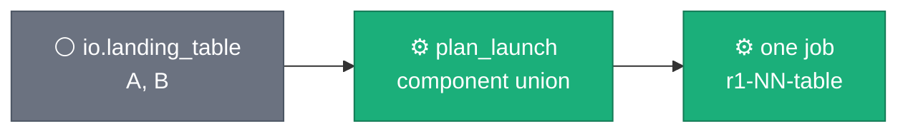

*A whole-model launch selects every enabled table of one model file and runs
one job per batch.*

*`launch.tables: all`.*

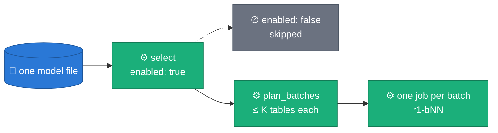

The flag is `--tables=explicit|all` (config `launch.tables`, template
parameter `tables`). Under `explicit` a multi-table plan is one job in
`multi_table_mode: single_job` (the default), one job per table in
`sequential_jobs`, as before.

| Mode | Selects | Needs | Refuses | Ignores, with one `launch_option_unused` WARNING each |
| :-- | :-- | :-- | :-- | :-- |
| `explicit` (default) | the `io.landing_table` targets and the tables their components pull in | `io.reference_table`, `io.landing_table` | `--batch_index`, `--batch_count` | `io.source_dataset`, `io.landing_dataset` |
| `all` | every `enabled: true` table of ONE model file | `io.source_dataset`, `io.landing_dataset` (each `project.dataset`); `relational.relationships_uri` naming one `.yaml` / `.yml` file that loads exactly one model | a global `relational.pk_cols` / `relational.identity_cols` (it would key every table the model leaves without a key: declare `pk:` / `identity:` per table); `--batch_index` without `--batch_count` or the reverse; an index outside `0 … count−1` | `io.reference_table`, `io.landing_table`, `io.ddl_uri` (a pin describes one table; every schema is extracted live) |

Both modes still need `io.dlq_table`, `generation.num_rows` (every table's
rows unless the model says otherwise), `launch.run_id` and
`serving.model_uri`. Every refusal is checked when the flags are parsed
(`model_launch_problems`), before any BigQuery read, and is argparse's usage
error (exit 2). A model file that loads more than one model, or enables no
table, stops the launch (`ModelLaunchError`). A direct file name loads a
documentation sample too, so `config/relationships/example_isolated_forest.yaml`
can be launched.

*Note (2026-10-31).* The Composer env overlay `composer/sdfb_env.yaml`
carries `relational.relationships_uri`, its 19th marker
`{{SDFB_RELATIONSHIPS_URI}}`: one model file on GCS,
`gs://<bucket>/synthetic/relationships/<model>.yaml`. The DAG's
`relationships_uri` param defaults to it, so a trigger that sets only
`tables=all` plans the overlay's model (the harness scenario
`all_from_overlay`). It is every launch's default, explicit ones included:
an explicit launch that sets `relationships_uri` in its trigger or its
`config_uri` file is unchanged, and one that leaves it unset now loads the
overlay's model. `load_layers` refuses an empty value (Ruling 36).

### D2 — A table's own source and rows: `source_table`, `num_rows`

*A table's source and rows come from the model when it says so, else from the
launch; it always lands under its own name.*

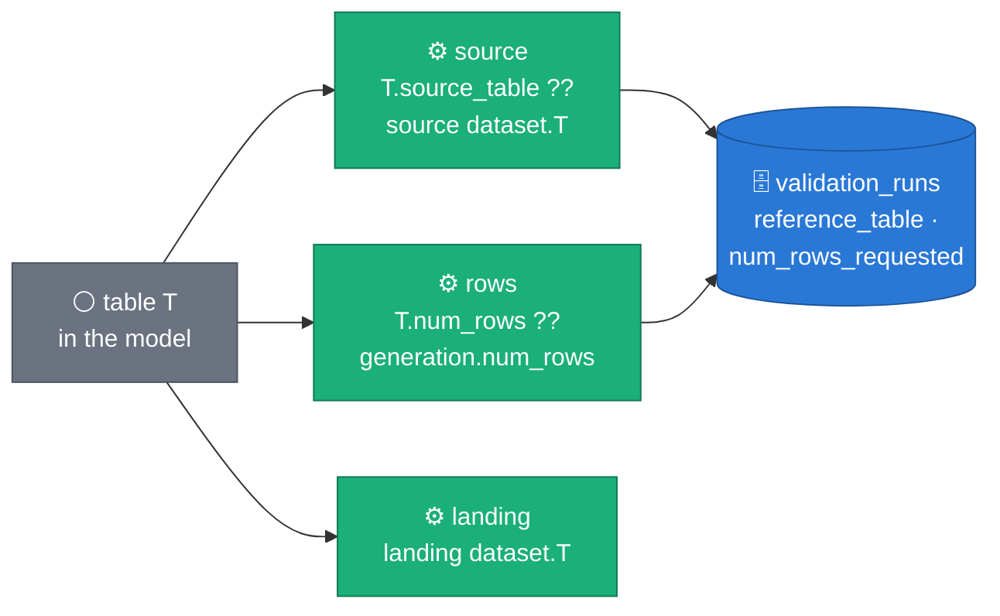

- **Both keys apply in both modes** (Ruling 6): an explicit launch of a model
  that sets them reads the override, and a model's `num_rows` wins over
  `--num_rows` for its table. Each overridden table is announced once, before
  any table is prepared: `table_override num_rows=… source_table=… table=…`
  (each key only when the model sets it), and
  `launch_config.resolved.overrides`. The row projection says
  `root — sized by its model num_rows=…` (Ruling 23) and the relationship card
  prints `source … · rows …` after the keys (Ruling 21).
- **The source dataset** is `io.source_dataset` under `all` and the reference
  table's dataset under `explicit`. A two-part `source_table` takes that
  dataset's project; a three-part one is kept; a source dataset without a
  project leaves a two-part name as written (`launch/tables.py::source_fqn`).
- **Grammar and strict types** (Ruling 7): `source_table` is
  `[project.]dataset.table` (`SOURCE_TABLE_RE`); `num_rows` an integer ≥ 1
  (Pydantic `StrictInt`: no `true`, no `"5000"`, no `5000.0`); `null` is
  absent. The evaluator's hand-written parser copies the grammar and the
  strict types, so the two accept and refuse the same values. The Composer
  mirror reads only `enabled` and the FK refs; the launcher validates the rest
  when a batch starts.
- **`num_rows` on a table a parent drives is a load error** (Ruling 8): an
  enabled table with an enforced in-model edge to an enabled parent takes its
  rows from its parent's keys ([ADR 0036](0036-parent-driven-fanout-generation.md)),
  whatever `generate_fk_relationships` says at launch.
- **Absent keys stay out of every canonical form** (Ruling 9): `sha12` appends
  `:src=…` / `:rows=…` only when set, so every committed model keeps its sha
  and its `fk_fanout_stats` cache key; the GUI export writes them only when
  set. The generation record's `relationships.tables[T]` carries both, `null`
  when unset.
- **A driving parent is measured on its own source** (Ruling 22): the fan-out
  reads `source_fqn(parent, its relations, source dataset)`, which equals the
  old expression for a model without overrides.

### D3 — The planner: first-fit-decreasing over whole components

*First-fit-decreasing packs whole components: no edge crosses a batch.*

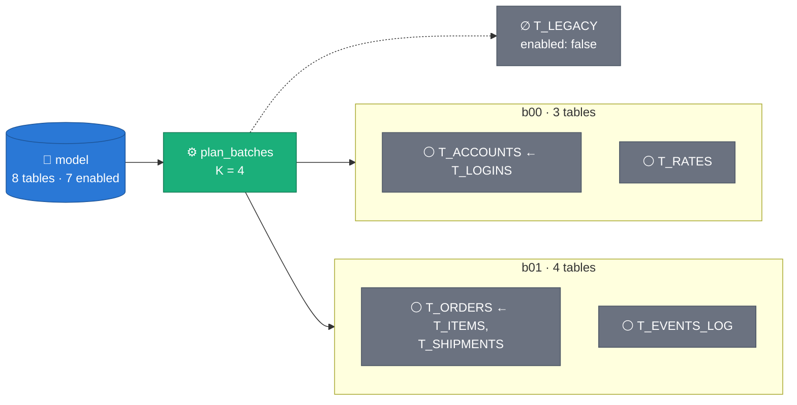

`plan_batches` (`sdfb_core/launch/batches.py`) does four steps:

1. **Components** of the selected tables (`RelationshipRegistry.component`):
   undirected, over every in-model edge between two enabled tables, enforced
   or documented. A disabled table is not traversed, so a branch reached only
   through it detaches.
2. **Sort** them by size descending, then by their first table name.
3. **First-fit-decreasing** into bins of at most K tables: each component goes
   into the first bin it fits, else a new one. A component larger than K gets
   a bin of its own (`Batch.oversized`) and runs whole. Every batch's
   launcher re-plans the whole model, so each launcher logs one
   `model_batch_oversized` WARNING per oversized batch of the plan.
4. **Name** the bins by their first table: b00, b01, … in that order.

In the figure the components are sized 3, 2, 1, 1: the 3 opens b01's bin and
takes `T_EVENTS_LOG`; the 2 opens b00's and takes `T_RATES`
(`test_first_fit_decreasing_on_the_adr_figure`). The plan depends only on the
model's content and K, never on the order the file declares its tables
(`test_the_plan_depends_only_on_the_content_and_k`). K < 1 is refused.
First-fit-decreasing is the classic one-dimensional bin-packing heuristic of
[D. S. Johnson, A. Demers, J. D. Ullman, M. R. Garey, R. L. Graham, "Worst-case performance bounds for simple one-dimensional packing algorithms", SIAM J. Comput. 3(4), 1974](https://doi.org/10.1137/0203025);
here an item is a component and its size its table count.

**A component is never split**: a child is generated from its parent's landed
keys inside one job ([ADR 0030](0030-single-job-relational-generation.md),
[ADR 0036](0036-parent-driven-fanout-generation.md)), so a component spread
over two jobs would lose its referential integrity.

### D4 — Orchestration: the launcher is authoritative

*Every batch job plans the model again and stops when its count is not the
orchestrator's.*

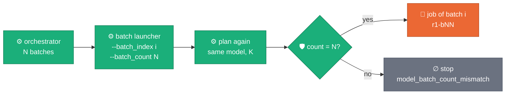

Three things run the batches (`run_pipeline.py::chosen_batches`):

| Orchestrator | What it does |
| :-- | :-- |
| the Composer generation DAG with `tables=all`, `composer/synthetic_beam_bigquery.py` (D6) | one Flex Template launch per batch, `tables=all`, `batch_index`, `batch_count`, `run_id=<base>`; at most the parallel cap at once (D5) |
| `scripts/launch/run_model.py`, from a checkout | one launcher process per batch, `--tables=all --batch_index=i --batch_count=N`, at most `launch.max_parallel_jobs` at once; refuses `--batch_index`, `--batch_count`, `--job_name` and any abbreviation of them of three or more characters; on Ctrl-C or SIGTERM stops its launchers and prints every Dataflow job already created with the `gcloud dataflow jobs cancel` command (stopping a launcher does not cancel its job); exit 0 (every batch finished, or `--dry_run`), 1 (a batch failed; the others ran), 2 (a usage error: nothing was launched) |
| the launcher alone, `--tables=all` without `--batch_index` | a one-batch plan runs as one job, Flex included. Above one batch: on the CLI every batch in sequence (`model_batches_in_sequence` WARNING); a batch that fails is logged (`model_batch_failed`) and the next one runs, and the launch then exits naming every failed batch (Ruling 15). On Flex it refuses, naming the Composer DAG with `tables=all`, `run_model.py` and the K that would make one job |

- **"On Flex"** (Ruling 16) means the environment variable
  `FLEX_TEMPLATE_PYTHON_PY_FILE` is set. `docker/Dockerfile` sets it for every
  process of the image, and a checkout's shell does not, so a CLI run *inside*
  the container counts as Flex and refuses a multi-batch plan without
  `--batch_index`. Run the CLI and `run_model.py` from a checkout.
- **The count check** happens before any BigQuery read of the batch's tables
  (only the model file has been loaded): `model_batch_count_mismatch
  max_tables_per_job=… planned=… replanned=…` (ERROR), then a stop that says
  to trigger the Composer DAG with `tables=all` again or rerun `run_model.py`. A model edit or a K
  change that keeps the count is not detected by it; every row's snapshot
  carries the model's `sha12` (`relationships_digest`) and `batch.tables`, so
  one digest across the launch proves one model (RUN_PLAYBOOK §2e step 10).
- **Run ids** (Ruling 14): the job of batch *i* runs as `<base>-bNN`, its
  tables as `<base>-bNN-MM-<table>` (a one-table batch too), and every row's
  `launch_run_id` is `<base>`. The DAG's `tables=all` branch names each job
  `<job_name>-bNN`, to which the Dataflow provider appends `-<8 hex>`; a CLI
  batch job is named from its run id (`sdfb-<base>-bNN`, sanitized).
- **One `config_digest` per launch**: `launch.batch_index` and
  `launch.batch_count` are launch identity, flags only, like `launch.run_id`,
  and left out of the snapshot's `values`.
- **The record**: the snapshot's `batch` block is `{index, count, tables}`;
  each batch logs its own `launch_scenario` and `launch_config`, whose
  `resolved` gains `launch_run_id` and `batch` (Ruling 31), so a batch job
  evaluated alone by its job id resolves like any multi-table job.
- **One `prepare_record_base` per batch.** A CLI run of N batches repeats the
  `validation_runs` schema read and any `generation_record_degraded` or
  `config_sets_evaluation_input` WARNING once per batch; a DAG or
  `run_model.py` batch is its own process and reads once. The store keys
  (`launch_cache_keys`) are computed once per launcher, so every batch reads
  and writes the same stores.
- **The mirror.** The Composer environment has neither sdfb-core nor
  pydantic, so `composer/sdfb_batches.py` repeats the planner with the
  standard library and PyYAML, plus every pure piece of the launch (planning
  inputs with file-wins, job names, the launch environment and parameters,
  the landed ids, the banner; Ruling 19). A parity test pins it to sdfb-core
  on every committed model and on generated forests of up to 120 tables
  (`packages/sdfb-tests/tests/unit/composer/test_sdfb_batches.py`).

### D5 — The parallel cap

*The cap decides how many batch jobs hold GPUs at once, never what they
generate.*

*`max_parallel_jobs = 1` (the default until 2026-11-04; 3 since, below).*

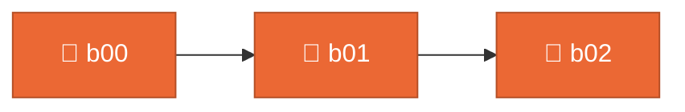

*`max_parallel_jobs = 2`.*

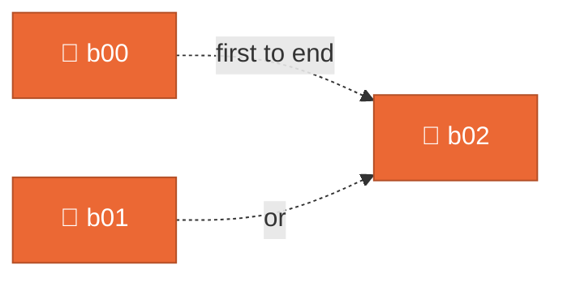

b00 and b01 start together; b02 takes the slot of whichever ends first. Each
running batch job holds its workers' GPUs (the DAG's batch launch asks for up
to `maxWorkers` 4 workers of one GPU each), so the cap is bounded by the
regional GPU quota. Ruling 13 says where each cap lives:

- `scripts/launch/run_model.py` reads `launch.max_parallel_jobs`
  (`--max_parallel_jobs`; default 1 until 2026-11-04, Ruling 12's "the only
  value inside every GPU quota", and 3 since: three jobs of four one-GPU
  workers need 12 GPUs, inside the corp region's 16 T4 and 32 L4; an
  environment with less quota sets 1 or 2). The launcher accepts the key but never reads it, since a
  launcher runs one job or a sequence; the Flex Template does not declare it.
- The DAG's cap is `sdfb_batches.parallel_cap` (*revised 2026-10-31*; it
  was the Airflow Variable alone; *revised 2026-11-04*: a trigger's
  `max_parallel_jobs` DAG param wins for its run, and the layers below are
  that param's default): the Variable `SDFB_MAX_PARALLEL_JOBS` when
  it is set and not empty, else `launch.max_parallel_jobs` of
  `generator.yaml` overlaid by `sdfb_env.yaml`; never below 1. It is read
  when Composer parses the file, and the launch gate holds it (*revised
  2026-11-03*: it was the mapped task's `max_active_tis_per_dag`, which
  Airflow fixes at parse time, [Airflow: dynamic task mapping](https://airflow.apache.org/docs/apache-airflow/stable/authoring-and-scheduling/dynamic-task-mapping.html);
  see [the launch gate](#the-launch-gate-2026-11-03)).
  The Variable applies at the next parse, without a re-import; an overlay
  change takes the next import (it is a DAGs-folder file). A value
  that is no integer fails the DAG's import with a `ValueError` naming where
  it came from. The overlay key has no marker: an environment that wants a
  cap above 1 writes `config: launch: {max_parallel_jobs: "2"}` into its
  `sdfb_env.yaml` by hand (a quoted string, like every overlay value), or
  sets the Variable, which stays so an operator can change the cap without a
  re-import. A config file's `launch.max_parallel_jobs` does nothing in the
  DAG: the file is read when a run starts, after the cap is fixed.

*The DAG's cap: the highest layer that sets it wins (revised 2026-10-31 and 2026-11-04).*

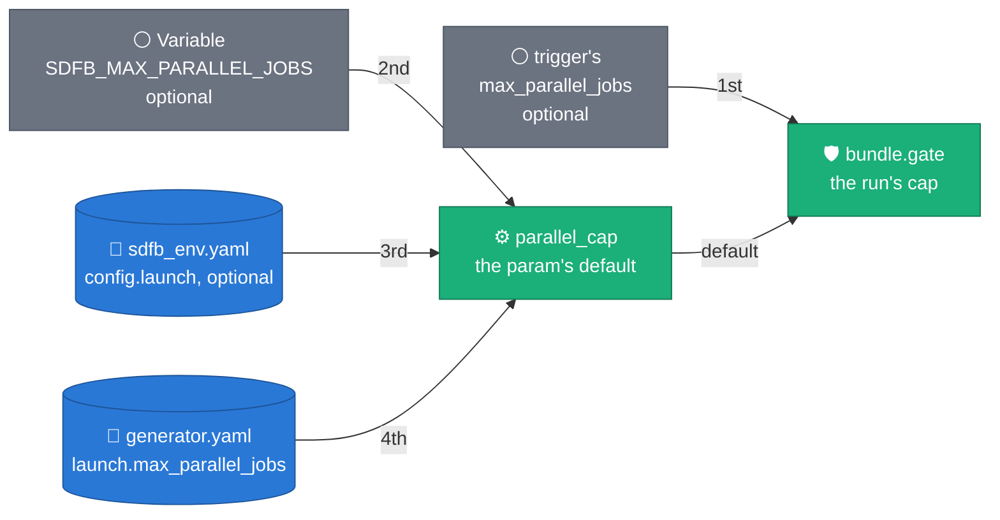

#### The launch gate (2026-11-03)

*Revised 2026-11-03 (unreleased, amended in place).* The first corp
whole-model launch (2026-11-02: an isolated forest of 132 tables, K = 10, 14
batches, cap 1) ran b00 and lost b01 to b13: the scheduler failed all 13
instances, with no start date and no try, 10 minutes into the launch. Two
Airflow 2.x mechanisms combine; both read in the scheduler's source,
identical in 2.10.5 and 2.11.0:

- **The stale-DAG sweep.** With a standalone DAG processor (Composer 3) the
  scheduler deactivates every DAG whose file was last parsed more than
  `[scheduler] dag_stale_not_seen_duration` ago (600 s by default) and
  deletes its serialized DAG
  ([`_cleanup_stale_dags`](https://github.com/apache/airflow/blob/2.11.0/airflow/jobs/scheduler_job_runner.py#L2143-L2165);
  [the setting](https://airflow.apache.org/docs/apache-airflow/2.11.0/configurations-ref.html#dag-stale-not-seen-duration)).
  The shared environment parsed the file about every 670 s, so the DAG was
  missing for up to a minute in every parse cycle until its file was parsed
  again.
- **The fail-fast, for a DAG with a task-level limit only.** When the
  scheduler queues a SCHEDULED instance of a DAG whose
  `has_task_concurrency_limits` is set (some task sets
  `max_active_tis_per_dag` or `max_active_tis_per_dagrun`,
  [`dag.py`](https://github.com/apache/airflow/blob/2.11.0/airflow/models/dag.py#L3300-L3303)),
  it loads the serialized DAG to read the limit; when the DAG is missing it
  sets every SCHEDULED instance of that DAG to FAILED
  ([`_executable_task_instances_to_queued`](https://github.com/apache/airflow/blob/2.11.0/airflow/jobs/scheduler_job_runner.py#L524-L541)).
  A RUNNING instance is not touched, and no retry follows.

`max_active_tis_per_dag` both set that flag and parked `batches - cap`
instances in SCHEDULED for the whole launch, so a sweep was certain to find
them. The flag covers the whole DAG: the explicit branch's reschedule-mode
sensors were exposed too, briefly, at each poke.

*Before, and after (one scheduler pass over a SCHEDULED instance).*

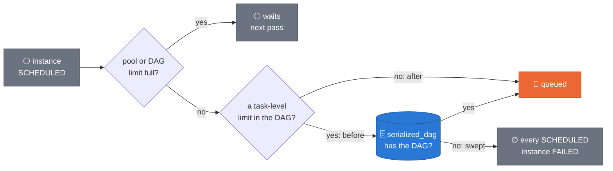

**Decision.** The DAG sets no task-level limit on any task, and the cap is
a launch gate in the batch operator: `_GatedFlexTemplateOperator`, a
`DataflowStartFlexTemplateOperator` whose `pre_execute` reads its siblings'
states and, until `sdfb_batches.may_launch` holds (every batch `cap` or more
indexes below it has ended), raises `AirflowRescheduleException` for two
minutes later: the instance waits up for reschedule, holding no worker slot,
and pokes again. Once it may, it launches its job and waits for it. At most
`cap` jobs run at once, and an instance waits only on lower indexes, so no
two wait on each other. Each poke passes SCHEDULED and QUEUED for moments,
and an instance that waits SCHEDULED longer (for a pool slot, or the DAG's
`max_active_tasks`) only waits: without the flag the scheduler never checks
the serialized DAG there. A reschedule keeps the try
([`dagrun.py`](https://github.com/apache/airflow/blob/2.11.0/airflow/models/dagrun.py#L1610-L1621):
an instance up for reschedule is scheduled again without `try_number + 1`),
so `retries=0` still means one launch; a mapped instance's reschedule date is
honoured through its `task_reschedule` row
([`ReadyToRescheduleDep`](https://github.com/apache/airflow/blob/2.11.0/airflow/ti_deps/deps/ready_to_reschedule.py)).
*Wrong, corrected 2026-11-04*: that dependency belongs to sensors only
([`BaseSensorOperator.deps`](https://github.com/apache/airflow/blob/2.10.5/airflow/sensors/base.py#L170)),
so an operator's reschedule date is never read and the instance is queued
again at once ([the gate as a sensor](#the-gate-as-a-sensor-in-a-bundle-2026-11-04)).
A pin keeps the flag off:
`test_generation_dag.py::test_no_task_sets_a_task_level_concurrency_limit`.

*The gate at cap 1 (time runs right).*

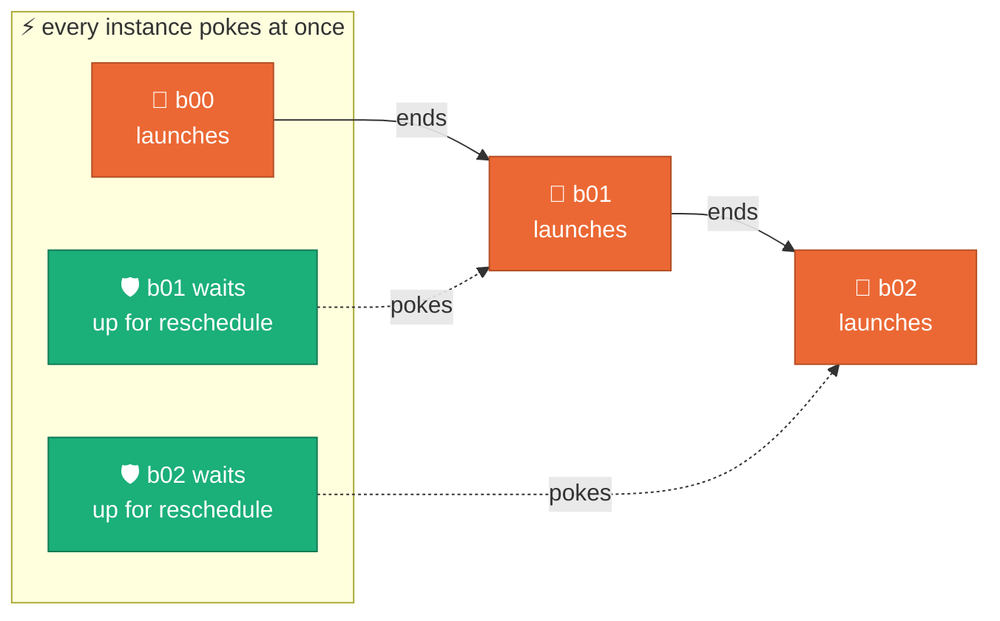

What it costs, and what it does not do:

- **A poke every two minutes per waiting instance**: a task start that
  parses the DAG file (about 3 s on the corp environment), and up to two
  minutes between a batch's end and the next one's launch. A sleeping gate
  was the first version of this decision, and the review of 2026-11-03
  rejected it (below).
- **Clearing.** A cleared instance launches once its lower siblings have
  ended, so clearing a failed one after the run has ended launches it at
  once; cleared while a higher batch's job still runs, it launches beside it,
  one job over the cap.
- **The diagnosis.** `fail_if_a_batch_failed` names the failed batches, and
  those that failed with neither a start nor an end date
  (`sdfb_batches.never_started`): the ones the scheduler failed, to clear.
- **The environment.** Raising `dag_stale_not_seen_duration` above the
  parse cycle stops the sweep itself (DEPLOYMENT_PREREQUISITES, Composer; the
  check is in RUN_PLAYBOOK §2e). The DAG does not depend on it: the gate
  holds without it.
- **Laptop evidence, no Composer.** The harness runs the real gate on the
  real task instances (`all_14_batches_cap_1`, `all_middle_batch_fails`) with
  the poke at 0: `dag.test()` starts the mapped instances in no fixed order,
  the waiting ones are rescheduled (64 waits in the two scenarios) and run
  again, every instance on its first try, and the batches launched in the
  gate's order, b00 to b13; after b01 fails, b02 launches. `dag.test()` runs
  one task at a time, so how many jobs run at once is the property
  `test_sdfb_batches.py::test_the_gate_never_runs_more_than_cap_jobs`, over
  any order of completions. Unverified until the corp relaunch: Composer's
  own parse cycle, the sweep, and the reschedule dates under its scheduler.

Rejected:

- **A gate that sleeps, RUNNING** (the first version, and the fix brief's).
  Each waiting instance holds a Celery worker slot for hours (with cap 1 and
  14 half-hour batches, about 45 slot-hours). On a shared environment at its
  most workers, the later instances then sit QUEUED, and after
  `[scheduler] task_queued_timeout` (600 s by default) and two requeues the
  scheduler fails them
  ([`_handle_tasks_stuck_in_queued`](https://github.com/apache/airflow/blob/2.11.0/airflow/jobs/scheduler_job_runner.py#L1788-L1859)),
  stamping a start and an end date: batches lost again, by another route,
  where `max_active_tis_per_dag` had kept them SCHEDULED. The brief rejected
  rescheduling because each poke passes SCHEDULED; that holds only for a DAG
  with the flag.
- **One dispatcher task** launching every batch through `DataflowHook` and
  polling: one slot and no SCHEDULED instance at all, but no per-batch
  instance to clear, no per-batch XCom for `collect_landed`, and its own
  cancel-on-kill. The fallback if the gate fails on Composer.
- **`max_active_tis_per_dag` or `max_active_tis_per_dagrun`**: either sets
  the flag.
- **A Composer pool.** An environment setting the DAG cannot check: an
  instance in a pool that does not exist is never scheduled.
- **A deferrable gate** (a trigger): it needs a triggerer, which this DAG
  does not need today.
- **Only raising `dag_stale_not_seen_duration`**: needed, but a DAG must
  not depend on a setting it cannot check.

#### The gate as a sensor, in a bundle (2026-11-04)

*Revised 2026-11-04 (unreleased, amended in place).* The 2026-11-03 relaunch
ran its 14 batches one at a time, from 18:57 to 23:30 UTC, and the gate did
not wait between pokes. Airflow honours a reschedule date only through
`ReadyToRescheduleDep`, which only a sensor's task instances carry
([`sensors/base.py`](https://github.com/apache/airflow/blob/2.10.5/airflow/sensors/base.py#L170);
[`ready_to_reschedule.py`](https://github.com/apache/airflow/blob/2.10.5/airflow/ti_deps/deps/ready_to_reschedule.py)).
A `DataflowStartFlexTemplateOperator` subclass raising
`AirflowRescheduleException` went up for reschedule, scheduled, queued and
running again within 1 to 4 s. Measured on Composer (`TaskInstance Finished`
events per instance, 18:00 to 00:30 UTC):

| instance | executor round trips |
| :-- | --: |
| b03 | 1,098 |
| b06 | 2,392 |
| b11 | 2,804 |
| b13 | 4,949 |

About 25,000 round trips for the launch. At 21:00:27 UTC the executor
reported b11 "finished with state success" while its state read queued,
and the scheduler marked it FAILED (`retries=0`): b11 launched no job, and
its ten tables are part of the 50 with no row.

**Decision.** The `tables=all` branch is one mapped task group per batch,
`bundle[i]`
([Airflow: mapping over a task group](https://airflow.apache.org/docs/apache-airflow/2.10.5/authoring-and-scheduling/dynamic-task-mapping.html#mapping-over-a-task-group);
Airflow 2.5 and later, Composer runs 2.10). Every task of a bundle shares
its batch's map index, so each one reads its own batch's XComs:

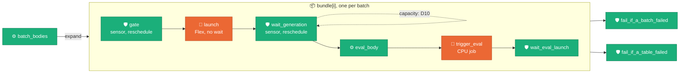

- **`gate`** is `_LaunchGateSensor`, a `BaseSensorOperator` in reschedule
  mode. Its poke reads the bundles' `wait_generation` states and returns
  `sdfb_batches.may_launch(i, cap, states)`, `cap` being the run's
  `max_parallel_jobs`. A bundle holds a slot of the cap from its launch
  until its wait ends, so at most `cap` generation jobs run at once, and
  the proof of `may_launch` is unchanged (a bundle waits only on lower
  indexes). An evaluation holds no slot.
- **`launch`** returns as soon as the job is queued (`wait_until_finished`
  off, `retries=0`), and **`wait_generation`** waits in reschedule mode. No
  task of a bundle holds a worker slot while it waits, where `start_batch`
  held one Celery slot per running batch for its job's hours.
- **No task-level limit**, as before: the cap is the gate alone (the pin
  `test_no_task_sets_a_task_level_concurrency_limit` stays).
- **The leaves** `fail_if_a_batch_failed` (one_failed) and
  `fail_if_a_table_failed` (all_done) hang off every bundle's
  `wait_generation` and print the same banners. The failure message names
  each failed bundle and the task it failed in (`sdfb_batches.bundle_failures`).

*At cap 3 (time runs right): a bundle launches when the bundle three below
it has ended its generation; evaluations run beside the next jobs.*

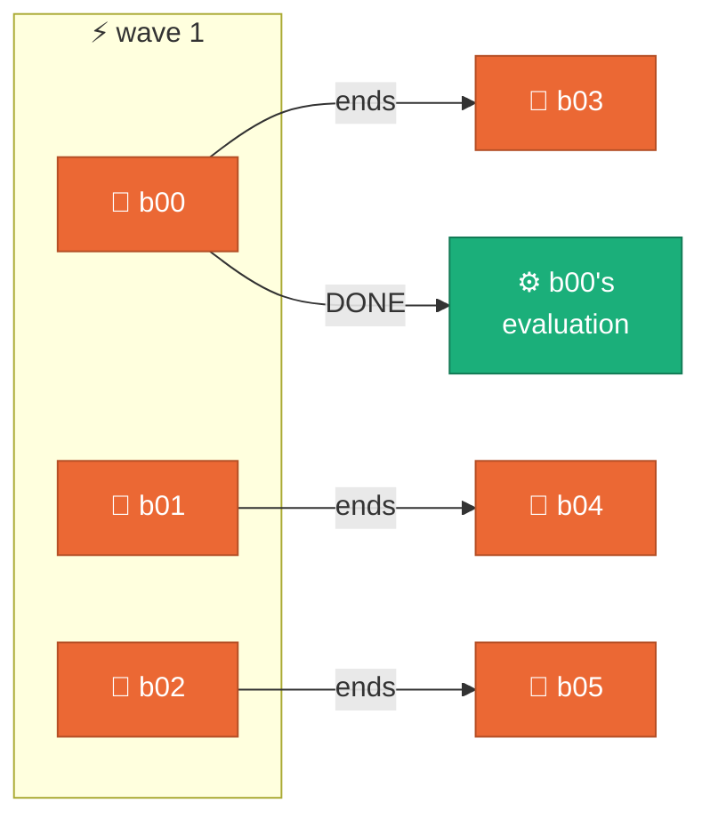

At cap 3, 14 batches of about 30 minutes run in five waves (3, 3, 3, 3, 2),
about 2.5 hours where cap 1 took 4.5. The default is 3 since this revision:
three jobs of four one-GPU workers need 12 GPUs of the regional quota.

Laptop evidence, no Composer: the harness (`scripts/composer/check_dags.py`)
runs the group under Airflow 2.10.5's `dag.test()`. Fourteen bundles at
cap 1 (the trigger's `max_parallel_jobs`) and at the default 3, every
bundle launched only after the bundles `cap` or more below it had ended
their generation, and every bundle evaluated its own job. Unverified until
the corp relaunch: the scheduler honouring the sensors' reschedule dates
under Composer.

Rejected:

- **Keeping the operator and setting `reschedule = True`.** The dependency
  comes from the class's `deps`, not the attribute, and the sensor base
  class is what calls `poke` and raises the reschedule: the operator would
  have to become a sensor anyway.
- **Three separately mapped tasks** (a gate sensor, a launch, a wait, each
  `.expand`ed over the bodies). Outside a task group a mapped task waits
  for every instance of its mapped upstream, not for its own index: every
  launch would wait for every gate.

### D6 — One generation DAG, two branches

*Revised 2026-10-26 (unreleased, amended in place).* D6 first decided a
second Composer DAG, `composer/synthetic_model_launch.py`
(`synthetic_sdfb_model_<DAG_VERSION>`), with six tasks of its own. It
duplicated most of the generation DAG, and it is deleted. The generation
DAG, `composer/synthetic_beam_bigquery.py` (DAG id
`synthetic_sdfb_<dag_version>`, master's), launches every shape: one table,
an FK group, or every enabled table of a model. Its params are the union of
the two DAGs' plus `tables` (`explicit` | `all`), and its defaults come from
`generator.yaml` and the env overlay ([ADR 0043](0043-generator-config.md),
revision of 2026-10-26).

*One evaluation covers what the launch landed; under `all` a failed batch or
a failed table fails the run, not its neighbours.*

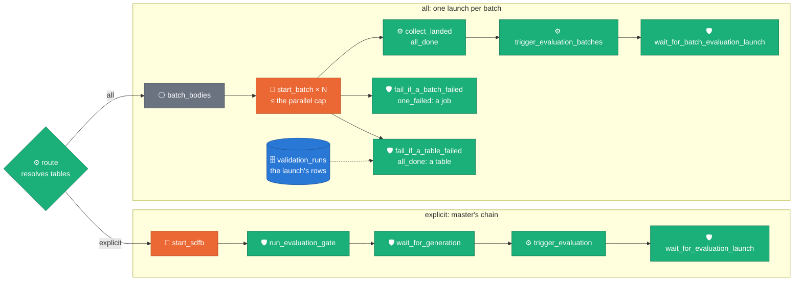

**Which branch.** `route` is a `@task.branch`. It resolves `tables` with
`sdfb_batches.resolve_tables_mode`: a `config_uri` file's `launch.tables`
wins over the param (ADR 0043's file wins), so a file that says `all` takes
the batch branch whatever the trigger says. It reads the file through
`GCSHook` only when `config_uri` is set, and the model file only on the
`all` branch: an explicit launch without `config_uri` reads nothing from GCS,
as master's DAG read nothing. The file's `serving.client_type`, `gpu`,
`sdk_containers` and `launcher_machine_type` go over the params before any
launch body is built (`with_file_hardware`, ADR 0043 R2). Explicit: it mints
the run id (`<dag run id>-<8 hex>`), pushes `sdfb_batches.explicit_body`
under `body` and returns `start_sdfb`. All: it plans with
`sdfb_batches.launch_plan` over `whole_model_params` (an empty
`source_dataset` or `landing_dataset` takes the `project.dataset` of the
overlay's default source table or landing table), pushes the bodies, the base
run id, the batch count, the model file, the batches, the banner and the
verdict inputs (`verdict_inputs`, below), and returns `batch_bodies`. It
pushes the resolved `mode` either way.

| Task | Branch | Trigger rule | Does |
| :-- | :-- | :-- | :-- |
| `route` | both | `all_success` | the branch, the bodies, the plan's `MODEL LAUNCH PLAN` banner (above). A `PlanError` (bad YAML, a bad `launch:` or `serving:` value, a missing or non-UTF-8 object, a model that is not one gs:// file, K below one) fails it with `AirflowFailException`, never retried; any other error (a transient GCS read) is retried as the environment says |
| `start_sdfb` → `run_evaluation_gate` → `wait_for_generation` → `trigger_evaluation` → `wait_for_evaluation_launch` | explicit | `all_success` | master's five tasks, ids and arguments; the gate builds the evaluation body (the job id `start_sdfb` returned, the mode `route` resolved) |
| `batch_bodies` | all | `all_success` | returns `route`'s bodies: Airflow maps a task only over another task's return value, never a custom XCom key, and a branch's return value is the branch it takes |
| `start_batch` | all | `all_success` | one mapped `DataflowStartFlexTemplateOperator` per body, `wait_until_finished=True`, `retries=0`, the launch gate holding the parallel cap (D5). A job that ends in any state but DONE fails its own instance; the other instances run on (the DAG sets no fail-stop) |
| `collect_landed` | all | `all_done` | after every instance, the failed ones included: returns the evaluation's launch body over the jobs that reached DONE, in batch order; skips (and so skips the evaluation) when `route` planned no batch, when `run_evaluation` is off, or when nothing landed |
| `trigger_evaluation_batches` | all | `all_success` | one CPU Flex launch of the same template, its body `collect_landed`'s: `sdfb_job=evaluation`, `run_id=<base>`, `generation_job_ids=<the landed ids>`, `relationships_uri` (empty when `generate_fk_relationships` is false), `scope=manual`, `trigger=chained`, `output_dataset` = `evaluation_output_dataset`; neither `reference_rows_limit` nor `validation_runs_table` (Ruling 30). Not waited for |
| `wait_for_batch_evaluation_launch` | all | `all_success` | master's reschedule sensor on the evaluation job; its failure callback `_close_batch_running_row` closes the evaluation's RUNNING registry row, found by `base_run_id` |
| `fail_if_a_batch_failed` | all | `one_failed` | a leaf that fails once a `start_batch` instance failed; skipped when every batch succeeded, when the explicit branch ran, or when `route` failed (which fails the run itself) |
| `fail_if_a_table_failed` | all | `all_done` | a leaf, after every `start_batch` instance (revised 2026-10-31): reads the launch's `validation_runs` rows and fails when a planned table's newest row is not `PASSED` or no row names it, logging the `TABLE VERDICTS` banner; skips when `route` planned no batch, and with a WARNING when no `validation_runs` table is named; a `FAILED_BLOCKER` is informational under `client_type=fake` ([below](#the-table-is-the-unit-of-failure-2026-10-31)) |

- **`wait_until_finished=True` is what makes the cap count running jobs**: an
  instance holds its slot, and an Airflow worker slot (the operator is not
  deferrable), until its job ends. Killing a running instance (a Composer
  worker restart, marking it failed) cancels that batch's Dataflow job: the
  operator's `on_kill` cancels the job it waits for.
- **Retries**: `start_batch` passes `retries=0`: a retried batch would launch
  again under the same base run id, landing its rows twice under append after
  a job that failed once its rows had loaded. To run a failed batch again,
  fix the cause and clear its `start_batch` instance with its downstream
  tasks. Every other task leaves retries to the environment, as master's
  chain does; a `PlanError` in `route` is an `AirflowFailException`, which
  Airflow does not retry.
- **The schedule is master's** (`schedule_interval="@once"`,
  `max_active_runs=1`): Composer runs one explicit launch of the overlay's
  default table when it imports the DAG, as master's DAG did. The deleted
  model DAG was manual-only; a `tables=all` launch is a manual trigger.
- **The Composer environment's service account** reads the config file and
  the model file (`GCSHook`), so it needs `storage.objects.get` on them, and
  only for a launch with `config_uri` or `tables=all`.
- **The run's outcome**: Airflow fails a run by a failed leaf. After a failed
  batch the watcher fails at once and the run ends failed once the
  evaluation's launch has been waited for; with every batch landed the watcher
  is skipped and the run ends as `fail_if_a_table_failed` and the
  evaluation's launch did (the outcomes table [below](#the-table-is-the-unit-of-failure-2026-10-31)).
- **Laptop evidence, no Composer**:
  [`scripts/composer/check_dags.py`](../../scripts/composer/check_dags.py)
  imports the DAG folder (the DAG, `sdfb_batches.py`, `generator.yaml` and a
  filled `sdfb_env.yaml`) into Airflow 2.10.5 with the Google provider 12.0.0
  and runs fourteen triggers through `dag.test()` with every Google call
  patched, `BigQueryHook` included (it serves each scenario's
  `validation_runs` rows): four explicit launches (L4, T4, an FK group, the
  evaluation off), an explicit trigger whose config file says `all`, one
  batch, two batches, a failed batch, a plan that fails, and three judged by
  their tables' rows: the overlay's model with no trigger value
  (`all_from_overlay`), a table whose gate failed while every batch job
  reached DONE (`all_table_fails`), and a `validation_runs` table without
  `status_reason` (`all_old_validation_runs`, which proves the query without
  the column was issued), and two through the launch gate at cap 1
  (`all_14_batches_cap_1`, `all_middle_batch_fails`; D5). Every task state, launch body and GCS read
  matched (`test_generation_dag.py::test_the_harness_run_is_the_plans`); the
  explicit launches resolve like master's recorded ones but for
  `DELIBERATE_CHANGES` and read nothing from GCS
  (`test_launch_helpers.py::test_explicit_launch_resolves_like_master`).
- **Unverified on Composer**, checked by RUN_PLAYBOOK §2e: a mapped
  `DataflowStartFlexTemplateOperator` with `wait_until_finished=True` holding
  its slot until its job ends and failing on any other terminal state;
  `xcom_pull(task_ids="start_batch")` returning the mapped return values in
  map order without the failed instances; `all_done` and `one_failed` counting
  every mapped instance; the job-name suffix; `on_kill`; and
  `fail_if_a_table_failed`'s read of `validation_runs` through
  `BigQueryHook().insert_job(...).result()`, the call the registry callbacks
  already make, with BigQuery's live error text for a missing column (the
  leaf matches `Unrecognized name: status_reason`,
  `sdfb_batches.MISSING_REASON_COLUMN`, taken from BigQuery's error messages,
  not from a run).

#### The table is the unit of failure (2026-10-31)

*Revised 2026-10-31 (unreleased, amended in place).* Until this revision a
batch job was the unit of failure: one table's preflight stop aborted its
whole batch before anything launched, and one table's BLOCKER failed the
Dataflow job for every table in it, so its good tables were never
evaluated. Under `tables=all` the job now ends DONE whenever the
infrastructure worked, every table's verdict is its `validation_runs` row,
and the Composer run fails from those rows, naming the tables.

*A failed table fails itself; a component's members fail together; the job
ends DONE.*

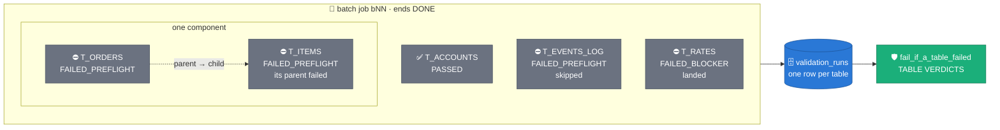

- **Scope** (Ruling 32): only a whole-model batch, `launch.tables: all`.
  The rule is mode-based, not count-based: a one-table batch of a
  whole-model launch gets the recording gate too. An explicit launch,
  single-table or FK group, keeps the collect-then-fail prep and the fatal
  gate.
- **The component inside the job** (Ruling 33): the tables of the batch
  reachable from a table over the in-model edges between tables of the same
  batch (`run_pipeline.py::batch_components`); an isolated table is a
  component of one. The planner never splits a component (D3), so a
  component of the plan is whole inside its batch.
- **The prep-skip rule** (`run_pipeline.py::_prep_relational_specs`, the
  single-job runner): when a table's prep raises, its whole component fails.
  What fails it: a preflight `SystemExit` and any other `Exception` (a read
  the look-ahead ran, a library error); a `BaseException` such as
  `KeyboardInterrupt` still stops the launcher. Each failed table is logged
  `table_skipped table=… reason=…` (ERROR). A member of a failed component
  that is not prepped yet is not prepped; a parent already prepped is dropped
  with its failed child. A member's reason is
  `component member <X> failed preflight: <X's reason>` (parents come first
  in plan order). The surviving tables launch exactly as before: the values
  carried between tables (`rows_by_landing`, `distinct_keys_by_landing`)
  only ever passed between members of one component. Once per batch with
  skipped tables the launcher logs
  `model_batch_partial skipped=… skipped_tables=… tables=…` (WARNING).
- **Each skipped table gets a row** written by the same job, through the
  `validation_runs` sink a built table takes, so it carries the generation
  record's columns like every row of the batch:
  `status = FAILED_PREFLIGHT`, `valid_count = 0`, `dlq_count = 0`, an empty
  `reference_digest` (nothing was read), and `status_reason` the
  `[preflight …]` stop's text, cut to 1,000 characters
  (`summary.py::preflight_failed_summary`, `STATUS_REASON_MAX`). Any other
  exception's text may quote a cell, so its reason is value-free:
  `<ExceptionType> during driver-side preflight (traceback in the launcher
  log)` (Ruling 38). Without a `validation_runs` table no row is written;
  the milestones carry the reasons.
- **Every table skipped**: the launcher stops as before ("N of M planned
  tables failed driver-side preflight — nothing was launched"), the batch
  job fails, and the DAG reads its tables as NO ROW. A one-table batch runs
  through `_run_one_table`, not the single-job runner: a preflight stop there
  fails the launcher with no row, the same outcome. Under
  `multi_table_mode: sequential_jobs` a batch's tables run one job each and
  the first stop ends the batch, as before; their gates record too.
- **The recording gate** (`pipeline.py::_BlockerGateDoFn`,
  `PipelineConfig.blocker_verdict_only`, set on every table of a
  whole-model batch): on a `FAILED_BLOCKER` row it logs
  `blocker_gate_recorded blocker_count=… gate=… observed=… run_id=… table=…`
  (ERROR) and never raises, so the job runs on to DONE. The row's
  `status_reason` is the sentence an explicit launch's job failure carries.
  The fake client gets the recording gate too (it had none): one more log
  line, no other change. Every other launch keeps `fail_on_blocker`.
- **`status_reason`** (Ruling 34): the 36th column of `validation_runs`,
  NULLABLE STRING, after `config`. It is written only when the live table has
  it; otherwise the rows omit it and the launcher logs
  `status_reason_unsupported reason=schema_unreadable|missing_column table=…`
  (WARNING; silent when no `validation_runs` table is named). It is not part
  of [ADR 0044](0044-generation-record.md)'s all-or-nothing record set: a
  table with ADR 0044's columns and not this one still gets its record. The
  committed schema file is a superset, so ADR 0044's `bq update` adds it.
- **What `route` pushes for the leaf** (`sdfb_batches.verdict_inputs`, the
  XCom key `verdict_inputs`): the `validation_runs_table` (a `config_uri`
  file's `io.validation_runs_table` when it sets one, else the overlay's),
  the `landing_dataset` (a file's `io.landing_dataset`, else
  `whole_model_params`'), and the `client_type` after `with_file_hardware`.
  A null in the file is unset, as the launcher reads it.
- **The leaf** (`fail_if_a_table_failed`, `all_done`, downstream of
  `start_batch`): it reads the launch's rows with
  `sdfb_batches.verdicts_query`, a parameterised `SELECT … WHERE
  launch_run_id = @base OR STARTS_WITH(run_id, CONCAT(@base, '-b'))`, through
  `BigQueryHook` (Ruling 35). The second clause is D7's rule for rows without
  a record, so a `validation_runs` table not yet migrated to ADR 0044 still
  yields verdicts. On BigQuery's `Unrecognized name: status_reason` it
  queries again without the column, and each reason reads "no reason
  recorded (the table has no status_reason column)". A
  `validation_runs_table` that is no `project.dataset.table` fails the leaf
  once, like a `PlanError`; any other error is retried as the environment
  says. `sdfb_batches.table_verdicts` keeps each planned table's newest row
  (by `created_at`, then `run_id`), and `verdict_banner` logs
  `TABLE VERDICTS | N planned · P passed · F failed · M no row`, then one line
  per table that did not pass (`<table> | <status> | <reason>`), per planned
  table with no row (`<table> | NO ROW | batch bNN did not reach DONE, or
  the record is off`) and per row of a table the plan does not name
  (`UNPLANNED`, never fatal). The run fails when any planned table is not
  `PASSED` or has no row. Under `client_type=fake` a `FAILED_BLOCKER` reads
  `FAILED_BLOCKER (informational: client_type=fake)` and fails nothing: the
  fake client's gate never failed a job. `FAILED_PREFLIGHT` and NO ROW fail
  on every client.
- **Timing**: `validation_runs` rows land by FILE_LOADS before a job reaches
  DONE, because a job is DONE only after its load stage finished
  (`wait_on_write` orders the raising gate after the load), so
  `all_done` after `start_batch` sees every DONE job's rows. A job that
  failed wrote none, or some: the leaf reports what it finds.
- **The evaluator** leaves a `FAILED_PREFLIGHT` table out of the
  evaluation, keyed on the row's status after the position check, with the
  note `<table>: not generated by the launch (FAILED_PREFLIGHT: <reason or
  "no reason recorded">)`; a `FAILED_BLOCKER` table landed and is evaluated
  (`context/launch.py`, `RunRecord.status_reason`).
- **`launch_config` is unchanged** (Ruling 37): it is logged before any table
  is prepared, so it still lists the skipped tables; `model_batch_partial`
  and the rows carry them.
- **The CLI**: `--tables=all` without `--batch_index` exits 1 after every
  batch ran, naming each skipped table ("N table(s) skipped at preflight; the
  others ran"); a BLOCKER verdict does not change the exit (a Flex launcher
  exits 0: the job is its own record, and the rows carry the skips).
  `scripts/launch/run_model.py` prints, after its per-batch lines,
  `Per-table verdicts (a DONE batch may hold a failed table, ADR 0045):` and
  the `bq query` that lists the launch's tables that did not pass (or
  `# no validation_runs_table: verdicts are not recorded`).
- **IAM**: the Composer environment's service account reads
  `validation_runs` (`roles/bigquery.dataViewer` on its dataset;
  `roles/bigquery.jobUser`, which the registry callbacks already need).

**Outcomes** (Airflow fails a run by a failed leaf):

| Situation | `fail_if_a_batch_failed` | `fail_if_a_table_failed` | The run |
| :-- | :-- | :-- | :-- |
| every batch DONE, every table `PASSED` | skipped | success | as the evaluation's launch did |
| every batch DONE, a table `FAILED_BLOCKER` or `FAILED_PREFLIGHT` | skipped | failed, naming it | failed; every DONE batch evaluated |
| a batch job failed (infrastructure, a count mismatch, every table of the batch skipped, a one-table batch's preflight stop) | failed | failed: its tables NO ROW | failed; the other batches evaluated |
| no `validation_runs` table named (the record off) | as before | skipped, with a WARNING | as before |
| `validation_runs` without `status_reason`, or not migrated to ADR 0044 | as before | runs: rows found by `launch_run_id` or `run_id`, reasons "no reason recorded" | as the rows say |
| `client_type=fake`, a table `FAILED_BLOCKER`, nothing else | skipped | success; the banner lists it as informational | success |
| an explicit launch, or `route` failed | skipped | skipped | as before |

To run the failed tables again: an explicit launch of each fixed table, or a
copy of the model with every other table `enabled: false`, launched with
`tables=all` (RUN_PLAYBOOK §2e step 12). The DAG has no "re-run the failed
tables" option (ROADMAP).

### D7 — The evaluator: one evaluation per bundle

*Revised 2026-11-04 (unreleased, amended in place).* The 2026-11-03 relaunch
evaluated its 77 landed tables as one job, and the Flex launcher failed after
12 minutes with `Timeout in polling result file`: the planning of 77 tables
did not fit its window. Each bundle now evaluates its own batch job once
that job is DONE (`eval_body`, `trigger_eval`, `wait_eval_launch` in the
bundle; `--run_id <base> --generation_job_ids <that job>`), at most K tables
per evaluation by construction. A bundle whose generation failed skips its
own evaluation and nothing else; `collect_landed` and the aggregated
evaluation are gone. The evaluation job is CPU only, named
`<evaluation name>-bNN-<ts>` (inside the same 63 characters), and holds no
slot of the cap. Its failure callback, `_close_bundle_running_row`, finds
the RUNNING row by that bundle's generation job id, which the registry
records as `generation_job_id`, never by the base run id every bundle's
evaluation shares: one dead launcher closes no other bundle's row.

The evaluator is unchanged: it writes each `evaluation_*` table once per job
already, so concurrent evaluations add one load per table each (D9's
budget). `scripts/launch/run_model.py` still prints one evaluation command
over the landed batches.

A whole-model launch is evaluated as `sdfb-eval run --run_id <base>
--generation_job_ids <id>,<id>`, the batch jobs that landed (Ruling 2), not
as `--tables`: the evaluator takes exactly one target, and `--tables` reads
each source as `<reference_dataset>.<name>`, which would ignore a
`source_table`. On the `--run_id` path every table is compared with the
source its `validation_runs` row names, an override included.

- **A batch's rows are the launch's** (Ruling 3, `context/launch.py::_launch_of`):
  a row belongs to the asked base when its recorded `launch_run_id` names it,
  or its run id's base does, or — only on a row without a recorded launch —
  when its run id's base is the asked base plus a batch suffix `-bNN`.
- **Narrowed by the recorded `job_id`** (Ruling 4, `context/runs.py::rows_of_jobs`):
  rows of jobs not listed are dropped with a note; a row with no `job_id` (the
  worker could not read it, ADR 0044) is kept with a note that it may belong
  to an unlisted batch. Positions are checked per batch, so a gap is named by
  its batch.
- **`--generation_job_ids` goes with `--run_id` alone**; any other target with
  it is a usage error. It narrows ONE evaluation, unlike the standalone
  evaluation DAG's `generation_job_ids` param, which fans out one evaluation
  per job.
- **`scope=manual`**: the DAG's `tables=all` branch and `run_model.py` pass it, because a
  `--run_id` evaluation has no labelled writes and `auto` would resolve every
  table's scope to `unknown`.
- **The registry** `evaluation_data_history` gains `generation_job_ids`
  (REPEATED STRING, appended after ADR 0044's columns; Ruling 5): the listed
  ids on a model launch, `[generation_job_id]` on a single job, `[]` when the
  evaluation names none; `generation_job_id` is the first id.
- **`_evaluation_key` is unchanged** (Ruling 29): it already holds every run
  id, which distinguishes the batches. The request key of a launch that
  failed to resolve gains the job ids when they are given.
- Metrics, scoring and the catalogue are unchanged.

### D8 — Parallel prep

*Threads read ahead; the cross-table steps keep the plan's order, so the
outputs do not change.*

*`prep_workers = 1`: before ADR 0045.*

*`prep_workers = W`: reads ahead.*

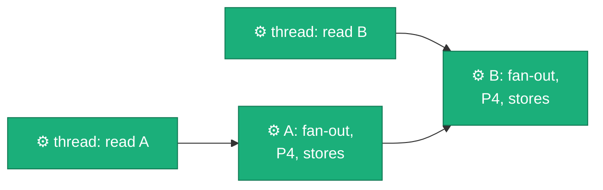

`launch.prep_workers` (default 8; `--prep_workers`, template parameter
`prep_workers`) is Ruling 17:

- **Where**: only the single-job multi-table runner (`_run_relational_job`).
  A single-table launch, `sequential_jobs`, `prep_workers: 1` and a one-table
  plan create no thread.
- **What runs on a thread** (`prefetch_table_prep`): `resolve_schemas` (both
  schemas), `load_reference_rows`, and the source-stats computation including
  the `exact` aggregate scan — reads and pure profiling, nothing else. No
  model and no embedder: the transformers v5 lazy-import race of 2026-07-30
  is why.
- **How** (`PrepReadAhead`): the first table's prep logs
  `launch_prep_parallel tables=… workers=…` and submits every table's reads;
  each table's prep then takes its own, in plan order, where the sequential
  prep read them. The fan-out, preflight P4, the pools and the stores run
  where they did. Source stats are computed on a thread but written after
  preflight, as before, so a table whose preflight stops writes no stats. A
  read that failed raises at its table's turn, the same exception as before.
  At the end the reads not started are cancelled and the ones in flight
  waited for.
- **The one default-on change in what a launch does** for a launch that uses
  none of this ADR's options: the outputs are identical; the timing, the log
  order, and the reads already paid by a table that preflight then stops
  differ (under `--source_stats=exact` that includes its exact aggregate
  scan, and the look-ahead can have finished later tables' reads when a hard
  failure lands). The launcher also issues more BigQuery reads at once.
  `launch.prep_workers: 1` restores the previous sequence exactly
  (`packages/sdfb-tests/tests/unit/cli/test_parallel_prep.py`).
- **A second, usage-level change** for every launch, at parse time
  (Ruling 25): the new flags make some abbreviations ambiguous, so a launch
  typed with one now stops with argparse's usage error before it does
  anything. No spelled-out flag changes. *(Revised 2026-10-26: hidden aliases
  put every abbreviation master accepted back on its flag, so no launch that
  parsed on master stops here; see Ruling 25.)*

### D9 — One load job per shared table per job (2026-11-04)

*The 2026-11-03 relaunch lost four batch jobs to BigQuery's table update
rate.* b02, b03, b08 and b12 failed after 16 to 19 minutes on
`Exceeded rate limits: too many table update operations for this table`
(`rateLimitExceeded`) in `<TABLE>/WriteRagChunks`, a FILE_LOADS append into
`synthetic_rag.rag_chunks`. `build_relational_pipeline` applied each table's
own write, so a batch of ten fired one load job per table into the same
table, and the population branches finish together. BigQuery allows about
five update operations per table per ten seconds
([BigQuery quotas: table operations](https://cloud.google.com/bigquery/quotas#standard_tables)).
Loads into `rag_chunks` per batch (`INFORMATION_SCHEMA.JOBS_BY_PROJECT`):

| batch | loads | rate-limited | span of the burst |
| :-- | --: | --: | --: |
| b01 | 10 | 0 | 32 s |
| b02 | 8 | 2 | 15 s |
| b03 | 8 | 2 | 12 s |
| b08 | 7 | 1 | 8 s |
| b12 | 10 | 1 | 22 s |
| the others | 10 | 0 | 24–68 s |

Over the launch, per shared table:

| table | loads | peak per 10 s |
| :-- | --: | --: |
| `rag_chunks` | 105 | 7 |
| `source_table_stats` | 112 | 3 |
| `validation_runs` | 82 | 3 |
| `freetext_pools` | 17 | 1 |
| `dlq` | 9 | 1 |

Retries cannot heal it: Beam 2.76 names a load job deterministically
(`…_pane<i>_partition<k>`, `bigquery_file_loads.py::TriggerLoadJobs`), its
insert of an existing id returns that job, and `finish_bundle` polls it
(`wait_for_bq_job`): each of Dataflow's four work-item retries read the same
failed job. Parallel bundles would multiply the burst.

**Decision.**

- `build_relational_pipeline` writes the RAG chunks, the DLQ and the
  `validation_runs` rows **once per sink**: the tables handed the same sink
  object are flattened into one write (`RagChunks/Flatten` →
  `WriteRagChunks`, `DLQ/Flatten` → `WriteDLQ`, `ValidationRuns/Flatten`
  → `WriteValidationRun`), and a skipped table's `FAILED_PREFLIGHT` row
  joins the same write. The launcher hands every table naming the same
  destination table the same sink (`run_pipeline._share_sinks`). A table
  alone on its sink keeps its own labelled write, so a single-table job's
  graph is unchanged.
- Each row still carries its own table and run id. Each table's pool trigger
  still waits on its own embedded chunks (`AwaitRagPopulation`, ADR 0034
  D8). Each table's BLOCKER gate waits on the shared write's load jobs, so
  a tripped gate fails the job once every table's row has committed, and a
  job that dies before that write lands no `validation_runs` row at all
  (`fail_if_a_table_failed` reads its tables NO ROW, as for a failed job).
- The blocking loads outside Beam's sinks (`freetext_pools`,
  `source_table_stats`, `fanout_stats`) go through
  `sdfb_beam.io.bq_load.load_json_rows`, which retries `rateLimitExceeded`
  and `backendError` up to five times, 2 to 32 s apart with jitter, each
  retry a new load job, and only when no row can have landed (the insert
  was refused, or the job itself failed with that reason; a failed load
  commits nothing). A poll error on a job whose outcome is unknown is raised.

*Before, and after (one batch of three tables).*

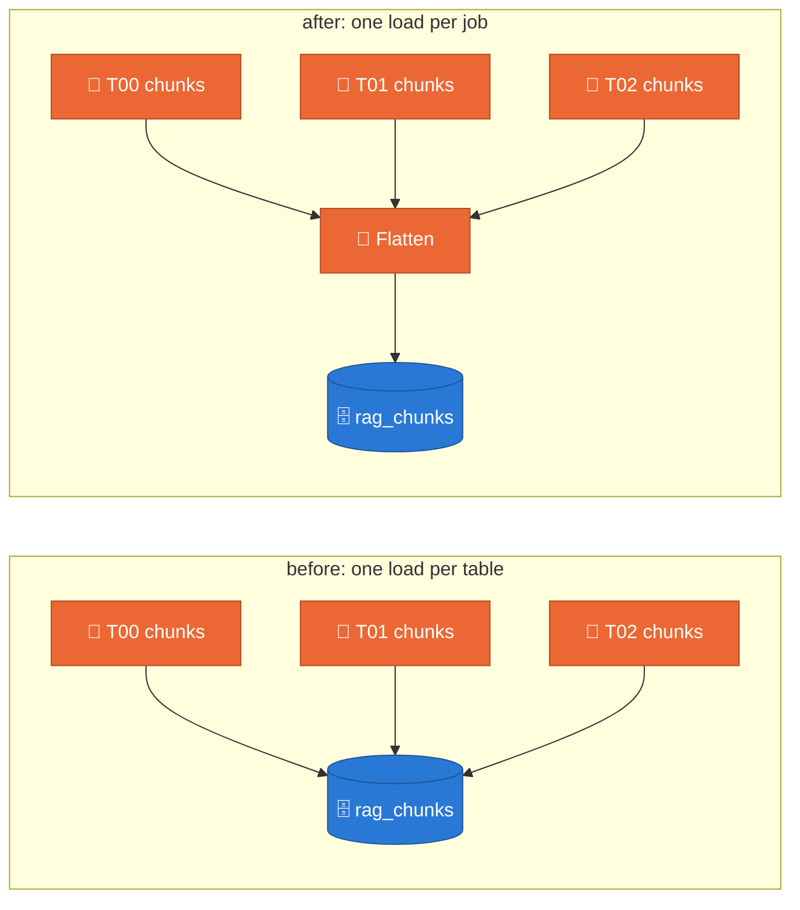

Laptop evidence: `test_shared_writes.py` builds a ten-table job and finds
one `WriteRagChunks`, one `WriteDLQ` and one `WriteValidationRun`, each
table's `AwaitRagPopulation` reading its own `RagEmbedChunks` and each
`BlockerGate` the shared write's load jobs; a DirectRunner job lands every
table's row through the one sink. `test_bq_load.py` holds the back-off.

### D10 — A capacity failure is relaunched (2026-11-04)

A bundle whose batch job could not start for capacity (a zone out of GPUs,
a regional quota used up by the other bundles) is relaunched after a
back-off, without replaying a row. `wait_generation` is
`_GenerationWaitSensor`, a reschedule-mode sensor that reads the job
through `DataflowHook`. DONE ends it, returning the job id the bundle's
evaluation reads. A FAILED job is relaunched only when **both** hold
(`sdfb_batches.is_capacity_failure`):

- one of its job messages names a capacity cause from a small tested
  allowlist: `ZONE_RESOURCE_POOL_EXHAUSTED` (and `…_WITH_DETAILS`),
  `QUOTA_EXCEEDED`, Compute's `Quota '<NAME>' exceeded`, `does not have
  enough resources available`
  ([Dataflow: worker pool failures](https://cloud.google.com/dataflow/docs/guides/common-errors#worker-pool-failure));
  the wrapper "Startup of the worker pool … failed" alone is no cause,
  since it also wraps subnetwork, permission and image failures that no
  wait heals;
- it ran no work item: no `ElementCount` metric above zero in its job
  metrics (`sdfb_batches.ran_work`), so no row was written.

The relaunch is the same body, so the run ids are the same (nothing
landed), named `<job>-bNN-rN-<8 hex>`. It waits 10, then 20, then 40
minutes after the failure (`capacity_backoff_seconds`), at most the run's
`capacity_retries` times (a DAG param, default 3). The bundle keeps its slot
of the cap meanwhile. Any other end fails the wait with
`AirflowFailException`, never retried: `rateLimitExceeded`, BigQuery's own
"Quota exceeded", a traceback, a cancelled job. The rationale for
`retries=0` stands for those.

*A bundle's generation wait.*

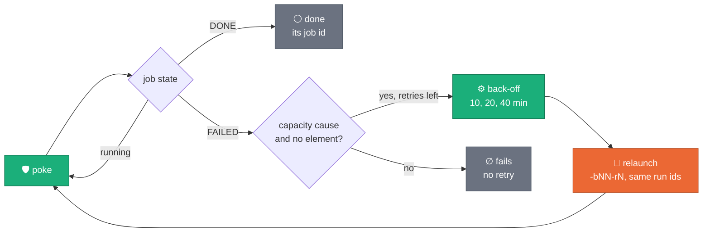

The attempts are an XCom of the bundle's `launch` (`ATTEMPT_KEY`): a
reschedule-mode sensor's own XComs are cleared at each poke
(`TaskInstance._run_raw_task`, Airflow 2.10.5). A "launching" marker is
written before each relaunch call, so a worker that dies inside the call
fails the bundle rather than launch a second job beside a first that may
run. The harness's `all_capacity_retry` relaunches b01 as `-b01-r1` with the
same parameters, and b01's evaluation reads the relaunched job;
`all_job_fails_not_capacity` does not relaunch, and b02 still runs.

Rejected: a hint from the regional GPU quota before launching (Compute
`regions.get`). It cannot be read atomically against the other bundles'
launches, so the retry is the guarantee either way; not built.

### Rulings

The numbered decisions the code cites as "Ruling N" (or "ADR 0045 Ruling N").

1. **Two template names are shared.** `docker/flex_template_metadata.json`
   declared `tables` and `landing_dataset` for the evaluator; the generator's
   parameters of the same names join them, each help text says
   "Generation: … Evaluation: …", and neither carries a pattern.
2. **The model evaluation targets `--run_id <base>` plus
   `--generation_job_ids`**, not `--tables` (D7).
3. **A whole-model batch's rows are the launch's**: by `launch_run_id`, else
   the run id's base, else — only on a row without a recorded launch — the
   `-bNN` suffix (D7). A launch whose own run id ends in `-bNN`, written
   without a record and evaluated by the shorter prefix, is read as a batch.
4. **`--generation_job_ids` narrows by the recorded `job_id`**; a row without
   one is kept with a note (D7).
5. **`generation_job_ids` is written on every new registry row**, and the
   registry is migrated before the new evaluator and the GUI (D7,
   Consequences).
6. **`source_table` and `num_rows` apply in both launch modes**, each
   override announced (D2).
7. **`source_table` grammar and strict types**; a missing project is the
   launch source dataset's (D2).
8. **"A parent-driven child" at load time** is an enabled table with an
   enforced in-model edge to an enabled parent; `num_rows` there is a load
   error (D2).
9. **Absent keys stay out of every canonical form**: `sha12`, the GUI export;
   the snapshot writes them `null` (D2).
10. **What `launch.tables: all` needs and ignores**: the D1 table, with one
    `launch_option_unused` WARNING per ignored key, under `explicit` too.
11. **One model file**: `.yaml` / `.yml`, exactly one model; a sample loads by
    its file name (D1).
12. **Defaults**: `max_tables_per_job` 10, `prep_workers` 8,
    `max_parallel_jobs` 1.
13. **`launch.max_parallel_jobs` belongs to the orchestrators**; the model
    DAG reads `SDFB_MAX_PARALLEL_JOBS` (D5). *(Revised 2026-10-31: the
    generation DAG reads `launch.max_parallel_jobs` from `generator.yaml`
    overlaid by `sdfb_env.yaml`, and the Variable `SDFB_MAX_PARALLEL_JOBS`
    wins when it is set and not empty, `sdfb_batches.parallel_cap`; D5.)*
14. **Run ids** `<base>-bNN` and `<base>-bNN-MM-<table>`; `launch_run_id` is
    `<base>` (D4).
15. **The CLI runs the batches in sequence and keeps going** after a failed
    batch, then exits naming every failed one (D4).
16. **"On Flex" is `FLEX_TEMPLATE_PYTHON_PY_FILE`** (D4).
17. **Parallel prep is pull-based and output-neutral**; `prep_workers: 1`
    restores the previous sequence (D8).
18. **The model DAG's shape**: the six tasks and trigger rules of D6, `plan`'s
    return value the launch bodies. *(Revised 2026-10-26: no model DAG; the
    generation DAG's `tables=all` branch, D6, with `route` planning and
    `batch_bodies` returning the bodies.)*
19. **`composer/sdfb_batches.py` holds the planner mirror and every pure
    piece of the launch**, unit-tested without Airflow (D4).
20. **Logging under `all`**: a batch gets no "N targets WITH relationships"
    advice (the planner chose its tables), and `main` logs no up-front
    `relationship_model` card per target; the card is still logged for every
    table during its batch's prep, and by the workers. `model_launch_plan`
    states the whole plan once per launcher.
21. **The relationship card shows an override** after the keys (D2).
22. **A driving parent's fan-out is measured on the parent's own source**
    (D2).
23. **The row projection reads a root's own rows** (`root_rows`, empty unless
    a plan has a `num_rows` override); a driven child past ten times its
    chain root's rows is measured against that root's rows (D2).
24. **The single-table DAG's `source_dataset` param is evaluation-only**:
    `scripts/gui/export_knobs.py` does not count a DAG param whose
    description begins "Only with run_evaluation" as a surface of a generator
    flag. *(Revised 2026-10-26: the one DAG's `source_dataset`,
    `landing_dataset`, `tables`, `max_tables_per_job` and `prep_workers` are
    surfaces of their generator keys.)*
25. **Abbreviated flags**: argparse's prefix matching stays on; the
    abbreviations only `--landing_table` (`--l` … `--landing_`),
    `--batch_size` (`--ba` … `--batch_`) or `--thresholds_uri` (`--t`)
    matched before are now ambiguous with `--landing_dataset`,
    `--batch_index` / `--batch_count` and `--tables`, and stop the launch at
    parse time. *(Revised 2026-10-26: hidden aliases keep every prefix master
    accepted on its flag, `--t`, `--l…`, `--ba…` and `--g…` included
    ([ADR 0043](0043-generator-config.md) R6); only a prefix master already
    refused as ambiguous, such as `--b`, still stops the launch.)*
26. **The Dataflow Solution Guides copy** ships neither `composer/` nor
    `scripts/launch/`; it ships `example_isolated_forest.yaml`, and its form of
    a whole-model launch is the launcher's `--tables=all` (batches in
    sequence).
27. **The committed example uses generic names** (`T_ACCOUNTS`,
    `T_EVENTS_LOG`, `T_RATES`, `T_LEGACY`, dataset `other_ds`).
28. **No Terraform, `tiers.yaml` or single-table DAG change**: the
    single-table DAG keeps its params and its launch. *(Revised 2026-10-26:
    the one DAG keeps master's explicit chain, task ids and launch, with the
    `tables=all` branch beside it, D6.)*
29. **`_evaluation_key` is unchanged** (D7).
30. **The `tables=all` branch's evaluation passes neither `reference_rows_limit` nor
    `validation_runs_table`** (D6).
31. **Every batch job logs its own `launch_scenario` and `launch_config`**
    (D4).
32. **Table-level failure is mode-based** (2026-10-31): it applies to every
    batch of `launch.tables: all`, a one-table batch included, and to no
    explicit launch (D6, the table is the unit of failure).
33. **The unit of failure is the connected component inside the job**: a
    table whose prep raises fails every table of the batch it reaches over
    in-model edges; an isolated table fails alone (D6).
34. **`FAILED_PREFLIGHT` and `status_reason`**: a skipped table's row has
    `status = FAILED_PREFLIGHT` and `valid_count = 0`; `status_reason`, the
    36th `validation_runs` column, carries the gate's sentence on
    `FAILED_BLOCKER` or the preflight reason. It is written only when the
    live table has the column, and it is outside ADR 0044's all-or-nothing
    record set (D6).
35. **The leaf finds the launch's rows by `launch_run_id` or the `-b` run-id
    prefix**, D7's rule for rows without a record; a `FAILED_BLOCKER` is
    informational under `client_type=fake`, as that client's gate has always
    been (D6).
36. **An empty overlay `relational.relationships_uri` is refused at load**
    (`sdfb_batches.load_layers`, `ValueError`): the launcher reads `''` as
    relationships off, so an unfilled marker would run every launch without
    a model. It is the one overlay key with an empty-value rule (D1 note).
37. **`launch_config` is unchanged**: it is logged before any table is
    prepared, so it lists the skipped tables; `model_batch_partial` and the
    `FAILED_PREFLIGHT` rows carry them, and the evaluator keys on the row's
    status (D6).
38. **A non-preflight exception's reason is value-free**: its text may quote
    a reference value (a BigQuery or library error), so `status_reason` says
    `<ExceptionType> during driver-side preflight (traceback in the launcher
    log)` and the launcher log keeps the rest; a `[preflight …]` stop's text
    names columns, counts and tables, never values, and is kept (D6).

## Alternatives rejected

- **The evaluator's `--tables` for the model evaluation.** Two targets with
  `--run_id`, which the evaluator refuses, and sources by name, which would
  ignore `source_table` overrides (D7).
- **One evaluation per batch job**, the standalone evaluation DAG's fan-out.
  The acceptance wants one evaluation over every landed table; one evaluation
  per batch would split the launch's scores and registry rows. *Reversed on
  2026-11-04* (D7): one evaluation of 77 tables did not fit the Flex
  launcher's window, and a bundle's evaluation of at most K tables does.
- **A runtime DAG param for the parallel cap.** Not possible while the cap
  was `max_active_tis_per_dag`, which Airflow fixes when it parses the file.
  *Done on 2026-11-04*: the gate reads the run's `max_parallel_jobs` (D5).
- **A Composer pool for the cap** ([Airflow: pools](https://airflow.apache.org/docs/apache-airflow/stable/administration-and-deployment/pools.html)).
  An Airflow admin setting outside the DAG file, which the DAG cannot check
  ([the launch gate](#the-launch-gate-2026-11-03)).
- **A second DAG file for whole-model launches.** Decided first (the model
  DAG of 2026-10-21) and reversed on 2026-10-26: it duplicated most of the
  generation DAG, and every launch shape now goes through one DAG (D6).
- **Splitting a component across jobs to fill bins.** It would break
  referential integrity (D3).
- **Merging the per-table DLQ and `validation_runs` sinks per job.** Deferred
  (Consequences: the load-job budget). *Done on 2026-11-04*, with the RAG
  chunks (D9).

## Consequences

- **Enables**: one trigger generates a 100+-table model, each batch inside
  its own launch window; a table can be sourced from another dataset or
  project and sized on its own; one evaluation scores the launch.
- **Rollout, in order** (RUN_PLAYBOOK §2e is the checklist):
  1. **Migrate the registry** before the new evaluator runs and before the
     GUI is deployed: the new evaluator's load jobs carry
     `generation_job_ids`, and the regenerated GUI contract expects it on
     every registry row, as ADR 0044's list expects its two columns. One
     `bq update` with the committed schema covers ADR 0044 and this ADR (the
     file is a superset), in the same session as the new image; a rollback to
     an image from between the two ADRs drops only `generation_job_ids`
     ([RUN_PLAYBOOK §2d](../RUN_PLAYBOOK.md#2d-corp-acceptance-of-the-generation-record-a2)
     step 1, [`DEPLOYMENT_PREREQUISITES.md`](../DEPLOYMENT_PREREQUISITES.md)).
  2. **Image and Flex Template rebuild.** The template declares six new
     parameters (`source_dataset`, `max_tables_per_job`, `prep_workers`,
     `batch_index`, `batch_count`, `generation_job_ids`), and `tables` and
     `landing_dataset` are now names both jobs read.
  3. **Workflow 3** takes the edits of
     [RUN_PLAYBOOK §0b](../RUN_PLAYBOOK.md#0b-workflow-3-for-the-one-generation-dag-untracked-workflows)
     (one `sed` on `composer/sdfb_env.yaml`; import the DAG,
     `sdfb_batches.py`, `generator.yaml` and `sdfb_env.yaml`; the 19th
     marker, `{{SDFB_RELATIONSHIPS_URI}}`, needs one more `sed -e` and its
     GitHub variable), and, for a cap above 1, the overlay's
     `launch.max_parallel_jobs` or the Variable `SDFB_MAX_PARALLEL_JOBS`.
  4. **IAM for the verdicts**: the Composer environment's service account
     reads `validation_runs` (`roles/bigquery.dataViewer` on its dataset).
- **The load-job budget of the shared tables.** Each batch job writes its
  tables' landing rows with one load job per table, and (since D9) its DLQ,
  `validation_runs` and RAG chunks with one load job per job. BigQuery
  limits load jobs per table per day
  ([BigQuery quotas: load jobs](https://cloud.google.com/bigquery/quotas#load_jobs);
  1,500 at the time of writing), so a 14-batch launch now costs the shared
  tables about 14 loads each, where it cost about 100.
- **K = 10 is an estimate**, not a measurement: the corp run reads each
  batch's margin to the Flex launcher's 12 minutes
  ([Dataflow: troubleshoot Flex Templates](https://cloud.google.com/dataflow/docs/guides/troubleshoot-templates))
  and lowers K where a margin is thin.
- **Abbreviated flags.** Every abbreviation master accepted reaches the same
  flag, `--t` → `--thresholds_uri` included (hidden aliases, Ruling 25's
  revision). A prefix master already refused as ambiguous (`--b`) still fails
  at parse time: spell the flag out.
- **No held Airflow worker slot** (revised 2026-11-04): every wait of a
  bundle is a reschedule-mode sensor; a poke holds a slot for seconds.
- **One evaluation, and one registry row, per bundle** (D7, revised
  2026-11-04): a 14-batch launch writes 14 evaluations under one base run
  id, each listed under its own batch job in `evaluation_latest_per_job`.
- **A validation_runs row lands only when its job's shared write does**
  (D9): a job that dies before it leaves its tables NO ROW, where tables
  written earlier in the job used to keep theirs.
- **A run id ending in `-bNN`**, written without a record and evaluated by a
  shorter prefix, is read as a batch of that prefix (Ruling 3).
- **`validation_runs` has 36 columns** (revised 2026-10-31): the one
  `bq update` with the committed schema adds ADR 0044's fourteen and
  `status_reason`; a table without `status_reason` still gets its record and
  rows without a reason (Ruling 34).
- **A `tables=all` run can fail with every batch job DONE**: read
  `fail_if_a_table_failed`'s `TABLE VERDICTS` banner, which names each table,
  its status and its reason. A one-table batch whose table stops at
  preflight fails its job instead, and the banner reads its table NO ROW
  (the reason is in that batch's launcher log).
- **Under `tables=all` a BLOCKER no longer fails the Dataflow job**: the job
  ends DONE with the table's `FAILED_BLOCKER` row, and the Composer run fails
  from it. A CLI launch learns it from `run_model.py`'s verdict query, not
  from its exit status.
- **Every launch's default `relationships_uri` is the overlay's**: an
  explicit launch that leaves it unset in its trigger now loads the
  overlay's model, and a table that model declares takes its `pk:`,
  `identity:` and `enabled` flag from it.
- **`evaluation_latest_per_job`** keeps one row per `generation_job_id`; with
  one evaluation per bundle (D7) each batch job has its own.
- **A CLI sequence repeats the record's schema read per batch** (D4).
- **The Dataflow Solution Guides copy** has `--tables=all` (batches in
  sequence on the CLI) but no parallel runner and no Composer DAG (Ruling 26).
- **Forbids**: a component split across jobs; a batch launch that runs after
  its count disagrees with the orchestrator's; a global key applied to every
  table of a model.

## Acceptance criteria

| AC | Criterion | Proof |
| :-- | :-- | :-- |
| AC-B-1 | `tables: all` over `example_isolated_forest.yaml` selects exactly the enabled tables | `packages/sdfb-tests/tests/unit/launch/test_batches.py::test_the_isolated_forest_example_selects_exactly_the_enabled_tables` |
| AC-B-2 | `plan_batches` is deterministic, never splits a component, and the Composer mirror matches it | `packages/sdfb-tests/tests/unit/launch/test_batches.py` (`test_the_plan_depends_only_on_the_content_and_k`, `test_a_component_is_never_split_and_every_table_runs_once`); `packages/sdfb-tests/tests/unit/composer/test_sdfb_batches.py` |
| AC-B-3 | `source_table` and `num_rows` land in `validation_runs.reference_table` / `num_rows_requested` | `packages/sdfb-tests/tests/unit/cli/test_model_launch_main.py::test_every_batch_records_its_tables_sources_rows_and_one_digest` |
| AC-B-4 | Every committed model's sha12 is unchanged; the explicit relational launch plan equals its golden | `packages/sdfb-tests/tests/unit/contracts/test_relationship_launch_keys.py::test_absent_keys_leave_every_committed_sha_unchanged`; `packages/sdfb-tests/tests/unit/cli/test_launch_plan_golden.py` |
| AC-B-5 | (GCP) A `tables=all` DAG launch with at least two batches: every batch launches inside the 12-minute window, and one evaluation covers every landed table; a table that fails preflight leaves its batch DONE with its `FAILED_PREFLIGHT` row, and `fail_if_a_table_failed` names it | the corp run of [RUN_PLAYBOOK §2e](../RUN_PLAYBOOK.md#2e-corp-acceptance-of-whole-model-launches-b) (pending; steps 12, 12b and 12c are the failure paths: a preflight stop, a missing source, a recorded BLOCKER) and `packages/sdfb-tests/tests/integration/test_model_launch_gcp.py` |
| AC-B-6 | Under `tables=all` a component that fails preflight is skipped with its `FAILED_PREFLIGHT` row and reason, and the rest of the batch lands | `packages/sdfb-tests/tests/unit/cli/test_model_launch_main.py::test_a_table_that_fails_preflight_is_skipped_and_the_rest_land` (and the component, parent-already-prepped, any-exception and every-table-fails tests beside it) |
| AC-B-7 | Under `tables=all` a tripped gate ends the job DONE with a `FAILED_BLOCKER` row and its reason; the DAG fails the run naming every failed and missing table while evaluating every DONE batch | `packages/sdfb-tests/tests/integration/test_validation_runs.py::test_a_whole_model_batch_lands_a_failed_blocker_row_and_the_pipeline_completes`; `packages/sdfb-tests/tests/unit/composer/test_sdfb_batches.py::test_table_verdicts_names_passed_failed_missing_and_unplanned`; the harness scenario `all_table_fails` (`test_generation_dag.py::test_the_harness_run_is_the_plans`) |
| AC-B-8 | A trigger with only `tables=all` plans the overlay's model file; an empty `relationships_uri` in the overlay stops the import | `packages/sdfb-tests/tests/unit/composer/test_launch_helpers.py::test_an_empty_relationships_uri_in_the_overlay_is_refused`; the harness scenario `all_from_overlay` |
| AC-B-9 | No task of the DAG sets a task-level limit; the launch gate, a reschedule-mode sensor over the bundles' `wait_generation` states, runs at most `cap` batch jobs at once, each after every bundle `cap` or more below it ended, and a failed batch does not stop the later ones; the relaunch of the 2026-11-02 forest runs all 14 batches | `packages/sdfb-tests/tests/unit/composer/test_generation_dag.py::test_no_task_sets_a_task_level_concurrency_limit`, `::test_the_gate_is_a_reschedule_mode_sensor_on_the_waits_states`, `::test_batches_are_one_mapped_bundle_group`; `test_sdfb_batches.py::test_the_gate_never_runs_more_than_cap_jobs`; the harness scenarios `all_14_batches_cap_1`, `all_14_batches_default_cap` and `all_middle_batch_fails`; the corp relaunch (RUN_PLAYBOOK §2e, pending) |
| AC-B-10 | A ten-table job applies one `WriteRagChunks`, one `WriteDLQ` and one `WriteValidationRun`; each table's pool trigger waits on its own chunks; the blocking loads back off on `rateLimitExceeded` with a new job each time | `packages/sdfb-tests/tests/unit/test_shared_writes.py`; `packages/sdfb-tests/tests/unit/io/test_bq_load.py` |
| AC-B-11 | Each bundle evaluates its own job once it is DONE; a failed bundle skips its own evaluation only | `test_generation_dag.py::test_each_bundle_evaluates_its_own_job_and_holds_no_slot`, `::test_the_harness_bundles_evaluate_their_own_jobs` |
| AC-B-12 | A FAILED job that ran nothing for a capacity cause is relaunched with the same run ids; `rateLimitExceeded` and code errors are not | `test_sdfb_batches.py::test_is_capacity_failure`; `test_generation_dag.py::test_the_wait_relaunches_only_a_capacity_failure`, `::test_the_harness_relaunches_a_capacity_failure_only` |

## Figure provenance

| Figure | Form | Claim |
| :-- | :-- | :-- |
| M1, `launch.tables: explicit` (D1) | inline mermaid, this file | an explicit launch is today's: the targets and their components, one job |
| M2, `launch.tables: all` (D1) | inline mermaid, this file | a whole-model launch selects every enabled table of one model file and runs one job per batch |
| M3, the planner (D3; also in DESIGN.md §4.5) | inline mermaid, this file | first-fit-decreasing packs whole components: no edge crosses a batch. The example is `test_first_fit_decreasing_on_the_adr_figure`'s |
| M4, per-table resolution (D2) | inline mermaid, this file | a table's source and rows come from the model when it says so, else from the launch |
| M5, the launcher is authoritative (D4) | inline mermaid, this file | every batch job plans the model again and stops when its count is not the orchestrator's |
| M6, `max_parallel_jobs` = 1 and = 2, and the DAG cap's layers (D5; third panel 2026-10-31) | inline mermaid, three panels, this file | the cap decides how many batch jobs hold GPUs at once, never what they generate; the DAG's cap is the highest layer that sets it, `generator.yaml` < `sdfb_env.yaml` < the Variable |
| M6b, the scheduler's pass before and after, and the gate at cap 1 (D5, 2026-11-03) | inline mermaid, two panels, this file | only a DAG with a task-level limit loses its SCHEDULED instances to a stale-DAG sweep; with the gate a waiting instance is rescheduled, holding no worker slot, and the batches launch in turn |
| M7, one DAG, two branches (D6; revised 2026-10-26 and 2026-10-31) | inline mermaid, this file | one evaluation covers what the launch landed; under `all` a failed batch or a failed table fails the run, not its neighbours |
| M8, `prep_workers` = 1 and = W (D8) | inline mermaid, two panels, this file | threads read ahead; the cross-table steps keep the plan's order, so the outputs do not change |
| M9, the unit of failure (D6, 2026-10-31; also in DESIGN.md §4.5) | inline mermaid, this file | a failed table fails itself; a component's members fail together; the job ends DONE. The statuses are those `test_model_launch_main.py` and `test_validation_runs.py` assert |
| M10, the bundle group and the gate at cap 3 (D5, 2026-11-04) | inline mermaid, two panels, this file | each batch is a mapped group whose gate, a sensor, waits for the bundles `cap` below; each bundle evaluates its own job |
| M11, one load per shared table (D9) | inline mermaid, two panels, this file | a job's tables share one write per shared table instead of one each |
| M12, a bundle's generation wait (D10) | inline mermaid, this file | only a FAILED job that ran nothing for a capacity cause is relaunched, after a back-off |

The figures use the repository's mermaid house style (node classes and icons
as in `.claude/skills/visual-first-documentation/`) and carry no measured
number: every shape, count and name is read from the code and tests named
above. Links retrieved 2026-10-21. M7 was redrawn on 2026-10-26 from
`composer/synthetic_beam_bigquery.py` (its header and `route`), and again
from `composer/synthetic_beam_bigquery.py` on 2026-10-31 (the
`fail_if_a_table_failed` leaf, its header's trigger-rule table). M6's third
panel is read from `sdfb_batches.parallel_cap`, M6b from Airflow 2.11.0's
`scheduler_job_runner.py` (lines 486-541, 1788-1859, 2143-2165), `dag.py` (3300-3303), `dagrun.py` (1610-1621) and `ready_to_reschedule.py`,
retrieved 2026-11-03, and from `sdfb_batches.may_launch`, M9 from
`run_pipeline.py::_prep_relational_specs` and `pipeline.py::_BlockerGateDoFn`.
M10 to M12 (2026-11-04) are read from `composer/synthetic_beam_bigquery.py`
(`bundle`, `_LaunchGateSensor`, `_GenerationWaitSensor`),
`pipeline.py::build_relational_pipeline` and `sdfb_batches.is_capacity_failure`;
they carry no measured number. The 2026-11-03 numbers in D5, D7 and D9 are
typed once, in their tables, from the corp run's `gcloud logging`,
`gcloud dataflow` and `INFORMATION_SCHEMA.JOBS_BY_PROJECT` reads; Airflow's
`sensors/base.py` and `ready_to_reschedule.py` (2.10.5) and Beam 2.76's
`bigquery_file_loads.py` were read on 2026-11-04.
