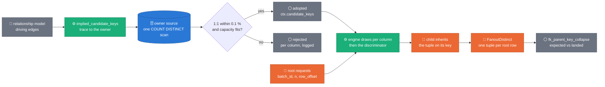

# ADR 0046 — A tuple that drives a grandchild is a candidate key of its owner: implied by the model, confirmed on the source, generated 1:1 with the PK

**Status:** ACCEPTED on the laptop (2026-11-13) — unit, engine and DirectRunner acceptance green on `task/finding-b-candidate-key`; Dataflow acceptance rides with the next corp relaunch (see Acceptance).
**Evidence:** two corp relational launches on the same model and source, one per engine (b1, b2), anonymised below; the per-table distinct counts were read off the landed tables after the runs.
**Extends:** [ADR 0036](0036-parent-driven-fanout-generation.md) (a widened driving edge carries inherited columns; `FanoutDistinct` fans a grandchild out over the parent's DISTINCT driving tuples) · [ADR 0037](0037-multi-parent-children.md) (the driving-edge choice and widening that make a non-PK tuple drive)
**Keeps:** [ADR 0032](0032-relationships-as-config.md) — `config/relationships/*.yaml` is the only source of relational structure; this ADR adds **no YAML key** · [ADR 0038](0038-measured-conflicts-adjust-the-model.md) — measure the source, adjust, say so; a measurement never stops a launch here · [ADR 0035](0035-pk-capacity-fk-bound-members.md) — the PK capacity gate is untouched · [ADR 0026](0026-measurement-first-mask-integrity.md)/[0027](0027-verified-wave4-operational-integrity.md) — no source value is re-emitted where the numeric scrub would have rejected it

## Context

The model has a root `TABLE_A` (PK `COL_KEY`), a child `TABLE_B` driven by
`TABLE_A` on `COL_KEY`, and a grandchild `TABLE_D` that references the triple
`(COL_P, COL_Q, COL_R)` in both. The registry therefore widens `TABLE_B`'s
driving edge with the triple (`fk_edge_widened`), `TABLE_B` copies it from its
`TABLE_A` key, and `TABLE_D` is driven by `TABLE_B` on the triple (ADR 0036 D4,
ADR 0037 rule 3). In the source the triple is 1:1 with the root key:

| | rows | distinct `COL_KEY` | distinct `COL_Q` | distinct `COL_R` | distinct triple |
|---|---:|---:|---:|---:|---:|
| source `TABLE_A` | 163,394 | 53,925 | 571 | 35,818 | **53,925** |
| b2 `TABLE_A` (10M) | 10,000,000 | 10,000,000 | 8,824 | 3,511,709 | 7,296,165 (27 % collide) |
| b2 `TABLE_D` | 264,067,180 | | | | 1,322,934 parents used |

`COL_P` is `constant`, `COL_Q` and `COL_R` are `numeric` in both engines'
`generation_plan`, and both engines draw them **per column**. Nothing ties the
tuple to the key, so tuples collide: 27 % of b2's 10M root rows share a triple
with another row. b1 coarsens the numerics further (`numeric_kanon_filter`,
`numeric_source_filter` keep and nudge onto a smaller value set) and its
`FanoutDistinct` emitted only **2,398,718** parent keys. `TABLE_D` fans out
over the DISTINCT triples `TABLE_B` offers, so the collision rate — an engine
artefact — became the whole b1-vs-b2 gap on `TABLE_D` (b1 90M rows, b2 264M).
(The 713M plan is a separate sizing error in `cli/preflight.py::_derived_rows`
and not this ADR's subject.)

The relationship model could not say the triple is a key of `TABLE_A`: its
only `pk:` is `COL_KEY`. But it already says something stronger. The triple
is the `ref_cols` of a **driving** edge: the grandchild is generated from its
distinct values, so the model asserts the triple identifies the rows it fans
out from. Whether it identifies them 1:1 is a fact about the data, which the
launch can measure.

## Decision

**D1 — the candidate key is implied, never declared.** Every enabled table's
driving edge names a tuple (`ref_cols`). `RelationshipRegistry
.implied_candidate_keys()` traces that tuple up the enforced edges that carry
it (a widened edge whose columns cover it, the table's own driving edge
first) to the table that **generates** it — its *owner* — and records
`(owner, cols, pk)` when the owner has a PK the tuple does not already
contain. In the shape above: `TABLE_D`'s driving tuple on `TABLE_B` traces
through `TABLE_B`'s widened edge to `TABLE_A`, so `(COL_P, COL_Q, COL_R)` is
an implied candidate key of `TABLE_A` with PK `COL_KEY`. No `unique:` key, no
new file format: the relationship model stays the only source of relational
structure, and a model without a non-PK driving tuple implies nothing.

**D2 — the source decides, the launch says so.** Per implied key whose driven
child is in the launch, the launcher runs one scan of the owner's source
(`io/fanout_stats.py::measure_candidate_key`):

```sql
SELECT COUNT(*),
       COUNT(DISTINCT TO_JSON_STRING(STRUCT(<pk>))),          -- pk_values
       COUNT(DISTINCT TO_JSON_STRING(STRUCT(<cols>))),        -- tuples
       COUNT(DISTINCT TO_JSON_STRING(STRUCT(<pk>, <cols−pk>))) -- pairs
FROM <owner source>
```

The tuple is 1:1 with the PK exactly when the three distinct counts agree;
`KeyCounts.one_to_one` accepts them within **±0.1 % of the PK count**
(`CANDIDATE_KEY_TOLERANCE = 0.001`): a handful of dirty source rows must not
cost the table its key (the generator makes it exactly 1:1 regardless), while
a tuple a real share of keys share — `COL_Q` alone, 571 of 53,925 — is far
outside it. A NULL member is a value, as in ADR 0038's PK GROUP BY. One
milestone per implied key, launcher-side:

```text
candidate_key_adopted  owner=TABLE_A cols=COL_P,COL_Q,COL_R pk=COL_KEY child=TABLE_D parent=TABLE_B
                       rows=163394 pk_values=53925 tuples=53925 pairs=53925 source=measured
                       discriminator=COL_R capacity=10000000 widened=False
candidate_key_rejected owner=… reason=not_one_to_one|owner_is_driven|no_integral_discriminator|capacity …
```

A rejection never stops the launch: the tuple generates per column exactly
as before, and the rejection's numbers are in the log. When the scan fails,
the reference sample decides and `candidate_key_measure_fallback` (WARNING)
says so — a sample sees a shared tuple only when it holds both of its keys,
so it is the weaker witness, used only in the measurement's absence (the ADR
0038 D5 line between a missing measurement and a contradicting one).

**D3 — the tuple is derived from the row's ordinal, through ONE column.** An
adopted key reaches the owner's engines as `GenerationContext.candidate_keys
= [{"cols", "pk"}]`; both engines bind it in `setup()` through one function
(`engines/candidate_keys.py::bind_candidate_keys`) and apply it in
`generate_batch` (`apply_candidate_keys`) after every per-column sampler has
run. Of the tuple's columns, one — the **discriminator**, the integral,
NULL-free column with the widest observed support (`COL_R` here) — is
overwritten with an injective function of the row's dense ordinal; every
other column keeps the engine's own draw, so the constant stays constant and
the code column keeps its codes and its marginal. Distinct ordinals give
distinct discriminators, hence distinct tuples, across every batch and
worker, with no barrier and no shared state.

The ordinal is the coordinate that already makes a root's PK unique without a
barrier: an identity PK is synthesized from `(run_id, batch_id, row_index)`
(`engines/identity.py`), after the engine yields. A PK *value* cannot be the
input — it is not dense, and on an identity table the engine never sees it —
but a root's batch plan is: `_default_requests` stamps each batch with
`row_offset = batch_id × batch_size` (only on a table with an adopted key, so
every other request is byte-identical), `GenerateRecordsDoFn` threads it into
`cfg.engine_specific["row_offset"]`, and the row at batch position `i` has
ordinal `row_offset + i ∈ [0, num_rows)`. Rows dropped by validation, or by
the root's PK barrier, take their tuple with them; every landed row keeps a
tuple no other row has, so **distinct tuples = distinct PK values = landed
rows**.



**D4 — the injection: a keyed permutation, then a band allocation over the
support.** `CandidateKeyEncoder.value(o)`:

1. `slot = π(o)`, a keyed bijection on `[0, num_rows)` keyed by
   `(run_id, table, column)`: three invertible multiply-add-xorshift rounds
   on the smallest power-of-two domain covering `num_rows` (the building
   blocks of [SplitMix64, Steele, Lea & Flood, OOPSLA 2014](https://doi.org/10.1145/2660193.2660195)),
   cycle-walked back into the domain ([Black & Rogaway, *Ciphers with
   Arbitrary Finite Domains*, CT-RSA 2002](https://doi.org/10.1007/3-540-45760-7_9)),
   at most two steps per value on average. It hides the ordinal's order
   (batch 0 does not get the smallest values); it is a statistical
   scrambler, not a cipher.
2. The discriminator's observed points `x_0 < … < x_m` (reference sample)
   cut its support into bands: the open gaps `(x_j, x_{j+1})`, each weighted
   `(c_j + c_{j+1}) / 2N` — the linear-interpolated empirical CDF both
   engines' inverse-CDF numeric samplers already follow — plus two
   zero-weight tails up to the column's **digit-format window** (the widest
   integers with the observed extremes' digit counts).
3. `num_rows` slots are apportioned over the bands by water-filling: in
   proportion to weight, capped at the band's *free* integers (integers
   that are neither an observed value nor in the source domain from the
   ADR 0023 `source_value_store`), largest remainder for the last split.
   Weight a saturated band cannot hold flows to the others; the tails are
   used only when every weighted band is full (`widened=True`).
4. Slot `k` of a band holding `a` slots over `f` free integers is the
   `⌊k·f/a⌋`-th free integer of that band — strictly increasing in `k`
   because `a ≤ f`, so injective. A free integer is found by rank in
   `O(log |banned|)` (`_select`).

Worked example — observed `COL_R ∈ {10, 14, 30}` (one row each),
`num_rows = 6`:

| band | free integers | weight | slots | slot → value |
|---|---|---:|---:|---|
| `[low, 10)` tail | — (not widened) | 0 | 0 | |
| `(10, 14)` | 11, 12, 13 (`f = 3`) | ⅓ | 3 | `k ↦ 11 + ⌊3k/3⌋` → 11, 12, 13 |
| `(14, 30)` | 15 … 29 (`f = 15`) | ⅓ | 3 | `k ↦ 15 + ⌊15k/3⌋` → 15, 20, 25 |
| `(30, high]` tail | — | 0 | 0 | |

Ordinals `0…5` go through `π` to slots `0…5` in a run-keyed order; the six
rows get `{11, 12, 13, 15, 20, 25}` — six distinct values, half in each gap
as the sample's mass says, none equal to 10, 14 or 30. With `num_rows = 30`
the gaps hold only 18 free integers, the window widens to the two-digit
format `[10, 99]`, and the remaining 12 slots land in the `(30, 99]` tail.

**D5 — capacity: widen within format, else flag and carry on.** A support
whose free integers cannot hold `num_rows` is widened to its digit format;
still short, the key is rejected with `reason=capacity needed= available=
window=` and the tuple generates per column. That mirrors ADR 0035 P4 in
*when* it is checked (launcher-side, before any GPU spend, recomputed on the
worker where the source domain is known) but not in *what* it does: P4
stops because a too-small PK space lands `pk.duplicate` BLOCKERs; a
too-small candidate-key space only reproduces today's per-column collision
rate, which is a fidelity loss the operator can read in the next milestone,
not a broken run.

**D6 — observability: two lines say whether it worked.** Launcher:
one `candidate_key_adopted|rejected` per implied key (D2). Worker:
`candidate_key_bound table= cols= pk= discriminator= capacity= widened=`
once per engine build, `candidate_key_unbound reason=` (WARNING) when the
worker's source domain leaves the key without capacity. And for EVERY
driving edge, in-DAG, the measured consequence:

```text
fk_parent_key_collapse table=TABLE_B cols=COL_P,COL_Q,COL_R child=TABLE_D
                       expected=<distinct COL_KEY in TABLE_B> landed=<distinct triples offered>
                       share=<landed/expected> anchor=COL_KEY expected_method=anchor_distinct
```

`landed` counts the `FanoutDistinct` output (the keys the grandchild is
driven by); `expected` counts the distinct values of the **anchor** — the
owner's PK under the parent's column names
(`RelationshipRegistry.driving_key_anchor`), carried on the fanout
`FkEdgeSpec.anchor_cols` — or the parent's rows when the driving tuple holds
the parent's own PK (`expected_method=parent_rows`). Both are combiners; the
anchor count is a KMV sketch (Beam `ApproximateUnique`, [Bar-Yossef et al.,
RANDOM 2002](https://doi.org/10.1007/3-540-45726-7_1); exact up to 65,536
values, ≈0.8 % error above), so the line adds no shuffle. Below a 0.99 share
it is a WARNING: on the b1 launch above it would have read `landed=2398718`
against roughly ten million.

## Alternatives considered

- **An explicit `unique: [[COL_P, COL_Q, COL_R]]` key in the model.**
  Rejected for now: it is a second way to say what the driving edge already
  says, an operator would have to know the source is 1:1 to write it, and a
  wrong one would make the synthetic table more unique than its source with
  no measurement in sight. Deferred, not refused — if a non-driving tuple
  ever needs the guarantee (a uniqueness the model has no edge for), this is
  where it goes, still confirmed by D2's measurement.
- **Per-column rejection sampling** (redraw a colliding tuple). Needs the set
  of tuples already emitted, which exists only per worker process; two
  workers still collide, so it turns a 27 % collision rate into a smaller
  one, never into zero, and b1's per-process emitted set (ADR 0028) is
  exactly that mechanism's limit.
- **A global dedup barrier on the tuple** (ADR 0034's barrier, keyed on the
  candidate key). Removes the duplicates instead of preventing them: the
  root lands fewer rows than requested (27 % fewer on b2, more on b1, so the
  engines still disagree), and it re-adds a full shuffle of the root that
  ADR 0034 took out.
- **A joint mixed-radix encoding over all tuple columns** (split the slot
  into one digit per column). Spreads uniqueness across the columns, so the
  discriminator would repeat across code values the way the source's does,
  and the capacity would be the product of the supports. Deferred: it must
  derive the code column from the ordinal too — replacing the engine's draw,
  and, for b1, re-deciding which codes are k-anonymous — for a capacity the
  single discriminator has not yet been shown to lack. It is the next step
  if a relaunch reports `reason=capacity`.
- **Format-preserving encryption** (FF1/FF3, [Bellare, Ristenpart, Rogaway &
  Stegers, SAC 2009](https://doi.org/10.1007/978-3-642-05445-7_19); NIST SP
  800-38G) for the permutation. Secrecy is not the requirement — the value
  is synthetic either way — and a block cipher per row costs more than the
  arithmetic rounds for a property this design does not use.

## Consequences

- **Both engines, one mechanism.** b1 and b2 call the same two functions
  from `sdfb-core`; given the same run, sample and source domain they write
  the same discriminator column (pinned by
  `test_both_engines_draw_the_same_discriminator`). The b1-vs-b2 gap on a
  grandchild driven by an inherited tuple closes: both offer one distinct
  tuple per root row.
- **Marginals.** The non-discriminator columns are untouched. The
  discriminator keeps its observed support (widened only when needed, and
  only within its digit format) and its banded shape; it loses its repeat
  structure — it becomes unique per row (the source's `COL_R` is 35,818
  distinct over 53,925 keys, so already near-unique). A saturated dense band
  (more rows asked for than integers between its observed values) moves its
  overflow to the neighbouring bands; the shape bends there, recorded in no
  milestone yet.
- **Privacy.** The discriminator never equals a reference value or a value
  of the source domain the ADR 0023 store returns, so no source tuple is
  emitted verbatim — stricter than b1's numeric scrub, which keeps
  k-anonymous values exact; b2, which had no numeric scrub, gains one on this
  column. b1's own scrub still runs on the per-column draw it overwrites
  (wasted work, harmless).
- **Driven owners are out of scope.** A tuple generated by a table that is
  itself driven (no dense ordinal: its requests are parent-key batches) is
  reported `reason=owner_is_driven` and generates per column.
- **Cost.** One `COUNT(DISTINCT …)` scan of the owner's source per implied
  key and launch (not cached — unlike the fan-out payload, nothing else
  reads it); about 11 µs per generated row of the owner for the encoder,
  measured on the laptop over 20,000 ordinals (pure Python); two
  combiners per driving edge for the collapse line.
- **No golden moves.** A table with no adopted key gets no `row_offset`, no
  `candidate_keys`, and identical rows; the config-parity goldens are
  unchanged.

## Acceptance

- [x] Unit: `packages/sdfb-tests/tests/unit/engines/test_candidate_keys.py`
  — the permutation is a bijection, the encoder is injective over 20k
  ordinals, stays inside the support and off every observed and forbidden
  value, follows the sample's bands, widens within format, rejects a short
  capacity and a sample with no integral column, keeps NUMERIC as Decimal.
- [x] Engines: `packages/sdfb-tests/tests/unit/engines/test_candidate_key_engines.py`
  — b1 and b2 each generate 20k rows over 8 batches with as many distinct
  triples as rows (and collide without the entry), keep the constant
  constant, write the same discriminator, and leave a request without
  `row_offset` per column.
- [x] Registry: `packages/sdfb-tests/tests/unit/contracts/test_candidate_key_registry.py`
  — the corp shape implies `(COL_P, COL_Q, COL_R)` on `TABLE_A` with anchor
  `COL_KEY`; a driving edge onto the parent PK implies nothing; a driven
  owner is flagged.
- [x] Launcher: `packages/sdfb-tests/tests/unit/cli/test_candidate_key_launch.py`
  — adopted on the corp counts; a tuple shared by keys is left alone; a
  failed scan falls back to the sample, loudly; a short capacity rejects
  without stopping; the fanout `FkEdgeSpec` carries the anchor.
- [x] DirectRunner: `packages/sdfb-tests/tests/unit/test_fanout_candidate_key.py`
  — `TABLE_A → TABLE_B → TABLE_D` with `TABLE_B` inheriting the triple:
  with the key, `TABLE_D` is driven by one distinct triple per `TABLE_A`
  row in BOTH engines and `fk_parent_key_collapse` reads `landed ==
  expected`; without it, fewer.
- [ ] Corp relaunch, both engines: `candidate_key_adopted` for the triple on
  `TABLE_A`; `TABLE_A` distinct triples = `TABLE_A` rows;
  `fk_parent_key_collapse child=TABLE_D` reads a share ≥ 0.99, i.e.
  `TABLE_D`'s distinct parent triples ≈ the distinct `TABLE_A` keys used by
  `TABLE_B` (≈ `TABLE_A` rows less its zero-fan-out keys) in b1 AND b2 —
  where today they read 2.4M (b1) and 1.3M of 7.3M (b2).
