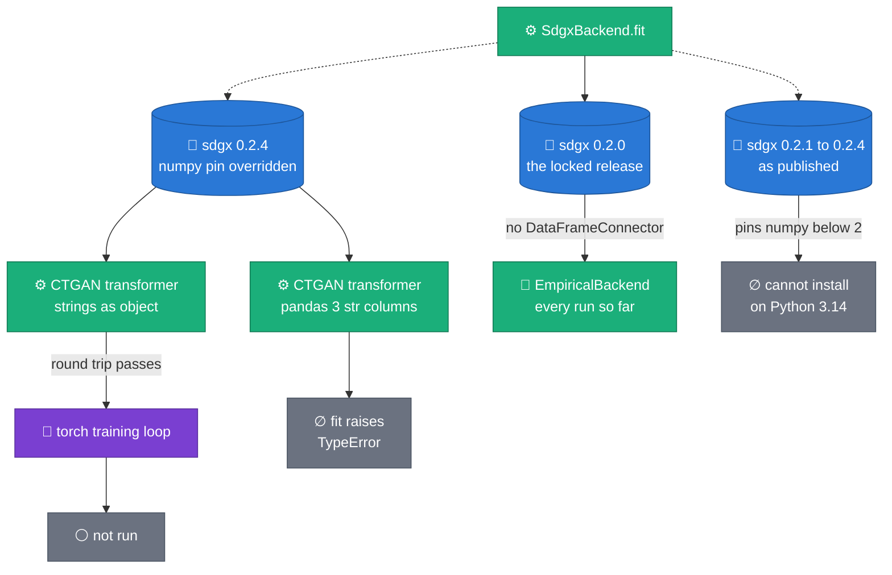
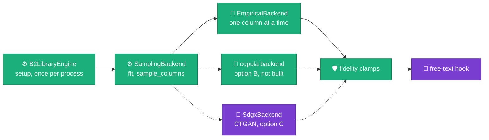
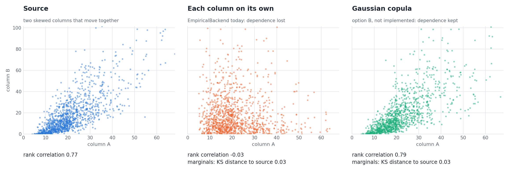

# B.2 library engine: what `sdgx` can do here, and the backend options

**Status:** ASSESSMENT. No decision is taken and no engine code changes
with this document. It records why `engine=b2_library` has never fitted
`sdgx`, what it would take, and three ways forward, as the reference for
the next design decision on a library-wrapper engine (this one, or a
later `bX_library`).
Depends on [ADR 0013](../adr/0013-distribution-estimator-spine.md) (the
spine, and the selection of `sdgx`). Companions: the engine's
[README](../../packages/sdfb-core/src/sdfb_core/engines/b2_library/README.md)
(what samples the rows today) and its
[library-choice spike](../../packages/sdfb-core/src/sdfb_core/engines/b2_library/SPIKE_LIBRARY_CHOICE.md).

## 1. Evidence: where the `sdgx` path stops

A b2 launch logs
`b2_backend_fallback reason=sdgx_incompatible` and samples every table
with the NumPy `EmpiricalBackend`. The usual reading is "`sdgx` needs
`numpy<2`, and Python 3.14 has no numpy 1.x". That is the first of two
stops. The second is pandas 3.



The solid path is what runs today. The dotted paths were probed on
2026-11-16 by
[`scripts/doc/probe_sdgx_compat.py`](../../scripts/doc/probe_sdgx_compat.py),
which builds a throwaway environment holding `sdgx` 0.2.4 with its
`numpy<2` requirement replaced by the workspace lock's versions (a
[uv dependency override](https://docs.astral.sh/uv/concepts/resolution/#dependency-overrides))
and walks what `SdgxBackend._fit_sdgx` asks of the library, one stage per
row, on a seeded toy frame. Its output on this repository's laptop:

```
python 3.14.5 on darwin x86_64; sdgx 0.2.4, numpy 2.3.5, pandas 3.0.3, scikit-learn 1.8.0, torch not installed
```

| # | stage | outcome | detail |
|---|---|---|---|
| 1 | import connector, loader, metadata | ok | sdgx 0.2.4 |
| 2 | infer metadata from the frame | ok | discrete=4 int=1 float=2 |
| 3 | default processors: fit + convert | ok | 12 processors |
| 4 | what nulls become before CTGAN | ok | numeric: 583 nulls -> 583 zeros; categorical: 955 nulls -> 955 'NAN_VALUE' |
| 5 | CTGAN transformer, pandas 3 `str` columns | **FAIL** | TypeError: Cannot interpret '<StringDtype(na_value=nan)>' as a data type |
| 6 | CTGAN transformer, strings cast to `object` | ok | fit, transform, inverse: 6 columns back |
| 7 | CTGAN's default device here | SKIP | no torch wheel for this platform |
| 8 | `_fit_sdgx` calls as written, then sample | SKIP | no torch wheel for this platform |
| 9 | the same with strings cast to `object` | SKIP | no torch wheel for this platform |

What the table establishes, and what it does not:

- **Installing is solvable.** With the override, `sdgx` 0.2.4 resolves and
  imports beside numpy 2.3.5 and pandas 3.0.3 on Python 3.14 (rows 1 to 3).
  Without it, the resolver picks numpy 1.26.4 and pandas 2.0.3, which
  publish no Python 3.14 wheel
  ([numpy 1.26.4 files](https://pypi.org/project/numpy/1.26.4/#files)).
  The override is a uv feature: a plain `pip install` of the `[library]`
  extra, or of an exported requirements file without `--no-deps`, still
  meets `numpy<2`.
- **numpy 2 is not what breaks the fit.** pandas 3 infers its new `str`
  dtype for string columns
  ([PDEP-14](https://pandas.pydata.org/pdeps/0014-string-dtype.html)), and
  CTGAN's data transformer hands that dtype to numpy (row 5). The frame
  `SdgxBackend._reference_frame` builds (`pd.DataFrame(rows)`) has
  exactly those columns.
- **A local cast is enough for the transformer.** With the string columns
  cast to `object` on our frame, the transformer fits, encodes and decodes
  (row 6). No process-global `future.infer_string` option is needed, which
  matters because DoFn threads share the process.
- **The training loop is unverified.** Rows 7 to 9 need torch, and torch
  publishes no Python 3.14 wheel for an Intel Mac. They are
  `_fit_sdgx`'s calls verbatim and run with the same command on the M4 or
  a Linux runner. Until they do, "CTGAN works after the cast" is a
  hypothesis.

Upstream will not close the gap. The last `sdgx` release is 0.2.4 of
2024-12-03 ([PyPI](https://pypi.org/project/sdgx/#history)); the pin
arrived in June 2024
([#190](https://github.com/hitsz-ids/synthetic-data-generator/pull/190))
and no release has lifted it; the default branch's last commits are
pre-commit bot updates of early 2025; and
[#249](https://github.com/hitsz-ids/synthetic-data-generator/issues/249),
a fit error reproducing the project's own CTGAN notebook, is open since
2024-12-09.

## 2. Architecture: one seam, three candidates behind it

`B2LibraryEngine.setup` profiles the reference rows, then fits one
`SamplingBackend` (`fit`, `sample_columns`) once per worker process;
`generate_batch` samples from it, clamps each value into its observed
support, and patches free-text columns through the `ModelClient`. Every
option below is a choice of what sits behind that seam. Nothing else in
the engine, the DoFns or the DAG depends on it.



Solid edges run today. `SdgxBackend` is drawn in the GPU colour because
that is where its fit would land (§4, defect 2).

## 3. What the backend choice changes: dependence between columns

`EmpiricalBackend.sample_columns` loops over the columns and draws each
from its own profile. Every marginal is kept: that is what the
inverse-CDF numerics
([ADR 0022](../adr/0022-stats-driven-generation.md)) and the empirical
categorical tables are for. What a per-column sampler cannot keep is how two columns move
together, and that is the one thing a joint model (CTGAN in the original
selection) was meant to add.



*Claim: sampling each column on its own keeps every marginal and loses
the dependence between columns; a Gaussian copula keeps both.*
Entry level: the middle cloud has the right spread along each axis and
none of the left cloud's slope; the right cloud has both. Formally, by
Sklar's theorem a joint distribution factors into its marginals and a
copula on the unit cube; the middle panel replaces the source's copula
with the independence copula, the right panel with a Gaussian copula
whose correlation is estimated from the source's normal scores
([Nelsen, *An Introduction to Copulas*, Springer 2006](https://doi.org/10.1007/0-387-28678-0);
used for synthetic tables by
[Patki, Wedge and Veeramachaneni, *The Synthetic Data Vault*, IEEE DSAA 2016](https://doi.org/10.1109/DSAA.2016.49)).
The figure is a seeded concept draw, not a run: the middle panel is the
mechanism of `EmpiricalBackend.sample_columns`, the right panel is option
B and is not implemented. CTGAN
([Xu, Skoularidou, Cuesta-Infante and Veeramachaneni, *Modeling Tabular Data using Conditional GAN*, NeurIPS 2019](https://arxiv.org/abs/1907.00503))
has no panel because it has not been run here.

The evaluator already scores this property on landed tables:
`pair.spearman_delta`, `pair.pearson_delta`, `pair.cramers_v_delta`,
`pair.nmi_delta`, `pair.contingency_tvd`, `table.corr_rms_delta` and
`table.corr_max_delta`
([catalogue](../../packages/sdfb-evaluation/src/sdfb_evaluation/catalogue/metrics.yaml)).
The catalogue's own reading of `table.corr_rms_delta` names the case: at
or above its bad threshold, "the correlation structure is broadly off,
e.g. columns sampled independently". No b2 evaluation was read for this
assessment, so how far today's b2 tables sit from their sources on these
metrics is an open measurement, not a finding.

## 4. The wrapper today: five defects a successful fit would expose

Because the fit has never succeeded, the code after it has never run.
Read against `sdgx` 0.2.4, `SdgxBackend`
([`backends.py`](../../packages/sdfb-core/src/sdfb_core/engines/b2_library/backends.py))
would land these the first time it did:

| # | Defect | Where | How it is known |
|---|---|---|---|
| 1 | **Null rates are lost.** `sdgx` fills numeric nulls with 0 and categorical nulls with `'NAN_VALUE'`, and on the way back turns the marker into `""` and leaves the zeros. `sample_columns` re-injects nulls for temporal columns only, so a nullable numeric column lands with a spike at zero and no nulls. | `SdgxBackend.sample_columns` | probe row 4; `NonValueTransformer.reverse_convert` read |
| 2 | **CTGAN trains on the worker's GPU.** The wrapper passes only `epochs`; `CTGANSynthesizerModel` defaults to `device="cuda"` when torch sees one. On an L4 worker that GPU is the one the vLLM server holds. | `SdgxBackend._fit_sdgx` | `sdgx` source read; probe row 7 prints it where torch is installed |
| 3 | **One unseeded model per worker process.** The engine is built once per process (`dofns/generate.py::_acquire_shared_engine`), and torch is seeded at sample time only, so each process fits a different GAN and two workers sample from different distributions. | `SdgxBackend._seed_torch`, called from `sample_columns` | code read |
| 4 | **`similarity` does nothing, and temporals lose their shape.** The `sdgx` branch ignores `temperature`, and it calls `sample_temporal` without the profile's `quantiles`, which the empirical branch passes. | `SdgxBackend.sample_columns` vs `EmpiricalBackend._sample_one` | code read |
| 5 | **Reference rows are written to the worker's disk.** The loader the wrapper builds over the frame keeps nothing on disk, but `Synthesizer.fit` wraps the processed rows in a generator-backed loader, which refuses `NoCache` and caches parquet under `./.sdgx_cache`. | `synthesizer.fit()` in `SdgxBackend._fit_sdgx` | `sdgx` source read; probe rows 8 and 9 count the files |

None of these affects a run today: all five sit behind the fit.

## 5. Other libraries, as published on 2026-11-16

| Library | Licence | Python 3.14 beside numpy 2 | Reading |
|---|---|---|---|
| [`sdgx`](https://pypi.org/project/sdgx/) 0.2.4 | Apache-2.0 | no: pins `numpy<2` | §1 |
| [`sdv`](https://pypi.org/project/sdv/) 2.2.0, [`ctgan`](https://pypi.org/project/ctgan/) 0.13.0, [`copulas`](https://pypi.org/project/copulas/) 0.15.0 | BUSL-1.1 | declared (`python<3.15`) | maintained; the licence is the question ADR 0013 deferred to a legal review |
| [`synthcity`](https://pypi.org/project/synthcity/) 0.2.12 | Apache-2.0 | no: pins `numpy<2.0` | the same stop as `sdgx` |
| [`mostlyai-engine`](https://pypi.org/project/mostlyai-engine/) 2.7.4 | Apache-2.0 | no: `python<3.14` | permissive and maintained; revisit when it supports 3.14 |
| [`smartnoise-synth`](https://pypi.org/project/smartnoise-synth/) 1.0.8 | MIT | declares `python<3.15` | differentially private synthesizers; dependencies not assessed |
| [`be-great`](https://pypi.org/project/be-great/) 0.0.14, [`realtabformer`](https://pypi.org/project/realtabformer/) 0.2.4 | MIT | declare no upper bound | language-model generators; not assessed against ADR 0013's spine |

Only the declared metadata was read for the rows other than `sdgx`;
none of them was installed.

## 6. Options

| | A. Retire `sdgx`, keep empirical | B. Copula backend, in-house | C. Make `sdgx` fit |
|---|---|---|---|
| What changes | `sdgx` leaves the `[library]` extra; `scipy` and `scikit-learn` take its place there (below); `SdgxBackend` and its probe go; `generation_plan` says `backend=empirical` | a third `SamplingBackend`: the empirical marginals, fed by correlated uniforms as in §3's right panel | a uv override in the root `pyproject.toml`, the `object` cast in `_reference_frame`, and the five fixes of §4 |
| Rows today | identical: the same code samples them | marginals by the same code; the row pairing changes | change wherever the fit succeeds |
| Dependence between columns | lost, as today | kept for monotone relations between numeric and ordered columns | whatever CTGAN learns in the epochs given |
| Determinism | seeded, bit for bit | seeded, bit for bit | not across machines; one model per process (§4, 3) |
| New dependencies | none; `sdgx` leaves with `table-evaluator`, `dython`, `seaborn`, `matplotlib` and `faker` | `scipy` in `sdfb-core` for the normal CDF and its inverse | an unmaintained package held in place by an override |
| GPU | none | none | competes with vLLM unless forced to CPU (§4, 2) |
| Unknowns | none | categorical-to-categorical dependence needs more than a rank correlation; fit and sample cost at wide tables | whether the training loop runs at all on Python 3.14 (§1, rows 7 to 9); fit time against the spike's 5-minute bound |

**One trap in A.** The evaluator runs on the generator's environment in
the image and imports `scipy` and `scikit-learn`. In the workspace lock
those two reach the image only through `sdgx`: every package that
requires them (`sdgx`, `table-evaluator`, `dython`, `seaborn`) arrives
with the `[library]` extra, which is why
[`docker/Dockerfile`](../../docker/Dockerfile) installs that extra and
checks at build time that the image's own venv imports both. Dropping
`sdgx` without declaring the two directly gives an image that generates
and cannot evaluate. The same holds for B's `scipy`.

The assessment's recommendation is **A now, B as its own design**, and C
only as a bounded spike if GAN evidence is wanted for its own sake. A
costs nothing that has ever run and makes the engine say what it does. B
buys the property the original selection was after, with code this
repository owns, no GPU, and the reproducibility contract intact; it
needs its own design document and ADR, with the evaluator's pair metrics
as the judge. C spends the most to depend on a package nobody maintains.
The choice is open.

## 7. Acceptance, per option

Each line is falsifiable with milestones and metrics that exist today.

**A. Retire `sdgx`.**
- Every b2 table logs `generation_plan backend=empirical`, and a b2 job's
  worker log has no `b2_backend_fallback` line.
- For a fixed seed, the rows of `B2LibraryEngine()` before the change and
  after it are equal (the `sdgx_fallback_empirical` path and the
  `empirical` path are the same sampler).
- The image builds with no `sdgx` in it, and the Dockerfile's build-time
  check still prints `scipy` and `scikit-learn` from the image's own venv.

**B. Copula backend.**
- The five `GenerationEngine` ABC contract tests pass with the copula
  backend, the reproducibility test included.
- On the same landed tables, `table.corr_rms_delta` and
  `pair.spearman_delta` move toward the source against the empirical
  backend by more than their noise floors, and no `column.*` metric nor
  `column.null_rate_delta` regresses beyond its own.
- The fit adds no GPU work and stays inside `setup`.

**C. `sdgx` spike.**
- `uv run --script scripts/doc/probe_sdgx_compat.py` on the M4 or a Linux
  runner reports `ok` on row 9. Row 8 is expected to fail as row 5 does.
- A run logs `b2_backend_fitted backend=sdgx` and
  `generation_plan backend=sdgx_ctgan`, with no `b2_backend_fallback`.
- `SdgxBackend.fit` on 10k reference rows finishes inside the spike
  document's 5-minute bound, on the CPU.
- Each defect of §4 has a test that fails before its fix:
  `column.null_rate_delta` and `row.null_pattern_tvd` do not regress
  against the empirical backend.

## 8. Figure and evidence provenance

| item | file | generated by |
|---|---|---|
| where the `sdgx` path stops; the seam and its candidates | inline mermaid above | — |
| the probe table of §1 | pasted from the probe's stdout, 2026-11-16, darwin x86_64 | `scripts/doc/probe_sdgx_compat.py` (inline dependency block: `sdgx` 0.2.4 with the workspace lock's numpy, pandas, pyarrow, scipy and scikit-learn as overrides) |
| dependence kept or lost | `docs/designs/assets/b2-library-dependence.png` | `scripts/doc/make_b2_library_figures.py` (CONCEPT block: seeded, 1,200 points, a lognormal and an exponential marginal, latent correlation 0.8) |

Regenerate:

```bash
uv run --script scripts/doc/probe_sdgx_compat.py              # the table of §1; rows 7 to 9 need torch
uv run --no-sync python3 scripts/doc/make_b2_library_figures.py
```

The probe carries the outcome it expects for each row and ends with the
count of rows that differ. A count above zero, or rows 7 to 9 reporting
on a machine with torch, means §1 needs a second look.

Palette: BLUE = source, ORANGE = defect, AQUA = healthy, as in the rest
of the asset set; the script prints their OKLab separation on every run.

External sources, retrieved 2026-11-16: PyPI project metadata for every
library in §5 and for `numpy` 1.26.4; the `sdgx` repository's releases,
commits, #190 and #249; the `sdgx` 0.2.4 wheel's source for the claims
marked "source read" in §4; the uv, pandas, Springer, IEEE and arXiv
pages linked inline.
