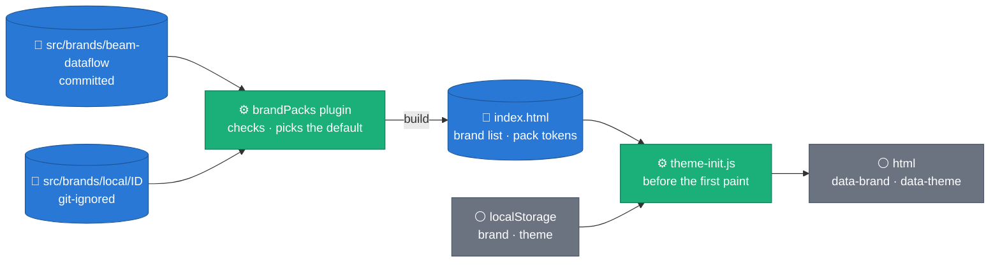
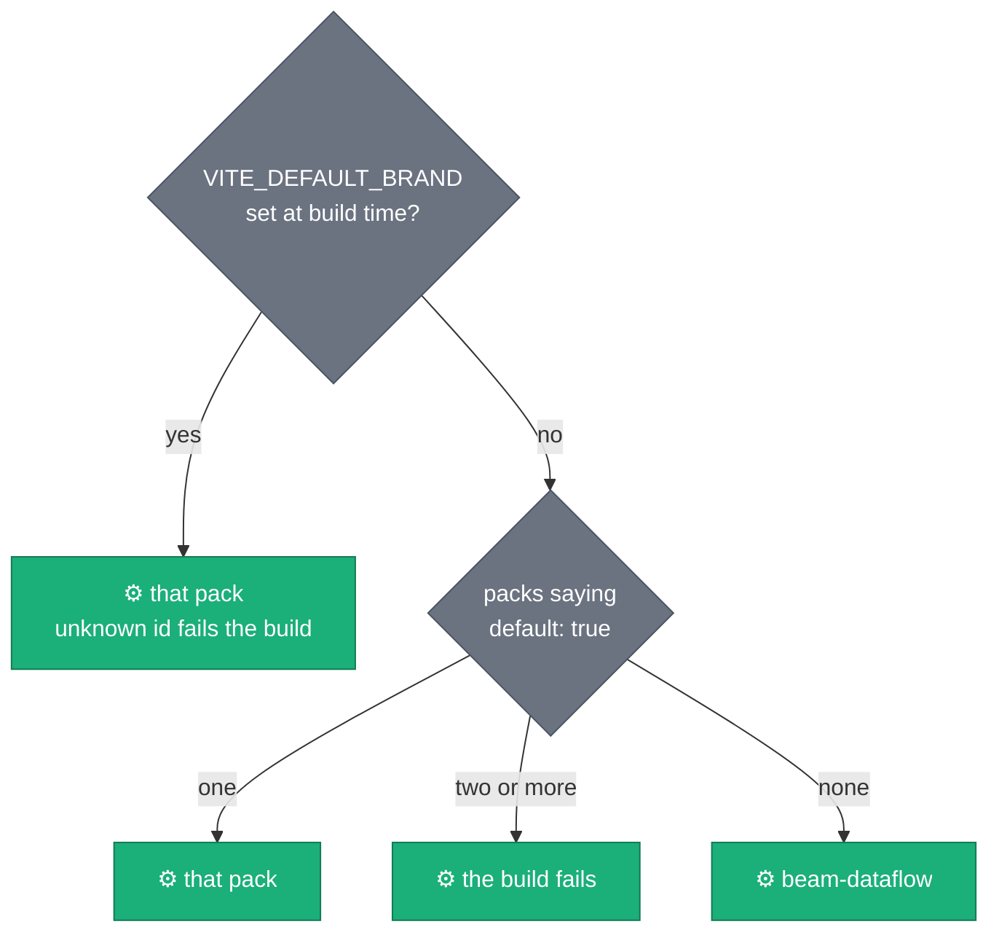

# Synthetic Platform — branding

**Claim: a dark, near-black console with Beam-orange and GCP-blue accents,
every colour a measured token, and no one else's marks in the product
identity. A deployment may bring its own brand as a pack that changes the
surfaces, ink and accents, never the product's name, mark or chart palette.**

## Name and mark

- The product is **Synthetic Platform**. Never "Apache Beam …", never a name
  that implies an Apache, Google or Orange product.
- The mark (`apps/web/src/app/ProductMark.tsx`, `apps/web/public/favicon.svg`)
  is original artwork: a solid circle (the real sample) overlapped by a dashed
  twin (its synthetic copy).
- **Apache Beam™** is a trademark of The Apache Software Foundation. The name
  and the firefly mascot refer to Apache Beam only, unmodified, with the TM
  attribution (shown in the footer). The mascot is available at
  `/assets/beam-firefly-mascot.png` for pages that identify Beam; it never
  stands for this product.
- The **Apache Beam logo** appears, unaltered, only as a link to
  <https://beam.apache.org/> (the ASF's terms for its logos): in the top bar's
  "Built with" links and on the Beam stages of the INTRO pipeline strip.
- Google Cloud product icons appear only inside diagrams, per Google's icon
  library: the repo's draw.io figures and the INTRO pipeline strip (BigQuery
  stages; the Data Analytics icon, Dataflow's, on the launcher stage). The top
  bar names **Dataflow** in text. The vLLM logo marks the GPU stage. Files,
  sources and terms: `ATTRIBUTION.md`.
- The CONFIG "amp" is an **original neutral dark console with text-labelled
  knobs** and Beam-orange accents. It does not reproduce Orange Amps' trade
  dress: no pictogram-only legends, no orange tolex, no crest, wordmark or
  slogan.

## Brands and modes

The appearance is two independent choices, stored per browser: a **brand**
(the build's packs) and a **mode** (dark, light, or the system's). `<html>`
carries both, `data-brand` and `data-theme`; `tokens.css` holds the committed
brand, `beam-dataflow`, and each other pack overrides a set of its tokens per
mode. The top bar's palette button (the "More" menu below 1180 px) lists both
as labelled radio groups.



_The build finds the packs, checks them and writes the brand list and the
packs' tokens into `index.html`; `public/theme-init.js` reads that list and the
stored choices and stamps `<html>` before any paint, so no reader sees the
default flash. With no local pack, the build carries `beam-dataflow` alone and
writes no token overrides._

### The default brand



_One panel per way the default is set. A reader's stored brand still wins over
the default; a stored brand the build no longer carries (its pack removed)
falls back to the default, in `theme-init.js` and in the app alike
(`src/lib/theme.test.ts` runs both)._

### Brand packs

A pack is a folder named after its id, holding `brand.json` and its logo
files. The committed packs live in `apps/web/src/brands/<id>/`; a
deployment's own pack goes in **`apps/web/src/brands/local/<id>/`**, which git
ignores, so a deployment's brand never reaches the repository.

| Key          | Required | What                                                                                                                                      |
| :----------- | :------- | :---------------------------------------------------------------------------------------------------------------------------------------- |
| `id`         | yes      | lower-case letters, digits, hyphens; the folder's name; the value of `data-brand`                                                         |
| `name`       | yes      | what the menu lists and the top bar prints beside the logo (at most 40 characters)                                                        |
| `default`    | no       | `true`: the build's default brand (see above)                                                                                             |
| `themeColor` | yes      | `{ "dark": "#rrggbb", "light": "#rrggbb" }`, the browser's `theme-color` per mode                                                         |
| `logo`       | no       | `{ "light": file, "dark": file, "plate"?: "#rrggbb", "wordmark"?: true }`: SVG, PNG or WebP in the folder, ≤ 64 KiB, inlined by the build |
| `tokens`     | no       | `{ "dark": { "--token": colour }, "light": { … } }`: the page's tokens this brand overrides                                               |
| `nav`        | no       | the same shape, re-scoped inside the top bar (`[data-app-header]`)                                                                        |

Colours are `#rrggbb` or `rgb(r g b / a)`. A pack may override the surfaces,
ink, accent, link, focus ring, the text colours that must keep their contrast
on its surfaces (CPU, GPU, Beam and status text), the chart frame (surface,
grid, axis, diverging midpoint) and `--nav-bg`, which paints the top bar (it
is transparent in `beam-dataflow`, so the bar shows the page through its
blur). The lists are `PAGE_TOKENS` and `NAV_TOKENS` in
`apps/web/src/brands/types.ts`; anything else is refused. The chart slots, the
sequential and diverging ramps and the status hues are shared by every brand:
they are validated once, below. Beam's stages keep Beam orange (`--beam`) in
every brand. A logo is shown beside the product name, after a divider, never
inside the product's link or name; `plate` puts a backing colour behind a mark
drawn for a light background, and `wordmark: true` drops the name text for a
logo that spells it. A pack's `$comment` key is ignored.

A fictitious example, the test fixture
`apps/web/src/test/fixtures/brands/acme/brand.json` (trimmed):

```json
{
  "id": "acme",
  "name": "Acme Analytics",
  "default": true,
  "logo": { "light": "acme-on-dark.svg", "dark": "acme-on-dark.svg" },
  "themeColor": { "dark": "#0f1d1d", "light": "#0f3b3a" },
  "tokens": {
    "light": { "--bg": "#f3f6f6", "--accent": "#0f766e", "--accent-fg": "#ffffff", "--nav-bg": "#0f3b3a" },
    "dark": { "--bg": "#0a1414", "--accent": "#2fbfad", "--accent-fg": "#0a1414", "--nav-bg": "#0f1d1d" }
  },
  "nav": { "light": { "--text-1": "#ffffff", "--text-2": "#d2e4e2", "--focus-ring": "#5fd3c4" } }
}
```

To add a deployment's brand:

1. Create `apps/web/src/brands/local/<id>/` with `brand.json` and the logo
   files, and a note of where the logos came from and on what terms.
2. Run `npm test`. `src/brands/brandPacks.test.ts` and
   `src/brands/brandContrast.test.ts` read every pack on the machine; a pack
   that is malformed, or a colour that misses a ratio below, fails there with
   the token and the ratio.
3. Make it the default with `"default": true`, or at build time:
   `VITE_DEFAULT_BRAND=<id> npm run build` (the environment or an
   `apps/web/.env` file; it wins over the pack's own `default`).
4. Build and serve as usual (`npm run build && npm start`, or the
   `Dockerfile`, whose build context then carries the pack).

### Contrast for every pack

`src/brands/brandContrast.test.ts` computes, for every pack present (the
committed one, the test fixture and any local pack) in both modes, the
`tokens.css` values with the pack's overrides on top, and holds them to WCAG
2.2 AA where the tables below hold `beam-dataflow`:

| Check                                                                                                         | Minimum |
| :------------------------------------------------------------------------------------------------------------ | ------: |
| `--text-1/2/3` on the page, `--surface-1/2/3`                                                                 | 4.5 : 1 |
| accent text, links, CPU / GPU / Beam text, status text on the page, `--surface-1/2`                           | 4.5 : 1 |
| accent text on `--accent-soft`, links on `--info-soft`, status text on its own 14 % tint, over the same three | 4.5 : 1 |
| `--accent-fg` on `--accent` (button labels)                                                                   | 4.5 : 1 |
| the top bar's ink on the bar, and on its `--surface-3`; its link on `--info-soft`                             | 4.5 : 1 |
| `--control-border` on the page and `--surface-1/2`; `--focus-ring` there, on `--surface-3` and on the bar     |   3 : 1 |

The ratios are computed, not typed into a table: a local pack needs no row in
this public file. The chart slots stay as validated below; on a pack's chart
surface a slot may fall under 3 : 1 as some do in light mode, and the "View
data" table is the relief channel there too.

### Third-party marks only identify

The Apache Beam logo, the Dataflow name, the Google Cloud icons, the vLLM logo
and a pack's logo each identify their own owner and nothing else: shown
unaltered (no recolouring, cropping or distortion), apart from the product's
mark and name, and only where their owners' terms allow (`ATTRIBUTION.md`
quotes them).

## Palette (tokens: `apps/web/src/styles/tokens.css`)

These are the committed brand's tokens, `beam-dataflow`, the default for any
Apache Beam or Dataflow user.

Brand hues: Beam orange `#eb6834`, GCP blue `#2a78d6`, aqua `#1baf7a`
(CPU, healthy), purple `#7a3fd1` (GPU), slate `#6b7280`.

### Dark (default)

| Token                       | Hex                               | Contrast (on surface-1 `#12151b`) | Use                                                                |
| :-------------------------- | :-------------------------------- | --------------------------------: | :----------------------------------------------------------------- |
| `--bg`                      | `#0b0d12`                         |                                 — | page                                                               |
| `--surface-1/2/3`           | `#12151b` / `#181c24` / `#20252f` |                                 — | cards / popovers / hover                                           |
| `--text-1`                  | `#f2f4f7`                         |                              16.6 | primary text                                                       |
| `--text-2`                  | `#b8bfcc`                         |                               9.9 | secondary text                                                     |
| `--text-3`                  | `#939aa7`                         |            6.5 (5.4 on surface-3) | muted text, axis labels                                            |
| `--accent`                  | `#eb6834`                         |                               5.7 | primary action, focus, active tab (fills, rings)                   |
| `--accent-text`             | `#f07a4a`                         |                               6.6 | orange text; 5.1 on `--accent-soft` (its 14 % tint) over surface-2 |
| `--accent-fg` on `--accent` | `#0b0d12`                         |                               6.1 | text on orange buttons                                             |
| `--link`                    | `#6da7ec`                         |                               7.3 | links                                                              |
| `--control-border`          | `#737b8d`                         |            4.3 (4.0 on surface-2) | input boundaries (WCAG 1.4.11)                                     |
| `--gpu-text`                | `#a37ae6`                         |                               5.6 | GPU labels (`--gpu` `#7a3fd1` is for marks, 3.0)                   |
| `--status-good`             | `#1baf7a`                         |                               6.5 | good (icon + label)                                                |
| `--status-warn`             | `#fab219`                         |                              10.0 | warning                                                            |
| `--status-serious`          | `#ec835a`                         |                               6.9 | serious                                                            |
| `--status-critical-text`    | `#f07373`                         |                               6.4 | critical text (`--status-critical` `#d03b3b` for marks, 3.8)       |

### Light (accessibility toggle)

| Token                                        | Hex                                           | Contrast (on surface-1 `#fcfcfb`) |
| :------------------------------------------- | :-------------------------------------------- | --------------------------------: |
| `--text-1/2/3`                               | `#0b0d12` / `#454b57` / `#5d6470`             |                  18.9 / 8.5 / 5.8 |
| `--accent-text`                              | `#9c3d18`                                     |                               6.6 |
| `--link`                                     | `#1c5cab`                                     |                               6.5 |
| `--control-border`                           | `#7d8492`                                     |                               3.7 |
| status text good / warn / serious / critical | `#0d6e4b` / `#8a5a00` / `#a3401a` / `#b42b2b` |             6.1 / 5.8 / 6.2 / 6.2 |

Status and tone text also clears **4.6 : 1 (AA) on its own 10–14 % tint** (status
pills, callouts, badges) over surface-1, surface-2 and the page background, in
both themes — the tinted pill background, not the plain surface, is what the
text sits on.

Contrast ratios are WCAG 2.x relative-luminance ratios, computed with the
dataviz skill's `contrast()` (2026-09-28). This table is their one home:
`apps/web/src/styles/branding.contrast.test.ts` recomputes each ratio from
`tokens.css` and fails when a colour change leaves a number stale.

### Chart palette

Categorical slots in **fixed order** — the dataviz skill's validated default
order with the brand's purple in slot 7:

|      Slot | Dark      | Light     |
| --------: | :-------- | :-------- |
|    1 blue | `#3987e5` | `#2a78d6` |
|  2 orange | `#d95926` | `#eb6834` |
|    3 aqua | `#1baf7a` | `#1baf7a` |
|  4 yellow | `#c98500` | `#eda100` |
| 5 magenta | `#d55181` | `#e87ba4` |
|   6 green | `#008300` | `#008300` |
|  7 purple | `#7a3fd1` | `#7a3fd1` |
|     8 red | `#e66767` | `#e34948` |

`validate_palette.js` results (adjacent pairs, Machado 2009 CVD simulation):

- **dark on `#12151b`: all checks pass** — lightness band, chroma, worst
  adjacent CVD ΔE 9.3 (aqua ↔ orange), normal-vision ΔE ≥ 19.3, every slot
  ≥ 3 : 1. Beam orange `#eb6834` itself sits just above the dark band
  (L 0.671 > 0.67), so charts use its dark step `#d95926`; UI accents keep
  `#eb6834`.
- **light on `#fcfcfb`: pass with the contrast WARN** — aqua, yellow and
  magenta are below 3 : 1, so the relief channel is mandatory: every chart has
  the "View data" table (ChartFrame) and direct labels where used.
- `--pairs all` (scatter, small multiples): the first **three** slots pass
  (worst CVD ΔE 9.3, normal-vision 22.4); past three, fold to "Other" or facet.

Status colours are reserved and always paired with an icon and a label. The
brand's "healthy" aqua is both status-good and categorical slot 3, so a chart
never shows both roles at once (UX.md, Charts).

## Type

Self-hosted OFL fonts: **Inter Variable** (UI) and **JetBrains Mono
Variable** (code, ids, tab labels), from `@fontsource-variable/*`.
Proportional figures for standalone numbers; `tabular-nums` in tables and
axes.
