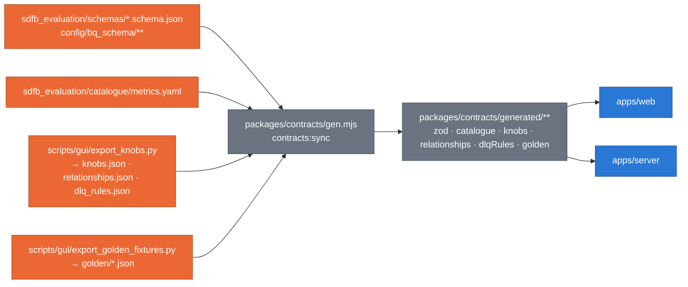
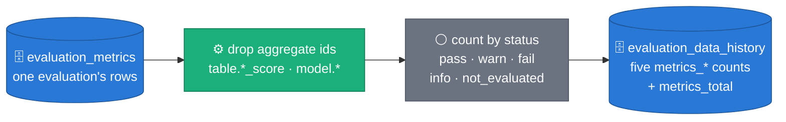
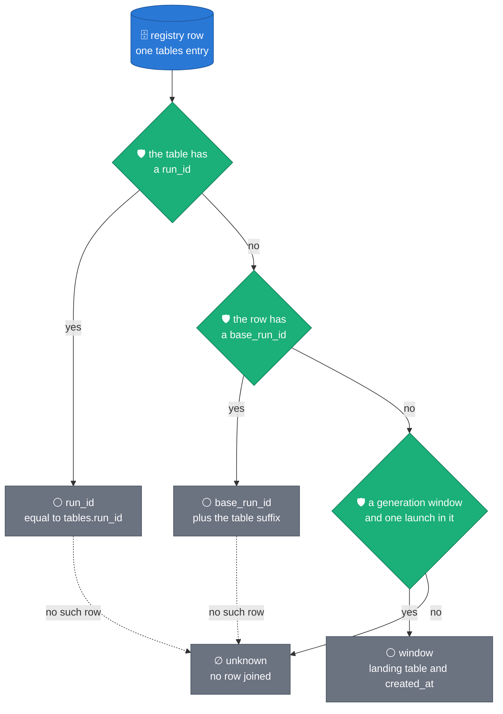
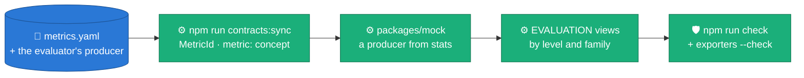

# Synthetic Platform — data contracts

**Claim: the Python side is the single source of truth; the GUI generates
its types from it and CI fails on drift** ([ADR 0042](../../docs/adr/0042-self-hosted-platform-gui.md) D5).



_`contracts:check` regenerates into a temporary directory and diffs; any
difference fails CI. `generated/**` is never edited by hand._

## What generates what

Every generated type traces back to the Python side. `gen.mjs` (run by
`npm run contracts:sync`) reads the JSON schemas and the catalogue itself; the
exporters in `scripts/gui/` write the JSON that `gen.mjs` then types.

| Python-side source (the truth)                                                                                                          | Written by                  | Generated file                                                       | What the TypeScript side imports                                                                                                        |
| :-------------------------------------------------------------------------------------------------------------------------------------- | :-------------------------- | :------------------------------------------------------------------- | :-------------------------------------------------------------------------------------------------------------------------------------- |
| `packages/sdfb-evaluation/src/sdfb_evaluation/schemas/evaluation_{data_history,metrics,profiles,row_flags}.schema.json` (+ `views.sql`) | `gen.mjs`                   | `generated/schemas.ts`                                               | `evaluationDataHistoryRowSchema`, `evaluationMetricsRowSchema`, `evaluationProfilesRowSchema`, `evaluationRowFlagsRowSchema`, `bqViews` |
| `config/bq_schema/synthetic_data_quality/{dlq,fk_fanout_stats,validation_runs}.schema.json`                                             | `gen.mjs`                   | `generated/schemas.ts`                                               | `dlqRowSchema`, `fkFanoutStatsRowSchema`, `validationRunsRowSchema`                                                                     |
| `config/bq_schema/synthetic_rag/{freetext_pools,rag_chunks,source_table_stats}.schema.json`                                             | `gen.mjs`                   | `generated/schemas.ts`                                               | `freetextPoolsRowSchema`, `ragChunksRowSchema`, `sourceTableStatsRowSchema`                                                             |
| column descriptions in those schemas that open with a vocabulary (`a \| b \| c — …`)                                                    | `gen.mjs`                   | `generated/schemas.ts`                                               | `vocabularies["<table>.<field>"]` (a `z.enum` inside each row schema), plus `bqTables` field metadata and `rowSchemas`                  |
| `packages/sdfb-evaluation/src/sdfb_evaluation/catalogue/metrics.yaml`                                                                   | `gen.mjs`                   | `generated/catalogue.ts`                                             | `catalogue`, `catalogueById`, `MetricId`, `CatalogueMetric`, `catalogueVersion`, and one `metric:<id>` concept per metric               |
| `run_pipeline.parse_args` defaults, module constants, `config/thresholds.yml`, the composer DAG and Flex Template parameters            | `export_knobs.py`           | `generated/knobs.json` → `knobs.ts`                                  | `knobs`, `KnobId`, `ChannelId`                                                                                                          |
| `config/relationships/example_*.yaml`, `*_example.yaml`, parsed by `RelationshipRegistry`                                               | `export_knobs.py`           | `generated/relationships.json` → `relationships.ts`                  | `relationships`, `RelationshipModelId`                                                                                                  |
| the DLQ envelopes of `sdfb_beam/dofns`, `dlq.normalize_dlq_record`, `config/thresholds.yml`                                             | `export_knobs.py`           | `generated/dlq_rules.json` → `dlqRules.ts`                           | `dlqRules`, `dlqRuleById`, `DlqRuleId`                                                                                                  |
| `sdfb_core.rag` (`HashingEmbedder`, `serialize_row`, retrieval)                                                                         | `export_golden_fixtures.py` | `generated/golden/{hashing_embedder,great_serialize,retrieval}.json` | test fixtures, imported as JSON by the golden tests                                                                                     |
| `sdfb_evaluation.scoring`, over the cases in `export_scoring_golden.py`                                                                 | `export_golden_fixtures.py` | `generated/golden/scoring.json`                                      | test fixtures ([scoring parity](ARCHITECTURE.md#scoring-parity-python--typescript))                                                     |
| `sdfb_evaluation.report.render.compare`, over the pairs in `export_compare_golden.py`                                                   | `export_golden_fixtures.py` | `generated/golden/compare.json`                                      | test fixtures ([compare parity](ARCHITECTURE.md#compare-parity-python--typescript))                                                     |
| every input above                                                                                                                       | `gen.mjs`                   | `generated/manifest.json`                                            | the sha256 of each input, so a hand edit of an exported file is drift too                                                               |

The API contract (`src/api.ts`), the payload parsers (`src/payloads.ts`) and
the relational and source-stats helpers are hand-written zod **on top of**
these generated rows. Most response shapes embed the row schemas whole or
reuse their vocabularies (`evaluationMetricsRowSchema.shape.status`). A few
joined shapes, such as `trendPointSchema` and `tableModelAdjustmentSchema`
([model adjustments](#model-adjustments-adr-0038)), restate columns by hand;
those are not regenerated, so a column type change on the Python side has to
be followed there by hand.

## Status

| Contract                                                      | Owner | State                                                                                                    |
| :------------------------------------------------------------ | :---- | :------------------------------------------------------------------------------------------------------- |
| Concept (`packages/contracts/src/concept.ts`)                 | G0a   | **done** — type, `defineConcepts`, `conceptSchema` (zod, in `concept.schema.ts`)                         |
| Core concepts (`src/concepts/core.ts`)                        | G0a   | **done** — noise floor, baseline, score, status, family, data source, the seven levels                   |
| Tab concepts (`src/concepts/<tab>.ts`)                        | G1–G4 | one file per tab                                                                                         |
| Generated zod from BigQuery JSON schemas                      | G0b   | **done** — `generated/schemas.ts`: 10 tables, `vocabularies`, `bqTables` field metadata, `bqViews`       |
| Catalogue → typed catalogue + `metric:<id>` concepts          | G0b   | **done** — `generated/catalogue.ts` (79 metrics); `src/concepts/catalogue.ts` hands them to the registry |
| `knobs.json` (values from code, `source: path:line`)          | G0b   | **done** — `scripts/gui/export_knobs.py`; typed as `generated/knobs.ts`                                  |
| `relationships.json` (the committed sample models)            | G0b   | **done** — `export_knobs.py`; typed as `generated/relationships.ts`; `parseEdge` in `src/relational.ts`  |
| `dlq_rules.json` (rule → error_type, step, stage, severity)   | G0b   | **done** — `export_knobs.py`; typed as `generated/dlqRules.ts` (`dlqRuleById`)                           |
| Golden fixtures (hashing embedder, GReaT, retrieval, scoring) | G0b   | **done** — `scripts/gui/export_golden_fixtures.py` → `generated/golden/*.json`                           |
| API contract (`src/api.ts`), payloads, profiler entry         | G0b   | **done** — hand-written zod on top of the generated rows                                                 |
| API client + TanStack Query hooks (`apps/web/src/lib/api.ts`) | G0b   | **done**                                                                                                 |

### How drift is caught

| Change on the Python side                                      | Caught by                                                                    |
| :------------------------------------------------------------- | :--------------------------------------------------------------------------- |
| a column, type, mode or vocabulary in a `*.schema.json`        | `npm run contracts:check` (gui CI) — `schemas.ts` and `manifest.json` differ |
| a vocabulary description that no longer parses (`a \| b \| c`) | `contracts:sync` fails, naming the field                                     |
| `metrics.yaml`                                                 | `contracts:check` — `catalogue.ts` differs                                   |
| a knob's default, constant, anchor token or source path        | `export_knobs.py --check` — the gui CI `exports` job                         |
| a sample relationship model, or a DoFn's DLQ envelope / step   | `export_knobs.py --check` (`relationships.json`, `dlq_rules.json`)           |
| only a line moved (`path:LINE`)                                | nothing: `--check` ignores line numbers (`--check-strict` does not)          |
| a "Docs differ" anchor that moved or vanished                  | `export_knobs.py` fails (the annotation is re-verified every run)            |
| `HashingEmbedder`, `serialize_row`, retrieval, the scorer      | `export_golden_fixtures.py --check`, then the TS golden tests                |
| a hand edit of an exported JSON or a golden file               | `contracts:check` — the input sha256 in `manifest.json`                      |
| a live vocabulary value the contract does not know             | passes as a string, `x-contract-warnings` on the response                    |
| live BigQuery rows that no longer match otherwise              | the BigQuery provider (502 `Contract Mismatch`, with the failing paths)      |

The exporters' checks run in `.github/workflows/gui.yml` (job `exports`,
triggered by the Python paths they read), not in the root pytest gate: an
unrelated Python change that shifts a line must not fail the Python suite,
and the tolerant check means it does not fail the GUI either.

Refresh everything after a Python change:

```bash
UV_PROJECT_ENVIRONMENT=$PWD/.venv-gui uv run python scripts/gui/export_knobs.py
UV_PROJECT_ENVIRONMENT=$PWD/.venv-gui uv run python scripts/gui/export_golden_fixtures.py
cd gui && npm run contracts:sync
```

## knobs.json

`channels` (SAMPLING, GENERATION, FREE TEXT, RAG, GUARDRAILS, RELATIONAL,
SERVING, EVALUATION), `knobs` (`id`, `channel`, `group`, `label`, `value`,
`unit`, `settable_via` ⊆ cli / composer / flex / constant / derived,
`cli_flag`, `composer_param` + `composer_default` when it differs,
`flex_param`, `choices`, `help` (argparse), `comment` (the code comment above a
constant), `source` = `path:LINE`, `related_adrs`, `docs`),
`annotations` (docs-vs-code: `docs_say`, `code_does`, `evidence[]` with
`path:line` + the verbatim excerpt), `measured_sources` and `measured` (the
figure scripts' MEASURED constants with their block header). The EVALUATION
channel is the flags of `sdfb-eval plan|run`, read from
`sdfb_evaluation/cli/main.py` by AST (the evaluator is a standalone project the
root env does not install): default, choices, help text and line are the
CLI's own, a flag the flex template declares is `flex`, and a listed flag the
CLI no longer has fails the export.

Every exported file carries `exported_from: { commit, dirty }` — the commit
its `path:LINE` links resolve at (link to the source at that ref, not at
`master`), and any referenced file that had uncommitted edits at export time.

## relationships.json

The committed sample models only (`config/relationships/example_*.yaml`,
`*_example.yaml`; real models are gitignored and never exported), parsed by
`sdfb_core.contracts.relationships.RelationshipRegistry`: per model its
`sha12`, `generation_order` and tables (`pk`, `identity`, `enabled`), and per
FK edge `cols → ref.ref_cols`, `enforced`, `drives`, `external`, the
registry's `role` (driving / implied / conditional / independent / external,
or `documented` for `enforced: false`, `disabled` on a disabled table) and
the `drawn_cols` a widened driving edge draws. `src/relational.ts` types it
and owns the edge-label helpers (`parseEdge`, `formatEdge`, `findEdge`).

## dlq_rules.json

Every DLQ `rule_id`, from the code: the `error_type` and `stage` each DoFn's
envelope sets (AST scan of `sdfb_beam/dofns`), the `pipeline_step`
`dlq.normalize_dlq_record` assigns, the `severity` / `dimension` / `scope`
`config/thresholds.yml` declares, and whether `BLOCKER_RULE_IDS` counts it.
What it shows today:

| rule_id                                              | error_type              | pipeline_step              | stage          | note                                                                                             |
| :--------------------------------------------------- | :---------------------- | :------------------------- | :------------- | :----------------------------------------------------------------------------------------------- |
| `schema.types`                                       | `pydantic`              | `ValidateRecordDoFn`       | `pre_write`    | BLOCKER, counted                                                                                 |
| `schema.non_finite`                                  | `load_safety`           | — (no mapping in dlq.py)   | `pre_write`    | not declared in thresholds.yml                                                                   |
| `schema.batch`                                       | `pandera`               | `PanderaValidateBatchDoFn` | `pre_write`    | CRITICAL                                                                                         |
| `row.duplicate` / `pk.duplicate` / `identity.unique` | `uniqueness`            | `EnforceUniqueness`        | `pre_write`    | BLOCKER, counted                                                                                 |
| `fk.orphan`                                          | `referential_integrity` | `EnforceFkIntegrityDoFn`   | `pre_write`    | BLOCKER in thresholds.yml, **not counted** by the gate                                           |
| `fk.unmatched`                                       | `referential_integrity` | `GenerateRecordsDoFn`      | `pre_generate` | not declared in thresholds.yml                                                                   |
| `engine_failure`                                     | `engine`                | `GenerateRecordsDoFn`      | `pre_write`    | BLOCKER, counted (weighted by the lost batch)                                                    |
| `null.required`                                      | —                       | —                          | —              | declared BLOCKER and counted, but **no DoFn emits it** (Pandera failures land as `schema.batch`) |

## Golden fixtures

| File                    | Python original                                                            | TS port (packages/stats)                                                   | Pinned                                                           |
| :---------------------- | :------------------------------------------------------------------------- | :------------------------------------------------------------------------- | :--------------------------------------------------------------- |
| `hashing_embedder.json` | `sdfb_core.rag.embedding.HashingEmbedder`                                  | `hashingEmbed`, `pySplit`, `hashingBucket`                                 | tokens, uint64-modulo buckets and signs exact; values 1e-6       |
| `great_serialize.json`  | `sdfb_core.rag.serialize.serialize_row`                                    | `serializeGreat`, `pyFloatRepr`, `pyStr`                                   | the text, exactly                                                |
| `retrieval.json`        | `retrieve_centroid_top_k` (pure index), `retrieve_kcenter_k`               | `centroidTopK`, `kcenter`, `kcenterRotate`, `selectSeedExamples`           | the picks, exactly (duplicates and a collapsed matrix)           |
| `scoring.json`          | `sdfb_evaluation.scoring` (`to_metric_row`, roll-ups, headline counts)     | `scoreRow`, `scoreValue`, `statusFor`, `aggregateScores`, `headlineCounts` | status, score and detail notes exactly; scores to 1e-12 relative |
| `compare.json`          | `sdfb_evaluation.report.render.compare` (`_delta`, `_noise`, `_direction`) | `diffMetric`, `noiseOf` (apps/web `lib/compare.ts`)                        | the verdict of every pair, and what its delta was judged against |

`compare.json` holds pairs of metric rows with the verdict `sdfb-eval compare`
(`sdfb_evaluation.report.render.compare`) gives each; the compare view's
`diffMetric` must give the same one
([compare parity](ARCHITECTURE.md#compare-parity-python--typescript)).

A golden file is the same on every machine: its numbers are integer arithmetic,
SHA-256 or correctly rounded IEEE 754 operations, and its `python` stamp is the
minor version (`3.11`), never the patch. The patch is whatever a machine
resolves `3.11` to (a laptop's uv and CI's differ), and a stamp that carried it
made `--check` fail in CI with nothing else changed. A failed `--check` prints
the first line that differs.

## The `metrics_info` identity



_The registry's five status counts always add up to its total:
`metrics_pass + metrics_warn + metrics_fail + metrics_info + metrics_not_evaluated = metrics_total`._

- **Why `info` has its own column.** An `info` row is measured but not gated
  (a documented edge's orphan rate, for example). Before `metrics_info`
  existed, those rows were in `metrics_total` and in no bucket, so the counts
  did not add up (Ruling R37; aggregate ids left out of the counts: R43).
- **Who computes it.** The evaluator's `headline_counts`
  (`sdfb_evaluation/scoring/__init__.py`) and its TypeScript mirror
  `headlineCounts` (`packages/stats/src/scoring.ts`), pinned to each other by
  the scoring golden's roll-up.
- **Who holds it to the identity.** Python:
  `test_headline_counts_feed_every_registry_metrics_column` (`test_scoring.py`).
  Mock: `mock.storyline.test.ts` recomputes every FINAL row's counts from its
  metric rows. BFF: `bigquery.contract.test.ts` checks that every registry
  query selects `metrics_info` and that the list rows add up.
- **How the list shows it.** The EVALUATION list's metrics cell
  (`MetricsCell` in `features/evaluation/ListPage.tsx`) reads the breakdown
  aloud as the identity. A row written before the column existed has
  `metrics_info = NULL`; the cell then shows the remainder as "info or other".
  Counts that do not add up are shown as inconsistent data, in words.

## Model adjustments (ADR 0038)

**Claim: the generator's verdict on a declared key reaches the browser as its
own payload, joined to the evaluation by the strongest key the registry row
has, and never across launches.**

`GET /api/evaluations/:id/adjustments` → `EvaluationAdjustments`
(`evaluationAdjustmentsSchema`, `src/api.ts`):

```ts
type TableModelAdjustment = {
  table: string; // tables[].name, else the landing table's short name
  run_id: string | null; // the joined validation_runs.run_id
  adjusted: boolean | null; // pk.duplicate is in excluded_rules; null = no row joined
  excluded_rules: string[]; // excluded_blocker_rules, split
  source_repeat_share: number | null;
  landing_repeat_share: number | null;
  repeat_share_delta: number | null; // landing − source
  within_tolerance: boolean | null; // repeat_share_within_tolerance, as written
  pk_duplicate_dlq: number | null; // dlq_by_rule["pk.duplicate"]
  verdict: "not_adjusted" | "faithful" | "under" | "over" | "unmeasured" | "unknown";
  joined_by: "run_id" | "base_run_id" | "window" | null;
};
type EvaluationAdjustments = {
  evaluation_id: string;
  model_adjustments: TableModelAdjustment[]; // one per generated table, registry order
  generation_job_evaluation_id: string | null; // another evaluation that ran as this row's generation job
};
```

Two `validation_runs` columns are not what their names suggest:
`excluded_blocker_rules` is comma-separated text (`""` on a table the launch
did not adjust, `NULL` on rows older than the column), and `dlq_by_rule` is a
JSON string. `parseExcludedRules` and the route's `parseCounts` read them; the
generated zod keeps both as `string | null`.



_`joinModelAdjustments` (`src/adjustments.ts`), per table. A key the row has
is never traded for a weaker one: a table with a run id joins that run or
nothing, and a row with a base run id joins that launch or nothing._

| Step | Join key                                                                                                                                  | `joined_by`   |
| :--- | :---------------------------------------------------------------------------------------------------------------------------------------- | :------------ |
| 1    | `tables[].run_id = validation_runs.run_id`                                                                                                | `run_id`      |
| 2    | `base_run_id` + the table's suffix: `<base>-NN-<table>` (`<table>` is the landing table's short name), or `<base>` for a one-table launch | `base_run_id` |
| 3    | the landing table, with `created_at` inside `[generation_started_at, generation_finished_at + 1 h]`, when every such row is of one launch | `window`      |
| 4    | none                                                                                                                                      | `null`        |

- **Never across launches.** Step 3 runs only when the registry row has no
  base run id; two launches writing the same landing table inside the window
  are ambiguous and give `unknown`, not the newer row. A Beam table spec
  (`project:dataset.table`) and the dotted name are one landing table.
  Several rows of one run (a retried write) are one launch: the newest is read.
- **The verdict is the generator's.** `faithful` is the stored
  `repeat_share_within_tolerance = true`; `under` / `over` is the sign of the
  delta when it is `false`; an excluded rule with no share is `unmeasured`
  (ADR 0038 D4: a launch that measured none writes none). Nothing is
  recomputed against the GUI's own copy of the tolerance.
- **The wrong job.** `generation_job_evaluation_id` is set when another
  evaluation's `evaluation_job_id` equals this row's `generation_job_id`
  (`evaluations.byJobId`). The job-name check needs no query:
  `isEvaluatorJobName` knows the two prefixes the evaluator runs under
  (`sdfb-evaluation-` from the composer DAGs, `sdfb-eval-` from its CLI). They
  are kept by hand in `adjustments.ts`: no exporter carries them, so a renamed
  evaluator job is not caught by `contracts:check`.

**Why a sibling route and not a field of the detail.** The brief allowed
either. The adjustments read a second table (`validation_runs`), with its own
dry run, bytes cap and row contract. As a field, a failure there (a cap, a
permission, a drifted column) would answer 4xx or 5xx for the whole evaluation;
as a route, the evaluation renders and the run view says the generator's half
is missing. `EvaluationDetail` stays what the evaluator wrote, and the compare
view, which reads details too, pays nothing. The run view requests both at
once and waits for both before its first paint, so a FAIL is never shown and
then re-read.

Two named queries serve it (`queries/registry.ts`), both parameterised and
read-only. `runs.forEvaluation` returns the candidate rows: a row matches
**any** of the three keys, so each guard requires its parameter to be set
(`IFNULL(ARRAY_LENGTH(@run_ids), 0) > 0 AND …`), where a list **filter**
treats an unset parameter as "all". It scans `validation_runs` whole (one row
per table per launch), as `runs.list` does.

## How to add a metric



_The catalogue is the only list of metrics; everything after it reads the
catalogue or is checked against it._

1. **Catalogue (Python side).** Add the metric to
   `packages/sdfb-evaluation/src/sdfb_evaluation/catalogue/metrics.yaml` with
   its producer in the evaluator; that work belongs to the evaluation package.
   If it needs a scoring rule the scorer does not have yet, add cases for it to
   `scripts/gui/export_scoring_golden.py` and re-run
   `export_golden_fixtures.py`.
2. **`npm run contracts:sync`.** `catalogue.ts` gains the id in `MetricId` and
   `catalogueById`, and a `metric:<id>` concept (its (i) popover) comes from the
   catalogue entry; `contracts.check.test.ts` holds catalogue and concepts one
   to one. Commit the regenerated files; `contracts:check` fails CI until you do.
3. **Mock.** Add a producer to `packages/mock/src/evaluate.ts`
   (`this.metric(id, reading)`), computing the value from the mock's profiles
   with a `packages/stats` function (add one, with a unit test, if the maths is
   new). A new profile kind also needs its parser in
   `packages/contracts/src/payloads.ts` (`parseProfile`). The scorer and the
   roll-ups need nothing: `scoreRow` reads direction, thresholds and noise
   method from the catalogue. The mock emits every catalogue id today, but no
   test fails when one is missing, so check the run view.
4. **Views.** Wherever the EVALUATION tab lists metrics by catalogue level and
   family (the scorecards' per-level counts, the interpretation list, the
   column heatmap, trends, compare), a new id appears without code. The
   dedicated panels name their ids (the pair order in `PairsPanel.tsx`, the
   privacy and detection panels, the column drawer's rate rows), so a metric
   meant for one of them needs a line there. Also optional: a related knob in
   `features/evaluation/lib/relatedKnobs.ts` (the cross-link test checks the
   knob exists) and an explanation sentence in `features/evaluation/lib/reading.ts`
   when the metric brings a new rule. Views are owned by the EVALUATION tab.
5. **Checks.** `npm run check` (types, unit tests including the mock storyline and
   the golden replays, `contracts:check`), then
   `export_golden_fixtures.py --check` and `export_knobs.py --check` from the
   repository root.

## The concept contract

```ts
type ConceptLink = { label: string; url: string; kind: "paper" | "docs" | "adr" | "code" };
type Concept = {
  id: string; // namespaced: "core:noise-floor", "metric:column.ks", "knob:reference_rows_limit"
  title: string;
  purpose: string; // ≤ 2 sentences
  formula?: string; // KaTeX, standard macros only
  interpretation?: { good?: string; bad?: string; tip?: string };
  pitfalls?: string;
  diagram?: string; // MiniDiagram id: "core:<name>" or "<tab>:<name>"
  links: ConceptLink[]; // https only
  level?: "field" | "column" | "pair" | "row" | "table" | "relationship" | "model";
};
```

Rules, enforced by `apps/web/src/lib/concepts.test.ts`:

- ids match `^[a-z][a-z0-9_-]*:[a-z0-9][a-z0-9._-]*$` and are unique across files;
- each file defines only its namespaces: `core.ts` → `core:`, `intro.ts` → `intro:`,
  `evaluation.ts` → `eval:`, `rag.ts` → `rag:`, `config.ts` → `knob:` / `config:` / `stats:`;
  `metric:` is reserved for the catalogue concepts G0b generates (`catalogue.ts`);
- every link is `https`; every formula renders in KaTeX with `throwOnError`;
- every `diagram` names a registered MiniDiagram;
- `purpose` has at most two sentences.

Catalogue metrics map one-to-one: `metric:<catalogue id>`, `title`,
`purpose`, `formula`, `interpretation.{good,bad}`, `pitfalls` and
`references` → `links` (`kind: "paper"` or `"code"`), `level` from the id
prefix.

## Data sources

| Mode             | Set by                                | Reads                                                                                                                                                      | Credentials                            |
| :--------------- | :------------------------------------ | :--------------------------------------------------------------------------------------------------------------------------------------------------------- | :------------------------------------- |
| `mock` (default) | `DATA_SOURCE=mock`                    | seeded fixtures (`packages/mock`), invented or public thelook names                                                                                        | none                                   |
| `bigquery`       | `DATA_SOURCE=bigquery`, `GCP_PROJECT` | `synthetic_data_quality.*`, `synthetic_rag.*` through named, parameterized, read-only `SELECT`s with `maximumBytesBilled` (10 GiB default) after a dry run | the runner's ADC, held by the BFF only |

Both modes serve the same routes and validate against the same generated zod.
Fetched rows are cached in memory (LRU) and never persisted.

## Mock data rules

- `.json` or `.ts` only (the precheck forbids csv, jsonl, parquet, avro); the
  mock is generated in memory at startup, nothing is written.
- E-mail addresses only at `example.com`; no 15–16-digit integers; no real
  corporate identifiers — invented or public thelook names only.
- Every metric value is computed from mock distributions by `packages/stats`,
  never typed. One declared exception: the adjusted-keys launch replays
  recorded row and key counts, typed once in `adjusted.ts` (`LAUNCH`); every
  share, rate, delta, DLQ count, gate ratio and verdict is derived from them
  (see below).

### The mock world (`packages/mock`)

- **Model:** `thelook_demo` — `users ──< orders ──< order_items >── products`
  (products external, `synthetic_data.products`), which is
  `config/relationships/gcp_public_fk_example.yaml` with one change:
  `order_items.user_id → users.id` is **documented** (`enforced: false`), so
  its `relationship.orphan_rate` is `info` (score null) next to a non-zero
  `relationship.orphan_rate_source`. Invented, so not in
  `relationships.json`: the BFF serves it (and `adjusted_keys_demo`, below)
  from `/api/relationships` in mock mode. Project `demo-project`: sources in `synthetic_source`, landings in
  `synthetic_data`. Plus `user_features`, a 200-column table launched alone
  with no relationship model (role `standalone`).
- **Identifiers as the pipeline writes them:** per-table run ids
  `<base>-00-users`, `<base>-01-orders`, `<base>-02-order_items`
  (`run_pipeline.plan_launch`; the one-table launch keeps `<base>`); reference
  digests per (table, sample size, source snapshot) — the tier is not in the
  digest, so the August digests are profiled on the sample tier by the first
  August launch and on the exact tier by `eval-0021` (2026-08-31); `users` also
  keeps a legacy profiler-"1" snapshot with a NULL `stats_tier`. Every
  TIMESTAMP has six fraction digits, and `evaluated_at` carries real
  microseconds. DLQ rows take `error_type` / `pipeline_step` / `stage` from
  `dlq_rules.json` (fk.orphan, fk.unmatched, schema.types, schema.batch,
  row/pk duplicates, engine_failure; never `null.required`). Every
  `not_evaluated` metric has `detail.reason`.
- **Storyline** (`storyline.ts`): 40 evaluations, 2026-08-03 … 2026-09-27.
  Weeks 1–4: b1 on the sample tier, the 512-value pool collapses on
  `users.city` (`column.distinct_ceiling_hit` = 1) and e-mails leak from the
  reference sample (memorization lifts FAIL); weeks 5–8: the exact tier and
  identifier expansion, no leak, fidelity up. Edge cases: `eval-0003` sampled
  on the DirectRunner (its rows say `method = sample` with the rate; the mock
  still grades every metric there, where the evaluator withholds those that
  need every row of a side), `eval-0014` FAILED, `eval-0017` PARTIAL (scope
  `count_mismatch`), `eval-0024` SKIPPED (empty appends scope), `eval-0027`
  PARTIAL (reference not verified: privacy `not_evaluated`), `eval-0032` the
  200-column table, `eval-0040` still RUNNING (no FINAL event; its RUNNING
  event is dated 2026-09-27, so the views show it as Stale, not Running:
  [`UX.md`](UX.md#status-levels-data-source)); scope notes
  `expired` (`eval-0007`, users) and `contaminated` (`eval-0030`,
  order_items) come with warnings (SUCCEEDED_WITH_WARNINGS). b2 runs keep
  joint structure (pair metrics pass more often) but interpolate through 11
  deciles. The catalogue moves 0.9.0 → 1.0.0 at `eval-0011` and the
  evaluator 0.1.0 → 0.2.0 at `eval-0021` (which changes
  `encoding_plan_digest`), so comparisons across either are flagged not
  comparable, with the reason.
- **The adjusted-keys launch** (`adjusted.ts`, ADR 0038): one more launch,
  next to the storyline and inside its dates (2026-09-13), of a second
  invented model, `adjusted_keys_demo`, under the repository's aliases:
  `B_TABLE` (root) and six driven children, five of which declare a `pk:`
  their source repeats. It replays the counts of one recorded five-table
  launch (`B_TABLE`, `C_TABLE`, `E_TABLE`, `A_TABLE`, `F_TABLE`) and adds two
  invented tables for the verdicts that launch did not produce (`D_TABLE`
  over-reproduced, `G_TABLE` unmeasured). Its `validation_runs` rows are folded
  as `build_run_summary` folds them: `excluded_blocker_rules = "pk.duplicate"`
  (`""` on the root), `pk.duplicate` = rows − distinct keys counted and not
  removed, the landing share written only next to a source share, the gate's
  ratio without the excluded rule. The evaluator's PK rows carry their counts
  in `detail` (`duplicate_rows`, `distinct_keys`, `null_key_rows`,
  `key_columns`), as `_key_duplicates` writes them; the storyline's PK rows
  predate that and carry none. Two evaluations read the launch, so the mock
  holds 42: `eval-0041`, chained to it (every table joins by its run id;
  `model_adjusted` is NULL, which the run view fills from `validation_runs`),
  and `eval-0042`, a composer evaluation handed an evaluator job as its
  generation job (one run id, no base run id, the evaluator's window: the
  other six tables are `unknown`, and the run view shows the wrong-job
  callout). `mock.storyline.test.ts` ("the adjusted-keys launch") recomputes
  every derived number and holds the six verdicts.
- **Computation** (`evaluate.ts`): profiles are counts drawn at the stated n
  from the generated rows' distributions; every metric is a `packages/stats`
  function of those profiles (KS bracket, PIT-W1, TVD, JSD, PSI, rate-ratio
  lifts, Gower DCR/NNDR, PRDC density/coverage …), with `baseline_value` =
  metric(reference sample, source) and noise floors from the same package;
  score and status apply the catalogue. `mock.storyline.test.ts` recomputes
  them from the stored profiles.
