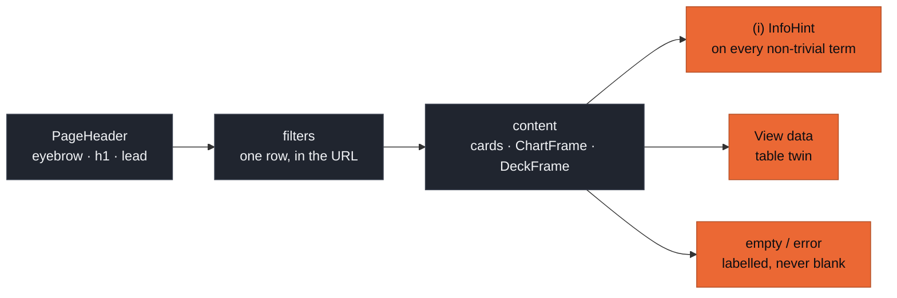
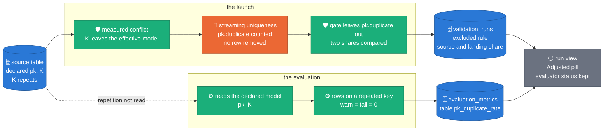
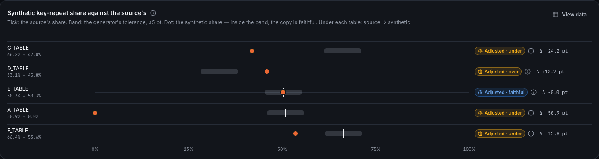
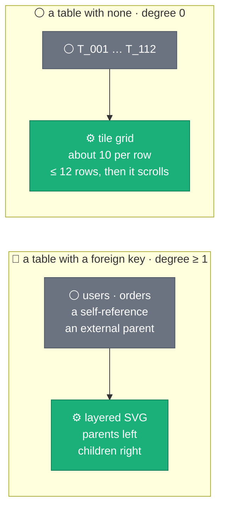

# Synthetic Platform — UX rules

**Claim: every view reads the same way — one `h1`, explanations one (i) away,
every chart with a table twin, status never colour-only — at 1440 px and at
390 px, in dark and light.** These rules bind every tab; the `/kit` page shows
each piece live.



_The page skeleton every tab follows; orange boxes are the non-negotiable
accessibility gates._

## Layout

- **One `h1` per page** through `PageHeader` (eyebrow = tab name). Sections use
  `h2`, cards `h3`.
- Content width is capped at 1440 px with a 16 px gutter on phones (24 px from
  `md`). No horizontal page scroll at 390 px: wide tables scroll inside
  `TableContainer` (focusable), the tab bar scrolls inside the nav.
- Filters sit in **one row above the content they scope**, stored in URL search
  params (shareable, back-button safe). Never inside a chart card.
- Refetching keeps the previous render at reduced opacity; skeletons only on
  first load.

## Explanations — InfoHint

- Put an `(i)` next to every metric, knob, level, formula-bearing term and
  unusual word. Content comes from the concept registry, never inline strings.
- It opens on **hover after 150 ms** (mouse and pen) **and** on **click,
  Enter or Space**; a click on a hover-opened hint pins it. **Esc** closes and
  returns focus. Touch opens by tap.
- Purpose: at most two sentences. Formula: KaTeX. Interpretation: _Good_,
  _Watch_, _Tip_; _Pitfall_ when there is one. Links go to primary sources and
  code (`kind`: paper, docs, adr, code) and open in a new tab.
- A (i) is 24 × 24 px (WCAG 2.5.8 target size).

## Charts — ChartFrame

Follow the dataviz method: pick the form first, colour last.

- **Categorical colour is assigned in fixed slot order** (`--chart-1..8`),
  never cycled, never re-ordered by rank; a filter must not repaint survivors.
  Past 8 series fold into "Other" (`--chart-other`) or facet. Scatter-like
  forms (any two marks can touch) cap at the first **3** slots.
- **Sequential** = one hue (`--seq-1..7`, "near zero" first); **diverging** =
  `--div-neg` / `--div-mid` / `--div-pos`.
- **Status colours are reserved** for status and always come with an icon and
  a label (`StatusPill`). A series that _means_ good/bad wears status tokens; a
  series that is just "series 4" wears categorical — never both in one chart.
- **One y-axis.** Two measures of different scale → two charts or small
  multiples.
- Marks: bars ≤ 24 px with a 4 px rounded data end; 2 px lines; ≥ 8 px markers
  with a 2 px surface ring; hairline solid grid. Text uses text tokens, never
  the series colour.
- A legend for ≥ 2 series; direct labels selectively. A tooltip on hover
  (crosshair on line/area, per-mark on bar/dot/cell) — tooltips enhance, the
  table twin carries every value.
- **Every chart has "View data"** (`DataTableFallback`). Degenerate data —
  `null`, `not_evaluated`, empty profiles, one run, 200 columns — renders a
  labelled empty state or a scrolling table, never a `NaN` axis.
- **Noise floor**: wherever a metric has one, show it (band or marker) and say
  "≈" for a difference it explains. Between two runs that is the rule of
  `sdfb-eval compare`: within the two rows' floors combined
  (`√(floor_A² + floor_B²)`), else two stored confidence intervals that
  overlap, else no "≈" at all.

## 3-D — DeckFrame

- One canvas per view; it is released when the route unmounts.
- Keyboard: focus the canvas; arrows pan, Shift + arrows orbit, + / − zoom.
  The hint line under the canvas says so.
- **WebGL2 missing or context lost** (Intel iGPU reset, a background tab):
  the frame swaps to `fallback` (a 2-D projection) and calls
  `onWebglUnavailable` once. Show a banner that says why.
- Keep a 2-D or table twin of the same data on the page.

## Status, levels, data source

- `StatusPill` for metric statuses (`pass`, `warn`, `fail`, `info`,
  `not_evaluated`) and run statuses (`RUNNING` … `FAILED`). `not_evaluated`
  and `SKIPPED` are neutral, not green.
- **An evaluation's status goes through `RunStatusPill`**, never a bare
  `StatusPill`: the registry's `RUNNING` is the last event it holds, not
  proof that a job runs.

  ```mermaid
  flowchart LR
    classDef cpu   fill:#1baf7a,color:#fff,stroke:#127a55
    classDef store fill:#2a78d6,color:#fff,stroke:#1d5599
    classDef data  fill:#6b7280,color:#fff,stroke:#4b5563

    E[("🗄️ last registry event")]:::store --> Q{"🛡️ which event"}:::cpu
    Q -- "FINAL" --> S["⚪ the row's<br/>own status"]:::data
    Q -- "RUNNING" --> A{"⚙️ recorded more<br/>than 24 h ago"}:::cpu
    A -- "no" --> R["⚪ Running<br/>blue, spinner"]:::data
    A -- "yes" --> T["⚪ Stale<br/>amber, slashed circle"]:::data
  ```

  _One rule, in `src/lib/runState.ts`: an evaluation whose last registry
  event is `RUNNING`, recorded more than 24 hours ago, is stale._ Why 24
  hours: every table an evaluation prepares for its reads expires 24 hours
  after it was created
  (`packages/sdfb-evaluation/src/sdfb_evaluation/context/scope.py`,
  `_EXPIRY`), so by then it is not expected to be running: the launch or the
  job most likely ended without recording a result. That is an inference
  from the event's age, not a reading of the job, so the words keep that
  register ("most likely", "is expected"); no text says flatly that the
  evaluation is not running, that its tables have expired, or that nothing
  more will be written. The pill is amber with a slashed circle: the tone of
  "Succeeded with warnings" without its triangle. On purpose it shares the
  icon with the run status Skipped (neutral) and the whole look with the
  scope status "Expired". Stale is a display state, derived in the browser from the
  row a view already has and the clock: the registry's status is still
  `RUNNING`, so the status filter and the sort keep saying `RUNNING`, and
  the pill's title says "Registry status RUNNING". On the run view the
  reason sits in a callout directly under the header, on every section: what
  the registry holds, since when, to check that no Dataflow job is still
  running before closing the row, and where the manual close is written down
  ([run playbook](../../docs/RUN_PLAYBOOK.md#a-running-row-that-never-closes);
  `CLOSE_BY_HAND` in `runState.ts` holds the heading and its anchor, and a
  test reads the playbook to keep them true). Unit tests fake the clock
  (`vi.setSystemTime`) or pass `now`. The two end-to-end tests of the rule
  fix the browser's clock (`page.clock.setFixedTime`), one on each side of
  it, so those two do not depend on the real date. The suite's other tests
  still render the mock's dated `RUNNING` evaluation under the real clock
  (Stale); none asserts on it.

- **A PK duplicate rate on a key the launch adjusted goes through
  `AdjustmentPill`** next to (or, for a readable verdict, in place of) the
  evaluator's pill: [Adjusted keys](#adjusted-keys-adr-0038).
- **A key check with no key declared** reads `Not applicable`, a neutral
  `StatusPill`, never `not_evaluated`'s "Not evaluated":
  [Isolated tables](#isolated-tables-whole-model-launches).
- `LevelChip` for FIELD, COLUMN, PAIR, ROW, TABLE, RELATIONSHIP, MODEL.
- The top nav always shows the data source: **MOCK** or **BIGQUERY
  <project>**. Views that show a BigQuery bytes estimate (from the BFF's
  response header) put it next to the data it cost.

## Adjusted keys (ADR 0038)

**Claim: a PK duplicate rate on a key the launch adjusted is shown with the
generator's verdict and the evaluator's status together, and the evaluator's
row is never changed.** The two answer different questions about the same
declared key, so a red FAIL alone reads an intended copy of the source's
repetition as a defect.



_Two measures over the same declared key reach the run view by two tables.
The launch measured the key repeating in the source, dropped it from the
effective model and copied the repetition
([ADR 0038](../../docs/adr/0038-measured-conflicts-adjust-the-model.md) D1 to
D4, D10; streaming uniqueness is
[ADR 0036](../../docs/adr/0036-parent-driven-fanout-generation.md) D6). The
evaluator grades the declared key, with no source baseline, so any repeat
fails._

- **Two formulas.** The generator's **repeat share** is the share of rows
  beyond the first per key, `1 − distinct keys ÷ rows`, compared with the
  source's own share within the code's tolerance (`REPEAT_SHARE_TOLERANCE`,
  the knob `repeat_share_tolerance`). The evaluator's **duplicate rate** is the
  share of rows whose key occurs at least twice, first rows included. The (i)
  `eval:repeat-share` puts them side by side with a worked example;
  `eval:model-adjusted` says what the launch did and how to read each verdict.
- **A re-reading, never a rewrite.** The evaluator's row, its status, the
  headline and every status count stay as stored, as they do under the
  documented-edge rule (Ruling R42) and the noise downgrade (Ruling R40).
  Wherever the Adjusted pill takes the place of the evaluator's pill, the
  evaluator's status stays on screen in words beside it
  (`evaluator: FAIL (threshold 0)`).
- **Checked before it is shown.** `1 − distinct_keys ÷ rows`, from the
  evaluator's own `detail`, must equal the generator's landing share to 1e-6.
  When it does not, the view says **Measures disagree** and gives no verdict.
- **Orphan rates do not change.** Referential integrity is another question;
  the orphan table, documented edges and noise downgrades render as before.

| Generator's verdict  | Pill                                              | Finding severity       | The evaluator's status stays as                 |
| :------------------- | :------------------------------------------------ | :--------------------- | :---------------------------------------------- |
| faithful             | `Adjusted · faithful`, info tone, scale icon      | info                   | words beside the pill, and the readout's figure |
| under / over         | `Adjusted · under` / `Adjusted · over`, warn tone | warn                   | the same                                        |
| unmeasured / unknown | the evaluator's own pill + `Adjusted?` outline    | the evaluator's, as is | its own pill, untouched                         |
| not adjusted         | the evaluator's own pill                          | the evaluator's, as is | its own pill, untouched                         |
| measures disagree    | the evaluator's own pill + `Measures disagree`    | the evaluator's, as is | its own pill, untouched                         |

_Unmeasured: the launch adjusted the key but measured no source share, so it
wrote none. Unknown: no `validation_runs` row could be joined to the table
([join order](DATA_CONTRACTS.md#model-adjustments-adr-0038)); the badge is not
shown when the registry itself says the launch adjusted nothing
(`model_adjusted = false`)._



_One row per adjusted table: the tick is the source's key-repeat share, the
band the generator's tolerance around it, the dot the synthetic share. A dot
inside its band is a faithful copy (`E_TABLE`); a dot left of it repeats the
key less than the source, right of it more. `A_TABLE`'s dot sits at zero: a
fully unique table that the evaluator passes and the generator does not. Mock
mode, 1440 px; provenance in [`assets/README.md`](assets/README.md)._

Where it shows, in the order a reader meets it:

1. **Interpretation.** Adjusted findings rank after the real FAILs (a copy that
   missed) or just before the documented INFO (a faithful one), each with its
   sentence in the launch's own numbers. One line under the headline says how
   many of the FAILs counted above are on adjusted keys. A table the evaluator
   passed but whose copy missed gains a WARN finding.
2. **Scorecards.** The PK row under "Look first" shows the pill, both shares,
   the delta and the tolerance beside the evaluator's value; the key-failure
   count stays the evaluator's, with the number on adjusted keys under it.
3. **Relational**, section "Model adjustments (ADR 0038)" above the orphan
   rates: one row per table, then the strip above, then each PK row's readout
   with the generator's half under the evaluator's numbers. The section appears
   only when a table has a verdict or a question.
4. **Model graph.** A "PK adj." chip per adjusted table, with a glyph per
   reading (≈ faithful, ↓ under, ↑ over, ? not readable), explained in the
   legend.
5. **Parameters.** A NULL `model_adjusted` reads
   `— (validation_runs says adjusted on N tables)` when the joined rows say so.
6. **CONFIG, guardrails.** The BLOCKER gate part lists the runs whose gate left
   a rule out, with the same pill.

**An evaluation wired to the wrong job.** When a registry row's
`generation_job_name` is an evaluator job's name, or its `generation_job_id` is
another evaluation's `evaluation_job_id`, a danger callout under the header
says so: scope and adjustments are then joined to the wrong job, and the
tables' verdicts read `Adjusted?`.

## Isolated tables (whole-model launches)

**Claim: a launch of 100+ unrelated tables reads as one bounded grid of
tiles; every table stays reachable by search and filter, and a key check with
no key declared reads "Not applicable", never empty or FAIL.** A whole-model
launch ([ADR 0045](../../docs/adr/0045-whole-model-launches.md),
[DESIGN §4.5](../../docs/DESIGN.md#45-whole-model-launches)) generates
every enabled table of one relationship model, and such a model may declare
no foreign key at all; drawn as layers, 100 such tables were one column that
the frame scaled to unreadable.

_A table with a foreign key is drawn in the layered graph; a table with none
is a tile in a bounded grid, so a forest of 100+ tables is one screen, not one
column:_



_One panel per placement (`features/evaluation/lib/graph.ts`, `buildGraph`): a
node is `layer` when an edge names it as child or parent, else `tile`. A
component is laid out as if the tiles were not there (`graph.test.ts` pins the
thelook coordinates with and without isolated tables); a table that references
itself, and an external parent, stay in the layers. A table the evaluation
does not cover and with no foreign key (a served model's disabled table) is
not drawn at all: the model card counts it. From ten tiles the model graph
takes the full row._

- **A tile** is a button that scopes the run view to its table: name, `PK` /
  `no PK` / `PK ?`, the status glyph and overall score, `⇄` for a
  `source_table` override, the batch job (`b03`), and the `PK adj.` chip when
  the launch adjusted the key ([above](#adjusted-keys-adr-0038)). Its status
  is FAIL when a zero-tolerance key check failed (duplicate keys, orphans),
  else its overall score's. Its left edge is the score colour; the words say
  everything the colour does, and its accessible name says them in full.
- **Not applicable.** When the relationship model declares no primary key (or
  no identity columns), the evaluator writes the key check as not evaluated
  with the reason `no primary key declared in the relationship model`
  (`… no identity columns …`). Only those two reasons read as not applicable:
  a neutral `Not applicable` pill (`StatusPill`, `tone="neutral"`) with
  **"Not applicable — no primary key declared"** (or "… no identity columns
  declared") in the scorecards' "Look first" (ranked last) and in the
  integrity units; one grouped finding per kind, ranked last in the
  Interpretation ("N tables declare no primary key (…): the uniqueness check
  is not applicable — nothing to check, not a gap."); `no PK` on the tile. The
  Not evaluated tile's footnote says how many of its rows are not applicable.
  Any other reason (sampled mode, no rows) stays "Not evaluated". Stored
  statuses and counts are the evaluator's.
- **The model summary card** (from two tables, above the scorecards): tables,
  primary keys declared and none, edges, isolated tables, source overrides and
  batch jobs, each job linked to the Dataflow console (`b00 ↗`). It says
  whether it reads the generation record
  ([ADR 0044](../../docs/adr/0044-generation-record.md)) or the registry and
  the metric rows; without a record, source overrides and batch jobs read
  `—`. Under Batch jobs it says `N recorded` when the record holds fewer batch
  jobs than the launch planned (a job wrote no row, or the evaluation does not
  list it), else `b00 … bNN`. Disabled tables are counted only
  when the GUI can read the whole model with the record's `sha12`: a launch
  records only what it generated, so a real model (never served) reads
  "disabled: not recorded". The evaluation list's job cell and the Parameters
  tab's `generation_job` row keep the registry's `generation_job_id`, the
  first batch job; the card lists them all, and the list's search finds any of
  them.
- **The Relational tab** of a launch that declared no foreign key says
  "Isolated tables — no relationships declared. Integrity is scored per
  table: columns, row count, keys where declared."
- **Filters** (from ten tables) sit in one row above the scorecards and live
  in the URL (`tq`, `pk`, `ts`, `batch`, `tsort`): **Find a table** (name
  search), **Primary key** (Any key · PK · No PK), **Table status** (All · Pass
  · Warn · Fail · Not evaluated), **Batch job** (when the tables have one) and
  the order (Worst first · By name). They narrow the tiles and the per-table
  scorecard rows only; roll-ups, findings and counts stay the whole run's, and
  the bar says "N of M tables". A filter that matches nothing says "No table
  matches the filters."; **Clear filters** resets all but the order, and a
  stale value in a shared link is dropped.
- **Per-table scorecards** render only their visible rows above twelve tables,
  inside a focusable frame (keyboard scrolling; the selected table scrolls into
  view). Each table's integrity score opens the units it averages: those that
  counted and those that were not applicable (and any not scored).
- **Without a served model** the graph is drawn from the declared tables of
  the launch's generation record, and its description says so. The run
  header's Tables in scope scrolls inside its frame above twelve tables.

## Data on screen

- **Source text.** RAG chunk text (`chunk_text`) and pool values are the
  operator's own governed reference data, shown to that operator by a
  loopback-only server; show them where they explain a view (a hovered point,
  a nearest-neighbour list). Source row keys (`source_pk`) never reach the
  browser, and flagged rows name the matched source record by a keyed hash
  only (`h:` and eight hex digits): the evaluator never writes a raw source
  key. Nothing on screen is written back or exported by the GUI.
- **Values newer than the contract.** A status, level, kind or side the
  contract does not list yet arrives as plain text (the response lists it in
  `warnings`): render it neutral (`StatusPill` falls back to a neutral pill
  with the raw text), never blank, never an error.
- **Timestamps** carry microseconds; display them rounded (seconds or
  minutes), but pass the exact string back when it identifies a row.

## Motion

- Respect `prefers-reduced-motion`: CSS animations collapse globally,
  ECharts animation is off, deck.gl inertia is off; Motion code uses
  `<MotionConfig reducedMotion="user">` or `useReducedMotion()`.
- Motion explains a change (a pipeline stage lighting up, a greedy k-center
  walk); it never decorates.

## Theme

Two choices, stored per browser, in the top bar's palette menu (the "More"
menu below 1180 px): the **brand** (the build's packs, `gui/BRANDING.md`
§ Brands and modes) and the **mode**, dark by default, light (kept for
accessibility) or the system's. Colours live only in `src/styles/tokens.css`
and the packs' overrides; components use the Tailwind token utilities
(`bg-surface-1`, `text-text-2`, `border-border`, `text-status-good-text` …).
Canvas renderers read tokens with `readToken()` and re-read them when
`useTheme().resolved` changes; a brand change remounts the page under the top
bar, so they read the new brand's tokens from scratch.

## Writing

Sentence case. Short sentences, active voice, concrete numbers with units
(`10,000 rows`, `1.5 MB`, `ε ≈ 0.0136`). Say what the reader can do next in
every empty and error state. Where docs and code disagree, show what the code
does and add `<Callout tone="docs-differ">` next to it. Single numbers go in a
`StatTile`, never a one-bar chart.

## Accessibility checklist (WCAG 2.2 AA)

- Skip link, landmarks (`header`, `nav "Tabs"`, `main`), `aria-current` on the
  active tab, a polite route announcement and focus moved to `main` after
  navigation.
- Text contrast ≥ 4.5 : 1, UI boundaries ≥ 3 : 1 (tokens are measured; see
  `gui/BRANDING.md`). Focus ring: 2 px `--focus-ring`, 2 px offset.
- Every icon-only control has an `aria-label`; tooltips repeat, never replace, it.
- Radix modals (Dialog, Sheet) `aria-hide` the page behind them while open,
  which axe reports as `aria-hidden-focus`. Run page-level axe with overlays
  closed, and check an open overlay with `new AxeBuilder({ page }).include('[role="dialog"]')`.
  Menus that do not need a focus trap use `modal={false}`.
- `npm run e2e` runs axe (wcag2a/aa, 2.1, 2.2) on every tab and on `/kit` in
  both themes; serious and critical violations fail the build.
