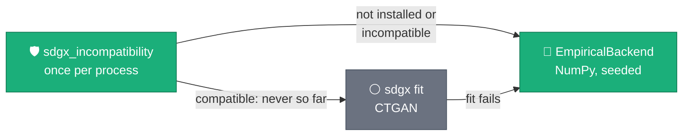

# B.2 library-wrapper engine (`b2_library`)

`B2LibraryEngine` — one of the two `GenerationEngine` implementations behind
the shared ABC (M1 §6). Library choice: **`sdgx`** (Apache-2.0). See
[`SPIKE_LIBRARY_CHOICE.md`](SPIKE_LIBRARY_CHOICE.md) for the decision record
(sdgx selected; SDV/GaussianCopula deferred pending BSL-1.1 sign-off) and the
fit-time / RAM / sample-quality measurement plan.

Design of record: [ADR 0013](../../../../../../docs/adr/0013-distribution-estimator-spine.md).

## What actually samples the rows today: the empirical backend

`sdgx` has **never** fitted in a production run. Every b2 table is sampled by
`EmpiricalBackend`, the pure-NumPy per-column backend in `backends.py`
(inverse-CDF numerics, empirical categoricals, jittered temporals):



Why the sdgx path cannot run:

| | |
|---|---|
| `SdgxBackend._fit_sdgx` needs | `sdgx.data_connectors.dataframe_connector.DataFrameConnector` |
| the locked `sdgx` | 0.2.0 — it has no `DataFrameConnector` |
| `sdgx` 0.2.1–0.2.4 | have it, but pin `numpy<2`: not installable beside the workspace's Python 3.14 / numpy 2.3.5 / pandas 3.0.3 |
| CTGAN on 0.2.0 itself | fails under pandas 3's string dtype unless `future.infer_string=False`, a process-global option that is unsafe with concurrent DoFn threads |

What it would take to make that path run (a dependency override, a dtype
cast, and five defects that sit behind the fit), the other libraries, and
the options are assessed in
[`docs/designs/2026-11-16-b2-library-backend-assessment.md`](../../../../../../docs/designs/2026-11-16-b2-library-backend-assessment.md).

So `SdgxBackend.fit` asks `sdgx_incompatibility()` first. It probes with
`importlib.util.find_spec` (which imports `sdgx` and `sdgx.data_connectors`,
pandas and pluggy, no torch) once per process and, when the connector is missing,
logs ONE line per process and samples with `EmpiricalBackend` without
attempting the import:

```
SDFB_MILESTONE name=b2_backend_fallback backend=empirical reason=sdgx_incompatible scope=process detail='sdgx 0.2.0 has no sdgx.data_connectors.dataframe_connector'
```

`reason=sdgx_not_installed` is the laptop's version (no `[library]` extra).
Before 2026-11-13 the same fact arrived as a failed import on every b2 table
(`detail='No module named sdgx.data_connectors.dataframe_connector'`). The
rows are the same either way: the fallback was already the empirical backend.
Per table, `generation_plan backend=sdgx_fallback_empirical` still names the
sampler. A fit that fails on a compatible `sdgx` keeps the per-table
`b2_backend_fallback reason=sdgx_fit_failed error=… detail=…` line.

## The spine (fit-once, vectorized-sample, LLM-only-for-free-text)

```
setup(model_client, ctx):       # once per Beam worker; idempotent
    profile reference_rows → per-column ColumnProfile          (fidelity.py)
    fit the statistical backend ONCE                            (backends.py)
generate_batch(n, cfg):         # many times; cheap, CPU
    vectorized-sample n rows (seeded)                           (backends.py)
    enforce fidelity: constant / range / enum clamps            (fidelity.py)
    patch FREE_TEXT / JSON / high-cardinality cols via the LLM   (freetext.py)
    yield GeneratedRecord (Pydantic; Pandera + DLQ downstream)
teardown(): release the fitted model
```

The LLM runs **O(1)** in N (free-text columns only); the bulk N is sampled
vectorized on CPU. Fidelity is preserved *by construction* (constants copied,
numerics clipped to observed bounds, categoricals drawn from the empirical
table) on top of the Mode-A Pandera contract.

## Modules

| File | Responsibility |
|---|---|
| `engine.py` | `B2LibraryEngine` — lifecycle, orchestration, pickling hooks. Registers as `"b2_library"`. |
| `fidelity.py` | Column profiling (`ColumnKind`, `ColumnProfile`) + post-hoc enforcement (`enforce_value`). LOCAL to B.2; may consolidate to `engines/_fidelity.py` post-merge. |
| `backends.py` | Sampling-backend seam: `SdgxBackend` (deferred `sdgx` import behind a once-per-process compatibility probe; has never fitted in production, see above) + `EmpiricalBackend` (pure NumPy; deterministic; what samples every b2 table today, and the reproducibility-contract backend). |
| `freetext.py` | Per-column free-text LLM hook via the `ModelClient` Protocol. Bounded unique pool, sample-with-replacement, honors `cfg.similarity`. |

## `similarity` mapping

- **Backend categorical sampling** (`engine._similarity_to_sampling_temperature`):
  similarity→1 ⇒ temp→0 (collapse to the empirical mode, max mimicry);
  similarity→0 ⇒ temp→~2 (flatten toward uniform within the observed
  support, max diversity).
- **Free-text hook** (`freetext.similarity_to_temperature` + `_blend_pools`):
  similarity sets the LLM sampling temperature *and* biases the
  sample-with-replacement draw toward the observed reference pool (high
  similarity) vs. the LLM-generated pool (low similarity).

## Constraints honored

- Pure `sdfb-core`: no `apache_beam`, no `vllm`, no GCP. NumPy is the only
  always-on heavy dep (the vectorized-sampling backbone). `sdgx` (+ torch) is
  imported **lazily** inside `SdgxBackend.fit()` — importing this package
  works on a laptop with only base deps.
- Engines call only the `ModelClient` Protocol; never import vLLM.
- The fitted engine pickles across the Beam worker boundary (the dynamic
  Pydantic record model is rebuilt from `ctx` on unpickle — see
  `engine.__getstate__/__setstate__`).

## Running the contract + engine tests

```bash
uv sync --group dev --extra library          # sdgx 0.2.0; the probe still → empirical
uv run pytest -m "not gpu and not gcp" -q     # 5 ABC contract tests + B.2 unit tests
```

The ABC contract pins the deterministic NumPy backend (`use_sdgx=False`).
A `sdgx`/CTGAN fit needs an `sdgx` release that has `DataFrameConnector` and
installs beside numpy 2 (none does today); its fit timing is still an M4 task
(see the spike doc).
